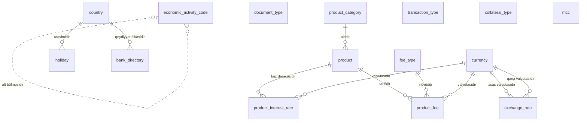

<!-- Bu fayl avtomatik yaradılıb (uv run bankmodel generate). Əl ilə redaktə etməyin. -->

# İstinad məlumatları (`ref`)

[← Konseptual model](index.md) | **Konseptual model** · [Məntiqi model](../02_mentiqi/01_ref.md) · [Fiziki model](../03_fiziki/01_ref.md)

Bütün domenlərin istifadə etdiyi kataloqlar və sorğu cədvəlləri: valyutalar, ölkələr, məzənnələr, bank kataloqu, məhsul kataloqu, əməliyyat, komissiya, sənəd və girov növləri. Biznes tərəfindən idarə olunan və vaxtaşırı dəyişən kod siyahıları burada saxlanılır.

## Diaqram

## Obyektlər

| # | Obyekt | Ad | Təsvir |
|---|---|---|---|
| 1 | `currency` | **Valyuta** | ISO 4217 valyuta kataloqu (AZN, USD, EUR və s.). |
| 2 | `country` | **Ölkə** | ISO 3166 ölkə kataloqu; rezidentlik, vətəndaşlıq, ünvan və sanksiya riskinin müəyyən edilməsi üçün. |
| 3 | `exchange_rate` | **Valyuta məzənnəsi** | Valyuta cütü üzrə tarixə görə məzənnələr: AMB-nin rəsmi məzənnəsi və bankın nağd/nağdsız alış-satış məzənnələri. |
| 4 | `holiday` | **Qeyri-iş günü** | Bayram və qeyri-iş günləri təqvimi; dəyər tarixi, ödəniş qrafiki və faiz hesablanması üçün istifadə olunur. |
| 5 | `bank_directory` | **Bank kataloqu** | Yerli və xarici banklar: BIC/SWIFT kodu, AMB bank kodu, müxbir hesab məlumatları. |
| 6 | `economic_activity_code` | **İqtisadi fəaliyyət növü** | İqtisadi fəaliyyət növlərinin iyerarxik təsnifatı (İFNT/NACE); hüquqi şəxslər və fərdi sahibkarlar üçün. |
| 7 | `document_type` | **Sənəd növü** | Şəxsiyyət və qeydiyyat sənədlərinin növləri: şəxsiyyət vəsiqəsi, pasport, yaşayış icazəsi, dövlət qeydiyyatı şəhadətnaməsi və s. |
| 8 | `product_category` | **Məhsul kateqoriyası** | Bank məhsullarının qrupları: cari hesab, əmanət, müddətli depozit, debet kart, kredit kartı, istehlak krediti, ipoteka, biznes krediti, kredit xətti. |
| 9 | `product` | **Məhsul** | Bankın təklif etdiyi konkret məhsul və onun ümumi parametrləri (müştəri tipi, minimal/maksimal müddət və məbləğ). |
| 10 | `product_interest_rate` | **Məhsul faiz dərəcəsi** | Məhsul üzrə standart illik faiz dərəcələri: valyuta, müddət və məbləğ diapazonuna görə, qüvvədə olma tarixləri ilə. Faiz faktiki/365 (actual/365) bazası ilə hesablanır. |
| 11 | `fee_type` | **Komissiya növü** | Komissiya və haqların kataloqu: hesab xidməti, köçürmə, nağdlaşdırma, kartın illik haqqı və s. |
| 12 | `product_fee` | **Məhsul komissiyası** | Məhsula tətbiq olunan komissiya tarifləri: sabit məbləğ və/və ya faiz, minimum/maksimum, qüvvədə olma tarixləri. |
| 13 | `transaction_type` | **Əməliyyat növü** | Hesab əməliyyatlarının kodları və istiqaməti (mədaxil/məxaric): köçürmə, nağd mədaxil, kart əməliyyatı, faiz, komissiya, kredit ödənişi və s. |
| 14 | `collateral_type` | **Girov növü** | Girov predmetlərinin növləri: daşınmaz əmlak, nəqliyyat vasitəsi, depozit, qiymətli metal, avadanlıq, mal-material. |
| 15 | `mcc` | **Satıcı kateqoriya kodu (MCC)** | ISO 18245 satıcı kateqoriya kodları; kart əməliyyatlarının təsnifatı, limitlər və riskin idarə edilməsi üçün. |

## Əlaqələr

| Əsas obyekt | Əlaqə | Asılı obyekt | Kardinallıq |
|---|---|---|---|
| `currency` | əsas valyutasıdır | `exchange_rate` | 1 : 0..N |
| `currency` | qarşı valyutasıdır | `exchange_rate` | 1 : 0..N |
| `country` | təqvimidir | `holiday` | 1 : 0..N |
| `country` | qeydiyyat ölkəsidir | `bank_directory` | 1 : 0..N |
| `economic_activity_code` | alt bölməsidir | `economic_activity_code` | 0..1 : 0..N |
| `product_category` | aiddir | `product` | 1 : 0..N |
| `product` | faiz dərəcəsidir | `product_interest_rate` | 1 : 0..N |
| `currency` | valyutasıdır | `product_interest_rate` | 1 : 0..N |
| `product` | tarifidir | `product_fee` | 1 : 0..N |
| `fee_type` | növüdür | `product_fee` | 1 : 0..N |
| `currency` | valyutasıdır | `product_fee` | 1 : 0..N |

## Bu domenə istinad edən digər obyektlər

| Obyekt | Domen | İstinad etdiyi obyekt | Əlaqə |
|---|---|---|---|
| `party` | Tərəf və müştəri (KYC) | `country` | rezidentlik ölkəsidir |
| `individual_profile` | Tərəf və müştəri (KYC) | `country` | vətəndaşlığıdır |
| `organization_profile` | Tərəf və müştəri (KYC) | `economic_activity_code` | əsas fəaliyyət növüdür |
| `organization_profile` | Tərəf və müştəri (KYC) | `country` | qeydiyyat ölkəsidir |
| `party_identifier` | Tərəf və müştəri (KYC) | `document_type` | növüdür |
| `party_identifier` | Tərəf və müştəri (KYC) | `country` | verən ölkədir |
| `party_address` | Tərəf və müştəri (KYC) | `country` | ölkəsidir |
| `account` | Hesablar və əməliyyatlar | `product` | məhsuludur |
| `account` | Hesablar və əməliyyatlar | `currency` | valyutasıdır |
| `account_transaction` | Hesablar və əməliyyatlar | `transaction_type` | növüdür |
| `account_transaction` | Hesablar və əməliyyatlar | `currency` | orijinal valyutadır |
| `account_fee_charge` | Hesablar və əməliyyatlar | `fee_type` | növüdür |
| `account_interest_rate` | Hesablar və əməliyyatlar | `product_interest_rate` | əsas götürülüb |
| `beneficiary` | Ödənişlər | `bank_directory` | alan bankdır |
| `payment_order` | Ödənişlər | `bank_directory` | alan bankdır |
| `payment_order` | Ödənişlər | `currency` | valyutasıdır |
| `fx_deal` | Ödənişlər | `exchange_rate` | tətbiq olunan məzənnədir |
| `merchant` | Kartlar | `mcc` | kateqoriyasıdır |
| `merchant` | Kartlar | `country` | ölkəsidir |
| `card` | Kartlar | `product` | məhsuludur |
| `card_authorization` | Kartlar | `currency` | əməliyyat valyutasıdır |
| `card_transaction` | Kartlar | `currency` | əməliyyat valyutasıdır |
| `credit_application` | Kreditlər | `product` | istənilən məhsuldur |
| `credit_application` | Kreditlər | `currency` | istənilən valyutadır |
| `credit_facility` | Kreditlər | `currency` | valyutasıdır |
| `loan` | Kreditlər | `product` | məhsuludur |
| `loan` | Kreditlər | `currency` | valyutasıdır |
| `collateral` | Kreditlər | `collateral_type` | növüdür |
| `collateral` | Kreditlər | `currency` | dəyərin valyutasıdır |
| `posting_rule` | Baş kitab (sadələşdirilmiş) | `transaction_type` | qaydasıdır |
| `posting_rule` | Baş kitab (sadələşdirilmiş) | `product` | qaydasıdır |
| `journal_entry_line` | Baş kitab (sadələşdirilmiş) | `currency` | valyutasıdır |
