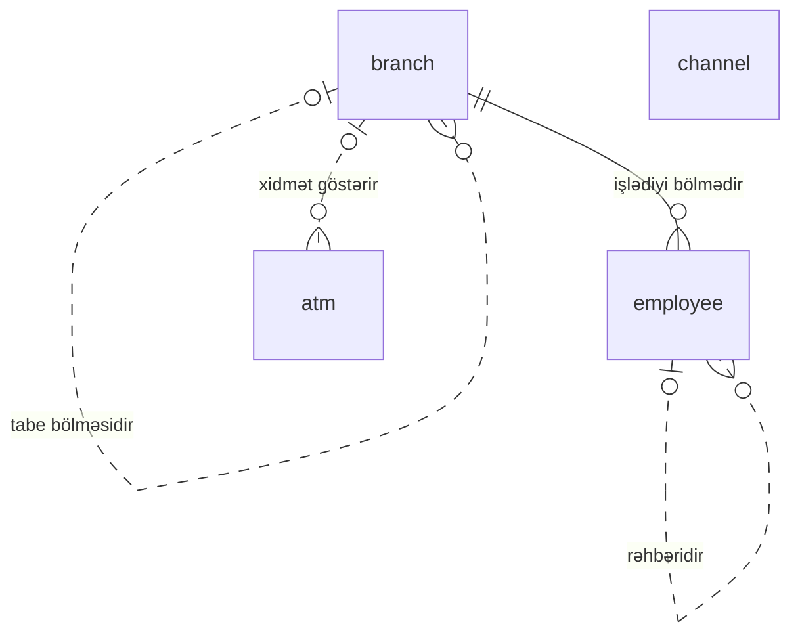

<!-- Bu fayl avtomatik yaradılıb (uv run bankmodel generate). Əl ilə redaktə etməyin. -->

# Təşkilat və kanallar (`org`)

[← Konseptual model](index.md) | **Konseptual model** · [Məntiqi model](../02_mentiqi/02_org.md) · [Fiziki model](../03_fiziki/02_org.md)

Bankın daxili strukturu və xidmət kanalları: filial və şöbələr, əməkdaşlar, müştərilərin banka müraciət etdiyi kanallar və bankomatlar.

## Diaqram

## Obyektlər

| # | Obyekt | Ad | Təsvir |
|---|---|---|---|
| 1 | `branch` | **Filial** | Bankın baş ofisi, filialları və şöbələri; şöbə filiala tabe ola bilər. |
| 2 | `employee` | **Əməkdaş** | Bank əməkdaşları: müştəri meneceri, kredit mütəxəssisi, operator, uyğunluq (compliance) əməkdaşı və s. |
| 3 | `channel` | **Xidmət kanalı** | Müştəriyə xidmət kanalları: filial, bankomat, internet bankçılıq, mobil bankçılıq, POS, çağrı mərkəzi, API. |
| 4 | `atm` | **Bankomat** | Bankın bankomatları və özünəxidmət terminalları: yerləşmə ünvanı, imkanlar, status. |

## Əlaqələr

| Əsas obyekt | Əlaqə | Asılı obyekt | Kardinallıq |
|---|---|---|---|
| `branch` | tabe bölməsidir | `branch` | 0..1 : 0..N |
| `branch` | işlədiyi bölmədir | `employee` | 1 : 0..N |
| `employee` | rəhbəridir | `employee` | 0..1 : 0..N |
| `branch` | xidmət göstərir | `atm` | 0..1 : 0..N |

## Bu domenə istinad edən digər obyektlər

| Obyekt | Domen | İstinad etdiyi obyekt | Əlaqə |
|---|---|---|---|
| `customer` | Tərəf və müştəri (KYC) | `branch` | xidmət filialıdır |
| `customer` | Tərəf və müştəri (KYC) | `employee` | müştəri meneceridir |
| `kyc_review` | Tərəf və müştəri (KYC) | `employee` | yoxlamanı aparıb |
| `account` | Hesablar və əməliyyatlar | `branch` | hesabın filialıdır |
| `account_transaction` | Hesablar və əməliyyatlar | `channel` | kanalıdır |
| `account_limit` | Hesablar və əməliyyatlar | `channel` | limitin kanalıdır |
| `payment_order` | Ödənişlər | `channel` | qəbul kanalıdır |
| `card_authorization` | Kartlar | `atm` | bankomatdır |
| `credit_application` | Kreditlər | `branch` | qəbul edən filialdır |
| `credit_application` | Kreditlər | `employee` | kredit mütəxəssisidir |
| `loan` | Kreditlər | `branch` | kreditin filialıdır |
| `loan_restructuring` | Kreditlər | `employee` | təsdiq edib |
| `journal_entry_line` | Baş kitab (sadələşdirilmiş) | `branch` | bölməsidir |
| `aml_case` | Uyğunluq və AML (sadələşdirilmiş) | `employee` | məsul əməkdaşdır |
