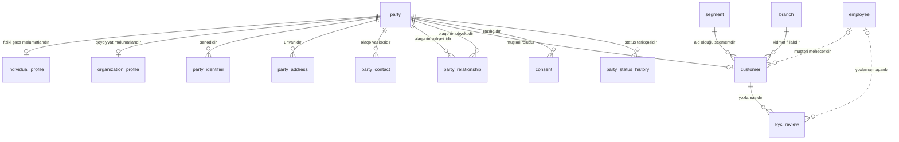

<!-- Bu fayl avtomatik yaradılıb (uv run bankmodel generate). Əl ilə redaktə etməyin. -->

# Tərəf və müştəri (KYC) (`party`)

[← Konseptual model](index.md) | **Konseptual model** · [Məntiqi model](../02_mentiqi/03_party.md) · [Fiziki model](../03_fiziki/03_party.md)

Bankla münasibətdə olan bütün fiziki və hüquqi şəxslər (tərəflər), onların sənədləri, ünvanları, əlaqə vasitələri, bir-biri ilə əlaqələri, müştəri rolu və KYC yoxlamaları. Tərəf supertipdir: fiziki şəxs, hüquqi şəxs və ya fərdi sahibkar ola bilər.

## Diaqram

Digər domenlərin obyektləri: `branch` (Təşkilat və kanallar), `employee` (Təşkilat və kanallar).

## Obyektlər

| # | Obyekt | Ad | Təsvir |
|---|---|---|---|
| 1 | `party` | **Tərəf** | Bankla münasibətdə olan istənilən şəxs (supertip). Növü: fiziki şəxs, hüquqi şəxs, fərdi sahibkar. Eyni tərəf müştəri, zamin, girov mülkiyyətçisi, benefisiar mülkiyyətçi və ya səlahiyyətli şəxs ola bilər. |
| 2 | `individual_profile` | **Fiziki şəxs profili** | Fiziki şəxsə və fərdi sahibkara aid şəxsi məlumatlar: soyad, ad, ata adı, doğum tarixi, FİN, vətəndaşlıq, PEP statusu. |
| 3 | `organization_profile` | **Təşkilat profili** | Hüquqi şəxsə və fərdi sahibkara aid qeydiyyat məlumatları: VÖEN, dövlət qeydiyyatı, təşkilati-hüquqi forma, fəaliyyət növü. Fərdi sahibkarın həm fiziki şəxs, həm də təşkilat profili olur. |
| 4 | `party_identifier` | **Tərəfin sənədi / identifikatoru** | Tərəfin şəxsiyyət və qeydiyyat sənədləri: şəxsiyyət vəsiqəsi, pasport, yaşayış icazəsi, şəhadətnamə; verilmə və etibarlılıq tarixləri ilə. |
| 5 | `party_address` | **Tərəfin ünvanı** | Qeydiyyat, faktiki və hüquqi ünvanlar; qüvvədə olma tarixləri ilə. |
| 6 | `party_contact` | **Əlaqə vasitəsi** | Telefon, e-poçt və digər əlaqə vasitələri; təsdiqlənmə statusu və üstünlük verilən vasitə əlaməti ilə. |
| 7 | `party_relationship` | **Tərəflər arası əlaqə** | İki tərəf arasında əlaqə: benefisiar mülkiyyətçi (UBO), direktor, təsisçi, səlahiyyətli imza sahibi, ailə üzvü; pay faizi və qüvvədə olma tarixləri ilə. |
| 8 | `segment` | **Müştəri seqmenti** | Müştəri seqmentləri: kütləvi pərakəndə, premium, mikro və kiçik biznes, orta biznes, korporativ. |
| 9 | `customer` | **Müştəri** | Tərəfin bankın müştərisi rolu: CIF nömrəsi, seqment, xidmət filialı, müştəri meneceri, münasibətin başlama və bitmə tarixi. |
| 10 | `kyc_review` | **KYC yoxlaması** | Müştərinin eyniləşdirilməsi və risk qiymətləndirilməsi (KYC/CDD/EDD): risk səviyyəsi, nəticə, növbəti yoxlama tarixi. Müştərinin cari risk səviyyəsi son təsdiqlənmiş yoxlamadır. |
| 11 | `consent` | **Razılıq** | Tərəfin razılıqları: fərdi məlumatların emalı, Kredit Bürosuna sorğu, marketinq bildirişləri; verilmə və geri götürülmə tarixləri ilə. |
| 12 | `party_status_history` | **Tərəf statusu tarixçəsi** | Tərəfin həyat dövrü statusunun dəyişiklikləri (yalnız əlavə olunur, dəyişdirilmir). |

## Əlaqələr

| Əsas obyekt | Əlaqə | Asılı obyekt | Kardinallıq |
|---|---|---|---|
| `party` | fiziki şəxs məlumatlarıdır | `individual_profile` | 1 : 0..1 |
| `party` | qeydiyyat məlumatlarıdır | `organization_profile` | 1 : 0..1 |
| `party` | sənədidir | `party_identifier` | 1 : 0..N |
| `party` | ünvanıdır | `party_address` | 1 : 0..N |
| `party` | əlaqə vasitəsidir | `party_contact` | 1 : 0..N |
| `party` | əlaqənin subyektidir | `party_relationship` | 1 : 0..N |
| `party` | əlaqənin obyektidir | `party_relationship` | 1 : 0..N |
| `party` | müştəri roludur | `customer` | 1 : 0..1 |
| `segment` | aid olduğu seqmentdir | `customer` | 1 : 0..N |
| `branch` (Təşkilat və kanallar) | xidmət filialıdır | `customer` | 1 : 0..N |
| `employee` (Təşkilat və kanallar) | müştəri meneceridir | `customer` | 0..1 : 0..N |
| `customer` | yoxlamasıdır | `kyc_review` | 1 : 0..N |
| `employee` (Təşkilat və kanallar) | yoxlamanı aparıb | `kyc_review` | 0..1 : 0..N |
| `party` | razılığıdır | `consent` | 1 : 0..N |
| `party` | status tarixçəsidir | `party_status_history` | 1 : 0..N |

## İstinad məlumatlarına əlaqələr

Diaqramı sadə saxlamaq üçün `ref` sxeminə olan əlaqələr yalnız burada göstərilir.

| Obyekt | İstinad obyekti | Əlaqə | Kardinallıq |
|---|---|---|---|
| `party` | `country` (Ölkə) | rezidentlik ölkəsidir | 1 : 0..N |
| `individual_profile` | `country` (Ölkə) | vətəndaşlığıdır | 1 : 0..N |
| `organization_profile` | `economic_activity_code` (İqtisadi fəaliyyət növü) | əsas fəaliyyət növüdür | 1 : 0..N |
| `organization_profile` | `country` (Ölkə) | qeydiyyat ölkəsidir | 1 : 0..N |
| `party_identifier` | `document_type` (Sənəd növü) | növüdür | 1 : 0..N |
| `party_identifier` | `country` (Ölkə) | verən ölkədir | 1 : 0..N |
| `party_address` | `country` (Ölkə) | ölkəsidir | 1 : 0..N |

## Bu domenə istinad edən digər obyektlər

| Obyekt | Domen | İstinad etdiyi obyekt | Əlaqə |
|---|---|---|---|
| `account` | Hesablar və əməliyyatlar | `customer` | hesabıdır |
| `account_holder` | Hesablar və əməliyyatlar | `party` | hesab üzrə roludur |
| `beneficiary` | Ödənişlər | `customer` | şablonudur |
| `fx_deal` | Ödənişlər | `customer` | mübadiləsidir |
| `card` | Kartlar | `party` | kart sahibidir |
| `credit_application` | Kreditlər | `customer` | müraciətidir |
| `credit_bureau_check` | Kreditlər | `party` | yoxlanılan tərəfdir |
| `credit_facility` | Kreditlər | `customer` | kredit xəttidir |
| `loan` | Kreditlər | `customer` | kreditidir |
| `collateral` | Kreditlər | `party` | mülkiyyətçisidir |
| `loan_guarantee` | Kreditlər | `party` | zamindir |
| `screening_check` | Uyğunluq və AML (sadələşdirilmiş) | `party` | yoxlanılan tərəfdir |
| `aml_case` | Uyğunluq və AML (sadələşdirilmiş) | `party` | araşdırılan tərəfdir |
| `aml_alert` | Uyğunluq və AML (sadələşdirilmiş) | `party` | siqnalın tərəfidir |
| `regulatory_report_item` | Uyğunluq və AML (sadələşdirilmiş) | `party` | hesabata daxildir |
