<!-- Bu fayl avtomatik yaradılıb (uv run bankmodel generate). Əl ilə redaktə etməyin. -->

# Hesablar və əməliyyatlar (`account`)

[← Konseptual model](index.md) | **Konseptual model** · [Məntiqi model](../02_mentiqi/04_account.md) · [Fiziki model](../03_fiziki/04_account.md)

Müştəri hesabları (cari, əmanət, müddətli depozit, kart hesabı), hesab sahibləri, qalıqlar, hesab əməliyyatları, bloklamalar, komissiyalar, faiz hesablanması, limitlər, daimi tapşırıqlar və çıxarışlar. Hesablar çoxvalyutalıdır: hər hesab bir valyutada açılır, müştərinin müxtəlif valyutalarda hesabları ola bilər.

## Diaqram

Digər domenlərin obyektləri: `beneficiary` (Ödənişlər), `branch` (Təşkilat və kanallar), `card_authorization` (Kartlar), `card_transaction` (Kartlar), `channel` (Təşkilat və kanallar), `customer` (Tərəf və müştəri (KYC)), `loan_disbursement` (Kreditlər), `loan_repayment` (Kreditlər), `party` (Tərəf və müştəri (KYC)), `payment_order` (Ödənişlər).

```mermaid
erDiagram
    account
    account_holder
    account_balance
    account_balance_daily
    account_transaction
    hold
    account_fee_charge
    interest_accrual
    account_interest_rate
    term_deposit_term
    overdraft_facility
    standing_order
    account_limit
    statement
    account_status_history
    beneficiary
    branch
    card_authorization
    card_transaction
    channel
    customer
    loan_disbursement
    loan_repayment
    party
    payment_order
    customer ||--o{ account : "hesabıdır"
    branch ||--o{ account : "hesabın filialıdır"
    account ||--|{ account_holder : "sahibləridir"
    party ||--o{ account_holder : "hesab üzrə roludur"
    account ||--|| account_balance : "cari qalığıdır"
    account ||--o{ account_balance_daily : "gün sonu qalığıdır"
    account ||--o{ account_transaction : "əməliyyatıdır"
    channel |o..o{ account_transaction : "kanalıdır"
    payment_order |o..o{ account_transaction : "nəticəsidir"
    card_transaction |o..o{ account_transaction : "nəticəsidir"
    loan_disbursement |o..o{ account_transaction : "nəticəsidir"
    loan_repayment |o..o{ account_transaction : "nəticəsidir"
    account_transaction |o..o| account_transaction : "stornosudur"
    account ||--o{ hold : "bloklamasıdır"
    card_authorization |o..o| hold : "bloklamaya səbəb olub"
    account ||--o{ account_fee_charge : "komissiyasıdır"
    account_transaction |o..o| account_fee_charge : "tutulma yazılışıdır"
    account ||--o{ interest_accrual : "hesablanmış faizidir"
    account ||--o{ account_interest_rate : "faiz dərəcəsidir"
    account ||--o| term_deposit_term : "depozit şərtləridir"
    account |o..o{ term_deposit_term : "faiz ödəniş hesabıdır"
    account ||--o{ overdraft_facility : "overdraftıdır"
    account ||--o{ standing_order : "debet hesabıdır"
    beneficiary ||--o{ standing_order : "alanıdır"
    account ||--o{ account_limit : "limitidir"
    channel |o..o{ account_limit : "limitin kanalıdır"
    account ||--o{ statement : "çıxarışıdır"
    account ||--o{ account_status_history : "status tarixçəsidir"
```

## Obyektlər

| # | Obyekt | Ad | Təsvir |
|---|---|---|---|
| 1 | `account` | **Hesab** | Müştəri hesabı: cari, əmanət, müddətli depozit və ya kart hesabı. AZ IBAN, valyuta, məhsul, xidmət filialı, status. |
| 2 | `account_holder` | **Hesab sahibi / səlahiyyətli şəxs** | Hesab ilə tərəf arasında rol: əsas sahib, birgə sahib, səlahiyyətli imza sahibi, etibarnamə üzrə nümayəndə; qüvvədə olma tarixləri ilə. |
| 3 | `account_balance` | **Hesab qalığı (cari)** | Hesabın cari qalıqları: mühasibat qalığı, istifadəyə yararlı qalıq, bloklanmış məbləğ. Hər əməliyyatla eyni tranzaksiyada yenilənir (performans üçün idarə olunan denormallaşdırma; mənbə — hesab əməliyyatları və bloklamalar). |
| 4 | `account_balance_daily` | **Gün sonu qalığı** | Hər iş günü sonunda hesab qalığının snapşotu; faiz hesablanması, çıxarış və hesabatlar üçün. |
| 5 | `account_transaction` | **Hesab əməliyyatı** | Hesab üzrə mədaxil/məxaric yazılışı: məbləğ, əməliyyat və dəyər tarixi, mənbə (ödəniş, kart, kredit), storno əlaqəsi. Yüksək həcmli cədvəldir, aylar üzrə bölmələnir. Yazılış dəyişdirilmir — düzəliş storno ilə edilir. |
| 6 | `hold` | **Bloklama** | Hesab vəsaitlərinin bloklanması: kart avtorizasiyası, məhkəmə qərarı, vergi orqanının sərəncamı, girov; bloklama və azad edilmə tarixləri ilə. |
| 7 | `account_fee_charge` | **Tutulmuş komissiya** | Hesabdan tutulan, güzəşt edilən və ya geri qaytarılan komissiyalar. |
| 8 | `interest_accrual` | **Faiz hesablanması** | Hesab üzrə gündəlik faiz hesablanması, kapitallaşma və ödənilmə; ödəmə mənbəyində tutulan vergi ilə. Gündəlik faiz = qalıq × illik dərəcə / 365 (actual/365). |
| 9 | `account_interest_rate` | **Hesab faiz dərəcəsi** | Hesaba tətbiq olunan faiz dərəcəsi, qüvvədə olma tarixləri ilə; məhsulun standart dərəcəsi və ya fərdi dərəcə. |
| 10 | `term_deposit_term` | **Müddətli depozit şərtləri** | Müddətli depozitin şərtləri: müddət, bitmə tarixi, avtomatik uzadılma, faizin ödənilmə qaydası, vaxtından əvvəl çıxarma şərtləri. |
| 11 | `overdraft_facility` | **Overdraft** | Cari hesab üzrə overdraft limiti və şərtləri: limit, faiz dərəcəsi, qüvvədə olma tarixləri. |
| 12 | `standing_order` | **Daimi tapşırıq** | Müştərinin müntəzəm köçürmə tapşırığı: məbləğ, tezlik, növbəti icra tarixi, başlama və bitmə tarixləri. |
| 13 | `account_limit` | **Hesab limiti** | Hesab üzrə əməliyyat limitləri: gündəlik və aylıq məxaric, tək əməliyyat, kanal üzrə məhdudiyyətlər. |
| 14 | `statement` | **Hesabdan çıxarış** | Dövr üzrə hesab çıxarışı: açılış və bağlanış qalığı, debet və kredit dövriyyələri, çatdırılma kanalı. |
| 15 | `account_status_history` | **Hesab statusu tarixçəsi** | Hesab statusunun dəyişiklikləri: açılış, dondurma, passiv (dormant), bağlanma; səbəb və icraçı ilə (yalnız əlavə olunur). |

## Əlaqələr

| Əsas obyekt | Əlaqə | Asılı obyekt | Kardinallıq |
|---|---|---|---|
| `customer` (Tərəf və müştəri (KYC)) | hesabıdır | `account` | 1 : 0..N |
| `branch` (Təşkilat və kanallar) | hesabın filialıdır | `account` | 1 : 0..N |
| `account` | sahibləridir | `account_holder` | 1 : 1..N |
| `party` (Tərəf və müştəri (KYC)) | hesab üzrə roludur | `account_holder` | 1 : 0..N |
| `account` | cari qalığıdır | `account_balance` | 1 : 1 |
| `account` | gün sonu qalığıdır | `account_balance_daily` | 1 : 0..N |
| `account` | əməliyyatıdır | `account_transaction` | 1 : 0..N |
| `channel` (Təşkilat və kanallar) | kanalıdır | `account_transaction` | 0..1 : 0..N |
| `payment_order` (Ödənişlər) | nəticəsidir | `account_transaction` | 0..1 : 0..N |
| `card_transaction` (Kartlar) | nəticəsidir | `account_transaction` | 0..1 : 0..N |
| `loan_disbursement` (Kreditlər) | nəticəsidir | `account_transaction` | 0..1 : 0..N |
| `loan_repayment` (Kreditlər) | nəticəsidir | `account_transaction` | 0..1 : 0..N |
| `account_transaction` | stornosudur | `account_transaction` | 0..1 : 0..1 |
| `account` | bloklamasıdır | `hold` | 1 : 0..N |
| `card_authorization` (Kartlar) | bloklamaya səbəb olub | `hold` | 0..1 : 0..1 |
| `account` | komissiyasıdır | `account_fee_charge` | 1 : 0..N |
| `account_transaction` | tutulma yazılışıdır | `account_fee_charge` | 0..1 : 0..1 |
| `account` | hesablanmış faizidir | `interest_accrual` | 1 : 0..N |
| `account` | faiz dərəcəsidir | `account_interest_rate` | 1 : 0..N |
| `account` | depozit şərtləridir | `term_deposit_term` | 1 : 0..1 |
| `account` | faiz ödəniş hesabıdır | `term_deposit_term` | 0..1 : 0..N |
| `account` | overdraftıdır | `overdraft_facility` | 1 : 0..N |
| `account` | debet hesabıdır | `standing_order` | 1 : 0..N |
| `beneficiary` (Ödənişlər) | alanıdır | `standing_order` | 1 : 0..N |
| `account` | limitidir | `account_limit` | 1 : 0..N |
| `channel` (Təşkilat və kanallar) | limitin kanalıdır | `account_limit` | 0..1 : 0..N |
| `account` | çıxarışıdır | `statement` | 1 : 0..N |
| `account` | status tarixçəsidir | `account_status_history` | 1 : 0..N |

## İstinad məlumatlarına əlaqələr

Diaqramı sadə saxlamaq üçün `ref` sxeminə olan əlaqələr yalnız burada göstərilir.

| Obyekt | İstinad obyekti | Əlaqə | Kardinallıq |
|---|---|---|---|
| `account` | `product` (Məhsul) | məhsuludur | 1 : 0..N |
| `account` | `currency` (Valyuta) | valyutasıdır | 1 : 0..N |
| `account_transaction` | `transaction_type` (Əməliyyat növü) | növüdür | 1 : 0..N |
| `account_transaction` | `currency` (Valyuta) | orijinal valyutadır | 0..1 : 0..N |
| `account_fee_charge` | `fee_type` (Komissiya növü) | növüdür | 1 : 0..N |
| `account_interest_rate` | `product_interest_rate` (Məhsul faiz dərəcəsi) | əsas götürülüb | 0..1 : 0..N |

## Bu domenə istinad edən digər obyektlər

| Obyekt | Domen | İstinad etdiyi obyekt | Əlaqə |
|---|---|---|---|
| `payment_order` | Ödənişlər | `account` | debet hesabıdır |
| `fx_deal` | Ödənişlər | `account` | satılan valyuta hesabıdır |
| `fx_deal` | Ödənişlər | `account` | alınan valyuta hesabıdır |
| `card` | Kartlar | `account` | kartıdır |
| `card_credit_line` | Kartlar | `account` | kredit xəttidir |
| `loan` | Kreditlər | `account` | hesablaşma hesabıdır |
| `loan_disbursement` | Kreditlər | `account` | köçürüldüyü hesabdır |
| `loan_repayment` | Kreditlər | `account` | mənbə hesabdır |
| `collateral` | Kreditlər | `account` | girov qoyulmuş depozitdir |
| `journal_entry` | Baş kitab (sadələşdirilmiş) | `account_transaction` | mühasibat əksidir |
| `aml_alert` | Uyğunluq və AML (sadələşdirilmiş) | `account_transaction` | siqnala səbəb olub |
| `regulatory_report_item` | Uyğunluq və AML (sadələşdirilmiş) | `account_transaction` | hesabata daxildir |
