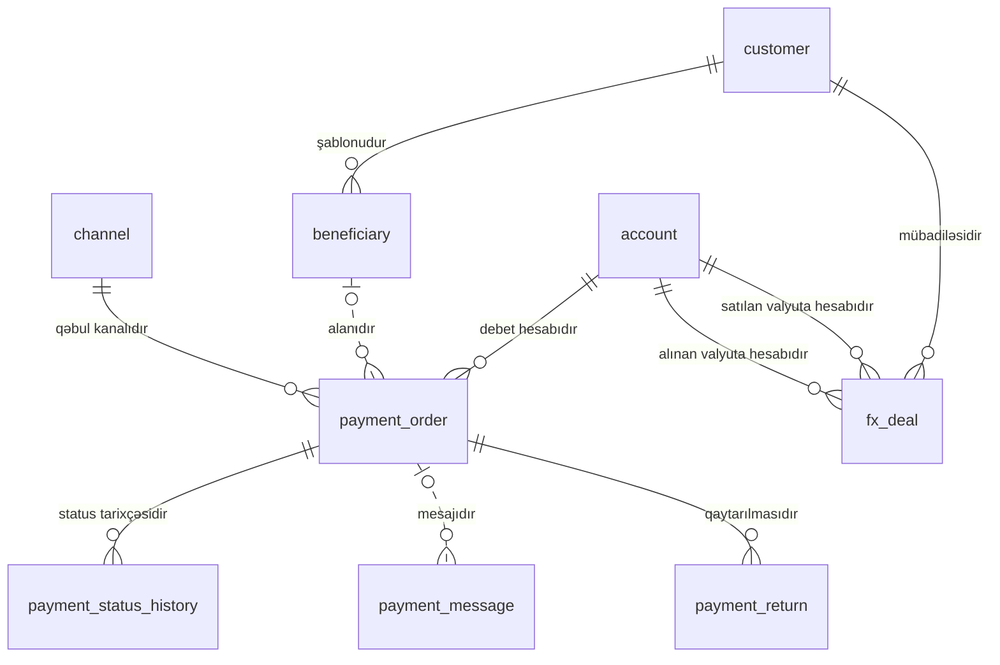

<!-- Bu fayl avtomatik yaradılıb (uv run bankmodel generate). Əl ilə redaktə etməyin. -->

# Ödənişlər (`payment`)

[← Konseptual model](index.md) | **Konseptual model** · [Məntiqi model](../02_mentiqi/05_payment.md) · [Fiziki model](../03_fiziki/05_payment.md)

Müştərilərin köçürmə tapşırıqları və onların icrası: daxili köçürmələr, yerli ödəniş sistemləri (AZIPS — iri məbləğli real vaxt, XÖHKS — kütləvi ödənişlər), beynəlxalq SWIFT köçürmələri, büdcə ödənişləri, qaytarılmalar və valyuta mübadiləsi.

## Diaqram

Digər domenlərin obyektləri: `account` (Hesablar və əməliyyatlar), `channel` (Təşkilat və kanallar), `customer` (Tərəf və müştəri (KYC)).

## Obyektlər

| # | Obyekt | Ad | Təsvir |
|---|---|---|---|
| 1 | `beneficiary` | **Benefisiar (alan)** | Müştərinin yadda saxladığı köçürmə alanı: ad, IBAN/hesab nömrəsi, VÖEN/FİN, alan bank. |
| 2 | `payment_order` | **Ödəniş tapşırığı** | Müştərinin köçürmə tapşırığı: növü (daxili, AZIPS, XÖHKS, SWIFT, büdcə), məbləğ, valyuta, təyinat, büdcə təsnifat kodu, dəyər tarixi, status. Alanın rekvizitləri tapşırıq anındakı vəziyyətlə saxlanılır (şablon sonradan dəyişsə də tapşırıq dəyişməz). |
| 3 | `payment_status_history` | **Ödəniş statusu tarixçəsi** | Ödəniş tapşırığının statuslarının dəyişikliyi: qəbul, yoxlama, göndərilmə, icra, rədd (yalnız əlavə olunur). |
| 4 | `payment_message` | **Ödəniş mesajı** | Ödəniş sistemlərinə göndərilən və onlardan alınan mesajlar (AZIPS, XÖHKS, SWIFT MT / ISO 20022): istiqamət, mesaj tipi, istinad, status. |
| 5 | `payment_return` | **Ödəniş qaytarılması** | Qaytarılmış və ya rədd edilmiş ödənişlər: səbəb kodu, qaytarılan məbləğ, tarix. |
| 6 | `fx_deal` | **Valyuta mübadiləsi** | Müştərinin hesabları arasında valyuta alqı-satqısı (konversiya): satılan və alınan məbləğ, tətbiq olunan məzənnə. Valyutalar hesablardan müəyyən olunur. |

## Əlaqələr

| Əsas obyekt | Əlaqə | Asılı obyekt | Kardinallıq |
|---|---|---|---|
| `customer` (Tərəf və müştəri (KYC)) | şablonudur | `beneficiary` | 1 : 0..N |
| `account` (Hesablar və əməliyyatlar) | debet hesabıdır | `payment_order` | 1 : 0..N |
| `beneficiary` | alanıdır | `payment_order` | 0..1 : 0..N |
| `channel` (Təşkilat və kanallar) | qəbul kanalıdır | `payment_order` | 1 : 0..N |
| `payment_order` | status tarixçəsidir | `payment_status_history` | 1 : 0..N |
| `payment_order` | mesajıdır | `payment_message` | 0..1 : 0..N |
| `payment_order` | qaytarılmasıdır | `payment_return` | 1 : 0..N |
| `customer` (Tərəf və müştəri (KYC)) | mübadiləsidir | `fx_deal` | 1 : 0..N |
| `account` (Hesablar və əməliyyatlar) | satılan valyuta hesabıdır | `fx_deal` | 1 : 0..N |
| `account` (Hesablar və əməliyyatlar) | alınan valyuta hesabıdır | `fx_deal` | 1 : 0..N |

## İstinad məlumatlarına əlaqələr

Diaqramı sadə saxlamaq üçün `ref` sxeminə olan əlaqələr yalnız burada göstərilir.

| Obyekt | İstinad obyekti | Əlaqə | Kardinallıq |
|---|---|---|---|
| `beneficiary` | `bank_directory` (Bank kataloqu) | alan bankdır | 0..1 : 0..N |
| `payment_order` | `bank_directory` (Bank kataloqu) | alan bankdır | 0..1 : 0..N |
| `payment_order` | `currency` (Valyuta) | valyutasıdır | 1 : 0..N |
| `fx_deal` | `exchange_rate` (Valyuta məzənnəsi) | tətbiq olunan məzənnədir | 0..1 : 0..N |

## Bu domenə istinad edən digər obyektlər

| Obyekt | Domen | İstinad etdiyi obyekt | Əlaqə |
|---|---|---|---|
| `account_transaction` | Hesablar və əməliyyatlar | `payment_order` | nəticəsidir |
| `standing_order` | Hesablar və əməliyyatlar | `beneficiary` | alanıdır |
| `screening_check` | Uyğunluq və AML (sadələşdirilmiş) | `payment_order` | yoxlanılan ödənişdir |
