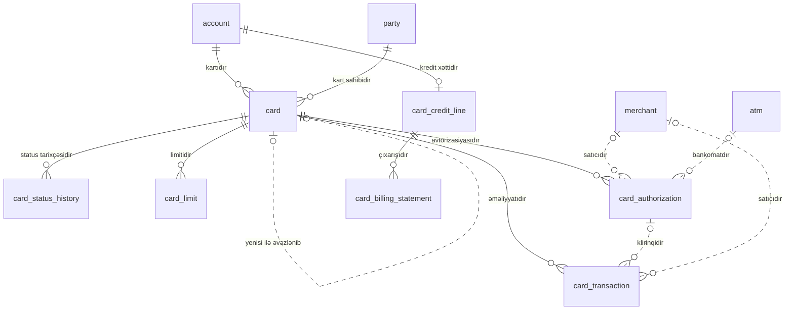

<!-- Bu fayl avtomatik yaradılıb (uv run bankmodel generate). Əl ilə redaktə etməyin. -->

# Kartlar (`card`)

[← Konseptual model](index.md) | **Konseptual model** · [Məntiqi model](../02_mentiqi/06_card.md) · [Fiziki model](../03_fiziki/06_card.md)

Debet və kredit kartları, onların limitləri, kredit kartı xətti və hesablaşma çıxarışları, real vaxt avtorizasiyaları və ödəniş sistemindən gələn klirinq əməliyyatları. Avtorizasiya bankın öz prosessinq sistemi tərəfindən aparılır. Kart həmişə hesaba bağlıdır: debet kart cari/kart hesabına, kredit kartı kredit xətti olan kart hesabına. Tam PAN, CVV və PIN bu bazada saxlanılmır (PCI DSS) — yalnız token və maskalanmış nömrə.

## Diaqram

Digər domenlərin obyektləri: `account` (Hesablar və əməliyyatlar), `atm` (Təşkilat və kanallar), `party` (Tərəf və müştəri (KYC)).

## Obyektlər

| # | Obyekt | Ad | Təsvir |
|---|---|---|---|
| 1 | `merchant` | **Satıcı (ticarət obyekti)** | Kartla ödəniş qəbul edən ticarət obyekti: ad, MCC, ölkə, şəhər; avtorizasiya məlumatından yaradılır. |
| 2 | `card` | **Kart** | Debet və ya kredit kartı: token, maskalanmış PAN, ödəniş sistemi (Visa/Mastercard), növ (fiziki/virtual), etibarlılıq müddəti, kart sahibi, bağlı hesab, status. |
| 3 | `card_status_history` | **Kart statusu tarixçəsi** | Kart statusunun dəyişiklikləri: buraxılış, aktivləşmə, bloklama, itki/oğurluq, bağlanma (yalnız əlavə olunur). |
| 4 | `card_limit` | **Kart limiti** | Kart üzrə limitlər: gündəlik nağdlaşdırma, POS, internet əməliyyatları, aylıq ümumi, tək əməliyyat. |
| 5 | `card_credit_line` | **Kredit kartı xətti** | Kart hesabının kredit limiti və şərtləri: hesablaşma dövrü günü, güzəşt müddəti, minimal ödəniş faizi, illik faiz dərəcəsi (actual/365). |
| 6 | `card_authorization` | **Kart avtorizasiyası** | Bankın prosessinq sistemində kart əməliyyatı üçün real vaxt avtorizasiya sorğusu və cavabı (təsdiq/imtina): məbləğ, valyuta, satıcı/bankomat, cavab kodu, RRN, STAN. Yüksək həcmli cədvəldir, aylar üzrə bölmələnir. |
| 7 | `card_transaction` | **Kart əməliyyatı (klirinq)** | Ödəniş sisteminin klirinq/hesablaşma faylı ilə təsdiqlənmiş kart əməliyyatı: əməliyyat və hesablaşma məbləği, valyutası, komissiya. Yüksək həcmli cədvəldir, aylar üzrə bölmələnir. |
| 8 | `card_billing_statement` | **Kredit kartı çıxarışı** | Kredit kartı üzrə hesablaşma dövrü çıxarışı: ümumi borc, minimal ödəniş, son ödəniş tarixi, ödənilmə vəziyyəti. |

## Əlaqələr

| Əsas obyekt | Əlaqə | Asılı obyekt | Kardinallıq |
|---|---|---|---|
| `account` (Hesablar və əməliyyatlar) | kartıdır | `card` | 1 : 0..N |
| `party` (Tərəf və müştəri (KYC)) | kart sahibidir | `card` | 1 : 0..N |
| `card` | yenisi ilə əvəzlənib | `card` | 0..1 : 0..1 |
| `card` | status tarixçəsidir | `card_status_history` | 1 : 0..N |
| `card` | limitidir | `card_limit` | 1 : 0..N |
| `account` (Hesablar və əməliyyatlar) | kredit xəttidir | `card_credit_line` | 1 : 0..1 |
| `card` | avtorizasiyasıdır | `card_authorization` | 1 : 0..N |
| `merchant` | satıcıdır | `card_authorization` | 0..1 : 0..N |
| `atm` (Təşkilat və kanallar) | bankomatdır | `card_authorization` | 0..1 : 0..N |
| `card` | əməliyyatıdır | `card_transaction` | 1 : 0..N |
| `card_authorization` | klirinqidir | `card_transaction` | 0..1 : 0..N |
| `merchant` | satıcıdır | `card_transaction` | 0..1 : 0..N |
| `card_credit_line` | çıxarışıdır | `card_billing_statement` | 1 : 0..N |

## İstinad məlumatlarına əlaqələr

Diaqramı sadə saxlamaq üçün `ref` sxeminə olan əlaqələr yalnız burada göstərilir.

| Obyekt | İstinad obyekti | Əlaqə | Kardinallıq |
|---|---|---|---|
| `merchant` | `mcc` (Satıcı kateqoriya kodu (MCC)) | kateqoriyasıdır | 1 : 0..N |
| `merchant` | `country` (Ölkə) | ölkəsidir | 1 : 0..N |
| `card` | `product` (Məhsul) | məhsuludur | 1 : 0..N |
| `card_authorization` | `currency` (Valyuta) | əməliyyat valyutasıdır | 1 : 0..N |
| `card_transaction` | `currency` (Valyuta) | əməliyyat valyutasıdır | 1 : 0..N |

## Bu domenə istinad edən digər obyektlər

| Obyekt | Domen | İstinad etdiyi obyekt | Əlaqə |
|---|---|---|---|
| `account_transaction` | Hesablar və əməliyyatlar | `card_transaction` | nəticəsidir |
| `hold` | Hesablar və əməliyyatlar | `card_authorization` | bloklamaya səbəb olub |
