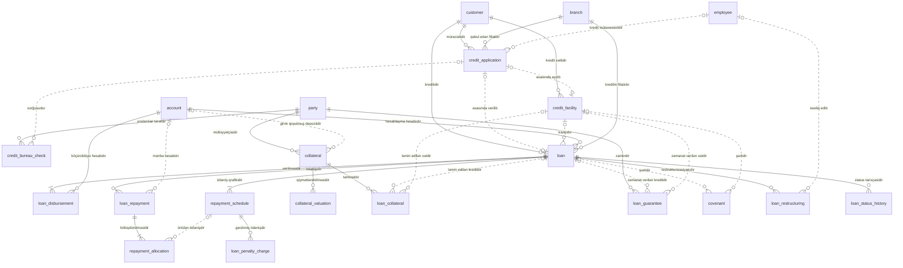

<!-- Bu fayl avtomatik yaradılıb (uv run bankmodel generate). Əl ilə redaktə etməyin. -->

# Kreditlər (`loan`)

[← Konseptual model](index.md) | **Konseptual model** · [Məntiqi model](../02_mentiqi/07_loan.md) · [Fiziki model](../03_fiziki/07_loan.md)

Kredit həyat dövrü: müraciət, Kredit Bürosu yoxlaması, kredit xətti (biznes), kredit müqaviləsi (istehlak, ipoteka, biznes krediti), kreditin verilməsi, ödəniş qrafiki, ödənişlər və onların bölüşdürülməsi, dəbbə (gündəlik dərəcə ilə cərimə), girov və zaminlik, kovenantlar, restrukturizasiya. Faizlər faktiki/365 (actual/365) bazası ilə hesablanır.

## Diaqram

Digər domenlərin obyektləri: `account` (Hesablar və əməliyyatlar), `branch` (Təşkilat və kanallar), `customer` (Tərəf və müştəri (KYC)), `employee` (Təşkilat və kanallar), `party` (Tərəf və müştəri (KYC)).

## Obyektlər

| # | Obyekt | Ad | Təsvir |
|---|---|---|---|
| 1 | `credit_application` | **Kredit müraciəti** | Kredit müraciəti: məhsul, istənilən məbləğ, valyuta və müddət, məqsəd, qərar, təsdiq edilmiş şərtlər. |
| 2 | `credit_bureau_check` | **Kredit Bürosu sorğusu** | Azərbaycan Kredit Bürosuna sorğu və nəticəsi: kredit skoru, mövcud öhdəliklər, gecikmələr; tərəfin razılığı əsasında. |
| 3 | `credit_facility` | **Kredit xətti** | Biznes müştəriləri üçün kredit xətti (bərpa olunan və ya olunmayan): ümumi limit, valyuta, istifadə müddəti. Xətt üzrə bir neçə kredit (tranş) verilə bilər; istifadə olunmuş məbləğ tranşların qalıqlarının cəmidir. |
| 4 | `loan` | **Kredit** | Kredit müqaviləsi və kredit hesabı: növ (istehlak, ipoteka, biznes, xətt üzrə tranş), məbləğ, valyuta, faiz dərəcəsi, müddət, ödəniş metodu (annuitet/diferensial), dəbbə şərtləri, qalıq borc, gecikmə günləri, status. Qalıq borc və gecikmə günləri əməliyyatlarla yenilənən idarə olunan denormallaşdırmadır. |
| 5 | `loan_disbursement` | **Kreditin verilməsi** | Kredit məbləğinin (və ya onun bir hissəsinin) müştəri hesabına köçürülməsi. |
| 6 | `repayment_schedule` | **Ödəniş qrafiki** | Kreditin ödəniş qrafiki: hər ödəniş tarixi üzrə əsas borc, faiz və komissiya məbləğləri, ödənilmiş hissələr. Restrukturizasiya zamanı yeni qrafik versiyası yaradılır, köhnə sətirlər SUPERSEDED olur. |
| 7 | `loan_repayment` | **Kredit ödənişi** | Müştərinin kredit üzrə etdiyi ödəniş: məbləğ, tarix, mənbə hesab, vaxtından əvvəl ödəniş əlaməti. |
| 8 | `repayment_allocation` | **Ödənişin bölüşdürülməsi** | Ödənişin qrafik üzrə ödənişlərə və komponentlərə bölüşdürülməsi. Növbəlilik: dəbbə → faiz → əsas borc → komissiya. |
| 9 | `loan_penalty_charge` | **Dəbbə (cərimə)** | Gecikmiş qrafik ödənişinə görə hər gün hesablanan dəbbə: gecikmiş məbləğ (kreditin dəbbə bazasına görə) × gündəlik dərəcə. |
| 10 | `collateral` | **Girov** | Girov predmeti: növ, təsvir, mülkiyyətçi, reyestr qeydiyyatı (daşınmaz əmlak çıxarışı, nəqliyyat vasitəsinin qeydiyyatı), girov qoyulmuş depozit hesabı. |
| 11 | `collateral_valuation` | **Girovun qiymətləndirilməsi** | Girovun bazar və likvid dəyərinin qiymətləndirilməsi: tarix, qiymətləndirici, məbləğ (girovun valyutasında). |
| 12 | `loan_collateral` | **Kreditin girovu** | Kredit və ya kredit xətti ilə girov arasında əlaqə: təminat məbləği, girov müqaviləsi nömrəsi, prioritet, qüvvədə olma tarixləri. |
| 13 | `loan_guarantee` | **Zaminlik** | Kredit və ya kredit xətti üzrə zamin (fiziki və ya hüquqi şəxs) və zaminlik müqaviləsi: zəmanət məbləği, qüvvədə olma tarixləri. |
| 14 | `covenant` | **Kovenant** | Biznes krediti üzrə maliyyə və qeyri-maliyyə şərtləri (məs. borc/EBITDA həddi) və onların yerinə yetirilməsinin yoxlanması. |
| 15 | `loan_restructuring` | **Restrukturizasiya** | Kredit şərtlərinin dəyişdirilməsi: müddət, faiz, ödəniş qrafiki; səbəb, təsdiq edən və qüvvəyə minmə tarixi. |
| 16 | `loan_status_history` | **Kredit statusu tarixçəsi** | Kredit statusunun dəyişiklikləri: aktiv, gecikmədə, restrukturizasiya, silinmiş, bağlanmış (yalnız əlavə olunur). |

## Əlaqələr

| Əsas obyekt | Əlaqə | Asılı obyekt | Kardinallıq |
|---|---|---|---|
| `customer` (Tərəf və müştəri (KYC)) | müraciətidir | `credit_application` | 1 : 0..N |
| `branch` (Təşkilat və kanallar) | qəbul edən filialdır | `credit_application` | 1 : 0..N |
| `employee` (Təşkilat və kanallar) | kredit mütəxəssisidir | `credit_application` | 0..1 : 0..N |
| `party` (Tərəf və müştəri (KYC)) | yoxlanılan tərəfdir | `credit_bureau_check` | 1 : 0..N |
| `credit_application` | sorğusudur | `credit_bureau_check` | 0..1 : 0..N |
| `customer` (Tərəf və müştəri (KYC)) | kredit xəttidir | `credit_facility` | 1 : 0..N |
| `credit_application` | əsasında açılıb | `credit_facility` | 0..1 : 0..1 |
| `customer` (Tərəf və müştəri (KYC)) | kreditidir | `loan` | 1 : 0..N |
| `credit_application` | əsasında verilib | `loan` | 0..1 : 0..1 |
| `credit_facility` | tranşıdır | `loan` | 0..1 : 0..N |
| `account` (Hesablar və əməliyyatlar) | hesablaşma hesabıdır | `loan` | 1 : 0..N |
| `branch` (Təşkilat və kanallar) | kreditin filialıdır | `loan` | 1 : 0..N |
| `loan` | verilməsidir | `loan_disbursement` | 1 : 1..N |
| `account` (Hesablar və əməliyyatlar) | köçürüldüyü hesabdır | `loan_disbursement` | 1 : 0..N |
| `loan` | ödəniş qrafikidir | `repayment_schedule` | 1 : 1..N |
| `loan` | ödənişidir | `loan_repayment` | 1 : 0..N |
| `account` (Hesablar və əməliyyatlar) | mənbə hesabdır | `loan_repayment` | 0..1 : 0..N |
| `loan_repayment` | bölüşdürülməsidir | `repayment_allocation` | 1 : 1..N |
| `repayment_schedule` | örtülən ödənişdir | `repayment_allocation` | 0..1 : 0..N |
| `repayment_schedule` | gecikmiş ödənişdir | `loan_penalty_charge` | 1 : 0..N |
| `party` (Tərəf və müştəri (KYC)) | mülkiyyətçisidir | `collateral` | 1 : 0..N |
| `account` (Hesablar və əməliyyatlar) | girov qoyulmuş depozitdir | `collateral` | 0..1 : 0..N |
| `collateral` | qiymətləndirilməsidir | `collateral_valuation` | 1 : 0..N |
| `collateral` | təminatdır | `loan_collateral` | 1 : 0..N |
| `loan` | təmin edilən kreditdir | `loan_collateral` | 0..1 : 0..N |
| `credit_facility` | təmin edilən xətdir | `loan_collateral` | 0..1 : 0..N |
| `party` (Tərəf və müştəri (KYC)) | zamindir | `loan_guarantee` | 1 : 0..N |
| `loan` | zəmanət verilən kreditdir | `loan_guarantee` | 0..1 : 0..N |
| `credit_facility` | zəmanət verilən xətdir | `loan_guarantee` | 0..1 : 0..N |
| `loan` | şərtidir | `covenant` | 0..1 : 0..N |
| `credit_facility` | şərtidir | `covenant` | 0..1 : 0..N |
| `loan` | restrukturizasiyasıdır | `loan_restructuring` | 1 : 0..N |
| `employee` (Təşkilat və kanallar) | təsdiq edib | `loan_restructuring` | 0..1 : 0..N |
| `loan` | status tarixçəsidir | `loan_status_history` | 1 : 0..N |

## İstinad məlumatlarına əlaqələr

Diaqramı sadə saxlamaq üçün `ref` sxeminə olan əlaqələr yalnız burada göstərilir.

| Obyekt | İstinad obyekti | Əlaqə | Kardinallıq |
|---|---|---|---|
| `credit_application` | `product` (Məhsul) | istənilən məhsuldur | 1 : 0..N |
| `credit_application` | `currency` (Valyuta) | istənilən valyutadır | 1 : 0..N |
| `credit_facility` | `currency` (Valyuta) | valyutasıdır | 1 : 0..N |
| `loan` | `product` (Məhsul) | məhsuludur | 1 : 0..N |
| `loan` | `currency` (Valyuta) | valyutasıdır | 1 : 0..N |
| `collateral` | `collateral_type` (Girov növü) | növüdür | 1 : 0..N |
| `collateral` | `currency` (Valyuta) | dəyərin valyutasıdır | 1 : 0..N |

## Bu domenə istinad edən digər obyektlər

| Obyekt | Domen | İstinad etdiyi obyekt | Əlaqə |
|---|---|---|---|
| `account_transaction` | Hesablar və əməliyyatlar | `loan_disbursement` | nəticəsidir |
| `account_transaction` | Hesablar və əməliyyatlar | `loan_repayment` | nəticəsidir |
