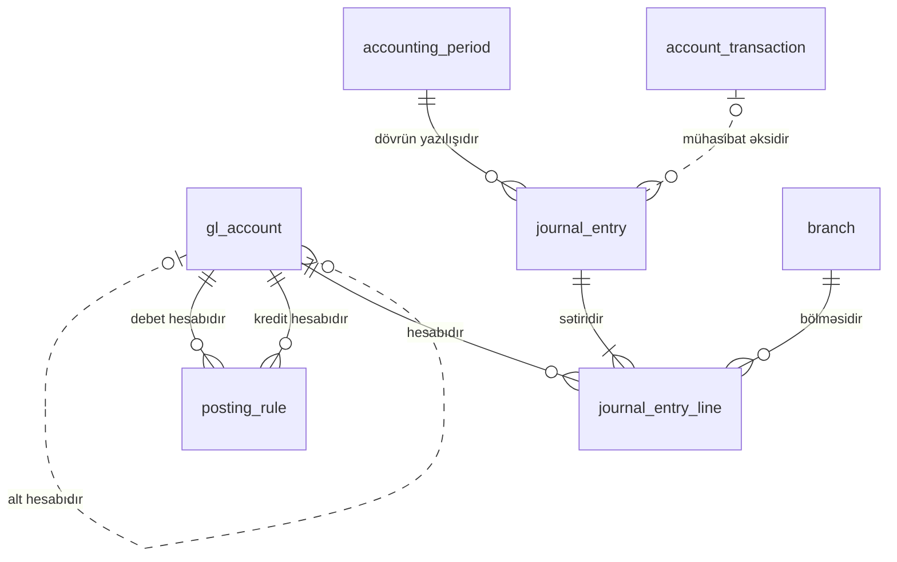

<!-- Bu fayl avtomatik yaradılıb (uv run bankmodel generate). Əl ilə redaktə etməyin. -->

# Baş kitab (sadələşdirilmiş) (`ledger`)

[← Konseptual model](index.md) | **Konseptual model** · [Məntiqi model](../02_mentiqi/08_ledger.md) · [Fiziki model](../03_fiziki/08_ledger.md)

Əməliyyatların mühasibat uçotunda əks olunması üçün sadələşdirilmiş baş kitab: baş kitab hesabları, mühasibat dövrləri, yazılış qaydaları və ikili yazılışlar (debet = kredit). AMB hesablar planının tam iyerarxiyası modelləşdirilmir; hesablar valideyn hesab vasitəsilə qruplaşdırılır.

## Diaqram

Digər domenlərin obyektləri: `account_transaction` (Hesablar və əməliyyatlar), `branch` (Təşkilat və kanallar).

## Obyektlər

| # | Obyekt | Ad | Təsvir |
|---|---|---|---|
| 1 | `gl_account` | **Baş kitab hesabı** | Balans və balansdankənar baş kitab hesabları; qrup hesabları və yazılış aparılan hesablar. |
| 2 | `accounting_period` | **Mühasibat dövrü** | Aylıq mühasibat dövrləri və onların statusu (açıq, bağlanır, bağlı). Bağlı dövrə yazılış aparılmır. |
| 3 | `posting_rule` | **Yazılış qaydası** | Məhsul və əməliyyat növünə görə debet və kredit baş kitab hesablarının müəyyən edilməsi qaydası; məhsul göstərilməyibsə qayda bütün məhsullara aiddir. |
| 4 | `journal_entry` | **Mühasibat yazılışı** | Mühasibat yazılışının başlığı: yazılış tarixi, dövr, mənbə hesab əməliyyatı, təsvir, status (qaralama/yazılıb/storno). |
| 5 | `journal_entry_line` | **Yazılış sətri** | Yazılışın debet və kredit sətirləri; hər yazılış üzrə AZN ekvivalentində debet və kredit cəmi bərabər olmalıdır (tətbiq səviyyəsində yazılış zamanı yoxlanılır). Yüksək həcmli cədvəldir, aylar üzrə bölmələnir. |

## Əlaqələr

| Əsas obyekt | Əlaqə | Asılı obyekt | Kardinallıq |
|---|---|---|---|
| `gl_account` | alt hesabıdır | `gl_account` | 0..1 : 0..N |
| `gl_account` | debet hesabıdır | `posting_rule` | 1 : 0..N |
| `gl_account` | kredit hesabıdır | `posting_rule` | 1 : 0..N |
| `accounting_period` | dövrün yazılışıdır | `journal_entry` | 1 : 0..N |
| `account_transaction` (Hesablar və əməliyyatlar) | mühasibat əksidir | `journal_entry` | 0..1 : 0..N |
| `journal_entry` | sətiridir | `journal_entry_line` | 1 : 1..N |
| `gl_account` | hesabıdır | `journal_entry_line` | 1 : 0..N |
| `branch` (Təşkilat və kanallar) | bölməsidir | `journal_entry_line` | 1 : 0..N |

## İstinad məlumatlarına əlaqələr

Diaqramı sadə saxlamaq üçün `ref` sxeminə olan əlaqələr yalnız burada göstərilir.

| Obyekt | İstinad obyekti | Əlaqə | Kardinallıq |
|---|---|---|---|
| `posting_rule` | `transaction_type` (Əməliyyat növü) | qaydasıdır | 1 : 0..N |
| `posting_rule` | `product` (Məhsul) | qaydasıdır | 0..1 : 0..N |
| `journal_entry_line` | `currency` (Valyuta) | valyutasıdır | 1 : 0..N |
