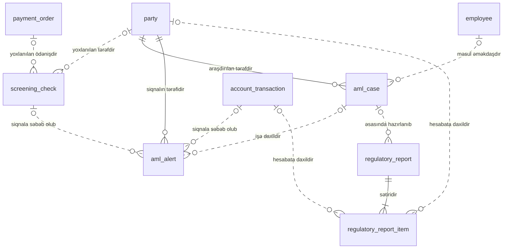

<!-- Bu fayl avtomatik yaradılıb (uv run bankmodel generate). Əl ilə redaktə etməyin. -->

# Uyğunluq və AML (sadələşdirilmiş) (`compliance`)

[← Konseptual model](index.md) | **Konseptual model** · [Məntiqi model](../02_mentiqi/09_compliance.md) · [Fiziki model](../03_fiziki/09_compliance.md)

Cinayət yolu ilə əldə edilmiş gəlirlərin leqallaşdırılmasına qarşı mübarizə (AML): sanksiya və PEP yoxlamaları, şübhəli əməliyyat siqnalları, araşdırma işləri və Maliyyə Monitorinqi Xidmətinə (MMX) hesabatlar.

## Diaqram

Digər domenlərin obyektləri: `account_transaction` (Hesablar və əməliyyatlar), `employee` (Təşkilat və kanallar), `party` (Tərəf və müştəri (KYC)), `payment_order` (Ödənişlər).

## Obyektlər

| # | Obyekt | Ad | Təsvir |
|---|---|---|---|
| 1 | `screening_check` | **Sanksiya / PEP yoxlaması** | Tərəfin və ya ödənişin sanksiya və PEP siyahıları üzrə yoxlanılması: siyahı, uyğunluq dərəcəsi, nəticə, qərar. |
| 2 | `aml_case` | **AML işi** | Bir və ya bir neçə siqnalın araşdırıldığı iş: məsul əməkdaş, prioritet, nəticə, MMX-yə məlumat verilib-verilməməsi. |
| 3 | `aml_alert` | **AML siqnalı** | Monitorinq qaydası və ya sanksiya yoxlaması ilə yaradılan şübhəli fəaliyyət siqnalı: qayda, risk balı, status. |
| 4 | `regulatory_report` | **Tənzimləyici hesabat** | MMX-yə (şübhəli əməliyyat, hədd məbləğini aşan əməliyyat) və AMB-yə göndərilən hesabat: növ, dövr, göndərilmə tarixi, status. |
| 5 | `regulatory_report_item` | **Hesabat sətri** | Hesabata daxil edilən əməliyyat və ya tərəf. |

## Əlaqələr

| Əsas obyekt | Əlaqə | Asılı obyekt | Kardinallıq |
|---|---|---|---|
| `party` (Tərəf və müştəri (KYC)) | yoxlanılan tərəfdir | `screening_check` | 0..1 : 0..N |
| `payment_order` (Ödənişlər) | yoxlanılan ödənişdir | `screening_check` | 0..1 : 0..N |
| `party` (Tərəf və müştəri (KYC)) | araşdırılan tərəfdir | `aml_case` | 1 : 0..N |
| `employee` (Təşkilat və kanallar) | məsul əməkdaşdır | `aml_case` | 0..1 : 0..N |
| `party` (Tərəf və müştəri (KYC)) | siqnalın tərəfidir | `aml_alert` | 1 : 0..N |
| `account_transaction` (Hesablar və əməliyyatlar) | siqnala səbəb olub | `aml_alert` | 0..1 : 0..N |
| `screening_check` | siqnala səbəb olub | `aml_alert` | 0..1 : 0..N |
| `aml_case` | işə daxildir | `aml_alert` | 0..1 : 0..N |
| `aml_case` | əsasında hazırlanıb | `regulatory_report` | 0..1 : 0..N |
| `regulatory_report` | sətiridir | `regulatory_report_item` | 1 : 1..N |
| `account_transaction` (Hesablar və əməliyyatlar) | hesabata daxildir | `regulatory_report_item` | 0..1 : 0..N |
| `party` (Tərəf və müştəri (KYC)) | hesabata daxildir | `regulatory_report_item` | 0..1 : 0..N |
