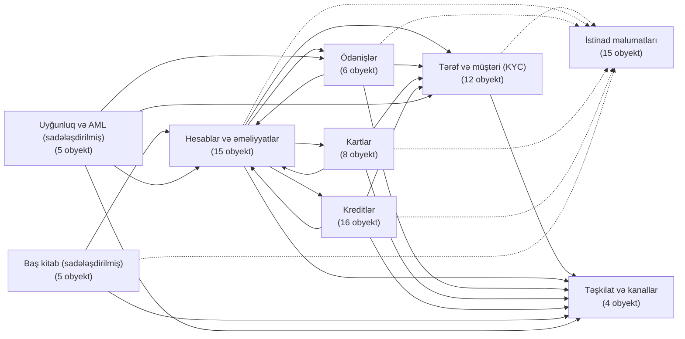

<!-- Bu fayl avtomatik yaradılıb (uv run bankmodel generate). Əl ilə redaktə etməyin. -->

# Konseptual model — Bank OLTP verilənlər modeli

**Konseptual model** · [Məntiqi model](../02_mentiqi/index.md) · [Fiziki model](../03_fiziki/index.md)

## Məqsəd və əhatə dairəsi

Bu sənəd Azərbaycanda fəaliyyət göstərən universal bankın əsas bank sisteminin (core banking) **OLTP** verilənlər modelinin konseptual səviyyəsini təsvir edir. Konseptual model biznes obyektlərini və onlar arasındakı əlaqələri göstərir; atributlar, açarlar və texniki detallar məntiqi və fiziki modellərdə verilir.

**Əsas qərarlar:**

- Model **OLTP** üçündür: normallaşdırılmış (3NF), tranzaksiya bütövlüyü və istinad bütövlüyü (FK) ilə.
- Yurisdiksiya: **Azərbaycan** — AZN və digər valyutalar, AZ IBAN, FİN, VÖEN, AZIPS/XÖHKS/SWIFT, AMB, MMX, Kredit Bürosu.
- Müştəri növləri: **fiziki şəxs**, **hüquqi şəxs**, **fərdi sahibkar** (vahid *tərəf* supertipi altında).
- Hesablar **çoxvalyutalıdır**; valyuta mübadiləsi ayrıca obyekt kimi modelləşdirilir.
- Kreditlər: istehlak, ipoteka, biznes krediti, kredit xətti; girov və zaminlik. Kartlar: debet və kredit.
- Hədəf VBİS: **PostgreSQL 18**.
- İstinad modeli: Databricks *lakehouse banking MVM* (OLAP) yalnız terminologiya və əhatə üçün istifadə olunub; struktur OLTP prinsiplərinə görə yenidən qurulub.

**Statistika:** 9 domen, 86 obyekt, 167 əlaqə.

## Domenlər xəritəsi

Ox asılılığı göstərir: domen oxun göstərdiyi domenin obyektlərinə istinad edir. Qırıq xətt — istinad məlumatlarına asılılıq.

## Domenlər

| # | Sxem | Domen | Obyekt sayı | Təsvir |
|---|---|---|---|---|
| 1 | `ref` | [İstinad məlumatları](01_ref.md) | 15 | Bütün domenlərin istifadə etdiyi kataloqlar və sorğu cədvəlləri: valyutalar, ölkələr, məzənnələr, bank kataloqu, məhsul kataloqu, əməliyyat, komissiya, sənəd və girov növləri. Biznes tərəfindən idarə olunan və vaxtaşırı dəyişən kod siyahıları burada saxlanılır. |
| 2 | `org` | [Təşkilat və kanallar](02_org.md) | 4 | Bankın daxili strukturu və xidmət kanalları: filial və şöbələr, əməkdaşlar, müştərilərin banka müraciət etdiyi kanallar və bankomatlar. |
| 3 | `party` | [Tərəf və müştəri (KYC)](03_party.md) | 12 | Bankla münasibətdə olan bütün fiziki və hüquqi şəxslər (tərəflər), onların sənədləri, ünvanları, əlaqə vasitələri, bir-biri ilə əlaqələri, müştəri rolu və KYC yoxlamaları. Tərəf supertipdir: fiziki şəxs, hüquqi şəxs və ya fərdi sahibkar ola bilər. |
| 4 | `account` | [Hesablar və əməliyyatlar](04_account.md) | 15 | Müştəri hesabları (cari, əmanət, müddətli depozit, kart hesabı), hesab sahibləri, qalıqlar, hesab əməliyyatları, bloklamalar, komissiyalar, faiz hesablanması, limitlər, daimi tapşırıqlar və çıxarışlar. Hesablar çoxvalyutalıdır: hər hesab bir valyutada açılır, müştərinin müxtəlif valyutalarda hesabları ola bilər. |
| 5 | `payment` | [Ödənişlər](05_payment.md) | 6 | Müştərilərin köçürmə tapşırıqları və onların icrası: daxili köçürmələr, yerli ödəniş sistemləri (AZIPS — iri məbləğli real vaxt, XÖHKS — kütləvi ödənişlər), beynəlxalq SWIFT köçürmələri, büdcə ödənişləri, qaytarılmalar və valyuta mübadiləsi. |
| 6 | `card` | [Kartlar](06_card.md) | 8 | Debet və kredit kartları, onların limitləri, kredit kartı xətti və hesablaşma çıxarışları, real vaxt avtorizasiyaları və ödəniş sistemindən gələn klirinq əməliyyatları. Avtorizasiya bankın öz prosessinq sistemi tərəfindən aparılır. Kart həmişə hesaba bağlıdır: debet kart cari/kart hesabına, kredit kartı kredit xətti olan kart hesabına. Tam PAN, CVV və PIN bu bazada saxlanılmır (PCI DSS) — yalnız token və maskalanmış nömrə. |
| 7 | `loan` | [Kreditlər](07_loan.md) | 16 | Kredit həyat dövrü: müraciət, Kredit Bürosu yoxlaması, kredit xətti (biznes), kredit müqaviləsi (istehlak, ipoteka, biznes krediti), kreditin verilməsi, ödəniş qrafiki, ödənişlər və onların bölüşdürülməsi, dəbbə (gündəlik dərəcə ilə cərimə), girov və zaminlik, kovenantlar, restrukturizasiya. Faizlər faktiki/365 (actual/365) bazası ilə hesablanır. |
| 8 | `ledger` | [Baş kitab (sadələşdirilmiş)](08_ledger.md) | 5 | Əməliyyatların mühasibat uçotunda əks olunması üçün sadələşdirilmiş baş kitab: baş kitab hesabları, mühasibat dövrləri, yazılış qaydaları və ikili yazılışlar (debet = kredit). AMB hesablar planının tam iyerarxiyası modelləşdirilmir; hesablar valideyn hesab vasitəsilə qruplaşdırılır. |
| 9 | `compliance` | [Uyğunluq və AML (sadələşdirilmiş)](09_compliance.md) | 5 | Cinayət yolu ilə əldə edilmiş gəlirlərin leqallaşdırılmasına qarşı mübarizə (AML): sanksiya və PEP yoxlamaları, şübhəli əməliyyat siqnalları, araşdırma işləri və Maliyyə Monitorinqi Xidmətinə (MMX) hesabatlar. |

## Diaqramların oxunması

| İşarə | Mənası |
|---|---|
| `\|\|` | dəqiq bir |
| `\|o` / `o\|` | sıfır və ya bir |
| `o{` | sıfır və ya çox |
| `\|{` | bir və ya çox |
| bütöv xətt | əsas obyekt mütləqdir (məcburi əlaqə) |
| qırıq xətt | əsas obyekt məcburi deyil (könüllü əlaqə) |

Əlaqənin adı əsas obyektdən (sol) asılı obyektə (sağ) doğru oxunur. Cədvəllərdə kardinallıq `əsas : asılı` şəklində verilir.

## Lüğət

| Termin | İzah |
|---|---|
| **AMB** | Azərbaycan Respublikasının Mərkəzi Bankı — bank sektorunun tənzimləyicisi və nəzarət orqanı. |
| **AZIPS** | Azərbaycan Ani Ödənişlər Sistemi — AMB-nin iri məbləğli və təcili ödənişlər üçün real vaxt rejimində hesablaşma sistemi. |
| **XÖHKS** | Xırda Ödənişlər üzrə Hesablaşma Klirinq Sistemi — kütləvi, kiçik məbləğli ödənişlər üçün AMB-nin klirinq sistemi. |
| **SWIFT / BIC** | Beynəlxalq bank mesajlaşma şəbəkəsi və bankın beynəlxalq identifikasiya kodu. |
| **IBAN** | Beynəlxalq bank hesab nömrəsi. Azərbaycanda 28 simvol: AZ + 2 yoxlama rəqəmi + 4 simvollu bank kodu + 20 simvollu hesab nömrəsi. |
| **FİN** | Fərdi identifikasiya nömrəsi — şəxsiyyət vəsiqəsində göstərilən 7 simvollu unikal kod. |
| **VÖEN** | Vergi ödəyicisinin eyniləşdirmə nömrəsi — hüquqi şəxslərə və fərdi sahibkarlara verilən 10 rəqəmli vergi kodu. |
| **CIF** | Müştəri məlumat faylı nömrəsi (Customer Information File) — bankın müştəriyə verdiyi daxili unikal nömrə. |
| **Tərəf (party)** | Bankla münasibətdə olan istənilən fiziki və ya hüquqi şəxs; müştəri, zamin, mülkiyyətçi və s. rollarda çıxış edə bilər. |
| **Fərdi sahibkar** | Hüquqi şəxs yaratmadan, VÖEN ilə qeydiyyatdan keçərək sahibkarlıq fəaliyyəti ilə məşğul olan fiziki şəxs. |
| **KYC / CDD / EDD** | Müştərini tanı / müştəri barəsində lazımi yoxlama / gücləndirilmiş yoxlama — AML qanunvericiliyi ilə tələb olunan eyniləşdirmə prosedurları. |
| **PEP** | Siyasi xadim (Politically Exposed Person) — gücləndirilmiş yoxlama tələb edən şəxs. |
| **UBO** | Benefisiar mülkiyyətçi (Ultimate Beneficial Owner) — hüquqi şəxsə son nəticədə sahib olan və ya onu idarə edən fiziki şəxs. |
| **AML** | Cinayət yolu ilə əldə edilmiş gəlirlərin leqallaşdırılmasına və terrorçuluğun maliyyələşdirilməsinə qarşı mübarizə. |
| **MMX** | Maliyyə Monitorinqi Xidməti — şübhəli və hədd məbləğini aşan əməliyyatlar barədə məlumatları qəbul edən dövlət orqanı. |
| **Kredit Bürosu** | Azərbaycan Kredit Bürosu — borcalanların kredit tarixçəsini toplayan və kredit hesabatları verən təşkilat. |
| **Dəyər tarixi** | Vəsaitin hesabda faktiki olaraq istifadəyə verildiyi və faizin hesablanmağa başladığı tarix. |
| **Annuitet / Diferensial** | Kredit ödəniş metodları: bərabər aylıq ödəniş / əsas borcun bərabər hissələrlə ödənilməsi (azalan ödəniş). |
| **Dəbbə** | Gecikmiş ödənişə görə hər gün gündəlik dərəcə ilə hesablanan cərimə. |
| **Faktiki/365 (actual/365)** | Faiz hesablama bazası: gündəlik faiz = qalıq × illik dərəcə / 365, günlər təqvim üzrə faktiki sayılır. |
| **Overdraft** | Cari hesab üzrə qalıqdan artıq vəsait istifadəsinə icazə verən qısamüddətli kredit limiti. |
| **Kovenant** | Kredit müqaviləsində borcalanın üzərinə qoyulan maliyyə və ya qeyri-maliyyə öhdəliyi. |
| **MCC** | Satıcı kateqoriya kodu (Merchant Category Code) — ticarət obyektinin fəaliyyət növünü göstərən 4 rəqəmli kod. |
| **PAN** | Kartın əsas nömrəsi (Primary Account Number); sistemdə yalnız maskalanmış formada və token kimi saxlanılır. |
| **Avtorizasiya / Klirinq** | Kart əməliyyatının real vaxtda təsdiqlənməsi / ödəniş sisteminin sonradan göndərdiyi yekun hesablaşma məlumatı. |
| **OLTP** | Onlayn tranzaksiya emalı — çoxsaylı qısa yazma/oxuma əməliyyatlarına, məlumat bütövlüyünə və normallaşdırmaya (3NF) yönəlmiş verilənlər bazası modeli. |
