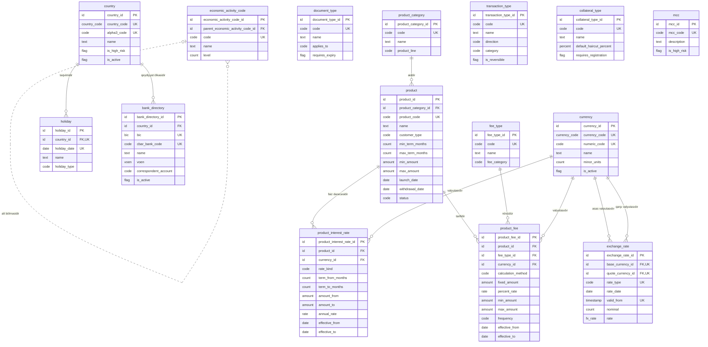

<!-- Bu fayl avtomatik yaradılıb (uv run bankmodel generate). Əl ilə redaktə etməyin. -->

# İstinad məlumatları (`ref`) — məntiqi model

[← Məntiqi model](index.md) | [Konseptual model](../01_konseptual/01_ref.md) · **Məntiqi model** · [Fiziki model](../03_fiziki/01_ref.md)

Bütün domenlərin istifadə etdiyi kataloqlar və sorğu cədvəlləri: valyutalar, ölkələr, məzənnələr, bank kataloqu, məhsul kataloqu, əməliyyat, komissiya, sənəd və girov növləri. Biznes tərəfindən idarə olunan və vaxtaşırı dəyişən kod siyahıları burada saxlanılır.

## Diaqram

## Obyektlər

### 1. `currency` — Valyuta

ISO 4217 valyuta kataloqu (AZN, USD, EUR və s.).

| # | Atribut | Məntiqi tip | Məcburi | Açar | Təsvir |
|---|---|---|---|---|---|
| 1 | `currency_id` | İdentifikator | Bəli | PK | Valyuta — surrogat identifikator (UUIDv7). |
| 2 | `currency_code` | Valyuta kodu (ISO 4217) | Bəli | AK1 | ISO 4217 hərf kodu (AZN, USD, EUR). |
| 3 | `numeric_code` | Kod | Bəli | AK2 | ISO 4217 rəqəm kodu (944 — AZN). |
| 4 | `name` | Mətn | Bəli |  | Valyutanın adı. |
| 5 | `minor_units` | Say | Bəli |  | Kəsr hissəsinin rəqəm sayı (AZN üçün 2). Susmaya görə: `2` |
| 6 | `is_active` | Bayraq (bəli/xeyr) | Bəli |  | Valyuta ilə əməliyyat aparılırmı. Susmaya görə: `true` |

**Əsas açar:** `currency_id`

**Alternativ açarlar:**

- AK1: `currency_code`
- AK2: `numeric_code`

**Biznes qaydaları:**

- Kəsr rəqəmləri 0–4 arasında olmalıdır.

### 2. `country` — Ölkə

ISO 3166 ölkə kataloqu; rezidentlik, vətəndaşlıq, ünvan və sanksiya riskinin müəyyən edilməsi üçün.

| # | Atribut | Məntiqi tip | Məcburi | Açar | Təsvir |
|---|---|---|---|---|---|
| 1 | `country_id` | İdentifikator | Bəli | PK | Ölkə — surrogat identifikator (UUIDv7). |
| 2 | `country_code` | Ölkə kodu (ISO 3166) | Bəli | AK1 | ISO 3166-1 alpha-2 kodu (AZ). |
| 3 | `alpha3_code` | Kod | Bəli | AK2 | ISO 3166-1 alpha-3 kodu (AZE). |
| 4 | `name` | Mətn | Bəli |  | Ölkənin adı. |
| 5 | `is_high_risk` | Bayraq (bəli/xeyr) | Bəli |  | FATF və ya daxili siyasət üzrə yüksək riskli ölkə. Susmaya görə: `false` |
| 6 | `is_active` | Bayraq (bəli/xeyr) | Bəli |  | Kataloqda aktivdir. Susmaya görə: `true` |

**Əsas açar:** `country_id`

**Alternativ açarlar:**

- AK1: `country_code`
- AK2: `alpha3_code`

### 3. `exchange_rate` — Valyuta məzənnəsi

Valyuta cütü üzrə tarixə görə məzənnələr: AMB-nin rəsmi məzənnəsi və bankın nağd/nağdsız alış-satış məzənnələri.

| # | Atribut | Məntiqi tip | Məcburi | Açar | Təsvir |
|---|---|---|---|---|---|
| 1 | `exchange_rate_id` | İdentifikator | Bəli | PK | Valyuta məzənnəsi — surrogat identifikator (UUIDv7). |
| 2 | `base_currency_id` | İdentifikator | Bəli | FK, AK1 | Valyuta istinadı (əsas valyutasıdır). |
| 3 | `quote_currency_id` | İdentifikator | Bəli | FK, AK1 | Valyuta istinadı (qarşı valyutasıdır). |
| 4 | `rate_type` | Kod | Bəli | AK1 | Məzənnə növü: AMB rəsmi, nağd alış/satış, nağdsız alış/satış. Dəyərlər: `OFFICIAL_CBAR`, `CASH_BUY`, `CASH_SELL`, `NONCASH_BUY`, `NONCASH_SELL` |
| 5 | `rate_date` | Tarix | Bəli |  | Məzənnənin aid olduğu tarix. |
| 6 | `valid_from` | Tarix-vaxt | Bəli | AK1 | Məzənnənin qüvvəyə mindiyi an (gün ərzində bir neçə dəfə dəyişə bilər). |
| 7 | `nominal` | Say | Bəli |  | Neçə vahid əsas valyuta üçün (adətən 1). Susmaya görə: `1` |
| 8 | `rate` | Məzənnə | Bəli |  | Nominal qədər əsas valyutanın qarşı valyutada dəyəri. |

**Əsas açar:** `exchange_rate_id`

**Alternativ açarlar:**

- AK1: `base_currency_id`, `quote_currency_id`, `rate_type`, `valid_from`

**Əlaqələr:**

| FK atributu | İstinad obyekti | Kardinallıq | Əlaqə |
|---|---|---|---|
| `base_currency_id` | `ref.currency` (Valyuta) | 1 : 0..N | əsas valyutasıdır |
| `quote_currency_id` | `ref.currency` (Valyuta) | 1 : 0..N | qarşı valyutasıdır |

**Biznes qaydaları:**

- Məzənnə və nominal müsbət olmalıdır.
- Əsas və qarşı valyuta fərqli olmalıdır.

### 4. `holiday` — Qeyri-iş günü

Bayram və qeyri-iş günləri təqvimi; dəyər tarixi, ödəniş qrafiki və faiz hesablanması üçün istifadə olunur.

| # | Atribut | Məntiqi tip | Məcburi | Açar | Təsvir |
|---|---|---|---|---|---|
| 1 | `holiday_id` | İdentifikator | Bəli | PK | Qeyri-iş günü — surrogat identifikator (UUIDv7). |
| 2 | `country_id` | İdentifikator | Bəli | FK, AK1 | Ölkə istinadı (təqvimidir). |
| 3 | `holiday_date` | Tarix | Bəli | AK1 | Qeyri-iş günü. |
| 4 | `name` | Mətn | Bəli |  | Bayramın və ya günün adı. |
| 5 | `holiday_type` | Kod | Bəli |  | Növ: dövlət bayramı, köçürülmüş istirahət günü, bankın qeyri-iş günü. Dəyərlər: `PUBLIC_HOLIDAY`, `TRANSFERRED_DAY_OFF`, `BANK_HOLIDAY` |

**Əsas açar:** `holiday_id`

**Alternativ açarlar:**

- AK1: `country_id`, `holiday_date`

**Əlaqələr:**

| FK atributu | İstinad obyekti | Kardinallıq | Əlaqə |
|---|---|---|---|
| `country_id` | `ref.country` (Ölkə) | 1 : 0..N | təqvimidir |

### 5. `bank_directory` — Bank kataloqu

Yerli və xarici banklar: BIC/SWIFT kodu, AMB bank kodu, müxbir hesab məlumatları.

| # | Atribut | Məntiqi tip | Məcburi | Açar | Təsvir |
|---|---|---|---|---|---|
| 1 | `bank_directory_id` | İdentifikator | Bəli | PK | Bank kataloqu — surrogat identifikator (UUIDv7). |
| 2 | `country_id` | İdentifikator | Bəli | FK | Ölkə istinadı (qeydiyyat ölkəsidir). |
| 3 | `bic` | BIC/SWIFT kodu | Xeyr | AK1 | SWIFT BIC kodu. |
| 4 | `cbar_bank_code` | Kod | Xeyr | AK2 | AMB tərəfindən verilmiş 6 rəqəmli bank kodu (yerli banklar üçün). |
| 5 | `name` | Mətn | Bəli |  | Bankın adı. |
| 6 | `voen` | VÖEN | Xeyr |  | Bankın VÖEN-i (yerli banklar üçün). |
| 7 | `correspondent_account` | Kod | Xeyr |  | Bankın AMB-dəki müxbir hesabı. |
| 8 | `is_active` | Bayraq (bəli/xeyr) | Bəli |  | Bank fəaliyyətdədir. Susmaya görə: `true` |

**Əsas açar:** `bank_directory_id`

**Alternativ açarlar:**

- AK1: `bic`
- AK2: `cbar_bank_code`

**Əlaqələr:**

| FK atributu | İstinad obyekti | Kardinallıq | Əlaqə |
|---|---|---|---|
| `country_id` | `ref.country` (Ölkə) | 1 : 0..N | qeydiyyat ölkəsidir |

**Biznes qaydaları:**

- BIC və ya AMB bank kodundan ən azı biri olmalıdır.

### 6. `economic_activity_code` — İqtisadi fəaliyyət növü

İqtisadi fəaliyyət növlərinin iyerarxik təsnifatı (İFNT/NACE); hüquqi şəxslər və fərdi sahibkarlar üçün.

| # | Atribut | Məntiqi tip | Məcburi | Açar | Təsvir |
|---|---|---|---|---|---|
| 1 | `economic_activity_code_id` | İdentifikator | Bəli | PK | İqtisadi fəaliyyət növü — surrogat identifikator (UUIDv7). |
| 2 | `parent_economic_activity_code_id` | İdentifikator | Xeyr | FK | İqtisadi fəaliyyət növü istinadı (alt bölməsidir). |
| 3 | `code` | Kod | Bəli | AK1 | Təsnifat kodu. |
| 4 | `name` | Mətn | Bəli |  | Fəaliyyət növünün adı. |
| 5 | `level` | Say | Bəli |  | İyerarxiya səviyyəsi (1 — bölmə, sonrakılar — alt bölmələr). |

**Əsas açar:** `economic_activity_code_id`

**Alternativ açarlar:**

- AK1: `code`

**Əlaqələr:**

| FK atributu | İstinad obyekti | Kardinallıq | Əlaqə |
|---|---|---|---|
| `parent_economic_activity_code_id` | `ref.economic_activity_code` (İqtisadi fəaliyyət növü) | 0..1 : 0..N | alt bölməsidir |

### 7. `document_type` — Sənəd növü

Şəxsiyyət və qeydiyyat sənədlərinin növləri: şəxsiyyət vəsiqəsi, pasport, yaşayış icazəsi, dövlət qeydiyyatı şəhadətnaməsi və s.

| # | Atribut | Məntiqi tip | Məcburi | Açar | Təsvir |
|---|---|---|---|---|---|
| 1 | `document_type_id` | İdentifikator | Bəli | PK | Sənəd növü — surrogat identifikator (UUIDv7). |
| 2 | `code` | Kod | Bəli | AK1 | Sənəd növünün kodu. |
| 3 | `name` | Mətn | Bəli |  | Sənəd növünün adı. |
| 4 | `applies_to` | Kod | Bəli |  | Hansı tərəf növü üçün. Dəyərlər: `INDIVIDUAL`, `ORGANIZATION`, `ANY` |
| 5 | `requires_expiry` | Bayraq (bəli/xeyr) | Bəli |  | Etibarlılıq müddəti məcburidir. Susmaya görə: `true` |

**Əsas açar:** `document_type_id`

**Alternativ açarlar:**

- AK1: `code`

### 8. `product_category` — Məhsul kateqoriyası

Bank məhsullarının qrupları: cari hesab, əmanət, müddətli depozit, debet kart, kredit kartı, istehlak krediti, ipoteka, biznes krediti, kredit xətti.

| # | Atribut | Məntiqi tip | Məcburi | Açar | Təsvir |
|---|---|---|---|---|---|
| 1 | `product_category_id` | İdentifikator | Bəli | PK | Məhsul kateqoriyası — surrogat identifikator (UUIDv7). |
| 2 | `code` | Kod | Bəli | AK1 | Kateqoriya kodu. |
| 3 | `name` | Mətn | Bəli |  | Kateqoriyanın adı. |
| 4 | `product_line` | Kod | Bəli |  | Məhsul xətti; hansı domenin obyektləri ilə işlədiyini müəyyən edir. Dəyərlər: `CURRENT_ACCOUNT`, `SAVINGS`, `TERM_DEPOSIT`, `DEBIT_CARD`, `CREDIT_CARD`, `CONSUMER_LOAN`, `MORTGAGE`, `BUSINESS_LOAN`, `CREDIT_LINE`, `OVERDRAFT` |

**Əsas açar:** `product_category_id`

**Alternativ açarlar:**

- AK1: `code`

### 9. `product` — Məhsul

Bankın təklif etdiyi konkret məhsul və onun ümumi parametrləri (müştəri tipi, minimal/maksimal müddət və məbləğ).

| # | Atribut | Məntiqi tip | Məcburi | Açar | Təsvir |
|---|---|---|---|---|---|
| 1 | `product_id` | İdentifikator | Bəli | PK | Məhsul — surrogat identifikator (UUIDv7). |
| 2 | `product_category_id` | İdentifikator | Bəli | FK | Məhsul kateqoriyası istinadı (aiddir). |
| 3 | `product_code` | Kod | Bəli | AK1 | Məhsul kodu. |
| 4 | `name` | Mətn | Bəli |  | Məhsulun adı. |
| 5 | `customer_type` | Kod | Bəli |  | Məhsulun hədəf müştəri növü. Dəyərlər: `INDIVIDUAL`, `LEGAL_ENTITY`, `INDIVIDUAL_ENTREPRENEUR`, `ANY` |
| 6 | `min_term_months` | Say | Xeyr |  | Minimal müddət (ay). |
| 7 | `max_term_months` | Say | Xeyr |  | Maksimal müddət (ay). |
| 8 | `min_amount` | Məbləğ | Xeyr |  | Minimal məbləğ. |
| 9 | `max_amount` | Məbləğ | Xeyr |  | Maksimal məbləğ. |
| 10 | `launch_date` | Tarix | Bəli |  | Satışa çıxarılma tarixi. |
| 11 | `withdrawal_date` | Tarix | Xeyr |  | Satışdan çıxarılma tarixi. |
| 12 | `status` | Kod | Bəli |  | Məhsulun statusu. Dəyərlər: `ACTIVE`, `SUSPENDED`, `WITHDRAWN` |

**Əsas açar:** `product_id`

**Alternativ açarlar:**

- AK1: `product_code`

**Əlaqələr:**

| FK atributu | İstinad obyekti | Kardinallıq | Əlaqə |
|---|---|---|---|
| `product_category_id` | `ref.product_category` (Məhsul kateqoriyası) | 1 : 0..N | aiddir |

**Biznes qaydaları:**

- Minimal müddət maksimaldan böyük ola bilməz.
- Minimal məbləğ maksimaldan böyük ola bilməz.

### 10. `product_interest_rate` — Məhsul faiz dərəcəsi

Məhsul üzrə standart illik faiz dərəcələri: valyuta, müddət və məbləğ diapazonuna görə, qüvvədə olma tarixləri ilə. Faiz faktiki/365 (actual/365) bazası ilə hesablanır.

| # | Atribut | Məntiqi tip | Məcburi | Açar | Təsvir |
|---|---|---|---|---|---|
| 1 | `product_interest_rate_id` | İdentifikator | Bəli | PK | Məhsul faiz dərəcəsi — surrogat identifikator (UUIDv7). |
| 2 | `product_id` | İdentifikator | Bəli | FK | Məhsul istinadı (faiz dərəcəsidir). |
| 3 | `currency_id` | İdentifikator | Bəli | FK | Valyuta istinadı (valyutasıdır). |
| 4 | `rate_kind` | Kod | Bəli |  | Dərəcənin növü. Dəyərlər: `DEPOSIT`, `LENDING`, `OVERDRAFT`, `PENALTY`, `CREDIT_CARD` |
| 5 | `term_from_months` | Say | Xeyr |  | Müddət diapazonunun başlanğıcı (ay). |
| 6 | `term_to_months` | Say | Xeyr |  | Müddət diapazonunun sonu (ay). |
| 7 | `amount_from` | Məbləğ | Xeyr |  | Məbləğ diapazonunun başlanğıcı. |
| 8 | `amount_to` | Məbləğ | Xeyr |  | Məbləğ diapazonunun sonu. |
| 9 | `annual_rate` | Faiz dərəcəsi | Bəli |  | İllik faiz dərəcəsi (0.125000 = 12.5%); dəbbə üçün gündəlik dərəcə. |
| 10 | `effective_from` | Tarix | Bəli |  | Qüvvəyə minmə tarixi. |
| 11 | `effective_to` | Tarix | Xeyr |  | Qüvvədən düşmə tarixi. |

**Əsas açar:** `product_interest_rate_id`

**Əlaqələr:**

| FK atributu | İstinad obyekti | Kardinallıq | Əlaqə |
|---|---|---|---|
| `product_id` | `ref.product` (Məhsul) | 1 : 0..N | faiz dərəcəsidir |
| `currency_id` | `ref.currency` (Valyuta) | 1 : 0..N | valyutasıdır |

**Biznes qaydaları:**

- Faiz dərəcəsi mənfi ola bilməz.
- Bitmə tarixi başlanğıcdan əvvəl ola bilməz.

### 11. `fee_type` — Komissiya növü

Komissiya və haqların kataloqu: hesab xidməti, köçürmə, nağdlaşdırma, kartın illik haqqı və s.

| # | Atribut | Məntiqi tip | Məcburi | Açar | Təsvir |
|---|---|---|---|---|---|
| 1 | `fee_type_id` | İdentifikator | Bəli | PK | Komissiya növü — surrogat identifikator (UUIDv7). |
| 2 | `code` | Kod | Bəli | AK1 | Komissiya kodu. |
| 3 | `name` | Mətn | Bəli |  | Komissiyanın adı. |
| 4 | `fee_category` | Kod | Bəli |  | Komissiya qrupu. Dəyərlər: `ACCOUNT_SERVICE`, `TRANSFER`, `CASH`, `CARD`, `LOAN`, `OTHER` |

**Əsas açar:** `fee_type_id`

**Alternativ açarlar:**

- AK1: `code`

### 12. `product_fee` — Məhsul komissiyası

Məhsula tətbiq olunan komissiya tarifləri: sabit məbləğ və/və ya faiz, minimum/maksimum, qüvvədə olma tarixləri.

| # | Atribut | Məntiqi tip | Məcburi | Açar | Təsvir |
|---|---|---|---|---|---|
| 1 | `product_fee_id` | İdentifikator | Bəli | PK | Məhsul komissiyası — surrogat identifikator (UUIDv7). |
| 2 | `product_id` | İdentifikator | Bəli | FK | Məhsul istinadı (tarifidir). |
| 3 | `fee_type_id` | İdentifikator | Bəli | FK | Komissiya növü istinadı (növüdür). |
| 4 | `currency_id` | İdentifikator | Bəli | FK | Valyuta istinadı (valyutasıdır). |
| 5 | `calculation_method` | Kod | Bəli |  | Hesablama üsulu. Dəyərlər: `FIXED`, `PERCENT`, `FIXED_PLUS_PERCENT` |
| 6 | `fixed_amount` | Məbləğ | Xeyr |  | Sabit məbləğ. |
| 7 | `percent_rate` | Faiz dərəcəsi | Xeyr |  | Əməliyyat məbləğindən faiz (0.005000 = 0.5%). |
| 8 | `min_amount` | Məbləğ | Xeyr |  | Minimal komissiya. |
| 9 | `max_amount` | Məbləğ | Xeyr |  | Maksimal komissiya. |
| 10 | `frequency` | Kod | Bəli |  | Tutulma tezliyi. Dəyərlər: `ONE_TIME`, `PER_TRANSACTION`, `MONTHLY`, `ANNUAL` |
| 11 | `effective_from` | Tarix | Bəli |  | Qüvvəyə minmə tarixi. |
| 12 | `effective_to` | Tarix | Xeyr |  | Qüvvədən düşmə tarixi. |

**Əsas açar:** `product_fee_id`

**Əlaqələr:**

| FK atributu | İstinad obyekti | Kardinallıq | Əlaqə |
|---|---|---|---|
| `product_id` | `ref.product` (Məhsul) | 1 : 0..N | tarifidir |
| `fee_type_id` | `ref.fee_type` (Komissiya növü) | 1 : 0..N | növüdür |
| `currency_id` | `ref.currency` (Valyuta) | 1 : 0..N | valyutasıdır |

**Biznes qaydaları:**

- Hesablama üsuluna uyğun sabit məbləğ və/və ya faiz göstərilməlidir.
- Bitmə tarixi başlanğıcdan əvvəl ola bilməz.

### 13. `transaction_type` — Əməliyyat növü

Hesab əməliyyatlarının kodları və istiqaməti (mədaxil/məxaric): köçürmə, nağd mədaxil, kart əməliyyatı, faiz, komissiya, kredit ödənişi və s.

| # | Atribut | Məntiqi tip | Məcburi | Açar | Təsvir |
|---|---|---|---|---|---|
| 1 | `transaction_type_id` | İdentifikator | Bəli | PK | Əməliyyat növü — surrogat identifikator (UUIDv7). |
| 2 | `code` | Kod | Bəli | AK1 | Əməliyyat növünün kodu. |
| 3 | `name` | Mətn | Bəli |  | Əməliyyat növünün adı. |
| 4 | `direction` | Kod | Bəli |  | İcazə verilən istiqamət. Dəyərlər: `DEBIT`, `CREDIT`, `BOTH` |
| 5 | `category` | Kod | Bəli |  | Əməliyyat qrupu. Dəyərlər: `TRANSFER`, `CASH`, `CARD`, `INTEREST`, `FEE`, `LOAN`, `FX`, `ADJUSTMENT` |
| 6 | `is_reversible` | Bayraq (bəli/xeyr) | Bəli |  | Storno edilə bilər. Susmaya görə: `true` |

**Əsas açar:** `transaction_type_id`

**Alternativ açarlar:**

- AK1: `code`

### 14. `collateral_type` — Girov növü

Girov predmetlərinin növləri: daşınmaz əmlak, nəqliyyat vasitəsi, depozit, qiymətli metal, avadanlıq, mal-material.

| # | Atribut | Məntiqi tip | Məcburi | Açar | Təsvir |
|---|---|---|---|---|---|
| 1 | `collateral_type_id` | İdentifikator | Bəli | PK | Girov növü — surrogat identifikator (UUIDv7). |
| 2 | `code` | Kod | Bəli | AK1 | Girov növünün kodu. |
| 3 | `name` | Mətn | Bəli |  | Girov növünün adı. |
| 4 | `default_haircut_percent` | Faiz payı | Xeyr |  | Standart diskont (dəyərdən çıxılan faiz). |
| 5 | `requires_registration` | Bayraq (bəli/xeyr) | Bəli |  | Dövlət reyestrində qeydiyyat tələb olunur. Susmaya görə: `false` |

**Əsas açar:** `collateral_type_id`

**Alternativ açarlar:**

- AK1: `code`

**Biznes qaydaları:**

- Diskont 0–100% arasında olmalıdır.

### 15. `mcc` — Satıcı kateqoriya kodu (MCC)

ISO 18245 satıcı kateqoriya kodları; kart əməliyyatlarının təsnifatı, limitlər və riskin idarə edilməsi üçün.

| # | Atribut | Məntiqi tip | Məcburi | Açar | Təsvir |
|---|---|---|---|---|---|
| 1 | `mcc_id` | İdentifikator | Bəli | PK | Satıcı kateqoriya kodu (MCC) — surrogat identifikator (UUIDv7). |
| 2 | `mcc_code` | Kod | Bəli | AK1 | 4 rəqəmli MCC kodu. |
| 3 | `description` | Mətn | Bəli |  | Kateqoriyanın təsviri. |
| 4 | `is_high_risk` | Bayraq (bəli/xeyr) | Bəli |  | Yüksək riskli kateqoriya (qumar, kriptovalyuta və s.). Susmaya görə: `false` |

**Əsas açar:** `mcc_id`

**Alternativ açarlar:**

- AK1: `mcc_code`

**Biznes qaydaları:**

- MCC 4 rəqəmdən ibarət olmalıdır.
