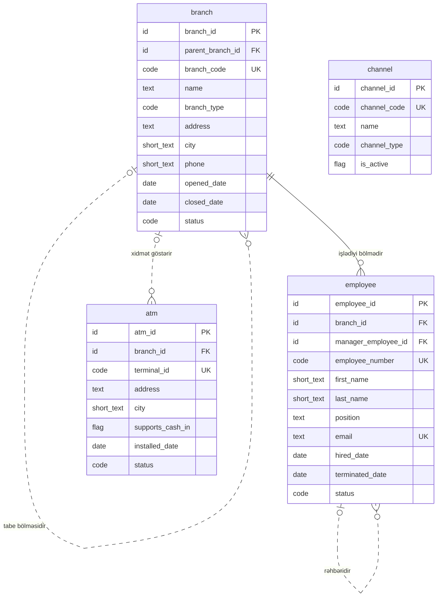

<!-- Bu fayl avtomatik yaradılıb (uv run bankmodel generate). Əl ilə redaktə etməyin. -->

# Təşkilat və kanallar (`org`) — məntiqi model

[← Məntiqi model](index.md) | [Konseptual model](../01_konseptual/02_org.md) · **Məntiqi model** · [Fiziki model](../03_fiziki/02_org.md)

Bankın daxili strukturu və xidmət kanalları: filial və şöbələr, əməkdaşlar, müştərilərin banka müraciət etdiyi kanallar və bankomatlar.

## Diaqram

## Obyektlər

### 1. `branch` — Filial

Bankın baş ofisi, filialları və şöbələri; şöbə filiala tabe ola bilər.

| # | Atribut | Məntiqi tip | Məcburi | Açar | Təsvir |
|---|---|---|---|---|---|
| 1 | `branch_id` | İdentifikator | Bəli | PK | Filial — surrogat identifikator (UUIDv7). |
| 2 | `parent_branch_id` | İdentifikator | Xeyr | FK | Filial istinadı (tabe bölməsidir). |
| 3 | `branch_code` | Kod | Bəli | AK1 | Bölmənin daxili kodu. |
| 4 | `name` | Mətn | Bəli |  | Bölmənin adı. |
| 5 | `branch_type` | Kod | Bəli |  | Bölmənin növü. Dəyərlər: `HEAD_OFFICE`, `BRANCH`, `DIVISION` |
| 6 | `address` | Mətn | Bəli |  | Ünvan. |
| 7 | `city` | Qısa mətn | Bəli |  | Şəhər / rayon. |
| 8 | `phone` | Qısa mətn | Xeyr |  | Əlaqə telefonu. |
| 9 | `opened_date` | Tarix | Bəli |  | Açılış tarixi. |
| 10 | `closed_date` | Tarix | Xeyr |  | Bağlanma tarixi. |
| 11 | `status` | Kod | Bəli |  | Status. Dəyərlər: `ACTIVE`, `CLOSED` |

**Əsas açar:** `branch_id`

**Alternativ açarlar:**

- AK1: `branch_code`

**Əlaqələr:**

| FK atributu | İstinad obyekti | Kardinallıq | Əlaqə |
|---|---|---|---|
| `parent_branch_id` | `org.branch` (Filial) | 0..1 : 0..N | tabe bölməsidir |

### 2. `employee` — Əməkdaş

Bank əməkdaşları: müştəri meneceri, kredit mütəxəssisi, operator, uyğunluq (compliance) əməkdaşı və s.

| # | Atribut | Məntiqi tip | Məcburi | Açar | Təsvir |
|---|---|---|---|---|---|
| 1 | `employee_id` | İdentifikator | Bəli | PK | Əməkdaş — surrogat identifikator (UUIDv7). |
| 2 | `branch_id` | İdentifikator | Bəli | FK | Filial istinadı (işlədiyi bölmədir). |
| 3 | `manager_employee_id` | İdentifikator | Xeyr | FK | Əməkdaş istinadı (rəhbəridir). |
| 4 | `employee_number` | Kod | Bəli | AK1 | Tabel nömrəsi. |
| 5 | `first_name` | Qısa mətn | Bəli |  | Ad. |
| 6 | `last_name` | Qısa mətn | Bəli |  | Soyad. |
| 7 | `position` | Mətn | Bəli |  | Vəzifə. |
| 8 | `email` | Mətn | Xeyr | AK2 | Korporativ e-poçt. |
| 9 | `hired_date` | Tarix | Bəli |  | İşə qəbul tarixi. |
| 10 | `terminated_date` | Tarix | Xeyr |  | İşdən çıxma tarixi. |
| 11 | `status` | Kod | Bəli |  | Status. Dəyərlər: `ACTIVE`, `ON_LEAVE`, `TERMINATED` |

**Əsas açar:** `employee_id`

**Alternativ açarlar:**

- AK1: `employee_number`
- AK2: `email`

**Əlaqələr:**

| FK atributu | İstinad obyekti | Kardinallıq | Əlaqə |
|---|---|---|---|
| `branch_id` | `org.branch` (Filial) | 1 : 0..N | işlədiyi bölmədir |
| `manager_employee_id` | `org.employee` (Əməkdaş) | 0..1 : 0..N | rəhbəridir |

### 3. `channel` — Xidmət kanalı

Müştəriyə xidmət kanalları: filial, bankomat, internet bankçılıq, mobil bankçılıq, POS, çağrı mərkəzi, API.

| # | Atribut | Məntiqi tip | Məcburi | Açar | Təsvir |
|---|---|---|---|---|---|
| 1 | `channel_id` | İdentifikator | Bəli | PK | Xidmət kanalı — surrogat identifikator (UUIDv7). |
| 2 | `channel_code` | Kod | Bəli | AK1 | Kanalın kodu. |
| 3 | `name` | Mətn | Bəli |  | Kanalın adı. |
| 4 | `channel_type` | Kod | Bəli |  | Kanalın növü. Dəyərlər: `BRANCH`, `ATM`, `INTERNET_BANKING`, `MOBILE_BANKING`, `POS`, `CALL_CENTER`, `API` |
| 5 | `is_active` | Bayraq (bəli/xeyr) | Bəli |  | Kanal aktivdir. Susmaya görə: `true` |

**Əsas açar:** `channel_id`

**Alternativ açarlar:**

- AK1: `channel_code`

### 4. `atm` — Bankomat

Bankın bankomatları və özünəxidmət terminalları: yerləşmə ünvanı, imkanlar, status.

| # | Atribut | Məntiqi tip | Məcburi | Açar | Təsvir |
|---|---|---|---|---|---|
| 1 | `atm_id` | İdentifikator | Bəli | PK | Bankomat — surrogat identifikator (UUIDv7). |
| 2 | `branch_id` | İdentifikator | Xeyr | FK | Filial istinadı (xidmət göstərir). |
| 3 | `terminal_id` | Kod | Bəli | AK1 | Terminal identifikatoru (prosessinqdə istifadə olunan). |
| 4 | `address` | Mətn | Bəli |  | Yerləşmə ünvanı. |
| 5 | `city` | Qısa mətn | Bəli |  | Şəhər / rayon. |
| 6 | `supports_cash_in` | Bayraq (bəli/xeyr) | Bəli |  | Nağd mədaxil qəbul edir. Susmaya görə: `false` |
| 7 | `installed_date` | Tarix | Bəli |  | Quraşdırılma tarixi. |
| 8 | `status` | Kod | Bəli |  | Status. Dəyərlər: `ACTIVE`, `OUT_OF_SERVICE`, `DECOMMISSIONED` |

**Əsas açar:** `atm_id`

**Alternativ açarlar:**

- AK1: `terminal_id`

**Əlaqələr:**

| FK atributu | İstinad obyekti | Kardinallıq | Əlaqə |
|---|---|---|---|
| `branch_id` | `org.branch` (Filial) | 0..1 : 0..N | xidmət göstərir |
