<!-- Bu fayl avtomatik yaradılıb (uv run bankmodel generate). Əl ilə redaktə etməyin. -->

# Tərəf və müştəri (KYC) (`party`) — məntiqi model

[← Məntiqi model](index.md) | [Konseptual model](../01_konseptual/03_party.md) · **Məntiqi model** · [Fiziki model](../03_fiziki/03_party.md)

Bankla münasibətdə olan bütün fiziki və hüquqi şəxslər (tərəflər), onların sənədləri, ünvanları, əlaqə vasitələri, bir-biri ilə əlaqələri, müştəri rolu və KYC yoxlamaları. Tərəf supertipdir: fiziki şəxs, hüquqi şəxs və ya fərdi sahibkar ola bilər.

## Diaqram

```mermaid
erDiagram
    party {
        id party_id PK
        id residence_country_id FK
        code party_type
        text display_name
        flag is_resident
        code status
    }
    individual_profile {
        id individual_profile_id PK
        id party_id FK, UK
        id citizenship_country_id FK
        short_text last_name
        short_text first_name
        short_text patronymic
        date birth_date
        text birth_place
        code gender
        fin fin UK
        flag is_pep
        code marital_status
        code employment_status
        amount monthly_income_azn
    }
    organization_profile {
        id organization_profile_id PK
        id party_id FK, UK
        id economic_activity_code_id FK
        id registration_country_id FK
        text legal_name
        text short_name
        voen voen UK
        code legal_form
        short_text registration_number
        date registration_date
        text registration_authority
        amount authorized_capital
        count employee_count
        amount annual_turnover_azn
        text website
    }
    party_identifier {
        id party_identifier_id PK
        id party_id FK
        id document_type_id FK, UK
        id issuing_country_id FK, UK
        code document_series UK
        short_text document_number UK
        date issue_date
        date expiry_date
        text issuing_authority
        flag is_primary
        flag is_verified
    }
    party_address {
        id party_address_id PK
        id party_id FK
        id country_id FK
        code address_type
        text address_line
        short_text city
        short_text district
        code postal_code
        date effective_from
        date effective_to
        flag is_primary
    }
    party_contact {
        id party_contact_id PK
        id party_id FK
        code contact_type
        text contact_value
        flag is_primary
        flag is_verified
        timestamp verified_at
    }
    party_relationship {
        id party_relationship_id PK
        id from_party_id FK
        id to_party_id FK
        code relationship_type
        percent ownership_percent
        date effective_from
        date effective_to
    }
    segment {
        id segment_id PK
        code segment_code UK
        text name
        code customer_group
    }
    customer {
        id customer_id PK
        id party_id FK, UK
        id segment_id FK
        id home_branch_id FK
        id relationship_manager_id FK
        code cif_number UK
        date customer_since
        date closed_date
        code preferred_language
        code status
    }
    kyc_review {
        id kyc_review_id PK
        id customer_id FK
        id reviewed_by_employee_id FK
        code review_type
        code due_diligence_level
        code risk_level
        code outcome
        date review_date
        date next_review_date
        text source_of_funds
        long_text comment
    }
    consent {
        id consent_id PK
        id party_id FK
        code consent_type
        timestamp granted_at
        timestamp revoked_at
        text document_reference
    }
    party_status_history {
        id party_status_history_id PK
        id party_id FK
        code from_status
        code to_status
        timestamp changed_at
        code reason_code
        long_text comment
    }
    branch
    employee
    party ||--o| individual_profile : "fiziki şəxs məlumatlarıdır"
    party ||--o| organization_profile : "qeydiyyat məlumatlarıdır"
    party ||--o{ party_identifier : "sənədidir"
    party ||--o{ party_address : "ünvanıdır"
    party ||--o{ party_contact : "əlaqə vasitəsidir"
    party ||--o{ party_relationship : "əlaqənin subyektidir"
    party ||--o{ party_relationship : "əlaqənin obyektidir"
    party ||--o| customer : "müştəri roludur"
    segment ||--o{ customer : "aid olduğu seqmentdir"
    branch ||--o{ customer : "xidmət filialıdır"
    employee |o..o{ customer : "müştəri meneceridir"
    customer ||--o{ kyc_review : "yoxlamasıdır"
    employee |o..o{ kyc_review : "yoxlamanı aparıb"
    party ||--o{ consent : "razılığıdır"
    party ||--o{ party_status_history : "status tarixçəsidir"
```

## Obyektlər

### 1. `party` — Tərəf

Bankla münasibətdə olan istənilən şəxs (supertip). Növü: fiziki şəxs, hüquqi şəxs, fərdi sahibkar. Eyni tərəf müştəri, zamin, girov mülkiyyətçisi, benefisiar mülkiyyətçi və ya səlahiyyətli şəxs ola bilər.

| # | Atribut | Məntiqi tip | Məcburi | Açar | Təsvir |
|---|---|---|---|---|---|
| 1 | `party_id` | İdentifikator | Bəli | PK | Tərəf — surrogat identifikator (UUIDv7). |
| 2 | `residence_country_id` | İdentifikator | Bəli | FK | Ölkə istinadı (rezidentlik ölkəsidir). |
| 3 | `party_type` | Kod | Bəli |  | Tərəfin növü (subtip diskriminatoru): fiziki şəxs, hüquqi şəxs, fərdi sahibkar. Dəyərlər: `INDIVIDUAL`, `LEGAL_ENTITY`, `INDIVIDUAL_ENTREPRENEUR` |
| 4 | `display_name` | Mətn | Bəli |  | Göstərilən ad (fiziki şəxs üçün tam ad, təşkilat üçün qısa ad). |
| 5 | `is_resident` | Bayraq (bəli/xeyr) | Bəli |  | Azərbaycan Respublikasının rezidentidir. |
| 6 | `status` | Kod | Bəli |  | Tərəfin həyat dövrü statusu. Dəyərlər: `PROSPECT`, `ACTIVE`, `INACTIVE`, `BLOCKED`, `DECEASED`, `LIQUIDATED` |

**Əsas açar:** `party_id`

**Əlaqələr:**

| FK atributu | İstinad obyekti | Kardinallıq | Əlaqə |
|---|---|---|---|
| `residence_country_id` | `ref.country` (Ölkə) | 1 : 0..N | rezidentlik ölkəsidir |

### 2. `individual_profile` — Fiziki şəxs profili

Fiziki şəxsə və fərdi sahibkara aid şəxsi məlumatlar: soyad, ad, ata adı, doğum tarixi, FİN, vətəndaşlıq, PEP statusu.

| # | Atribut | Məntiqi tip | Məcburi | Açar | Təsvir |
|---|---|---|---|---|---|
| 1 | `individual_profile_id` | İdentifikator | Bəli | PK | Fiziki şəxs profili — surrogat identifikator (UUIDv7). |
| 2 | `party_id` | İdentifikator | Bəli | FK, AK1 | Tərəf istinadı (fiziki şəxs məlumatlarıdır). |
| 3 | `citizenship_country_id` | İdentifikator | Bəli | FK | Ölkə istinadı (vətəndaşlığıdır). |
| 4 | `last_name` | Qısa mətn | Bəli |  | Soyad. |
| 5 | `first_name` | Qısa mətn | Bəli |  | Ad. |
| 6 | `patronymic` | Qısa mətn | Xeyr |  | Ata adı. |
| 7 | `birth_date` | Tarix | Bəli |  | Doğum tarixi. |
| 8 | `birth_place` | Mətn | Xeyr |  | Doğum yeri. |
| 9 | `gender` | Kod | Bəli |  | Cins. Dəyərlər: `MALE`, `FEMALE` |
| 10 | `fin` | FİN | Xeyr | AK2 | FİN — şəxsiyyət vəsiqəsindəki 7 simvollu kod (Azərbaycan vətəndaşları və yaşayış icazəsi olanlar üçün). |
| 11 | `is_pep` | Bayraq (bəli/xeyr) | Bəli |  | Siyasi xadimdir (PEP). Susmaya görə: `false` |
| 12 | `marital_status` | Kod | Xeyr |  | Ailə vəziyyəti. Dəyərlər: `SINGLE`, `MARRIED`, `DIVORCED`, `WIDOWED` |
| 13 | `employment_status` | Kod | Xeyr |  | Məşğulluq vəziyyəti. Dəyərlər: `EMPLOYED`, `SELF_EMPLOYED`, `UNEMPLOYED`, `RETIRED`, `STUDENT` |
| 14 | `monthly_income_azn` | Məbləğ | Xeyr |  | Bəyan edilmiş aylıq gəlir (AZN). |

**Əsas açar:** `individual_profile_id`

**Alternativ açarlar:**

- AK1: `party_id`
- AK2: `fin`

**Əlaqələr:**

| FK atributu | İstinad obyekti | Kardinallıq | Əlaqə |
|---|---|---|---|
| `party_id` | `party.party` (Tərəf) | 1 : 0..1 | fiziki şəxs məlumatlarıdır |
| `citizenship_country_id` | `ref.country` (Ölkə) | 1 : 0..N | vətəndaşlığıdır |

**Biznes qaydaları:**

- FİN 7 simvoldan (rəqəm və böyük latın hərfləri) ibarət olmalıdır.

### 3. `organization_profile` — Təşkilat profili

Hüquqi şəxsə və fərdi sahibkara aid qeydiyyat məlumatları: VÖEN, dövlət qeydiyyatı, təşkilati-hüquqi forma, fəaliyyət növü. Fərdi sahibkarın həm fiziki şəxs, həm də təşkilat profili olur.

| # | Atribut | Məntiqi tip | Məcburi | Açar | Təsvir |
|---|---|---|---|---|---|
| 1 | `organization_profile_id` | İdentifikator | Bəli | PK | Təşkilat profili — surrogat identifikator (UUIDv7). |
| 2 | `party_id` | İdentifikator | Bəli | FK, AK1 | Tərəf istinadı (qeydiyyat məlumatlarıdır). |
| 3 | `economic_activity_code_id` | İdentifikator | Bəli | FK | İqtisadi fəaliyyət növü istinadı (əsas fəaliyyət növüdür). |
| 4 | `registration_country_id` | İdentifikator | Bəli | FK | Ölkə istinadı (qeydiyyat ölkəsidir). |
| 5 | `legal_name` | Mətn | Bəli |  | Tam rəsmi adı. |
| 6 | `short_name` | Mətn | Xeyr |  | Qısa adı. |
| 7 | `voen` | VÖEN | Xeyr | AK2 | VÖEN — 10 rəqəmli vergi ödəyicisi kodu (qeyri-rezident təşkilatlarda olmaya bilər). |
| 8 | `legal_form` | Kod | Bəli |  | Təşkilati-hüquqi forma: MMC, ASC, QSC, tam/kommandit ortaqlıq, kooperativ, publik hüquqi şəxs, qeyri-kommersiya təşkilatı, xarici şirkətin filialı, fərdi sahibkar. Dəyərlər: `LLC`, `OJSC`, `CJSC`, `GENERAL_PARTNERSHIP`, `LIMITED_PARTNERSHIP`, `COOPERATIVE`, `PUBLIC_LEGAL_ENTITY`, `NON_PROFIT`, `FOREIGN_BRANCH`, `INDIVIDUAL_ENTREPRENEUR` |
| 9 | `registration_number` | Qısa mətn | Xeyr |  | Dövlət qeydiyyat nömrəsi. |
| 10 | `registration_date` | Tarix | Bəli |  | Dövlət qeydiyyatı tarixi. |
| 11 | `registration_authority` | Mətn | Xeyr |  | Qeydiyyatı aparan orqan. |
| 12 | `authorized_capital` | Məbləğ | Xeyr |  | Nizamnamə kapitalı (AZN). |
| 13 | `employee_count` | Say | Xeyr |  | İşçi sayı. |
| 14 | `annual_turnover_azn` | Məbləğ | Xeyr |  | İllik dövriyyə (AZN). |
| 15 | `website` | Mətn | Xeyr |  | Veb sayt. |

**Əsas açar:** `organization_profile_id`

**Alternativ açarlar:**

- AK1: `party_id`
- AK2: `voen`

**Əlaqələr:**

| FK atributu | İstinad obyekti | Kardinallıq | Əlaqə |
|---|---|---|---|
| `party_id` | `party.party` (Tərəf) | 1 : 0..1 | qeydiyyat məlumatlarıdır |
| `economic_activity_code_id` | `ref.economic_activity_code` (İqtisadi fəaliyyət növü) | 1 : 0..N | əsas fəaliyyət növüdür |
| `registration_country_id` | `ref.country` (Ölkə) | 1 : 0..N | qeydiyyat ölkəsidir |

**Biznes qaydaları:**

- VÖEN 10 rəqəmdən ibarət olmalıdır.

### 4. `party_identifier` — Tərəfin sənədi / identifikatoru

Tərəfin şəxsiyyət və qeydiyyat sənədləri: şəxsiyyət vəsiqəsi, pasport, yaşayış icazəsi, şəhadətnamə; verilmə və etibarlılıq tarixləri ilə.

| # | Atribut | Məntiqi tip | Məcburi | Açar | Təsvir |
|---|---|---|---|---|---|
| 1 | `party_identifier_id` | İdentifikator | Bəli | PK | Tərəfin sənədi / identifikatoru — surrogat identifikator (UUIDv7). |
| 2 | `party_id` | İdentifikator | Bəli | FK | Tərəf istinadı (sənədidir). |
| 3 | `document_type_id` | İdentifikator | Bəli | FK, AK1 | Sənəd növü istinadı (növüdür). |
| 4 | `issuing_country_id` | İdentifikator | Bəli | FK, AK1 | Ölkə istinadı (verən ölkədir). |
| 5 | `document_series` | Kod | Xeyr | AK1 | Sənədin seriyası (AA, AZE və s.). |
| 6 | `document_number` | Qısa mətn | Bəli | AK1 | Sənədin nömrəsi. |
| 7 | `issue_date` | Tarix | Xeyr |  | Verilmə tarixi. |
| 8 | `expiry_date` | Tarix | Xeyr |  | Etibarlılıq müddətinin sonu. |
| 9 | `issuing_authority` | Mətn | Xeyr |  | Sənədi verən orqan. |
| 10 | `is_primary` | Bayraq (bəli/xeyr) | Bəli |  | Əsas şəxsiyyət sənədidir. Susmaya görə: `false` |
| 11 | `is_verified` | Bayraq (bəli/xeyr) | Bəli |  | Sənəd yoxlanılıb (orijinal / dövlət reyestri). Susmaya görə: `false` |

**Əsas açar:** `party_identifier_id`

**Alternativ açarlar:**

- AK1: `document_type_id`, `issuing_country_id`, `document_series`, `document_number` (boş dəyərlər də təkrarlana bilməz)

**Əlaqələr:**

| FK atributu | İstinad obyekti | Kardinallıq | Əlaqə |
|---|---|---|---|
| `party_id` | `party.party` (Tərəf) | 1 : 0..N | sənədidir |
| `document_type_id` | `ref.document_type` (Sənəd növü) | 1 : 0..N | növüdür |
| `issuing_country_id` | `ref.country` (Ölkə) | 1 : 0..N | verən ölkədir |

**Biznes qaydaları:**

- Etibarlılıq tarixi verilmə tarixindən sonra olmalıdır.

### 5. `party_address` — Tərəfin ünvanı

Qeydiyyat, faktiki və hüquqi ünvanlar; qüvvədə olma tarixləri ilə.

| # | Atribut | Məntiqi tip | Məcburi | Açar | Təsvir |
|---|---|---|---|---|---|
| 1 | `party_address_id` | İdentifikator | Bəli | PK | Tərəfin ünvanı — surrogat identifikator (UUIDv7). |
| 2 | `party_id` | İdentifikator | Bəli | FK | Tərəf istinadı (ünvanıdır). |
| 3 | `country_id` | İdentifikator | Bəli | FK | Ölkə istinadı (ölkəsidir). |
| 4 | `address_type` | Kod | Bəli |  | Ünvanın növü. Dəyərlər: `REGISTRATION`, `ACTUAL`, `LEGAL`, `POSTAL` |
| 5 | `address_line` | Mətn | Bəli |  | Küçə, ev, mənzil. |
| 6 | `city` | Qısa mətn | Bəli |  | Şəhər / rayon. |
| 7 | `district` | Qısa mətn | Xeyr |  | Rayon / qəsəbə. |
| 8 | `postal_code` | Kod | Xeyr |  | Poçt indeksi (AZ1000). |
| 9 | `effective_from` | Tarix | Bəli |  | Ünvanın qüvvədə olma başlanğıcı. |
| 10 | `effective_to` | Tarix | Xeyr |  | Ünvanın qüvvədə olma sonu. |
| 11 | `is_primary` | Bayraq (bəli/xeyr) | Bəli |  | Əsas əlaqə ünvanıdır. Susmaya görə: `false` |

**Əsas açar:** `party_address_id`

**Əlaqələr:**

| FK atributu | İstinad obyekti | Kardinallıq | Əlaqə |
|---|---|---|---|
| `party_id` | `party.party` (Tərəf) | 1 : 0..N | ünvanıdır |
| `country_id` | `ref.country` (Ölkə) | 1 : 0..N | ölkəsidir |

**Biznes qaydaları:**

- Bitmə tarixi başlanğıcdan əvvəl ola bilməz.

### 6. `party_contact` — Əlaqə vasitəsi

Telefon, e-poçt və digər əlaqə vasitələri; təsdiqlənmə statusu və üstünlük verilən vasitə əlaməti ilə.

| # | Atribut | Məntiqi tip | Məcburi | Açar | Təsvir |
|---|---|---|---|---|---|
| 1 | `party_contact_id` | İdentifikator | Bəli | PK | Əlaqə vasitəsi — surrogat identifikator (UUIDv7). |
| 2 | `party_id` | İdentifikator | Bəli | FK | Tərəf istinadı (əlaqə vasitəsidir). |
| 3 | `contact_type` | Kod | Bəli |  | Əlaqə vasitəsinin növü. Dəyərlər: `MOBILE_PHONE`, `HOME_PHONE`, `WORK_PHONE`, `EMAIL`, `FAX` |
| 4 | `contact_value` | Mətn | Bəli |  | Telefon nömrəsi (E.164, +994...) və ya e-poçt ünvanı. |
| 5 | `is_primary` | Bayraq (bəli/xeyr) | Bəli |  | Üstünlük verilən vasitədir. Susmaya görə: `false` |
| 6 | `is_verified` | Bayraq (bəli/xeyr) | Bəli |  | OTP və ya digər üsulla təsdiqlənib. Susmaya görə: `false` |
| 7 | `verified_at` | Tarix-vaxt | Xeyr |  | Təsdiqlənmə anı. |

**Əsas açar:** `party_contact_id`

**Əlaqələr:**

| FK atributu | İstinad obyekti | Kardinallıq | Əlaqə |
|---|---|---|---|
| `party_id` | `party.party` (Tərəf) | 1 : 0..N | əlaqə vasitəsidir |

### 7. `party_relationship` — Tərəflər arası əlaqə

İki tərəf arasında əlaqə: benefisiar mülkiyyətçi (UBO), direktor, təsisçi, səlahiyyətli imza sahibi, ailə üzvü; pay faizi və qüvvədə olma tarixləri ilə.

| # | Atribut | Məntiqi tip | Məcburi | Açar | Təsvir |
|---|---|---|---|---|---|
| 1 | `party_relationship_id` | İdentifikator | Bəli | PK | Tərəflər arası əlaqə — surrogat identifikator (UUIDv7). |
| 2 | `from_party_id` | İdentifikator | Bəli | FK | Tərəf istinadı (əlaqənin subyektidir). |
| 3 | `to_party_id` | İdentifikator | Bəli | FK | Tərəf istinadı (əlaqənin obyektidir). |
| 4 | `relationship_type` | Kod | Bəli |  | Əlaqənin növü (from_party → to_party: məs. fiziki şəxs təşkilatın UBO-sudur). Dəyərlər: `UBO`, `DIRECTOR`, `FOUNDER`, `AUTHORIZED_SIGNATORY`, `CHIEF_ACCOUNTANT`, `LEGAL_REPRESENTATIVE`, `SPOUSE`, `PARENT`, `CHILD` |
| 5 | `ownership_percent` | Faiz payı | Xeyr |  | Mülkiyyət payı (UBO və təsisçi üçün). |
| 6 | `effective_from` | Tarix | Bəli |  | Əlaqənin başlanğıcı. |
| 7 | `effective_to` | Tarix | Xeyr |  | Əlaqənin sonu. |

**Əsas açar:** `party_relationship_id`

**Əlaqələr:**

| FK atributu | İstinad obyekti | Kardinallıq | Əlaqə |
|---|---|---|---|
| `from_party_id` | `party.party` (Tərəf) | 1 : 0..N | əlaqənin subyektidir |
| `to_party_id` | `party.party` (Tərəf) | 1 : 0..N | əlaqənin obyektidir |

**Biznes qaydaları:**

- Tərəf özü ilə əlaqədə ola bilməz.
- Pay 0–100% arasında olmalıdır.
- Bitmə tarixi başlanğıcdan əvvəl ola bilməz.

### 8. `segment` — Müştəri seqmenti

Müştəri seqmentləri: kütləvi pərakəndə, premium, mikro və kiçik biznes, orta biznes, korporativ.

| # | Atribut | Məntiqi tip | Məcburi | Açar | Təsvir |
|---|---|---|---|---|---|
| 1 | `segment_id` | İdentifikator | Bəli | PK | Müştəri seqmenti — surrogat identifikator (UUIDv7). |
| 2 | `segment_code` | Kod | Bəli | AK1 | Seqment kodu. |
| 3 | `name` | Mətn | Bəli |  | Seqmentin adı. |
| 4 | `customer_group` | Kod | Bəli |  | Müştəri qrupu. Dəyərlər: `RETAIL`, `BUSINESS` |

**Əsas açar:** `segment_id`

**Alternativ açarlar:**

- AK1: `segment_code`

### 9. `customer` — Müştəri

Tərəfin bankın müştərisi rolu: CIF nömrəsi, seqment, xidmət filialı, müştəri meneceri, münasibətin başlama və bitmə tarixi.

| # | Atribut | Məntiqi tip | Məcburi | Açar | Təsvir |
|---|---|---|---|---|---|
| 1 | `customer_id` | İdentifikator | Bəli | PK | Müştəri — surrogat identifikator (UUIDv7). |
| 2 | `party_id` | İdentifikator | Bəli | FK, AK1 | Tərəf istinadı (müştəri roludur). |
| 3 | `segment_id` | İdentifikator | Bəli | FK | Müştəri seqmenti istinadı (aid olduğu seqmentdir). |
| 4 | `home_branch_id` | İdentifikator | Bəli | FK | Filial istinadı (xidmət filialıdır). |
| 5 | `relationship_manager_id` | İdentifikator | Xeyr | FK | Əməkdaş istinadı (müştəri meneceridir). |
| 6 | `cif_number` | Kod | Bəli | AK2 | CIF — bankın müştəriyə verdiyi unikal nömrə. |
| 7 | `customer_since` | Tarix | Bəli |  | Müştəri münasibətinin başlama tarixi. |
| 8 | `closed_date` | Tarix | Xeyr |  | Münasibətin bitmə tarixi. |
| 9 | `preferred_language` | Kod | Bəli |  | Ünsiyyət dili. Dəyərlər: `AZ`, `EN`, `RU` Susmaya görə: `'AZ'` |
| 10 | `status` | Kod | Bəli |  | Müştəri statusu. Dəyərlər: `ACTIVE`, `DORMANT`, `BLOCKED`, `CLOSED` |

**Əsas açar:** `customer_id`

**Alternativ açarlar:**

- AK1: `party_id`
- AK2: `cif_number`

**Əlaqələr:**

| FK atributu | İstinad obyekti | Kardinallıq | Əlaqə |
|---|---|---|---|
| `party_id` | `party.party` (Tərəf) | 1 : 0..1 | müştəri roludur |
| `segment_id` | `party.segment` (Müştəri seqmenti) | 1 : 0..N | aid olduğu seqmentdir |
| `home_branch_id` | `org.branch` (Filial) | 1 : 0..N | xidmət filialıdır |
| `relationship_manager_id` | `org.employee` (Əməkdaş) | 0..1 : 0..N | müştəri meneceridir |

### 10. `kyc_review` — KYC yoxlaması

Müştərinin eyniləşdirilməsi və risk qiymətləndirilməsi (KYC/CDD/EDD): risk səviyyəsi, nəticə, növbəti yoxlama tarixi. Müştərinin cari risk səviyyəsi son təsdiqlənmiş yoxlamadır.

| # | Atribut | Məntiqi tip | Məcburi | Açar | Təsvir |
|---|---|---|---|---|---|
| 1 | `kyc_review_id` | İdentifikator | Bəli | PK | KYC yoxlaması — surrogat identifikator (UUIDv7). |
| 2 | `customer_id` | İdentifikator | Bəli | FK | Müştəri istinadı (yoxlamasıdır). |
| 3 | `reviewed_by_employee_id` | İdentifikator | Xeyr | FK | Əməkdaş istinadı (yoxlamanı aparıb). |
| 4 | `review_type` | Kod | Bəli |  | Yoxlamanın səbəbi. Dəyərlər: `ONBOARDING`, `PERIODIC`, `EVENT_DRIVEN` |
| 5 | `due_diligence_level` | Kod | Bəli |  | Yoxlama səviyyəsi: sadələşdirilmiş, standart, gücləndirilmiş. Dəyərlər: `SIMPLIFIED`, `STANDARD`, `ENHANCED` |
| 6 | `risk_level` | Kod | Bəli |  | Müəyyən edilmiş AML risk səviyyəsi. Dəyərlər: `LOW`, `MEDIUM`, `HIGH`, `UNACCEPTABLE` |
| 7 | `outcome` | Kod | Bəli |  | Nəticə. Dəyərlər: `APPROVED`, `REJECTED`, `PENDING_INFO` |
| 8 | `review_date` | Tarix | Bəli |  | Yoxlama tarixi. |
| 9 | `next_review_date` | Tarix | Xeyr |  | Növbəti yoxlama tarixi. |
| 10 | `source_of_funds` | Mətn | Xeyr |  | Vəsaitlərin mənbəyi. |
| 11 | `comment` | Uzun mətn | Xeyr |  | Qeydlər. |

**Əsas açar:** `kyc_review_id`

**Əlaqələr:**

| FK atributu | İstinad obyekti | Kardinallıq | Əlaqə |
|---|---|---|---|
| `customer_id` | `party.customer` (Müştəri) | 1 : 0..N | yoxlamasıdır |
| `reviewed_by_employee_id` | `org.employee` (Əməkdaş) | 0..1 : 0..N | yoxlamanı aparıb |

### 11. `consent` — Razılıq

Tərəfin razılıqları: fərdi məlumatların emalı, Kredit Bürosuna sorğu, marketinq bildirişləri; verilmə və geri götürülmə tarixləri ilə.

| # | Atribut | Məntiqi tip | Məcburi | Açar | Təsvir |
|---|---|---|---|---|---|
| 1 | `consent_id` | İdentifikator | Bəli | PK | Razılıq — surrogat identifikator (UUIDv7). |
| 2 | `party_id` | İdentifikator | Bəli | FK | Tərəf istinadı (razılığıdır). |
| 3 | `consent_type` | Kod | Bəli |  | Razılığın növü. Dəyərlər: `PERSONAL_DATA_PROCESSING`, `CREDIT_BUREAU_INQUIRY`, `MARKETING`, `ELECTRONIC_COMMUNICATION` |
| 4 | `granted_at` | Tarix-vaxt | Bəli |  | Razılığın verildiyi an. |
| 5 | `revoked_at` | Tarix-vaxt | Xeyr |  | Razılığın geri götürüldüyü an. |
| 6 | `document_reference` | Mətn | Xeyr |  | Razılıq sənədinin / elektron imzanın istinadı. |

**Əsas açar:** `consent_id`

**Əlaqələr:**

| FK atributu | İstinad obyekti | Kardinallıq | Əlaqə |
|---|---|---|---|
| `party_id` | `party.party` (Tərəf) | 1 : 0..N | razılığıdır |

**Biznes qaydaları:**

- Geri götürülmə verilmədən əvvəl ola bilməz.

### 12. `party_status_history` — Tərəf statusu tarixçəsi

Tərəfin həyat dövrü statusunun dəyişiklikləri (yalnız əlavə olunur, dəyişdirilmir).

| # | Atribut | Məntiqi tip | Məcburi | Açar | Təsvir |
|---|---|---|---|---|---|
| 1 | `party_status_history_id` | İdentifikator | Bəli | PK | Tərəf statusu tarixçəsi — surrogat identifikator (UUIDv7). |
| 2 | `party_id` | İdentifikator | Bəli | FK | Tərəf istinadı (status tarixçəsidir). |
| 3 | `from_status` | Kod | Xeyr |  | Əvvəlki status (ilk yazılışda boş). Dəyərlər: `PROSPECT`, `ACTIVE`, `INACTIVE`, `BLOCKED`, `DECEASED`, `LIQUIDATED` |
| 4 | `to_status` | Kod | Bəli |  | Yeni status. Dəyərlər: `PROSPECT`, `ACTIVE`, `INACTIVE`, `BLOCKED`, `DECEASED`, `LIQUIDATED` |
| 5 | `changed_at` | Tarix-vaxt | Bəli |  | Statusun dəyişdiyi an. Susmaya görə: `now()` |
| 6 | `reason_code` | Kod | Xeyr |  | Dəyişikliyin səbəb kodu. |
| 7 | `comment` | Uzun mətn | Xeyr |  | Əlavə izah. |

**Əsas açar:** `party_status_history_id`

**Əlaqələr:**

| FK atributu | İstinad obyekti | Kardinallıq | Əlaqə |
|---|---|---|---|
| `party_id` | `party.party` (Tərəf) | 1 : 0..N | status tarixçəsidir |

**Biznes qaydaları:**

- Yeni status əvvəlkindən fərqli olmalıdır.
