<!-- Bu fayl avtomatik yaradılıb (uv run bankmodel generate). Əl ilə redaktə etməyin. -->

# Hesablar və əməliyyatlar (`account`) — məntiqi model

[← Məntiqi model](index.md) | [Konseptual model](../01_konseptual/04_account.md) · **Məntiqi model** · [Fiziki model](../03_fiziki/04_account.md)

Müştəri hesabları (cari, əmanət, müddətli depozit, kart hesabı), hesab sahibləri, qalıqlar, hesab əməliyyatları, bloklamalar, komissiyalar, faiz hesablanması, limitlər, daimi tapşırıqlar və çıxarışlar. Hesablar çoxvalyutalıdır: hər hesab bir valyutada açılır, müştərinin müxtəlif valyutalarda hesabları ola bilər.

## Diaqram

```mermaid
erDiagram
    account {
        id account_id PK
        id customer_id FK
        id product_id FK
        id currency_id FK
        id branch_id FK
        code account_number UK
        iban iban UK
        code account_type
        text account_name
        date opened_date
        date closed_date
        flag is_joint
        code status
    }
    account_holder {
        id account_holder_id PK
        id account_id FK, UK
        id party_id FK, UK
        code holder_role UK
        code signing_rule
        short_text power_of_attorney_number
        date effective_from UK
        date effective_to
    }
    account_balance {
        id account_balance_id PK
        id account_id FK, UK
        amount ledger_balance
        amount blocked_amount
        amount available_balance
        timestamp last_transaction_at
    }
    account_balance_daily {
        id account_balance_daily_id PK
        id account_id FK, UK
        date balance_date UK
        amount ledger_balance
        amount available_balance
        amount debit_turnover
        amount credit_turnover
    }
    account_transaction {
        id account_transaction_id PK
        id account_id FK
        id transaction_type_id FK
        id channel_id FK
        id original_currency_id FK
        id payment_order_id FK
        id card_transaction_id FK
        id loan_disbursement_id FK
        id loan_repayment_id FK
        id reversed_account_transaction_id FK, UK
        date transaction_date
        date value_date
        timestamp posted_at
        code direction
        amount amount
        amount original_amount
        amount balance_after
        code reference_number
        text narrative
        code status
    }
    hold {
        id hold_id PK
        id account_id FK
        id card_authorization_id FK, UK
        code hold_type
        amount amount
        timestamp placed_at
        timestamp expires_at
        timestamp released_at
        text legal_document_reference
        text reason
        code status
    }
    account_fee_charge {
        id account_fee_charge_id PK
        id account_id FK
        id fee_type_id FK
        id account_transaction_id FK, UK
        date charge_date
        amount amount
        text waiver_reason
        code status
    }
    interest_accrual {
        id interest_accrual_id PK
        id account_id FK, UK
        date accrual_date UK
        amount balance_base
        rate annual_rate
        amount accrued_amount
        amount withholding_tax_amount
        flag is_capitalized
    }
    account_interest_rate {
        id account_interest_rate_id PK
        id account_id FK, UK
        id product_interest_rate_id FK
        rate annual_rate
        date effective_from UK
        date effective_to
    }
    term_deposit_term {
        id term_deposit_term_id PK
        id account_id FK, UK
        id payout_account_id FK
        count term_months
        date start_date
        date maturity_date
        code interest_payment_frequency
        flag auto_rollover
        flag allows_top_up
        flag allows_partial_withdrawal
        rate early_withdrawal_rate
    }
    overdraft_facility {
        id overdraft_facility_id PK
        id account_id FK
        amount limit_amount
        rate annual_rate
        date effective_from
        date effective_to
        code status
    }
    standing_order {
        id standing_order_id PK
        id debit_account_id FK
        id beneficiary_id FK
        amount amount
        code frequency
        count execution_day
        date start_date
        date end_date
        date next_execution_date
        text purpose
        code status
    }
    account_limit {
        id account_limit_id PK
        id account_id FK, UK
        id channel_id FK, UK
        code limit_type UK
        amount limit_amount
        date effective_from UK
        date effective_to
    }
    statement {
        id statement_id PK
        id account_id FK, UK
        date period_start UK
        date period_end UK
        amount opening_balance
        amount closing_balance
        amount total_debit
        amount total_credit
        timestamp generated_at
        code delivery_channel
    }
    account_status_history {
        id account_status_history_id PK
        id account_id FK
        code from_status
        code to_status
        timestamp changed_at
        code reason_code
        long_text comment
    }
    beneficiary
    branch
    card_authorization
    card_transaction
    channel
    customer
    loan_disbursement
    loan_repayment
    party
    payment_order
    customer ||--o{ account : "hesabıdır"
    branch ||--o{ account : "hesabın filialıdır"
    account ||--|{ account_holder : "sahibləridir"
    party ||--o{ account_holder : "hesab üzrə roludur"
    account ||--|| account_balance : "cari qalığıdır"
    account ||--o{ account_balance_daily : "gün sonu qalığıdır"
    account ||--o{ account_transaction : "əməliyyatıdır"
    channel |o..o{ account_transaction : "kanalıdır"
    payment_order |o..o{ account_transaction : "nəticəsidir"
    card_transaction |o..o{ account_transaction : "nəticəsidir"
    loan_disbursement |o..o{ account_transaction : "nəticəsidir"
    loan_repayment |o..o{ account_transaction : "nəticəsidir"
    account_transaction |o..o| account_transaction : "stornosudur"
    account ||--o{ hold : "bloklamasıdır"
    card_authorization |o..o| hold : "bloklamaya səbəb olub"
    account ||--o{ account_fee_charge : "komissiyasıdır"
    account_transaction |o..o| account_fee_charge : "tutulma yazılışıdır"
    account ||--o{ interest_accrual : "hesablanmış faizidir"
    account ||--o{ account_interest_rate : "faiz dərəcəsidir"
    account ||--o| term_deposit_term : "depozit şərtləridir"
    account |o..o{ term_deposit_term : "faiz ödəniş hesabıdır"
    account ||--o{ overdraft_facility : "overdraftıdır"
    account ||--o{ standing_order : "debet hesabıdır"
    beneficiary ||--o{ standing_order : "alanıdır"
    account ||--o{ account_limit : "limitidir"
    channel |o..o{ account_limit : "limitin kanalıdır"
    account ||--o{ statement : "çıxarışıdır"
    account ||--o{ account_status_history : "status tarixçəsidir"
```

## Obyektlər

### 1. `account` — Hesab

Müştəri hesabı: cari, əmanət, müddətli depozit və ya kart hesabı. AZ IBAN, valyuta, məhsul, xidmət filialı, status.

| # | Atribut | Məntiqi tip | Məcburi | Açar | Təsvir |
|---|---|---|---|---|---|
| 1 | `account_id` | İdentifikator | Bəli | PK | Hesab — surrogat identifikator (UUIDv7). |
| 2 | `customer_id` | İdentifikator | Bəli | FK | Müştəri istinadı (hesabıdır). |
| 3 | `product_id` | İdentifikator | Bəli | FK | Məhsul istinadı (məhsuludur). |
| 4 | `currency_id` | İdentifikator | Bəli | FK | Valyuta istinadı (valyutasıdır). |
| 5 | `branch_id` | İdentifikator | Bəli | FK | Filial istinadı (hesabın filialıdır). |
| 6 | `account_number` | Kod | Bəli | AK1 | Bankdaxili hesab nömrəsi (IBAN-ın 20 simvollu hissəsi). |
| 7 | `iban` | IBAN | Bəli | AK2 | AZ IBAN — 28 simvol: AZ + 2 yoxlama rəqəmi + 4 simvollu bank kodu + 20 simvollu hesab nömrəsi. |
| 8 | `account_type` | Kod | Bəli |  | Hesabın növü. Dəyərlər: `CURRENT`, `SAVINGS`, `TERM_DEPOSIT`, `CARD` |
| 9 | `account_name` | Mətn | Xeyr |  | Müştərinin hesaba verdiyi ad. |
| 10 | `opened_date` | Tarix | Bəli |  | Açılış tarixi. |
| 11 | `closed_date` | Tarix | Xeyr |  | Bağlanma tarixi. |
| 12 | `is_joint` | Bayraq (bəli/xeyr) | Bəli |  | Birgə hesabdır (bir neçə sahib). Susmaya görə: `false` |
| 13 | `status` | Kod | Bəli |  | Hesabın statusu. Dəyərlər: `PENDING`, `ACTIVE`, `DORMANT`, `FROZEN`, `CLOSED` |

**Əsas açar:** `account_id`

**Alternativ açarlar:**

- AK1: `account_number`
- AK2: `iban`

**Əlaqələr:**

| FK atributu | İstinad obyekti | Kardinallıq | Əlaqə |
|---|---|---|---|
| `customer_id` | `party.customer` (Müştəri) | 1 : 0..N | hesabıdır |
| `product_id` | `ref.product` (Məhsul) | 1 : 0..N | məhsuludur |
| `currency_id` | `ref.currency` (Valyuta) | 1 : 0..N | valyutasıdır |
| `branch_id` | `org.branch` (Filial) | 1 : 0..N | hesabın filialıdır |

**Biznes qaydaları:**

- IBAN Azərbaycan formatına (28 simvol) uyğun olmalıdır.
- Bağlanma tarixi yalnız bağlı hesabda və mütləq olmalıdır.

### 2. `account_holder` — Hesab sahibi / səlahiyyətli şəxs

Hesab ilə tərəf arasında rol: əsas sahib, birgə sahib, səlahiyyətli imza sahibi, etibarnamə üzrə nümayəndə; qüvvədə olma tarixləri ilə.

| # | Atribut | Məntiqi tip | Məcburi | Açar | Təsvir |
|---|---|---|---|---|---|
| 1 | `account_holder_id` | İdentifikator | Bəli | PK | Hesab sahibi / səlahiyyətli şəxs — surrogat identifikator (UUIDv7). |
| 2 | `account_id` | İdentifikator | Bəli | FK, AK1 | Hesab istinadı (sahibləridir). |
| 3 | `party_id` | İdentifikator | Bəli | FK, AK1 | Tərəf istinadı (hesab üzrə roludur). |
| 4 | `holder_role` | Kod | Bəli | AK1 | Tərəfin hesab üzrə rolu. Dəyərlər: `PRIMARY_OWNER`, `JOINT_OWNER`, `AUTHORIZED_SIGNATORY`, `POWER_OF_ATTORNEY`, `TRUSTEE` |
| 5 | `signing_rule` | Kod | Xeyr |  | İmza qaydası: tək, istənilən iki, hamısı birlikdə. Dəyərlər: `SOLE`, `ANY_TWO`, `ALL` |
| 6 | `power_of_attorney_number` | Qısa mətn | Xeyr |  | Etibarnamənin nömrəsi. |
| 7 | `effective_from` | Tarix | Bəli | AK1 | Rolun başlanğıcı. |
| 8 | `effective_to` | Tarix | Xeyr |  | Rolun sonu. |

**Əsas açar:** `account_holder_id`

**Alternativ açarlar:**

- AK1: `account_id`, `party_id`, `holder_role`, `effective_from`

**Əlaqələr:**

| FK atributu | İstinad obyekti | Kardinallıq | Əlaqə |
|---|---|---|---|
| `account_id` | `account.account` (Hesab) | 1 : 1..N | sahibləridir |
| `party_id` | `party.party` (Tərəf) | 1 : 0..N | hesab üzrə roludur |

**Biznes qaydaları:**

- Bitmə tarixi başlanğıcdan əvvəl ola bilməz.

### 3. `account_balance` — Hesab qalığı (cari)

Hesabın cari qalıqları: mühasibat qalığı, istifadəyə yararlı qalıq, bloklanmış məbləğ. Hər əməliyyatla eyni tranzaksiyada yenilənir (performans üçün idarə olunan denormallaşdırma; mənbə — hesab əməliyyatları və bloklamalar).

| # | Atribut | Məntiqi tip | Məcburi | Açar | Təsvir |
|---|---|---|---|---|---|
| 1 | `account_balance_id` | İdentifikator | Bəli | PK | Hesab qalığı (cari) — surrogat identifikator (UUIDv7). |
| 2 | `account_id` | İdentifikator | Bəli | FK, AK1 | Hesab istinadı (cari qalığıdır). |
| 3 | `ledger_balance` | Məbləğ | Bəli |  | Mühasibat qalığı. Susmaya görə: `0` |
| 4 | `blocked_amount` | Məbləğ | Bəli |  | Aktiv bloklamaların cəmi. Susmaya görə: `0` |
| 5 | `available_balance` | Məbləğ | Bəli |  | İstifadəyə yararlı qalıq (qalıq − bloklama + overdraft limiti). Susmaya görə: `0` |
| 6 | `last_transaction_at` | Tarix-vaxt | Xeyr |  | Son əməliyyatın anı. |

**Əsas açar:** `account_balance_id`

**Alternativ açarlar:**

- AK1: `account_id`

**Əlaqələr:**

| FK atributu | İstinad obyekti | Kardinallıq | Əlaqə |
|---|---|---|---|
| `account_id` | `account.account` (Hesab) | 1 : 1 | cari qalığıdır |

**Biznes qaydaları:**

- Bloklanmış məbləğ mənfi ola bilməz.

### 4. `account_balance_daily` — Gün sonu qalığı

Hər iş günü sonunda hesab qalığının snapşotu; faiz hesablanması, çıxarış və hesabatlar üçün.

| # | Atribut | Məntiqi tip | Məcburi | Açar | Təsvir |
|---|---|---|---|---|---|
| 1 | `account_balance_daily_id` | İdentifikator | Bəli | PK | Gün sonu qalığı — surrogat identifikator (UUIDv7). |
| 2 | `account_id` | İdentifikator | Bəli | FK, AK1 | Hesab istinadı (gün sonu qalığıdır). |
| 3 | `balance_date` | Tarix | Bəli | AK1 | Bank günü. |
| 4 | `ledger_balance` | Məbləğ | Bəli |  | Gün sonu mühasibat qalığı. |
| 5 | `available_balance` | Məbləğ | Bəli |  | Gün sonu istifadəyə yararlı qalıq. |
| 6 | `debit_turnover` | Məbləğ | Bəli |  | Gün ərzində debet dövriyyəsi. Susmaya görə: `0` |
| 7 | `credit_turnover` | Məbləğ | Bəli |  | Gün ərzində kredit dövriyyəsi. Susmaya görə: `0` |

**Əsas açar:** `account_balance_daily_id`

**Alternativ açarlar:**

- AK1: `account_id`, `balance_date`

**Əlaqələr:**

| FK atributu | İstinad obyekti | Kardinallıq | Əlaqə |
|---|---|---|---|
| `account_id` | `account.account` (Hesab) | 1 : 0..N | gün sonu qalığıdır |

### 5. `account_transaction` — Hesab əməliyyatı

Hesab üzrə mədaxil/məxaric yazılışı: məbləğ, əməliyyat və dəyər tarixi, mənbə (ödəniş, kart, kredit), storno əlaqəsi. Yüksək həcmli cədvəldir, aylar üzrə bölmələnir. Yazılış dəyişdirilmir — düzəliş storno ilə edilir.

| # | Atribut | Məntiqi tip | Məcburi | Açar | Təsvir |
|---|---|---|---|---|---|
| 1 | `account_transaction_id` | İdentifikator | Bəli | PK | Hesab əməliyyatı — surrogat identifikator (UUIDv7). |
| 2 | `account_id` | İdentifikator | Bəli | FK | Hesab istinadı (əməliyyatıdır). |
| 3 | `transaction_type_id` | İdentifikator | Bəli | FK | Əməliyyat növü istinadı (növüdür). |
| 4 | `channel_id` | İdentifikator | Xeyr | FK | Xidmət kanalı istinadı (kanalıdır). |
| 5 | `original_currency_id` | İdentifikator | Xeyr | FK | Valyuta istinadı (orijinal valyutadır). |
| 6 | `payment_order_id` | İdentifikator | Xeyr | FK | Ödəniş tapşırığı istinadı (nəticəsidir). |
| 7 | `card_transaction_id` | İdentifikator | Xeyr | FK | Kart əməliyyatı (klirinq) istinadı (nəticəsidir). |
| 8 | `loan_disbursement_id` | İdentifikator | Xeyr | FK | Kreditin verilməsi istinadı (nəticəsidir). |
| 9 | `loan_repayment_id` | İdentifikator | Xeyr | FK | Kredit ödənişi istinadı (nəticəsidir). |
| 10 | `reversed_account_transaction_id` | İdentifikator | Xeyr | FK, AK1 | Hesab əməliyyatı istinadı (stornosudur). |
| 11 | `transaction_date` | Tarix | Bəli |  | Əməliyyatın bank günü (bölmə açarı). |
| 12 | `value_date` | Tarix | Bəli |  | Dəyər tarixi. |
| 13 | `posted_at` | Tarix-vaxt | Bəli |  | Hesabda əks olunduğu an. Susmaya görə: `now()` |
| 14 | `direction` | Kod | Bəli |  | İstiqamət: məxaric (debet) və ya mədaxil (kredit). Dəyərlər: `DEBIT`, `CREDIT` |
| 15 | `amount` | Məbləğ | Bəli |  | Hesab valyutasında məbləğ (həmişə müsbət; işarə istiqamətlə verilir). |
| 16 | `original_amount` | Məbləğ | Xeyr |  | Orijinal valyutada məbləğ (konversiya olduqda). |
| 17 | `balance_after` | Məbləğ | Bəli |  | Əməliyyatdan sonrakı mühasibat qalığı. |
| 18 | `reference_number` | Kod | Bəli |  | Əməliyyatın istinad nömrəsi. |
| 19 | `narrative` | Mətn | Xeyr |  | Təyinat / təsvir. |
| 20 | `status` | Kod | Bəli |  | Status. Dəyərlər: `POSTED`, `REVERSED` Susmaya görə: `'POSTED'` |

**Əsas açar:** `account_transaction_id`

**Alternativ açarlar:**

- AK1: `reversed_account_transaction_id`

**Əlaqələr:**

| FK atributu | İstinad obyekti | Kardinallıq | Əlaqə |
|---|---|---|---|
| `account_id` | `account.account` (Hesab) | 1 : 0..N | əməliyyatıdır |
| `transaction_type_id` | `ref.transaction_type` (Əməliyyat növü) | 1 : 0..N | növüdür |
| `channel_id` | `org.channel` (Xidmət kanalı) | 0..1 : 0..N | kanalıdır |
| `original_currency_id` | `ref.currency` (Valyuta) | 0..1 : 0..N | orijinal valyutadır |
| `payment_order_id` | `payment.payment_order` (Ödəniş tapşırığı) | 0..1 : 0..N | nəticəsidir |
| `card_transaction_id` | `card.card_transaction` (Kart əməliyyatı (klirinq)) | 0..1 : 0..N | nəticəsidir |
| `loan_disbursement_id` | `loan.loan_disbursement` (Kreditin verilməsi) | 0..1 : 0..N | nəticəsidir |
| `loan_repayment_id` | `loan.loan_repayment` (Kredit ödənişi) | 0..1 : 0..N | nəticəsidir |
| `reversed_account_transaction_id` | `account.account_transaction` (Hesab əməliyyatı) | 0..1 : 0..1 | stornosudur |

**Biznes qaydaları:**

- Məbləğ müsbət olmalıdır.
- Əməliyyatın ən çoxu bir mənbəyi ola bilər (ödəniş, kart əməliyyatı, kreditin verilməsi və ya ödənişi).
- Orijinal valyuta və orijinal məbləğ birlikdə göstərilməlidir.

### 6. `hold` — Bloklama

Hesab vəsaitlərinin bloklanması: kart avtorizasiyası, məhkəmə qərarı, vergi orqanının sərəncamı, girov; bloklama və azad edilmə tarixləri ilə.

| # | Atribut | Məntiqi tip | Məcburi | Açar | Təsvir |
|---|---|---|---|---|---|
| 1 | `hold_id` | İdentifikator | Bəli | PK | Bloklama — surrogat identifikator (UUIDv7). |
| 2 | `account_id` | İdentifikator | Bəli | FK | Hesab istinadı (bloklamasıdır). |
| 3 | `card_authorization_id` | İdentifikator | Xeyr | FK, AK1 | Kart avtorizasiyası istinadı (bloklamaya səbəb olub). |
| 4 | `hold_type` | Kod | Bəli |  | Bloklamanın növü. Dəyərlər: `CARD_AUTHORIZATION`, `COURT_ORDER`, `TAX_AUTHORITY`, `COLLATERAL`, `BANK_INTERNAL` |
| 5 | `amount` | Məbləğ | Bəli |  | Bloklanmış məbləğ (hesab valyutasında). |
| 6 | `placed_at` | Tarix-vaxt | Bəli |  | Bloklama anı. Susmaya görə: `now()` |
| 7 | `expires_at` | Tarix-vaxt | Xeyr |  | Avtomatik azad olunma anı. |
| 8 | `released_at` | Tarix-vaxt | Xeyr |  | Faktiki azad olunma anı. |
| 9 | `legal_document_reference` | Mətn | Xeyr |  | Qərarın / sərəncamın nömrəsi və tarixi. |
| 10 | `reason` | Mətn | Xeyr |  | Səbəb. |
| 11 | `status` | Kod | Bəli |  | Status. Dəyərlər: `ACTIVE`, `RELEASED`, `EXPIRED`, `CAPTURED` |

**Əsas açar:** `hold_id`

**Alternativ açarlar:**

- AK1: `card_authorization_id`

**Əlaqələr:**

| FK atributu | İstinad obyekti | Kardinallıq | Əlaqə |
|---|---|---|---|
| `account_id` | `account.account` (Hesab) | 1 : 0..N | bloklamasıdır |
| `card_authorization_id` | `card.card_authorization` (Kart avtorizasiyası) | 0..1 : 0..1 | bloklamaya səbəb olub |

**Biznes qaydaları:**

- Məbləğ müsbət olmalıdır.
- Kart bloklaması avtorizasiyaya, digər bloklamalar isə avtorizasiyasız olmalıdır.

### 7. `account_fee_charge` — Tutulmuş komissiya

Hesabdan tutulan, güzəşt edilən və ya geri qaytarılan komissiyalar.

| # | Atribut | Məntiqi tip | Məcburi | Açar | Təsvir |
|---|---|---|---|---|---|
| 1 | `account_fee_charge_id` | İdentifikator | Bəli | PK | Tutulmuş komissiya — surrogat identifikator (UUIDv7). |
| 2 | `account_id` | İdentifikator | Bəli | FK | Hesab istinadı (komissiyasıdır). |
| 3 | `fee_type_id` | İdentifikator | Bəli | FK | Komissiya növü istinadı (növüdür). |
| 4 | `account_transaction_id` | İdentifikator | Xeyr | FK, AK1 | Hesab əməliyyatı istinadı (tutulma yazılışıdır). |
| 5 | `charge_date` | Tarix | Bəli |  | Hesablanma tarixi. |
| 6 | `amount` | Məbləğ | Bəli |  | Komissiya məbləği. |
| 7 | `waiver_reason` | Mətn | Xeyr |  | Güzəştin səbəbi. |
| 8 | `status` | Kod | Bəli |  | Status. Dəyərlər: `PENDING`, `CHARGED`, `WAIVED`, `REFUNDED` |

**Əsas açar:** `account_fee_charge_id`

**Alternativ açarlar:**

- AK1: `account_transaction_id`

**Əlaqələr:**

| FK atributu | İstinad obyekti | Kardinallıq | Əlaqə |
|---|---|---|---|
| `account_id` | `account.account` (Hesab) | 1 : 0..N | komissiyasıdır |
| `fee_type_id` | `ref.fee_type` (Komissiya növü) | 1 : 0..N | növüdür |
| `account_transaction_id` | `account.account_transaction` (Hesab əməliyyatı) | 0..1 : 0..1 | tutulma yazılışıdır |

**Biznes qaydaları:**

- Məbləğ mənfi ola bilməz.

### 8. `interest_accrual` — Faiz hesablanması

Hesab üzrə gündəlik faiz hesablanması, kapitallaşma və ödənilmə; ödəmə mənbəyində tutulan vergi ilə. Gündəlik faiz = qalıq × illik dərəcə / 365 (actual/365).

| # | Atribut | Məntiqi tip | Məcburi | Açar | Təsvir |
|---|---|---|---|---|---|
| 1 | `interest_accrual_id` | İdentifikator | Bəli | PK | Faiz hesablanması — surrogat identifikator (UUIDv7). |
| 2 | `account_id` | İdentifikator | Bəli | FK, AK1 | Hesab istinadı (hesablanmış faizidir). |
| 3 | `accrual_date` | Tarix | Bəli | AK1 | Hesablama günü. |
| 4 | `balance_base` | Məbləğ | Bəli |  | Faizin hesablandığı qalıq. |
| 5 | `annual_rate` | Faiz dərəcəsi | Bəli |  | Tətbiq olunan illik dərəcə. |
| 6 | `accrued_amount` | Məbləğ | Bəli |  | Hesablanmış faiz. |
| 7 | `withholding_tax_amount` | Məbləğ | Bəli |  | Ödəmə mənbəyində tutulan vergi. Susmaya görə: `0` |
| 8 | `is_capitalized` | Bayraq (bəli/xeyr) | Bəli |  | Faiz hesaba əlavə edilib (kapitallaşıb). Susmaya görə: `false` |

**Əsas açar:** `interest_accrual_id`

**Alternativ açarlar:**

- AK1: `account_id`, `accrual_date`

**Əlaqələr:**

| FK atributu | İstinad obyekti | Kardinallıq | Əlaqə |
|---|---|---|---|
| `account_id` | `account.account` (Hesab) | 1 : 0..N | hesablanmış faizidir |

### 9. `account_interest_rate` — Hesab faiz dərəcəsi

Hesaba tətbiq olunan faiz dərəcəsi, qüvvədə olma tarixləri ilə; məhsulun standart dərəcəsi və ya fərdi dərəcə.

| # | Atribut | Məntiqi tip | Məcburi | Açar | Təsvir |
|---|---|---|---|---|---|
| 1 | `account_interest_rate_id` | İdentifikator | Bəli | PK | Hesab faiz dərəcəsi — surrogat identifikator (UUIDv7). |
| 2 | `account_id` | İdentifikator | Bəli | FK, AK1 | Hesab istinadı (faiz dərəcəsidir). |
| 3 | `product_interest_rate_id` | İdentifikator | Xeyr | FK | Məhsul faiz dərəcəsi istinadı (əsas götürülüb). |
| 4 | `annual_rate` | Faiz dərəcəsi | Bəli |  | İllik faiz dərəcəsi. |
| 5 | `effective_from` | Tarix | Bəli | AK1 | Qüvvəyə minmə tarixi. |
| 6 | `effective_to` | Tarix | Xeyr |  | Qüvvədən düşmə tarixi. |

**Əsas açar:** `account_interest_rate_id`

**Alternativ açarlar:**

- AK1: `account_id`, `effective_from`

**Əlaqələr:**

| FK atributu | İstinad obyekti | Kardinallıq | Əlaqə |
|---|---|---|---|
| `account_id` | `account.account` (Hesab) | 1 : 0..N | faiz dərəcəsidir |
| `product_interest_rate_id` | `ref.product_interest_rate` (Məhsul faiz dərəcəsi) | 0..1 : 0..N | əsas götürülüb |

**Biznes qaydaları:**

- Bitmə tarixi başlanğıcdan əvvəl ola bilməz.
- Faiz dərəcəsi mənfi ola bilməz.

### 10. `term_deposit_term` — Müddətli depozit şərtləri

Müddətli depozitin şərtləri: müddət, bitmə tarixi, avtomatik uzadılma, faizin ödənilmə qaydası, vaxtından əvvəl çıxarma şərtləri.

| # | Atribut | Məntiqi tip | Məcburi | Açar | Təsvir |
|---|---|---|---|---|---|
| 1 | `term_deposit_term_id` | İdentifikator | Bəli | PK | Müddətli depozit şərtləri — surrogat identifikator (UUIDv7). |
| 2 | `account_id` | İdentifikator | Bəli | FK, AK1 | Hesab istinadı (depozit şərtləridir). |
| 3 | `payout_account_id` | İdentifikator | Xeyr | FK | Hesab istinadı (faiz ödəniş hesabıdır). |
| 4 | `term_months` | Say | Bəli |  | Müddət (ay). |
| 5 | `start_date` | Tarix | Bəli |  | Başlama tarixi. |
| 6 | `maturity_date` | Tarix | Bəli |  | Bitmə tarixi. |
| 7 | `interest_payment_frequency` | Kod | Bəli |  | Faizin ödənilmə tezliyi. Dəyərlər: `MONTHLY`, `QUARTERLY`, `AT_MATURITY` |
| 8 | `auto_rollover` | Bayraq (bəli/xeyr) | Bəli |  | Müddət bitdikdə avtomatik uzadılır. Susmaya görə: `false` |
| 9 | `allows_top_up` | Bayraq (bəli/xeyr) | Bəli |  | Əlavə vəsait qəbul edilir. Susmaya görə: `false` |
| 10 | `allows_partial_withdrawal` | Bayraq (bəli/xeyr) | Bəli |  | Qismən çıxarışa icazə verilir. Susmaya görə: `false` |
| 11 | `early_withdrawal_rate` | Faiz dərəcəsi | Xeyr |  | Vaxtından əvvəl çıxarışda tətbiq olunan dərəcə. |

**Əsas açar:** `term_deposit_term_id`

**Alternativ açarlar:**

- AK1: `account_id`

**Əlaqələr:**

| FK atributu | İstinad obyekti | Kardinallıq | Əlaqə |
|---|---|---|---|
| `account_id` | `account.account` (Hesab) | 1 : 0..1 | depozit şərtləridir |
| `payout_account_id` | `account.account` (Hesab) | 0..1 : 0..N | faiz ödəniş hesabıdır |

**Biznes qaydaları:**

- Bitmə tarixi başlama tarixindən sonra olmalıdır.
- Müddət müsbət olmalıdır.

### 11. `overdraft_facility` — Overdraft

Cari hesab üzrə overdraft limiti və şərtləri: limit, faiz dərəcəsi, qüvvədə olma tarixləri.

| # | Atribut | Məntiqi tip | Məcburi | Açar | Təsvir |
|---|---|---|---|---|---|
| 1 | `overdraft_facility_id` | İdentifikator | Bəli | PK | Overdraft — surrogat identifikator (UUIDv7). |
| 2 | `account_id` | İdentifikator | Bəli | FK | Hesab istinadı (overdraftıdır). |
| 3 | `limit_amount` | Məbləğ | Bəli |  | Overdraft limiti. |
| 4 | `annual_rate` | Faiz dərəcəsi | Bəli |  | İstifadə olunan məbləğə illik faiz dərəcəsi. |
| 5 | `effective_from` | Tarix | Bəli |  | Qüvvəyə minmə tarixi. |
| 6 | `effective_to` | Tarix | Xeyr |  | Qüvvədən düşmə tarixi. |
| 7 | `status` | Kod | Bəli |  | Status. Dəyərlər: `ACTIVE`, `SUSPENDED`, `CLOSED` |

**Əsas açar:** `overdraft_facility_id`

**Əlaqələr:**

| FK atributu | İstinad obyekti | Kardinallıq | Əlaqə |
|---|---|---|---|
| `account_id` | `account.account` (Hesab) | 1 : 0..N | overdraftıdır |

**Biznes qaydaları:**

- Bitmə tarixi başlanğıcdan əvvəl ola bilməz.
- Limit müsbət olmalıdır.

### 12. `standing_order` — Daimi tapşırıq

Müştərinin müntəzəm köçürmə tapşırığı: məbləğ, tezlik, növbəti icra tarixi, başlama və bitmə tarixləri.

| # | Atribut | Məntiqi tip | Məcburi | Açar | Təsvir |
|---|---|---|---|---|---|
| 1 | `standing_order_id` | İdentifikator | Bəli | PK | Daimi tapşırıq — surrogat identifikator (UUIDv7). |
| 2 | `debit_account_id` | İdentifikator | Bəli | FK | Hesab istinadı (debet hesabıdır). |
| 3 | `beneficiary_id` | İdentifikator | Bəli | FK | Benefisiar (alan) istinadı (alanıdır). |
| 4 | `amount` | Məbləğ | Bəli |  | Köçürmə məbləği (debet hesabının valyutasında). |
| 5 | `frequency` | Kod | Bəli |  | Tezlik. Dəyərlər: `WEEKLY`, `MONTHLY`, `QUARTERLY` |
| 6 | `execution_day` | Say | Xeyr |  | İcra günü (ayın günü və ya həftənin günü). |
| 7 | `start_date` | Tarix | Bəli |  | Başlama tarixi. |
| 8 | `end_date` | Tarix | Xeyr |  | Bitmə tarixi. |
| 9 | `next_execution_date` | Tarix | Xeyr |  | Növbəti icra tarixi. |
| 10 | `purpose` | Mətn | Bəli |  | Ödənişin təyinatı. |
| 11 | `status` | Kod | Bəli |  | Status. Dəyərlər: `ACTIVE`, `PAUSED`, `CANCELLED`, `COMPLETED` |

**Əsas açar:** `standing_order_id`

**Əlaqələr:**

| FK atributu | İstinad obyekti | Kardinallıq | Əlaqə |
|---|---|---|---|
| `debit_account_id` | `account.account` (Hesab) | 1 : 0..N | debet hesabıdır |
| `beneficiary_id` | `payment.beneficiary` (Benefisiar (alan)) | 1 : 0..N | alanıdır |

**Biznes qaydaları:**

- Məbləğ müsbət olmalıdır.
- Bitmə tarixi başlanğıcdan əvvəl ola bilməz.

### 13. `account_limit` — Hesab limiti

Hesab üzrə əməliyyat limitləri: gündəlik və aylıq məxaric, tək əməliyyat, kanal üzrə məhdudiyyətlər.

| # | Atribut | Məntiqi tip | Məcburi | Açar | Təsvir |
|---|---|---|---|---|---|
| 1 | `account_limit_id` | İdentifikator | Bəli | PK | Hesab limiti — surrogat identifikator (UUIDv7). |
| 2 | `account_id` | İdentifikator | Bəli | FK, AK1 | Hesab istinadı (limitidir). |
| 3 | `channel_id` | İdentifikator | Xeyr | FK, AK1 | Xidmət kanalı istinadı (limitin kanalıdır). |
| 4 | `limit_type` | Kod | Bəli | AK1 | Limitin növü. Dəyərlər: `DAILY_DEBIT`, `MONTHLY_DEBIT`, `SINGLE_TRANSACTION` |
| 5 | `limit_amount` | Məbləğ | Bəli |  | Limit məbləği. |
| 6 | `effective_from` | Tarix | Bəli | AK1 | Qüvvəyə minmə tarixi. |
| 7 | `effective_to` | Tarix | Xeyr |  | Qüvvədən düşmə tarixi. |

**Əsas açar:** `account_limit_id`

**Alternativ açarlar:**

- AK1: `account_id`, `channel_id`, `limit_type`, `effective_from` (boş dəyərlər də təkrarlana bilməz)

**Əlaqələr:**

| FK atributu | İstinad obyekti | Kardinallıq | Əlaqə |
|---|---|---|---|
| `account_id` | `account.account` (Hesab) | 1 : 0..N | limitidir |
| `channel_id` | `org.channel` (Xidmət kanalı) | 0..1 : 0..N | limitin kanalıdır |

**Biznes qaydaları:**

- Bitmə tarixi başlanğıcdan əvvəl ola bilməz.
- Limit mənfi ola bilməz.

### 14. `statement` — Hesabdan çıxarış

Dövr üzrə hesab çıxarışı: açılış və bağlanış qalığı, debet və kredit dövriyyələri, çatdırılma kanalı.

| # | Atribut | Məntiqi tip | Məcburi | Açar | Təsvir |
|---|---|---|---|---|---|
| 1 | `statement_id` | İdentifikator | Bəli | PK | Hesabdan çıxarış — surrogat identifikator (UUIDv7). |
| 2 | `account_id` | İdentifikator | Bəli | FK, AK1 | Hesab istinadı (çıxarışıdır). |
| 3 | `period_start` | Tarix | Bəli | AK1 | Dövrün başlanğıcı. |
| 4 | `period_end` | Tarix | Bəli | AK1 | Dövrün sonu. |
| 5 | `opening_balance` | Məbləğ | Bəli |  | Açılış qalığı. |
| 6 | `closing_balance` | Məbləğ | Bəli |  | Bağlanış qalığı. |
| 7 | `total_debit` | Məbləğ | Bəli |  | Debet dövriyyəsi. |
| 8 | `total_credit` | Məbləğ | Bəli |  | Kredit dövriyyəsi. |
| 9 | `generated_at` | Tarix-vaxt | Bəli |  | Hazırlanma anı. Susmaya görə: `now()` |
| 10 | `delivery_channel` | Kod | Bəli |  | Çatdırılma kanalı. Dəyərlər: `EMAIL`, `INTERNET_BANKING`, `BRANCH`, `POST` |

**Əsas açar:** `statement_id`

**Alternativ açarlar:**

- AK1: `account_id`, `period_start`, `period_end`

**Əlaqələr:**

| FK atributu | İstinad obyekti | Kardinallıq | Əlaqə |
|---|---|---|---|
| `account_id` | `account.account` (Hesab) | 1 : 0..N | çıxarışıdır |

**Biznes qaydaları:**

- Dövrün sonu başlanğıcdan əvvəl ola bilməz.

### 15. `account_status_history` — Hesab statusu tarixçəsi

Hesab statusunun dəyişiklikləri: açılış, dondurma, passiv (dormant), bağlanma; səbəb və icraçı ilə (yalnız əlavə olunur).

| # | Atribut | Məntiqi tip | Məcburi | Açar | Təsvir |
|---|---|---|---|---|---|
| 1 | `account_status_history_id` | İdentifikator | Bəli | PK | Hesab statusu tarixçəsi — surrogat identifikator (UUIDv7). |
| 2 | `account_id` | İdentifikator | Bəli | FK | Hesab istinadı (status tarixçəsidir). |
| 3 | `from_status` | Kod | Xeyr |  | Əvvəlki status (ilk yazılışda boş). Dəyərlər: `PENDING`, `ACTIVE`, `DORMANT`, `FROZEN`, `CLOSED` |
| 4 | `to_status` | Kod | Bəli |  | Yeni status. Dəyərlər: `PENDING`, `ACTIVE`, `DORMANT`, `FROZEN`, `CLOSED` |
| 5 | `changed_at` | Tarix-vaxt | Bəli |  | Statusun dəyişdiyi an. Susmaya görə: `now()` |
| 6 | `reason_code` | Kod | Xeyr |  | Dəyişikliyin səbəb kodu. |
| 7 | `comment` | Uzun mətn | Xeyr |  | Əlavə izah. |

**Əsas açar:** `account_status_history_id`

**Əlaqələr:**

| FK atributu | İstinad obyekti | Kardinallıq | Əlaqə |
|---|---|---|---|
| `account_id` | `account.account` (Hesab) | 1 : 0..N | status tarixçəsidir |

**Biznes qaydaları:**

- Yeni status əvvəlkindən fərqli olmalıdır.
