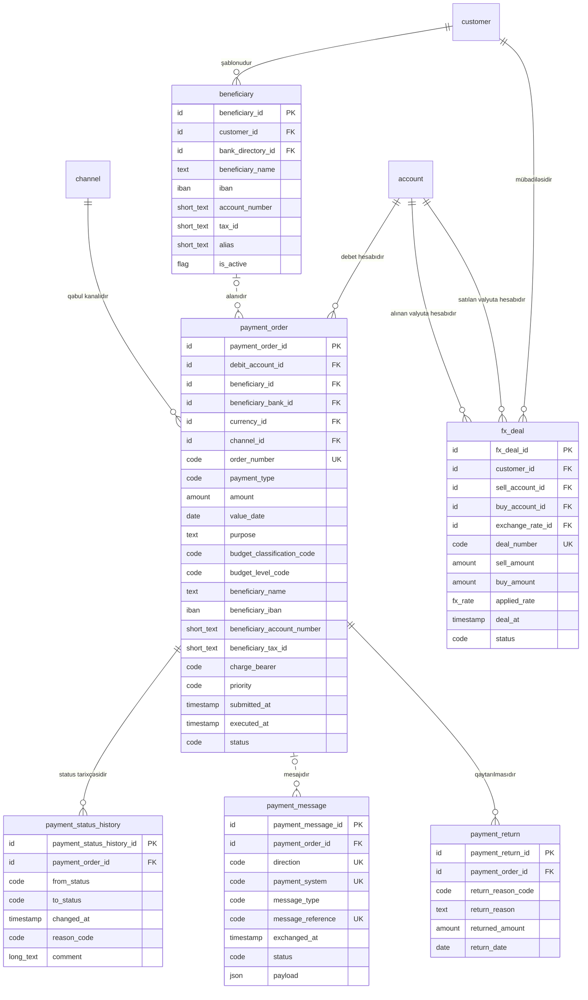

<!-- Bu fayl avtomatik yaradılıb (uv run bankmodel generate). Əl ilə redaktə etməyin. -->

# Ödənişlər (`payment`) — məntiqi model

[← Məntiqi model](index.md) | [Konseptual model](../01_konseptual/05_payment.md) · **Məntiqi model** · [Fiziki model](../03_fiziki/05_payment.md)

Müştərilərin köçürmə tapşırıqları və onların icrası: daxili köçürmələr, yerli ödəniş sistemləri (AZIPS — iri məbləğli real vaxt, XÖHKS — kütləvi ödənişlər), beynəlxalq SWIFT köçürmələri, büdcə ödənişləri, qaytarılmalar və valyuta mübadiləsi.

## Diaqram

## Obyektlər

### 1. `beneficiary` — Benefisiar (alan)

Müştərinin yadda saxladığı köçürmə alanı: ad, IBAN/hesab nömrəsi, VÖEN/FİN, alan bank.

| # | Atribut | Məntiqi tip | Məcburi | Açar | Təsvir |
|---|---|---|---|---|---|
| 1 | `beneficiary_id` | İdentifikator | Bəli | PK | Benefisiar (alan) — surrogat identifikator (UUIDv7). |
| 2 | `customer_id` | İdentifikator | Bəli | FK | Müştəri istinadı (şablonudur). |
| 3 | `bank_directory_id` | İdentifikator | Xeyr | FK | Bank kataloqu istinadı (alan bankdır). |
| 4 | `beneficiary_name` | Mətn | Bəli |  | Alanın adı. |
| 5 | `iban` | IBAN | Xeyr |  | Alanın IBAN-ı. |
| 6 | `account_number` | Qısa mətn | Xeyr |  | Alanın hesab nömrəsi (IBAN olmayan ölkələr üçün). |
| 7 | `tax_id` | Qısa mətn | Xeyr |  | Alanın VÖEN-i və ya FİN-i. |
| 8 | `alias` | Qısa mətn | Xeyr |  | Müştərinin verdiyi qısa ad. |
| 9 | `is_active` | Bayraq (bəli/xeyr) | Bəli |  | Şablon aktivdir. Susmaya görə: `true` |

**Əsas açar:** `beneficiary_id`

**Əlaqələr:**

| FK atributu | İstinad obyekti | Kardinallıq | Əlaqə |
|---|---|---|---|
| `customer_id` | `party.customer` (Müştəri) | 1 : 0..N | şablonudur |
| `bank_directory_id` | `ref.bank_directory` (Bank kataloqu) | 0..1 : 0..N | alan bankdır |

**Biznes qaydaları:**

- IBAN və ya hesab nömrəsi göstərilməlidir.

### 2. `payment_order` — Ödəniş tapşırığı

Müştərinin köçürmə tapşırığı: növü (daxili, AZIPS, XÖHKS, SWIFT, büdcə), məbləğ, valyuta, təyinat, büdcə təsnifat kodu, dəyər tarixi, status. Alanın rekvizitləri tapşırıq anındakı vəziyyətlə saxlanılır (şablon sonradan dəyişsə də tapşırıq dəyişməz).

| # | Atribut | Məntiqi tip | Məcburi | Açar | Təsvir |
|---|---|---|---|---|---|
| 1 | `payment_order_id` | İdentifikator | Bəli | PK | Ödəniş tapşırığı — surrogat identifikator (UUIDv7). |
| 2 | `debit_account_id` | İdentifikator | Bəli | FK | Hesab istinadı (debet hesabıdır). |
| 3 | `beneficiary_id` | İdentifikator | Xeyr | FK | Benefisiar (alan) istinadı (alanıdır). |
| 4 | `beneficiary_bank_id` | İdentifikator | Xeyr | FK | Bank kataloqu istinadı (alan bankdır). |
| 5 | `currency_id` | İdentifikator | Bəli | FK | Valyuta istinadı (valyutasıdır). |
| 6 | `channel_id` | İdentifikator | Bəli | FK | Xidmət kanalı istinadı (qəbul kanalıdır). |
| 7 | `order_number` | Kod | Bəli | AK1 | Tapşırığın unikal nömrəsi. |
| 8 | `payment_type` | Kod | Bəli |  | Ödənişin növü. Dəyərlər: `INTERNAL`, `AZIPS`, `XOHKS`, `SWIFT`, `BUDGET` |
| 9 | `amount` | Məbləğ | Bəli |  | Köçürmə məbləği (tapşırığın valyutasında). |
| 10 | `value_date` | Tarix | Bəli |  | İstənilən dəyər tarixi. |
| 11 | `purpose` | Mətn | Bəli |  | Ödənişin təyinatı. |
| 12 | `budget_classification_code` | Kod | Xeyr |  | Büdcə təsnifatı kodu (büdcə ödənişləri üçün). |
| 13 | `budget_level_code` | Kod | Xeyr |  | Büdcə səviyyəsinin kodu (büdcə ödənişləri üçün). |
| 14 | `beneficiary_name` | Mətn | Bəli |  | Alanın adı (tapşırıq anında). |
| 15 | `beneficiary_iban` | IBAN | Xeyr |  | Alanın IBAN-ı (tapşırıq anında). |
| 16 | `beneficiary_account_number` | Qısa mətn | Xeyr |  | Alanın hesab nömrəsi (IBAN olmadıqda). |
| 17 | `beneficiary_tax_id` | Qısa mətn | Xeyr |  | Alanın VÖEN-i / FİN-i. |
| 18 | `charge_bearer` | Kod | Xeyr |  | SWIFT komissiyasını kim ödəyir. Dəyərlər: `OUR`, `SHA`, `BEN` |
| 19 | `priority` | Kod | Bəli |  | Prioritet. Dəyərlər: `NORMAL`, `URGENT` Susmaya görə: `'NORMAL'` |
| 20 | `submitted_at` | Tarix-vaxt | Bəli |  | Tapşırığın qəbul edildiyi an. Susmaya görə: `now()` |
| 21 | `executed_at` | Tarix-vaxt | Xeyr |  | İcra anı. |
| 22 | `status` | Kod | Bəli |  | Tapşırığın statusu. Dəyərlər: `CREATED`, `PENDING_APPROVAL`, `SCREENING`, `SENT`, `EXECUTED`, `REJECTED`, `CANCELLED`, `RETURNED` |

**Əsas açar:** `payment_order_id`

**Alternativ açarlar:**

- AK1: `order_number`

**Əlaqələr:**

| FK atributu | İstinad obyekti | Kardinallıq | Əlaqə |
|---|---|---|---|
| `debit_account_id` | `account.account` (Hesab) | 1 : 0..N | debet hesabıdır |
| `beneficiary_id` | `payment.beneficiary` (Benefisiar (alan)) | 0..1 : 0..N | alanıdır |
| `beneficiary_bank_id` | `ref.bank_directory` (Bank kataloqu) | 0..1 : 0..N | alan bankdır |
| `currency_id` | `ref.currency` (Valyuta) | 1 : 0..N | valyutasıdır |
| `channel_id` | `org.channel` (Xidmət kanalı) | 1 : 0..N | qəbul kanalıdır |

**Biznes qaydaları:**

- Məbləğ müsbət olmalıdır.
- Alanın IBAN-ı və ya hesab nömrəsi olmalıdır.
- Büdcə ödənişində büdcə təsnifatı və səviyyə kodları məcburidir.
- SWIFT köçürməsində komissiya ödəyicisi göstərilməlidir.

### 3. `payment_status_history` — Ödəniş statusu tarixçəsi

Ödəniş tapşırığının statuslarının dəyişikliyi: qəbul, yoxlama, göndərilmə, icra, rədd (yalnız əlavə olunur).

| # | Atribut | Məntiqi tip | Məcburi | Açar | Təsvir |
|---|---|---|---|---|---|
| 1 | `payment_status_history_id` | İdentifikator | Bəli | PK | Ödəniş statusu tarixçəsi — surrogat identifikator (UUIDv7). |
| 2 | `payment_order_id` | İdentifikator | Bəli | FK | Ödəniş tapşırığı istinadı (status tarixçəsidir). |
| 3 | `from_status` | Kod | Xeyr |  | Əvvəlki status (ilk yazılışda boş). Dəyərlər: `CREATED`, `PENDING_APPROVAL`, `SCREENING`, `SENT`, `EXECUTED`, `REJECTED`, `CANCELLED`, `RETURNED` |
| 4 | `to_status` | Kod | Bəli |  | Yeni status. Dəyərlər: `CREATED`, `PENDING_APPROVAL`, `SCREENING`, `SENT`, `EXECUTED`, `REJECTED`, `CANCELLED`, `RETURNED` |
| 5 | `changed_at` | Tarix-vaxt | Bəli |  | Statusun dəyişdiyi an. Susmaya görə: `now()` |
| 6 | `reason_code` | Kod | Xeyr |  | Dəyişikliyin səbəb kodu. |
| 7 | `comment` | Uzun mətn | Xeyr |  | Əlavə izah. |

**Əsas açar:** `payment_status_history_id`

**Əlaqələr:**

| FK atributu | İstinad obyekti | Kardinallıq | Əlaqə |
|---|---|---|---|
| `payment_order_id` | `payment.payment_order` (Ödəniş tapşırığı) | 1 : 0..N | status tarixçəsidir |

**Biznes qaydaları:**

- Yeni status əvvəlkindən fərqli olmalıdır.

### 4. `payment_message` — Ödəniş mesajı

Ödəniş sistemlərinə göndərilən və onlardan alınan mesajlar (AZIPS, XÖHKS, SWIFT MT / ISO 20022): istiqamət, mesaj tipi, istinad, status.

| # | Atribut | Məntiqi tip | Məcburi | Açar | Təsvir |
|---|---|---|---|---|---|
| 1 | `payment_message_id` | İdentifikator | Bəli | PK | Ödəniş mesajı — surrogat identifikator (UUIDv7). |
| 2 | `payment_order_id` | İdentifikator | Xeyr | FK | Ödəniş tapşırığı istinadı (mesajıdır). |
| 3 | `direction` | Kod | Bəli | AK1 | İstiqamət. Dəyərlər: `OUTBOUND`, `INBOUND` |
| 4 | `payment_system` | Kod | Bəli | AK1 | Ödəniş sistemi. Dəyərlər: `AZIPS`, `XOHKS`, `SWIFT` |
| 5 | `message_type` | Kod | Bəli |  | Mesaj tipi (MT103, pacs.008 və s.). |
| 6 | `message_reference` | Kod | Bəli | AK1 | Mesajın sistemdəki istinadı. |
| 7 | `exchanged_at` | Tarix-vaxt | Bəli |  | Göndərilmə / qəbul anı. |
| 8 | `status` | Kod | Bəli |  | Mesajın statusu. Dəyərlər: `QUEUED`, `SENT`, `ACKNOWLEDGED`, `REJECTED`, `RECEIVED`, `PROCESSED` |
| 9 | `payload` | Strukturlaşdırılmış məlumat | Xeyr |  | Mesajın strukturlaşdırılmış məzmunu. |

**Əsas açar:** `payment_message_id`

**Alternativ açarlar:**

- AK1: `payment_system`, `direction`, `message_reference`

**Əlaqələr:**

| FK atributu | İstinad obyekti | Kardinallıq | Əlaqə |
|---|---|---|---|
| `payment_order_id` | `payment.payment_order` (Ödəniş tapşırığı) | 0..1 : 0..N | mesajıdır |

### 5. `payment_return` — Ödəniş qaytarılması

Qaytarılmış və ya rədd edilmiş ödənişlər: səbəb kodu, qaytarılan məbləğ, tarix.

| # | Atribut | Məntiqi tip | Məcburi | Açar | Təsvir |
|---|---|---|---|---|---|
| 1 | `payment_return_id` | İdentifikator | Bəli | PK | Ödəniş qaytarılması — surrogat identifikator (UUIDv7). |
| 2 | `payment_order_id` | İdentifikator | Bəli | FK | Ödəniş tapşırığı istinadı (qaytarılmasıdır). |
| 3 | `return_reason_code` | Kod | Bəli |  | Qaytarılma səbəbinin kodu. |
| 4 | `return_reason` | Mətn | Xeyr |  | Səbəbin izahı. |
| 5 | `returned_amount` | Məbləğ | Bəli |  | Qaytarılan məbləğ. |
| 6 | `return_date` | Tarix | Bəli |  | Qaytarılma tarixi. |

**Əsas açar:** `payment_return_id`

**Əlaqələr:**

| FK atributu | İstinad obyekti | Kardinallıq | Əlaqə |
|---|---|---|---|
| `payment_order_id` | `payment.payment_order` (Ödəniş tapşırığı) | 1 : 0..N | qaytarılmasıdır |

**Biznes qaydaları:**

- Məbləğ müsbət olmalıdır.

### 6. `fx_deal` — Valyuta mübadiləsi

Müştərinin hesabları arasında valyuta alqı-satqısı (konversiya): satılan və alınan məbləğ, tətbiq olunan məzənnə. Valyutalar hesablardan müəyyən olunur.

| # | Atribut | Məntiqi tip | Məcburi | Açar | Təsvir |
|---|---|---|---|---|---|
| 1 | `fx_deal_id` | İdentifikator | Bəli | PK | Valyuta mübadiləsi — surrogat identifikator (UUIDv7). |
| 2 | `customer_id` | İdentifikator | Bəli | FK | Müştəri istinadı (mübadiləsidir). |
| 3 | `sell_account_id` | İdentifikator | Bəli | FK | Hesab istinadı (satılan valyuta hesabıdır). |
| 4 | `buy_account_id` | İdentifikator | Bəli | FK | Hesab istinadı (alınan valyuta hesabıdır). |
| 5 | `exchange_rate_id` | İdentifikator | Xeyr | FK | Valyuta məzənnəsi istinadı (tətbiq olunan məzənnədir). |
| 6 | `deal_number` | Kod | Bəli | AK1 | Əqdin nömrəsi. |
| 7 | `sell_amount` | Məbləğ | Bəli |  | Satılan məbləğ. |
| 8 | `buy_amount` | Məbləğ | Bəli |  | Alınan məbləğ. |
| 9 | `applied_rate` | Məzənnə | Bəli |  | Faktiki tətbiq olunan məzənnə (fərdi məzənnə ola bilər). |
| 10 | `deal_at` | Tarix-vaxt | Bəli |  | Əqdin anı. Susmaya görə: `now()` |
| 11 | `status` | Kod | Bəli |  | Status. Dəyərlər: `EXECUTED`, `CANCELLED` |

**Əsas açar:** `fx_deal_id`

**Alternativ açarlar:**

- AK1: `deal_number`

**Əlaqələr:**

| FK atributu | İstinad obyekti | Kardinallıq | Əlaqə |
|---|---|---|---|
| `customer_id` | `party.customer` (Müştəri) | 1 : 0..N | mübadiləsidir |
| `sell_account_id` | `account.account` (Hesab) | 1 : 0..N | satılan valyuta hesabıdır |
| `buy_account_id` | `account.account` (Hesab) | 1 : 0..N | alınan valyuta hesabıdır |
| `exchange_rate_id` | `ref.exchange_rate` (Valyuta məzənnəsi) | 0..1 : 0..N | tətbiq olunan məzənnədir |

**Biznes qaydaları:**

- Satış və alış hesabları fərqli olmalıdır.
- Məbləğlər və məzənnə müsbət olmalıdır.
