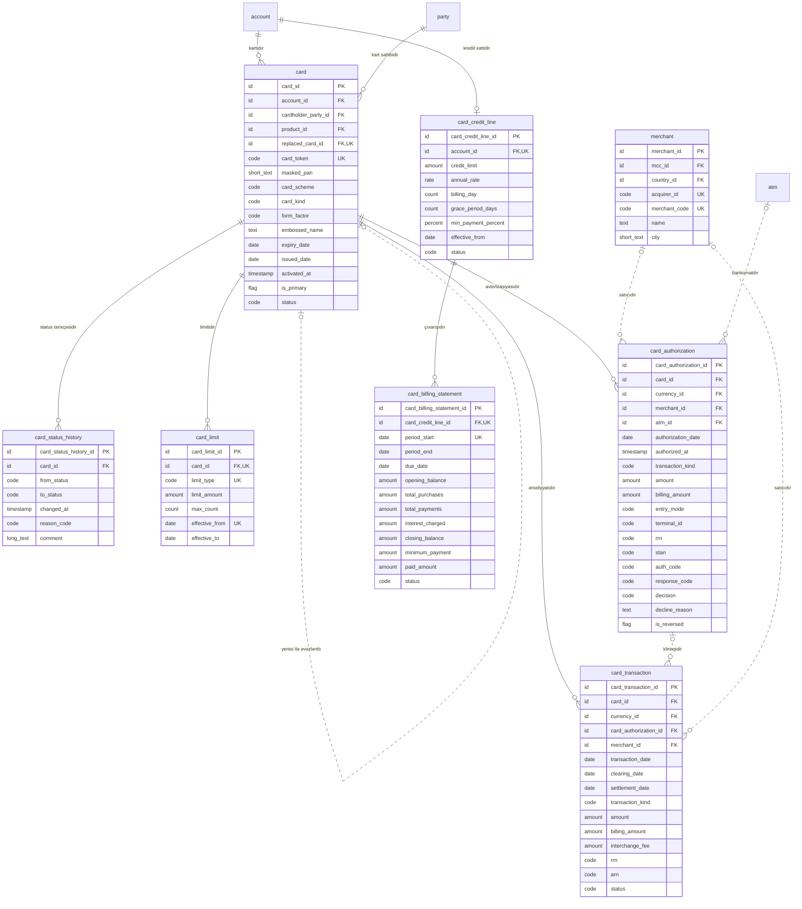

<!-- Bu fayl avtomatik yaradılıb (uv run bankmodel generate). Əl ilə redaktə etməyin. -->

# Kartlar (`card`) — məntiqi model

[← Məntiqi model](index.md) | [Konseptual model](../01_konseptual/06_card.md) · **Məntiqi model** · [Fiziki model](../03_fiziki/06_card.md)

Debet və kredit kartları, onların limitləri, kredit kartı xətti və hesablaşma çıxarışları, real vaxt avtorizasiyaları və ödəniş sistemindən gələn klirinq əməliyyatları. Avtorizasiya bankın öz prosessinq sistemi tərəfindən aparılır. Kart həmişə hesaba bağlıdır: debet kart cari/kart hesabına, kredit kartı kredit xətti olan kart hesabına. Tam PAN, CVV və PIN bu bazada saxlanılmır (PCI DSS) — yalnız token və maskalanmış nömrə.

## Diaqram

## Obyektlər

### 1. `merchant` — Satıcı (ticarət obyekti)

Kartla ödəniş qəbul edən ticarət obyekti: ad, MCC, ölkə, şəhər; avtorizasiya məlumatından yaradılır.

| # | Atribut | Məntiqi tip | Məcburi | Açar | Təsvir |
|---|---|---|---|---|---|
| 1 | `merchant_id` | İdentifikator | Bəli | PK | Satıcı (ticarət obyekti) — surrogat identifikator (UUIDv7). |
| 2 | `mcc_id` | İdentifikator | Bəli | FK | Satıcı kateqoriya kodu (MCC) istinadı (kateqoriyasıdır). |
| 3 | `country_id` | İdentifikator | Bəli | FK | Ölkə istinadı (ölkəsidir). |
| 4 | `acquirer_id` | Kod | Bəli | AK1 | Ekvayer bankın identifikatoru. |
| 5 | `merchant_code` | Kod | Bəli | AK1 | Ekvayerin verdiyi satıcı identifikatoru (MID). |
| 6 | `name` | Mətn | Bəli |  | Satıcının adı (çeklərdə göstərilən). |
| 7 | `city` | Qısa mətn | Xeyr |  | Şəhər. |

**Əsas açar:** `merchant_id`

**Alternativ açarlar:**

- AK1: `acquirer_id`, `merchant_code`

**Əlaqələr:**

| FK atributu | İstinad obyekti | Kardinallıq | Əlaqə |
|---|---|---|---|
| `mcc_id` | `ref.mcc` (Satıcı kateqoriya kodu (MCC)) | 1 : 0..N | kateqoriyasıdır |
| `country_id` | `ref.country` (Ölkə) | 1 : 0..N | ölkəsidir |

### 2. `card` — Kart

Debet və ya kredit kartı: token, maskalanmış PAN, ödəniş sistemi (Visa/Mastercard), növ (fiziki/virtual), etibarlılıq müddəti, kart sahibi, bağlı hesab, status.

| # | Atribut | Məntiqi tip | Məcburi | Açar | Təsvir |
|---|---|---|---|---|---|
| 1 | `card_id` | İdentifikator | Bəli | PK | Kart — surrogat identifikator (UUIDv7). |
| 2 | `account_id` | İdentifikator | Bəli | FK | Hesab istinadı (kartıdır). |
| 3 | `cardholder_party_id` | İdentifikator | Bəli | FK | Tərəf istinadı (kart sahibidir). |
| 4 | `product_id` | İdentifikator | Bəli | FK | Məhsul istinadı (məhsuludur). |
| 5 | `replaced_card_id` | İdentifikator | Xeyr | FK, AK1 | Kart istinadı (yenisi ilə əvəzlənib). |
| 6 | `card_token` | Kod | Bəli | AK2 | Kart tokeni (tam PAN təhlükəsiz kart anbarında saxlanılır). |
| 7 | `masked_pan` | Qısa mətn | Bəli |  | Maskalanmış kart nömrəsi (416973******1234). |
| 8 | `card_scheme` | Kod | Bəli |  | Ödəniş sistemi. Dəyərlər: `VISA`, `MASTERCARD` |
| 9 | `card_kind` | Kod | Bəli |  | Kartın növü. Dəyərlər: `DEBIT`, `CREDIT` |
| 10 | `form_factor` | Kod | Bəli |  | Fiziki və ya virtual kart. Dəyərlər: `PHYSICAL`, `VIRTUAL` |
| 11 | `embossed_name` | Mətn | Xeyr |  | Kartın üzərindəki ad. |
| 12 | `expiry_date` | Tarix | Bəli |  | Etibarlılıq müddətinin sonu (ayın son günü). |
| 13 | `issued_date` | Tarix | Bəli |  | Buraxılış tarixi. |
| 14 | `activated_at` | Tarix-vaxt | Xeyr |  | Aktivləşmə anı. |
| 15 | `is_primary` | Bayraq (bəli/xeyr) | Bəli |  | Əsas kartdır (əlavə kart deyil). Susmaya görə: `true` |
| 16 | `status` | Kod | Bəli |  | Kartın statusu. Dəyərlər: `ISSUED`, `ACTIVE`, `BLOCKED`, `LOST`, `STOLEN`, `EXPIRED`, `CLOSED` |

**Əsas açar:** `card_id`

**Alternativ açarlar:**

- AK1: `replaced_card_id`
- AK2: `card_token`

**Əlaqələr:**

| FK atributu | İstinad obyekti | Kardinallıq | Əlaqə |
|---|---|---|---|
| `account_id` | `account.account` (Hesab) | 1 : 0..N | kartıdır |
| `cardholder_party_id` | `party.party` (Tərəf) | 1 : 0..N | kart sahibidir |
| `product_id` | `ref.product` (Məhsul) | 1 : 0..N | məhsuludur |
| `replaced_card_id` | `card.card` (Kart) | 0..1 : 0..1 | yenisi ilə əvəzlənib |

**Biznes qaydaları:**

- Etibarlılıq tarixi buraxılış tarixindən sonra olmalıdır.

### 3. `card_status_history` — Kart statusu tarixçəsi

Kart statusunun dəyişiklikləri: buraxılış, aktivləşmə, bloklama, itki/oğurluq, bağlanma (yalnız əlavə olunur).

| # | Atribut | Məntiqi tip | Məcburi | Açar | Təsvir |
|---|---|---|---|---|---|
| 1 | `card_status_history_id` | İdentifikator | Bəli | PK | Kart statusu tarixçəsi — surrogat identifikator (UUIDv7). |
| 2 | `card_id` | İdentifikator | Bəli | FK | Kart istinadı (status tarixçəsidir). |
| 3 | `from_status` | Kod | Xeyr |  | Əvvəlki status (ilk yazılışda boş). Dəyərlər: `ISSUED`, `ACTIVE`, `BLOCKED`, `LOST`, `STOLEN`, `EXPIRED`, `CLOSED` |
| 4 | `to_status` | Kod | Bəli |  | Yeni status. Dəyərlər: `ISSUED`, `ACTIVE`, `BLOCKED`, `LOST`, `STOLEN`, `EXPIRED`, `CLOSED` |
| 5 | `changed_at` | Tarix-vaxt | Bəli |  | Statusun dəyişdiyi an. Susmaya görə: `now()` |
| 6 | `reason_code` | Kod | Xeyr |  | Dəyişikliyin səbəb kodu. |
| 7 | `comment` | Uzun mətn | Xeyr |  | Əlavə izah. |

**Əsas açar:** `card_status_history_id`

**Əlaqələr:**

| FK atributu | İstinad obyekti | Kardinallıq | Əlaqə |
|---|---|---|---|
| `card_id` | `card.card` (Kart) | 1 : 0..N | status tarixçəsidir |

**Biznes qaydaları:**

- Yeni status əvvəlkindən fərqli olmalıdır.

### 4. `card_limit` — Kart limiti

Kart üzrə limitlər: gündəlik nağdlaşdırma, POS, internet əməliyyatları, aylıq ümumi, tək əməliyyat.

| # | Atribut | Məntiqi tip | Məcburi | Açar | Təsvir |
|---|---|---|---|---|---|
| 1 | `card_limit_id` | İdentifikator | Bəli | PK | Kart limiti — surrogat identifikator (UUIDv7). |
| 2 | `card_id` | İdentifikator | Bəli | FK, AK1 | Kart istinadı (limitidir). |
| 3 | `limit_type` | Kod | Bəli | AK1 | Limitin növü. Dəyərlər: `DAILY_CASH`, `DAILY_PURCHASE`, `DAILY_ECOMMERCE`, `MONTHLY_TOTAL`, `SINGLE_TRANSACTION` |
| 4 | `limit_amount` | Məbləğ | Bəli |  | Limit məbləği (hesab valyutasında). |
| 5 | `max_count` | Say | Xeyr |  | Əməliyyat sayı limiti. |
| 6 | `effective_from` | Tarix | Bəli | AK1 | Qüvvəyə minmə tarixi. |
| 7 | `effective_to` | Tarix | Xeyr |  | Qüvvədən düşmə tarixi. |

**Əsas açar:** `card_limit_id`

**Alternativ açarlar:**

- AK1: `card_id`, `limit_type`, `effective_from`

**Əlaqələr:**

| FK atributu | İstinad obyekti | Kardinallıq | Əlaqə |
|---|---|---|---|
| `card_id` | `card.card` (Kart) | 1 : 0..N | limitidir |

**Biznes qaydaları:**

- Limit mənfi ola bilməz.
- Bitmə tarixi başlanğıcdan əvvəl ola bilməz.

### 5. `card_credit_line` — Kredit kartı xətti

Kart hesabının kredit limiti və şərtləri: hesablaşma dövrü günü, güzəşt müddəti, minimal ödəniş faizi, illik faiz dərəcəsi (actual/365).

| # | Atribut | Məntiqi tip | Məcburi | Açar | Təsvir |
|---|---|---|---|---|---|
| 1 | `card_credit_line_id` | İdentifikator | Bəli | PK | Kredit kartı xətti — surrogat identifikator (UUIDv7). |
| 2 | `account_id` | İdentifikator | Bəli | FK, AK1 | Hesab istinadı (kredit xəttidir). |
| 3 | `credit_limit` | Məbləğ | Bəli |  | Kredit limiti. |
| 4 | `annual_rate` | Faiz dərəcəsi | Bəli |  | İllik faiz dərəcəsi. |
| 5 | `billing_day` | Say | Bəli |  | Hesablaşma dövrünün bağlandığı gün (1–28). |
| 6 | `grace_period_days` | Say | Bəli |  | Güzəşt müddəti (gün). |
| 7 | `min_payment_percent` | Faiz payı | Bəli |  | Minimal ödəniş — borcun faizi. |
| 8 | `effective_from` | Tarix | Bəli |  | Qüvvəyə minmə tarixi. |
| 9 | `status` | Kod | Bəli |  | Status. Dəyərlər: `ACTIVE`, `SUSPENDED`, `CLOSED` |

**Əsas açar:** `card_credit_line_id`

**Alternativ açarlar:**

- AK1: `account_id`

**Əlaqələr:**

| FK atributu | İstinad obyekti | Kardinallıq | Əlaqə |
|---|---|---|---|
| `account_id` | `account.account` (Hesab) | 1 : 0..1 | kredit xəttidir |

**Biznes qaydaları:**

- Hesablaşma günü 1–28 arasında olmalıdır.
- Kredit limiti müsbət olmalıdır.
- Minimal ödəniş faizi 0–100% arasında olmalıdır.

### 6. `card_authorization` — Kart avtorizasiyası

Bankın prosessinq sistemində kart əməliyyatı üçün real vaxt avtorizasiya sorğusu və cavabı (təsdiq/imtina): məbləğ, valyuta, satıcı/bankomat, cavab kodu, RRN, STAN. Yüksək həcmli cədvəldir, aylar üzrə bölmələnir.

| # | Atribut | Məntiqi tip | Məcburi | Açar | Təsvir |
|---|---|---|---|---|---|
| 1 | `card_authorization_id` | İdentifikator | Bəli | PK | Kart avtorizasiyası — surrogat identifikator (UUIDv7). |
| 2 | `card_id` | İdentifikator | Bəli | FK | Kart istinadı (avtorizasiyasıdır). |
| 3 | `currency_id` | İdentifikator | Bəli | FK | Valyuta istinadı (əməliyyat valyutasıdır). |
| 4 | `merchant_id` | İdentifikator | Xeyr | FK | Satıcı (ticarət obyekti) istinadı (satıcıdır). |
| 5 | `atm_id` | İdentifikator | Xeyr | FK | Bankomat istinadı (bankomatdır). |
| 6 | `authorization_date` | Tarix | Bəli |  | Avtorizasiyanın bank günü (bölmə açarı). |
| 7 | `authorized_at` | Tarix-vaxt | Bəli |  | Sorğunun anı. |
| 8 | `transaction_kind` | Kod | Bəli |  | Əməliyyatın növü. Dəyərlər: `PURCHASE`, `CASH_WITHDRAWAL`, `ECOMMERCE`, `REFUND`, `BALANCE_INQUIRY`, `P2P` |
| 9 | `amount` | Məbləğ | Bəli |  | Əməliyyat valyutasında məbləğ. |
| 10 | `billing_amount` | Məbləğ | Bəli |  | Hesab valyutasında məbləğ (bloklanan). |
| 11 | `entry_mode` | Kod | Bəli |  | Kart məlumatının daxil edilmə üsulu. Dəyərlər: `CHIP`, `CONTACTLESS`, `MAGSTRIPE`, `ECOMMERCE`, `MANUAL` |
| 12 | `terminal_id` | Kod | Xeyr |  | Terminalın identifikatoru. |
| 13 | `rrn` | Kod | Bəli |  | Retrieval Reference Number — əməliyyatın istinad nömrəsi. |
| 14 | `stan` | Kod | Bəli |  | System Trace Audit Number. |
| 15 | `auth_code` | Kod | Xeyr |  | Təsdiq kodu (təsdiq edilmiş əməliyyatlar üçün). |
| 16 | `response_code` | Kod | Bəli |  | Cavab kodu (ISO 8583, 00 — təsdiq). |
| 17 | `decision` | Kod | Bəli |  | Qərar. Dəyərlər: `APPROVED`, `DECLINED` |
| 18 | `decline_reason` | Mətn | Xeyr |  | İmtinanın səbəbi. |
| 19 | `is_reversed` | Bayraq (bəli/xeyr) | Bəli |  | Avtorizasiya ləğv edilib (reversal). Susmaya görə: `false` |

**Əsas açar:** `card_authorization_id`

**Əlaqələr:**

| FK atributu | İstinad obyekti | Kardinallıq | Əlaqə |
|---|---|---|---|
| `card_id` | `card.card` (Kart) | 1 : 0..N | avtorizasiyasıdır |
| `currency_id` | `ref.currency` (Valyuta) | 1 : 0..N | əməliyyat valyutasıdır |
| `merchant_id` | `card.merchant` (Satıcı (ticarət obyekti)) | 0..1 : 0..N | satıcıdır |
| `atm_id` | `org.atm` (Bankomat) | 0..1 : 0..N | bankomatdır |

**Biznes qaydaları:**

- Təsdiq edilmiş avtorizasiyanın təsdiq kodu olmalıdır.
- Məbləğ mənfi ola bilməz.

### 7. `card_transaction` — Kart əməliyyatı (klirinq)

Ödəniş sisteminin klirinq/hesablaşma faylı ilə təsdiqlənmiş kart əməliyyatı: əməliyyat və hesablaşma məbləği, valyutası, komissiya. Yüksək həcmli cədvəldir, aylar üzrə bölmələnir.

| # | Atribut | Məntiqi tip | Məcburi | Açar | Təsvir |
|---|---|---|---|---|---|
| 1 | `card_transaction_id` | İdentifikator | Bəli | PK | Kart əməliyyatı (klirinq) — surrogat identifikator (UUIDv7). |
| 2 | `card_id` | İdentifikator | Bəli | FK | Kart istinadı (əməliyyatıdır). |
| 3 | `currency_id` | İdentifikator | Bəli | FK | Valyuta istinadı (əməliyyat valyutasıdır). |
| 4 | `card_authorization_id` | İdentifikator | Xeyr | FK | Kart avtorizasiyası istinadı (klirinqidir). |
| 5 | `merchant_id` | İdentifikator | Xeyr | FK | Satıcı (ticarət obyekti) istinadı (satıcıdır). |
| 6 | `transaction_date` | Tarix | Bəli |  | Əməliyyatın tarixi (bölmə açarı). |
| 7 | `clearing_date` | Tarix | Bəli |  | Klirinq faylının tarixi. |
| 8 | `settlement_date` | Tarix | Xeyr |  | Hesablaşma tarixi. |
| 9 | `transaction_kind` | Kod | Bəli |  | Əməliyyatın növü. Dəyərlər: `PURCHASE`, `CASH_WITHDRAWAL`, `ECOMMERCE`, `REFUND`, `BALANCE_INQUIRY`, `P2P` |
| 10 | `amount` | Məbləğ | Bəli |  | Əməliyyat valyutasında məbləğ. |
| 11 | `billing_amount` | Məbləğ | Bəli |  | Hesab valyutasında məbləğ. |
| 12 | `interchange_fee` | Məbləğ | Xeyr |  | İnterçeync komissiyası. |
| 13 | `rrn` | Kod | Bəli |  | Retrieval Reference Number. |
| 14 | `arn` | Kod | Xeyr |  | Acquirer Reference Number. |
| 15 | `status` | Kod | Bəli |  | Status. Dəyərlər: `CLEARED`, `POSTED`, `DISPUTED`, `REVERSED` |

**Əsas açar:** `card_transaction_id`

**Əlaqələr:**

| FK atributu | İstinad obyekti | Kardinallıq | Əlaqə |
|---|---|---|---|
| `card_id` | `card.card` (Kart) | 1 : 0..N | əməliyyatıdır |
| `currency_id` | `ref.currency` (Valyuta) | 1 : 0..N | əməliyyat valyutasıdır |
| `card_authorization_id` | `card.card_authorization` (Kart avtorizasiyası) | 0..1 : 0..N | klirinqidir |
| `merchant_id` | `card.merchant` (Satıcı (ticarət obyekti)) | 0..1 : 0..N | satıcıdır |

**Biznes qaydaları:**

- Məbləğ mənfi ola bilməz.

### 8. `card_billing_statement` — Kredit kartı çıxarışı

Kredit kartı üzrə hesablaşma dövrü çıxarışı: ümumi borc, minimal ödəniş, son ödəniş tarixi, ödənilmə vəziyyəti.

| # | Atribut | Məntiqi tip | Məcburi | Açar | Təsvir |
|---|---|---|---|---|---|
| 1 | `card_billing_statement_id` | İdentifikator | Bəli | PK | Kredit kartı çıxarışı — surrogat identifikator (UUIDv7). |
| 2 | `card_credit_line_id` | İdentifikator | Bəli | FK, AK1 | Kredit kartı xətti istinadı (çıxarışıdır). |
| 3 | `period_start` | Tarix | Bəli | AK1 | Dövrün başlanğıcı. |
| 4 | `period_end` | Tarix | Bəli |  | Dövrün sonu. |
| 5 | `due_date` | Tarix | Bəli |  | Minimal ödənişin son tarixi. |
| 6 | `opening_balance` | Məbləğ | Bəli |  | Dövrün əvvəlinə borc. |
| 7 | `total_purchases` | Məbləğ | Bəli |  | Dövr ərzində xərclər. |
| 8 | `total_payments` | Məbləğ | Bəli |  | Dövr ərzində ödənişlər. |
| 9 | `interest_charged` | Məbləğ | Bəli |  | Hesablanmış faiz. Susmaya görə: `0` |
| 10 | `closing_balance` | Məbləğ | Bəli |  | Dövrün sonuna ümumi borc. |
| 11 | `minimum_payment` | Məbləğ | Bəli |  | Minimal ödəniş məbləği. |
| 12 | `paid_amount` | Məbləğ | Bəli |  | Son tarixədək ödənilmiş məbləğ. Susmaya görə: `0` |
| 13 | `status` | Kod | Bəli |  | Status. Dəyərlər: `OPEN`, `PAID`, `PARTIALLY_PAID`, `OVERDUE` |

**Əsas açar:** `card_billing_statement_id`

**Alternativ açarlar:**

- AK1: `card_credit_line_id`, `period_start`

**Əlaqələr:**

| FK atributu | İstinad obyekti | Kardinallıq | Əlaqə |
|---|---|---|---|
| `card_credit_line_id` | `card.card_credit_line` (Kredit kartı xətti) | 1 : 0..N | çıxarışıdır |

**Biznes qaydaları:**

- Dövr tarixləri ardıcıl olmalıdır.
- Minimal ödəniş ümumi borcdan çox ola bilməz.
