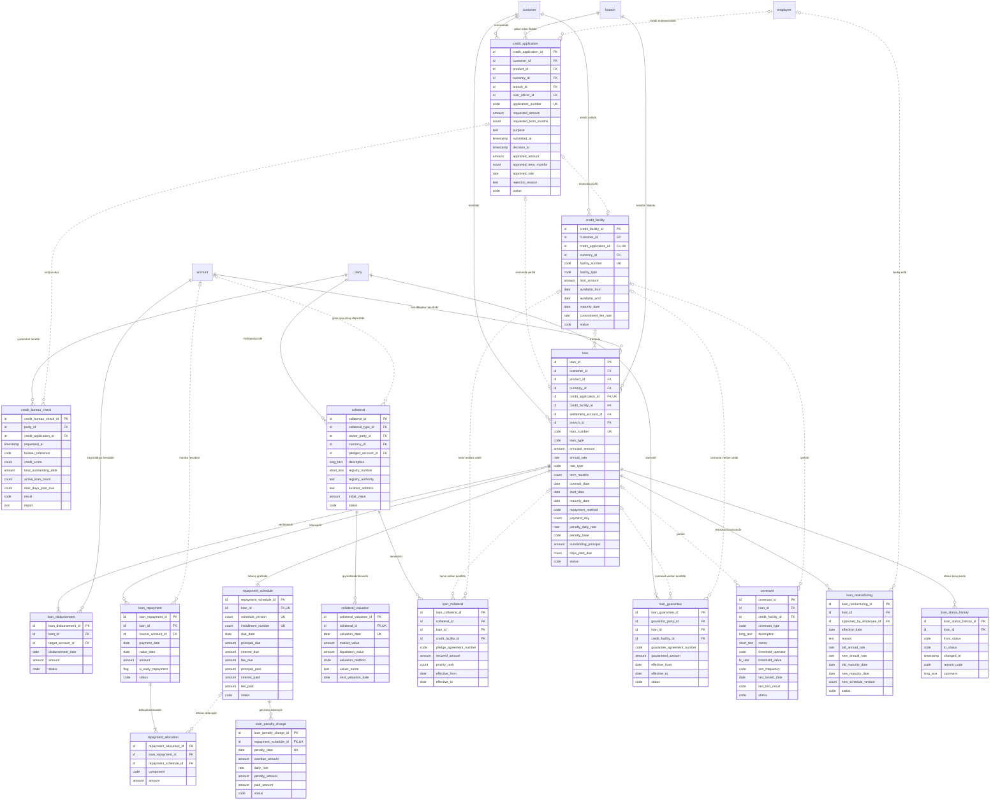

<!-- Bu fayl avtomatik yaradılıb (uv run bankmodel generate). Əl ilə redaktə etməyin. -->

# Kreditlər (`loan`) — məntiqi model

[← Məntiqi model](index.md) | [Konseptual model](../01_konseptual/07_loan.md) · **Məntiqi model** · [Fiziki model](../03_fiziki/07_loan.md)

Kredit həyat dövrü: müraciət, Kredit Bürosu yoxlaması, kredit xətti (biznes), kredit müqaviləsi (istehlak, ipoteka, biznes krediti), kreditin verilməsi, ödəniş qrafiki, ödənişlər və onların bölüşdürülməsi, dəbbə (gündəlik dərəcə ilə cərimə), girov və zaminlik, kovenantlar, restrukturizasiya. Faizlər faktiki/365 (actual/365) bazası ilə hesablanır.

## Diaqram

## Obyektlər

### 1. `credit_application` — Kredit müraciəti

Kredit müraciəti: məhsul, istənilən məbləğ, valyuta və müddət, məqsəd, qərar, təsdiq edilmiş şərtlər.

| # | Atribut | Məntiqi tip | Məcburi | Açar | Təsvir |
|---|---|---|---|---|---|
| 1 | `credit_application_id` | İdentifikator | Bəli | PK | Kredit müraciəti — surrogat identifikator (UUIDv7). |
| 2 | `customer_id` | İdentifikator | Bəli | FK | Müştəri istinadı (müraciətidir). |
| 3 | `product_id` | İdentifikator | Bəli | FK | Məhsul istinadı (istənilən məhsuldur). |
| 4 | `currency_id` | İdentifikator | Bəli | FK | Valyuta istinadı (istənilən valyutadır). |
| 5 | `branch_id` | İdentifikator | Bəli | FK | Filial istinadı (qəbul edən filialdır). |
| 6 | `loan_officer_id` | İdentifikator | Xeyr | FK | Əməkdaş istinadı (kredit mütəxəssisidir). |
| 7 | `application_number` | Kod | Bəli | AK1 | Müraciətin nömrəsi. |
| 8 | `requested_amount` | Məbləğ | Bəli |  | İstənilən məbləğ. |
| 9 | `requested_term_months` | Say | Bəli |  | İstənilən müddət (ay). |
| 10 | `purpose` | Mətn | Bəli |  | Kreditin məqsədi. |
| 11 | `submitted_at` | Tarix-vaxt | Bəli |  | Müraciət anı. Susmaya görə: `now()` |
| 12 | `decision_at` | Tarix-vaxt | Xeyr |  | Qərar anı. |
| 13 | `approved_amount` | Məbləğ | Xeyr |  | Təsdiq edilmiş məbləğ. |
| 14 | `approved_term_months` | Say | Xeyr |  | Təsdiq edilmiş müddət (ay). |
| 15 | `approved_rate` | Faiz dərəcəsi | Xeyr |  | Təsdiq edilmiş illik faiz dərəcəsi. |
| 16 | `rejection_reason` | Mətn | Xeyr |  | İmtinanın səbəbi. |
| 17 | `status` | Kod | Bəli |  | Müraciətin statusu. Dəyərlər: `DRAFT`, `SUBMITTED`, `UNDER_REVIEW`, `APPROVED`, `REJECTED`, `CANCELLED`, `CONTRACTED` |

**Əsas açar:** `credit_application_id`

**Alternativ açarlar:**

- AK1: `application_number`

**Əlaqələr:**

| FK atributu | İstinad obyekti | Kardinallıq | Əlaqə |
|---|---|---|---|
| `customer_id` | `party.customer` (Müştəri) | 1 : 0..N | müraciətidir |
| `product_id` | `ref.product` (Məhsul) | 1 : 0..N | istənilən məhsuldur |
| `currency_id` | `ref.currency` (Valyuta) | 1 : 0..N | istənilən valyutadır |
| `branch_id` | `org.branch` (Filial) | 1 : 0..N | qəbul edən filialdır |
| `loan_officer_id` | `org.employee` (Əməkdaş) | 0..1 : 0..N | kredit mütəxəssisidir |

**Biznes qaydaları:**

- Məbləğ və müddət müsbət olmalıdır.
- Təsdiq edilmiş müraciətdə təsdiq olunan şərtlər göstərilməlidir.

### 2. `credit_bureau_check` — Kredit Bürosu sorğusu

Azərbaycan Kredit Bürosuna sorğu və nəticəsi: kredit skoru, mövcud öhdəliklər, gecikmələr; tərəfin razılığı əsasında.

| # | Atribut | Məntiqi tip | Məcburi | Açar | Təsvir |
|---|---|---|---|---|---|
| 1 | `credit_bureau_check_id` | İdentifikator | Bəli | PK | Kredit Bürosu sorğusu — surrogat identifikator (UUIDv7). |
| 2 | `party_id` | İdentifikator | Bəli | FK | Tərəf istinadı (yoxlanılan tərəfdir). |
| 3 | `credit_application_id` | İdentifikator | Xeyr | FK | Kredit müraciəti istinadı (sorğusudur). |
| 4 | `requested_at` | Tarix-vaxt | Bəli |  | Sorğu anı. Susmaya görə: `now()` |
| 5 | `bureau_reference` | Kod | Xeyr |  | Büronun hesabat istinadı. |
| 6 | `credit_score` | Say | Xeyr |  | Kredit skoru. |
| 7 | `total_outstanding_debt` | Məbləğ | Xeyr |  | Bütün banklar üzrə qalıq borc (AZN). |
| 8 | `active_loan_count` | Say | Xeyr |  | Aktiv kreditlərin sayı. |
| 9 | `max_days_past_due` | Say | Xeyr |  | Maksimal gecikmə günləri. |
| 10 | `result` | Kod | Bəli |  | Sorğunun nəticəsi. Dəyərlər: `SUCCESS`, `NO_HIT`, `ERROR` |
| 11 | `report` | Strukturlaşdırılmış məlumat | Xeyr |  | Büronun hesabatı (strukturlaşdırılmış). |

**Əsas açar:** `credit_bureau_check_id`

**Əlaqələr:**

| FK atributu | İstinad obyekti | Kardinallıq | Əlaqə |
|---|---|---|---|
| `party_id` | `party.party` (Tərəf) | 1 : 0..N | yoxlanılan tərəfdir |
| `credit_application_id` | `loan.credit_application` (Kredit müraciəti) | 0..1 : 0..N | sorğusudur |

### 3. `credit_facility` — Kredit xətti

Biznes müştəriləri üçün kredit xətti (bərpa olunan və ya olunmayan): ümumi limit, valyuta, istifadə müddəti. Xətt üzrə bir neçə kredit (tranş) verilə bilər; istifadə olunmuş məbləğ tranşların qalıqlarının cəmidir.

| # | Atribut | Məntiqi tip | Məcburi | Açar | Təsvir |
|---|---|---|---|---|---|
| 1 | `credit_facility_id` | İdentifikator | Bəli | PK | Kredit xətti — surrogat identifikator (UUIDv7). |
| 2 | `customer_id` | İdentifikator | Bəli | FK | Müştəri istinadı (kredit xəttidir). |
| 3 | `credit_application_id` | İdentifikator | Xeyr | FK, AK1 | Kredit müraciəti istinadı (əsasında açılıb). |
| 4 | `currency_id` | İdentifikator | Bəli | FK | Valyuta istinadı (valyutasıdır). |
| 5 | `facility_number` | Kod | Bəli | AK2 | Kredit xətti müqaviləsinin nömrəsi. |
| 6 | `facility_type` | Kod | Bəli |  | Bərpa olunan və ya olunmayan. Dəyərlər: `REVOLVING`, `NON_REVOLVING` |
| 7 | `limit_amount` | Məbləğ | Bəli |  | Ümumi limit. |
| 8 | `available_from` | Tarix | Bəli |  | İstifadənin başlanğıcı. |
| 9 | `available_until` | Tarix | Bəli |  | Yeni tranş götürmək üçün son tarix. |
| 10 | `maturity_date` | Tarix | Bəli |  | Xəttin son ödəniş tarixi. |
| 11 | `commitment_fee_rate` | Faiz dərəcəsi | Xeyr |  | İstifadə olunmamış limitə illik komissiya dərəcəsi. |
| 12 | `status` | Kod | Bəli |  | Status. Dəyərlər: `ACTIVE`, `SUSPENDED`, `EXPIRED`, `CLOSED` |

**Əsas açar:** `credit_facility_id`

**Alternativ açarlar:**

- AK1: `credit_application_id`
- AK2: `facility_number`

**Əlaqələr:**

| FK atributu | İstinad obyekti | Kardinallıq | Əlaqə |
|---|---|---|---|
| `customer_id` | `party.customer` (Müştəri) | 1 : 0..N | kredit xəttidir |
| `credit_application_id` | `loan.credit_application` (Kredit müraciəti) | 0..1 : 0..1 | əsasında açılıb |
| `currency_id` | `ref.currency` (Valyuta) | 1 : 0..N | valyutasıdır |

**Biznes qaydaları:**

- Limit müsbət olmalıdır.
- Tarixlər ardıcıl olmalıdır.

### 4. `loan` — Kredit

Kredit müqaviləsi və kredit hesabı: növ (istehlak, ipoteka, biznes, xətt üzrə tranş), məbləğ, valyuta, faiz dərəcəsi, müddət, ödəniş metodu (annuitet/diferensial), dəbbə şərtləri, qalıq borc, gecikmə günləri, status. Qalıq borc və gecikmə günləri əməliyyatlarla yenilənən idarə olunan denormallaşdırmadır.

| # | Atribut | Məntiqi tip | Məcburi | Açar | Təsvir |
|---|---|---|---|---|---|
| 1 | `loan_id` | İdentifikator | Bəli | PK | Kredit — surrogat identifikator (UUIDv7). |
| 2 | `customer_id` | İdentifikator | Bəli | FK | Müştəri istinadı (kreditidir). |
| 3 | `product_id` | İdentifikator | Bəli | FK | Məhsul istinadı (məhsuludur). |
| 4 | `currency_id` | İdentifikator | Bəli | FK | Valyuta istinadı (valyutasıdır). |
| 5 | `credit_application_id` | İdentifikator | Xeyr | FK, AK1 | Kredit müraciəti istinadı (əsasında verilib). |
| 6 | `credit_facility_id` | İdentifikator | Xeyr | FK | Kredit xətti istinadı (tranşıdır). |
| 7 | `settlement_account_id` | İdentifikator | Bəli | FK | Hesab istinadı (hesablaşma hesabıdır). |
| 8 | `branch_id` | İdentifikator | Bəli | FK | Filial istinadı (kreditin filialıdır). |
| 9 | `loan_number` | Kod | Bəli | AK2 | Kredit müqaviləsinin nömrəsi. |
| 10 | `loan_type` | Kod | Bəli |  | Kreditin növü. Dəyərlər: `CONSUMER`, `MORTGAGE`, `BUSINESS`, `FACILITY_TRANCHE` |
| 11 | `principal_amount` | Məbləğ | Bəli |  | Kreditin məbləği. |
| 12 | `annual_rate` | Faiz dərəcəsi | Bəli |  | İllik faiz dərəcəsi (actual/365). |
| 13 | `rate_type` | Kod | Bəli |  | Sabit və ya üzən dərəcə. Dəyərlər: `FIXED`, `FLOATING` |
| 14 | `term_months` | Say | Bəli |  | Müddət (ay). |
| 15 | `contract_date` | Tarix | Bəli |  | Müqavilə tarixi. |
| 16 | `start_date` | Tarix | Bəli |  | Faiz hesablanmasının başlanğıcı. |
| 17 | `maturity_date` | Tarix | Bəli |  | Son ödəniş tarixi. |
| 18 | `repayment_method` | Kod | Bəli |  | Ödəniş metodu. Dəyərlər: `ANNUITY`, `DIFFERENTIATED`, `BULLET` |
| 19 | `payment_day` | Say | Bəli |  | Aylıq ödəniş günü (1–28). |
| 20 | `penalty_daily_rate` | Faiz dərəcəsi | Bəli |  | Dəbbənin gündəlik dərəcəsi (0.001000 = gündə 0.1%). |
| 21 | `penalty_base` | Kod | Bəli |  | Dəbbənin hesablandığı baza (müqavilə ilə müəyyən olunur): gecikmiş əsas borc və ya gecikmiş əsas borc + faiz. Dəyərlər: `OVERDUE_PRINCIPAL`, `OVERDUE_PRINCIPAL_AND_INTEREST` |
| 22 | `outstanding_principal` | Məbləğ | Bəli |  | Qalıq əsas borc. |
| 23 | `days_past_due` | Say | Bəli |  | Cari gecikmə günləri. Susmaya görə: `0` |
| 24 | `status` | Kod | Bəli |  | Kreditin statusu. Dəyərlər: `APPROVED`, `ACTIVE`, `OVERDUE`, `RESTRUCTURED`, `WRITTEN_OFF`, `CLOSED` |

**Əsas açar:** `loan_id`

**Alternativ açarlar:**

- AK1: `credit_application_id`
- AK2: `loan_number`

**Əlaqələr:**

| FK atributu | İstinad obyekti | Kardinallıq | Əlaqə |
|---|---|---|---|
| `customer_id` | `party.customer` (Müştəri) | 1 : 0..N | kreditidir |
| `product_id` | `ref.product` (Məhsul) | 1 : 0..N | məhsuludur |
| `currency_id` | `ref.currency` (Valyuta) | 1 : 0..N | valyutasıdır |
| `credit_application_id` | `loan.credit_application` (Kredit müraciəti) | 0..1 : 0..1 | əsasında verilib |
| `credit_facility_id` | `loan.credit_facility` (Kredit xətti) | 0..1 : 0..N | tranşıdır |
| `settlement_account_id` | `account.account` (Hesab) | 1 : 0..N | hesablaşma hesabıdır |
| `branch_id` | `org.branch` (Filial) | 1 : 0..N | kreditin filialıdır |

**Biznes qaydaları:**

- Məbləğ müsbət, qalıq borc isə 0 ilə kredit məbləği arasında olmalıdır.
- Tarixlər ardıcıl olmalıdır.
- Ödəniş günü 1–28 arasında olmalıdır.
- Tranş kredit xəttinə, digər kreditlər isə xəttsiz olmalıdır.
- Dərəcələr mənfi ola bilməz.

### 5. `loan_disbursement` — Kreditin verilməsi

Kredit məbləğinin (və ya onun bir hissəsinin) müştəri hesabına köçürülməsi.

| # | Atribut | Məntiqi tip | Məcburi | Açar | Təsvir |
|---|---|---|---|---|---|
| 1 | `loan_disbursement_id` | İdentifikator | Bəli | PK | Kreditin verilməsi — surrogat identifikator (UUIDv7). |
| 2 | `loan_id` | İdentifikator | Bəli | FK | Kredit istinadı (verilməsidir). |
| 3 | `target_account_id` | İdentifikator | Bəli | FK | Hesab istinadı (köçürüldüyü hesabdır). |
| 4 | `disbursement_date` | Tarix | Bəli |  | Verilmə tarixi. |
| 5 | `amount` | Məbləğ | Bəli |  | Verilən məbləğ. |
| 6 | `status` | Kod | Bəli |  | Status. Dəyərlər: `PENDING`, `COMPLETED`, `CANCELLED` |

**Əsas açar:** `loan_disbursement_id`

**Əlaqələr:**

| FK atributu | İstinad obyekti | Kardinallıq | Əlaqə |
|---|---|---|---|
| `loan_id` | `loan.loan` (Kredit) | 1 : 1..N | verilməsidir |
| `target_account_id` | `account.account` (Hesab) | 1 : 0..N | köçürüldüyü hesabdır |

**Biznes qaydaları:**

- Məbləğ müsbət olmalıdır.

### 6. `repayment_schedule` — Ödəniş qrafiki

Kreditin ödəniş qrafiki: hər ödəniş tarixi üzrə əsas borc, faiz və komissiya məbləğləri, ödənilmiş hissələr. Restrukturizasiya zamanı yeni qrafik versiyası yaradılır, köhnə sətirlər SUPERSEDED olur.

| # | Atribut | Məntiqi tip | Məcburi | Açar | Təsvir |
|---|---|---|---|---|---|
| 1 | `repayment_schedule_id` | İdentifikator | Bəli | PK | Ödəniş qrafiki — surrogat identifikator (UUIDv7). |
| 2 | `loan_id` | İdentifikator | Bəli | FK, AK1 | Kredit istinadı (ödəniş qrafikidir). |
| 3 | `schedule_version` | Say | Bəli | AK1 | Qrafikin versiyası. Susmaya görə: `1` |
| 4 | `installment_number` | Say | Bəli | AK1 | Ödənişin sıra nömrəsi. |
| 5 | `due_date` | Tarix | Bəli |  | Ödəniş tarixi. |
| 6 | `principal_due` | Məbləğ | Bəli |  | Ödənilməli əsas borc. |
| 7 | `interest_due` | Məbləğ | Bəli |  | Ödənilməli faiz. |
| 8 | `fee_due` | Məbləğ | Bəli |  | Ödənilməli komissiya. Susmaya görə: `0` |
| 9 | `principal_paid` | Məbləğ | Bəli |  | Ödənilmiş əsas borc. Susmaya görə: `0` |
| 10 | `interest_paid` | Məbləğ | Bəli |  | Ödənilmiş faiz. Susmaya görə: `0` |
| 11 | `fee_paid` | Məbləğ | Bəli |  | Ödənilmiş komissiya. Susmaya görə: `0` |
| 12 | `status` | Kod | Bəli |  | Status. Dəyərlər: `PENDING`, `PARTIALLY_PAID`, `PAID`, `OVERDUE`, `SUPERSEDED` |

**Əsas açar:** `repayment_schedule_id`

**Alternativ açarlar:**

- AK1: `loan_id`, `schedule_version`, `installment_number`

**Əlaqələr:**

| FK atributu | İstinad obyekti | Kardinallıq | Əlaqə |
|---|---|---|---|
| `loan_id` | `loan.loan` (Kredit) | 1 : 1..N | ödəniş qrafikidir |

**Biznes qaydaları:**

- Ödənilmiş məbləğ ödənilməli məbləğdən çox ola bilməz.
- Məbləğlər mənfi ola bilməz.

### 7. `loan_repayment` — Kredit ödənişi

Müştərinin kredit üzrə etdiyi ödəniş: məbləğ, tarix, mənbə hesab, vaxtından əvvəl ödəniş əlaməti.

| # | Atribut | Məntiqi tip | Məcburi | Açar | Təsvir |
|---|---|---|---|---|---|
| 1 | `loan_repayment_id` | İdentifikator | Bəli | PK | Kredit ödənişi — surrogat identifikator (UUIDv7). |
| 2 | `loan_id` | İdentifikator | Bəli | FK | Kredit istinadı (ödənişidir). |
| 3 | `source_account_id` | İdentifikator | Xeyr | FK | Hesab istinadı (mənbə hesabdır). |
| 4 | `payment_date` | Tarix | Bəli |  | Ödəniş tarixi. |
| 5 | `value_date` | Tarix | Bəli |  | Dəyər tarixi. |
| 6 | `amount` | Məbləğ | Bəli |  | Ödənilən məbləğ (kredit valyutasında). |
| 7 | `is_early_repayment` | Bayraq (bəli/xeyr) | Bəli |  | Vaxtından əvvəl ödənişdir. Susmaya görə: `false` |
| 8 | `status` | Kod | Bəli |  | Status. Dəyərlər: `POSTED`, `REVERSED` |

**Əsas açar:** `loan_repayment_id`

**Əlaqələr:**

| FK atributu | İstinad obyekti | Kardinallıq | Əlaqə |
|---|---|---|---|
| `loan_id` | `loan.loan` (Kredit) | 1 : 0..N | ödənişidir |
| `source_account_id` | `account.account` (Hesab) | 0..1 : 0..N | mənbə hesabdır |

**Biznes qaydaları:**

- Məbləğ müsbət olmalıdır.

### 8. `repayment_allocation` — Ödənişin bölüşdürülməsi

Ödənişin qrafik üzrə ödənişlərə və komponentlərə bölüşdürülməsi. Növbəlilik: dəbbə → faiz → əsas borc → komissiya.

| # | Atribut | Məntiqi tip | Məcburi | Açar | Təsvir |
|---|---|---|---|---|---|
| 1 | `repayment_allocation_id` | İdentifikator | Bəli | PK | Ödənişin bölüşdürülməsi — surrogat identifikator (UUIDv7). |
| 2 | `loan_repayment_id` | İdentifikator | Bəli | FK | Kredit ödənişi istinadı (bölüşdürülməsidir). |
| 3 | `repayment_schedule_id` | İdentifikator | Xeyr | FK | Ödəniş qrafiki istinadı (örtülən ödənişdir). |
| 4 | `component` | Kod | Bəli |  | Komponent. Dəyərlər: `PENALTY`, `INTEREST`, `PRINCIPAL`, `FEE` |
| 5 | `amount` | Məbləğ | Bəli |  | Bu komponentə yönəldilən məbləğ. |

**Əsas açar:** `repayment_allocation_id`

**Əlaqələr:**

| FK atributu | İstinad obyekti | Kardinallıq | Əlaqə |
|---|---|---|---|
| `loan_repayment_id` | `loan.loan_repayment` (Kredit ödənişi) | 1 : 1..N | bölüşdürülməsidir |
| `repayment_schedule_id` | `loan.repayment_schedule` (Ödəniş qrafiki) | 0..1 : 0..N | örtülən ödənişdir |

**Biznes qaydaları:**

- Məbləğ müsbət olmalıdır.

### 9. `loan_penalty_charge` — Dəbbə (cərimə)

Gecikmiş qrafik ödənişinə görə hər gün hesablanan dəbbə: gecikmiş məbləğ (kreditin dəbbə bazasına görə) × gündəlik dərəcə.

| # | Atribut | Məntiqi tip | Məcburi | Açar | Təsvir |
|---|---|---|---|---|---|
| 1 | `loan_penalty_charge_id` | İdentifikator | Bəli | PK | Dəbbə (cərimə) — surrogat identifikator (UUIDv7). |
| 2 | `repayment_schedule_id` | İdentifikator | Bəli | FK, AK1 | Ödəniş qrafiki istinadı (gecikmiş ödənişdir). |
| 3 | `penalty_date` | Tarix | Bəli | AK1 | Hesablama günü. |
| 4 | `overdue_amount` | Məbləğ | Bəli |  | Həmin gün gecikmiş məbləğ (dəbbə bazası). |
| 5 | `daily_rate` | Faiz dərəcəsi | Bəli |  | Tətbiq olunan gündəlik dərəcə. |
| 6 | `penalty_amount` | Məbləğ | Bəli |  | Hesablanmış dəbbə. |
| 7 | `paid_amount` | Məbləğ | Bəli |  | Ödənilmiş hissə. Susmaya görə: `0` |
| 8 | `status` | Kod | Bəli |  | Status. Dəyərlər: `ACCRUED`, `PAID`, `WAIVED` |

**Əsas açar:** `loan_penalty_charge_id`

**Alternativ açarlar:**

- AK1: `repayment_schedule_id`, `penalty_date`

**Əlaqələr:**

| FK atributu | İstinad obyekti | Kardinallıq | Əlaqə |
|---|---|---|---|
| `repayment_schedule_id` | `loan.repayment_schedule` (Ödəniş qrafiki) | 1 : 0..N | gecikmiş ödənişdir |

**Biznes qaydaları:**

- Məbləğlər düzgün olmalıdır.

### 10. `collateral` — Girov

Girov predmeti: növ, təsvir, mülkiyyətçi, reyestr qeydiyyatı (daşınmaz əmlak çıxarışı, nəqliyyat vasitəsinin qeydiyyatı), girov qoyulmuş depozit hesabı.

| # | Atribut | Məntiqi tip | Məcburi | Açar | Təsvir |
|---|---|---|---|---|---|
| 1 | `collateral_id` | İdentifikator | Bəli | PK | Girov — surrogat identifikator (UUIDv7). |
| 2 | `collateral_type_id` | İdentifikator | Bəli | FK | Girov növü istinadı (növüdür). |
| 3 | `owner_party_id` | İdentifikator | Bəli | FK | Tərəf istinadı (mülkiyyətçisidir). |
| 4 | `currency_id` | İdentifikator | Bəli | FK | Valyuta istinadı (dəyərin valyutasıdır). |
| 5 | `pledged_account_id` | İdentifikator | Xeyr | FK | Hesab istinadı (girov qoyulmuş depozitdir). |
| 6 | `description` | Uzun mətn | Bəli |  | Girov predmetinin təsviri. |
| 7 | `registry_number` | Qısa mətn | Xeyr |  | Dövlət reyestrində qeydiyyat nömrəsi. |
| 8 | `registry_authority` | Mətn | Xeyr |  | Reyestri aparan orqan. |
| 9 | `location_address` | Mətn | Xeyr |  | Yerləşmə ünvanı. |
| 10 | `initial_value` | Məbləğ | Bəli |  | İlkin razılaşdırılmış dəyər. |
| 11 | `status` | Kod | Bəli |  | Status. Dəyərlər: `ACTIVE`, `RELEASED`, `FORECLOSED` |

**Əsas açar:** `collateral_id`

**Əlaqələr:**

| FK atributu | İstinad obyekti | Kardinallıq | Əlaqə |
|---|---|---|---|
| `collateral_type_id` | `ref.collateral_type` (Girov növü) | 1 : 0..N | növüdür |
| `owner_party_id` | `party.party` (Tərəf) | 1 : 0..N | mülkiyyətçisidir |
| `currency_id` | `ref.currency` (Valyuta) | 1 : 0..N | dəyərin valyutasıdır |
| `pledged_account_id` | `account.account` (Hesab) | 0..1 : 0..N | girov qoyulmuş depozitdir |

**Biznes qaydaları:**

- Dəyər müsbət olmalıdır.

### 11. `collateral_valuation` — Girovun qiymətləndirilməsi

Girovun bazar və likvid dəyərinin qiymətləndirilməsi: tarix, qiymətləndirici, məbləğ (girovun valyutasında).

| # | Atribut | Məntiqi tip | Məcburi | Açar | Təsvir |
|---|---|---|---|---|---|
| 1 | `collateral_valuation_id` | İdentifikator | Bəli | PK | Girovun qiymətləndirilməsi — surrogat identifikator (UUIDv7). |
| 2 | `collateral_id` | İdentifikator | Bəli | FK, AK1 | Girov istinadı (qiymətləndirilməsidir). |
| 3 | `valuation_date` | Tarix | Bəli | AK1 | Qiymətləndirmə tarixi. |
| 4 | `market_value` | Məbləğ | Bəli |  | Bazar dəyəri. |
| 5 | `liquidation_value` | Məbləğ | Bəli |  | Likvid (məcburi satış) dəyəri. |
| 6 | `valuation_method` | Kod | Bəli |  | Qiymətləndirmə üsulu. Dəyərlər: `MARKET`, `INCOME`, `COST` |
| 7 | `valuer_name` | Mətn | Bəli |  | Qiymətləndirici (şirkət və ya şəxs). |
| 8 | `next_valuation_date` | Tarix | Xeyr |  | Növbəti qiymətləndirmə tarixi. |

**Əsas açar:** `collateral_valuation_id`

**Alternativ açarlar:**

- AK1: `collateral_id`, `valuation_date`

**Əlaqələr:**

| FK atributu | İstinad obyekti | Kardinallıq | Əlaqə |
|---|---|---|---|
| `collateral_id` | `loan.collateral` (Girov) | 1 : 0..N | qiymətləndirilməsidir |

**Biznes qaydaları:**

- Likvid dəyər müsbət olmalı və bazar dəyərini aşmamalıdır.

### 12. `loan_collateral` — Kreditin girovu

Kredit və ya kredit xətti ilə girov arasında əlaqə: təminat məbləği, girov müqaviləsi nömrəsi, prioritet, qüvvədə olma tarixləri.

| # | Atribut | Məntiqi tip | Məcburi | Açar | Təsvir |
|---|---|---|---|---|---|
| 1 | `loan_collateral_id` | İdentifikator | Bəli | PK | Kreditin girovu — surrogat identifikator (UUIDv7). |
| 2 | `collateral_id` | İdentifikator | Bəli | FK | Girov istinadı (təminatdır). |
| 3 | `loan_id` | İdentifikator | Xeyr | FK | Kredit istinadı (təmin edilən kreditdir). |
| 4 | `credit_facility_id` | İdentifikator | Xeyr | FK | Kredit xətti istinadı (təmin edilən xətdir). |
| 5 | `pledge_agreement_number` | Kod | Bəli |  | Girov müqaviləsinin nömrəsi. |
| 6 | `secured_amount` | Məbləğ | Bəli |  | Bu girovla təmin edilən məbləğ. |
| 7 | `priority_rank` | Say | Bəli |  | Girovun növbəliliyi (1 — birinci növbəli). Susmaya görə: `1` |
| 8 | `effective_from` | Tarix | Bəli |  | Qüvvəyə minmə tarixi. |
| 9 | `effective_to` | Tarix | Xeyr |  | Qüvvədən düşmə tarixi. |

**Əsas açar:** `loan_collateral_id`

**Əlaqələr:**

| FK atributu | İstinad obyekti | Kardinallıq | Əlaqə |
|---|---|---|---|
| `collateral_id` | `loan.collateral` (Girov) | 1 : 0..N | təminatdır |
| `loan_id` | `loan.loan` (Kredit) | 0..1 : 0..N | təmin edilən kreditdir |
| `credit_facility_id` | `loan.credit_facility` (Kredit xətti) | 0..1 : 0..N | təmin edilən xətdir |

**Biznes qaydaları:**

- Ya kreditə, ya da kredit xəttinə (yalnız birinə) aid olmalıdır.
- Bitmə tarixi başlanğıcdan əvvəl ola bilməz.
- Məbləğ müsbət olmalıdır.

### 13. `loan_guarantee` — Zaminlik

Kredit və ya kredit xətti üzrə zamin (fiziki və ya hüquqi şəxs) və zaminlik müqaviləsi: zəmanət məbləği, qüvvədə olma tarixləri.

| # | Atribut | Məntiqi tip | Məcburi | Açar | Təsvir |
|---|---|---|---|---|---|
| 1 | `loan_guarantee_id` | İdentifikator | Bəli | PK | Zaminlik — surrogat identifikator (UUIDv7). |
| 2 | `guarantor_party_id` | İdentifikator | Bəli | FK | Tərəf istinadı (zamindir). |
| 3 | `loan_id` | İdentifikator | Xeyr | FK | Kredit istinadı (zəmanət verilən kreditdir). |
| 4 | `credit_facility_id` | İdentifikator | Xeyr | FK | Kredit xətti istinadı (zəmanət verilən xətdir). |
| 5 | `guarantee_agreement_number` | Kod | Bəli |  | Zaminlik müqaviləsinin nömrəsi. |
| 6 | `guaranteed_amount` | Məbləğ | Bəli |  | Zəmanət məbləği. |
| 7 | `effective_from` | Tarix | Bəli |  | Qüvvəyə minmə tarixi. |
| 8 | `effective_to` | Tarix | Xeyr |  | Qüvvədən düşmə tarixi. |
| 9 | `status` | Kod | Bəli |  | Status. Dəyərlər: `ACTIVE`, `RELEASED`, `CALLED` |

**Əsas açar:** `loan_guarantee_id`

**Əlaqələr:**

| FK atributu | İstinad obyekti | Kardinallıq | Əlaqə |
|---|---|---|---|
| `guarantor_party_id` | `party.party` (Tərəf) | 1 : 0..N | zamindir |
| `loan_id` | `loan.loan` (Kredit) | 0..1 : 0..N | zəmanət verilən kreditdir |
| `credit_facility_id` | `loan.credit_facility` (Kredit xətti) | 0..1 : 0..N | zəmanət verilən xətdir |

**Biznes qaydaları:**

- Ya kreditə, ya da kredit xəttinə (yalnız birinə) aid olmalıdır.
- Bitmə tarixi başlanğıcdan əvvəl ola bilməz.
- Məbləğ müsbət olmalıdır.

### 14. `covenant` — Kovenant

Biznes krediti üzrə maliyyə və qeyri-maliyyə şərtləri (məs. borc/EBITDA həddi) və onların yerinə yetirilməsinin yoxlanması.

| # | Atribut | Məntiqi tip | Məcburi | Açar | Təsvir |
|---|---|---|---|---|---|
| 1 | `covenant_id` | İdentifikator | Bəli | PK | Kovenant — surrogat identifikator (UUIDv7). |
| 2 | `loan_id` | İdentifikator | Xeyr | FK | Kredit istinadı (şərtidir). |
| 3 | `credit_facility_id` | İdentifikator | Xeyr | FK | Kredit xətti istinadı (şərtidir). |
| 4 | `covenant_type` | Kod | Bəli |  | Növ. Dəyərlər: `FINANCIAL`, `NON_FINANCIAL` |
| 5 | `description` | Uzun mətn | Bəli |  | Şərtin mətni. |
| 6 | `metric` | Qısa mətn | Xeyr |  | Ölçülən göstərici (maliyyə kovenantları üçün). |
| 7 | `threshold_operator` | Kod | Xeyr |  | Müqayisə operatoru. Dəyərlər: `LT`, `LE`, `GT`, `GE`, `EQ` |
| 8 | `threshold_value` | Məzənnə | Xeyr |  | Hədd dəyəri. |
| 9 | `test_frequency` | Kod | Bəli |  | Yoxlama tezliyi. Dəyərlər: `MONTHLY`, `QUARTERLY`, `ANNUAL` |
| 10 | `last_tested_date` | Tarix | Xeyr |  | Son yoxlama tarixi. |
| 11 | `last_test_result` | Kod | Xeyr |  | Son yoxlamanın nəticəsi. Dəyərlər: `MET`, `BREACHED`, `WAIVED` |
| 12 | `status` | Kod | Bəli |  | Status. Dəyərlər: `ACTIVE`, `CLOSED` |

**Əsas açar:** `covenant_id`

**Əlaqələr:**

| FK atributu | İstinad obyekti | Kardinallıq | Əlaqə |
|---|---|---|---|
| `loan_id` | `loan.loan` (Kredit) | 0..1 : 0..N | şərtidir |
| `credit_facility_id` | `loan.credit_facility` (Kredit xətti) | 0..1 : 0..N | şərtidir |

**Biznes qaydaları:**

- Ya kreditə, ya da kredit xəttinə (yalnız birinə) aid olmalıdır.
- Maliyyə kovenantında göstərici, operator və hədd məcburidir.

### 15. `loan_restructuring` — Restrukturizasiya

Kredit şərtlərinin dəyişdirilməsi: müddət, faiz, ödəniş qrafiki; səbəb, təsdiq edən və qüvvəyə minmə tarixi.

| # | Atribut | Məntiqi tip | Məcburi | Açar | Təsvir |
|---|---|---|---|---|---|
| 1 | `loan_restructuring_id` | İdentifikator | Bəli | PK | Restrukturizasiya — surrogat identifikator (UUIDv7). |
| 2 | `loan_id` | İdentifikator | Bəli | FK | Kredit istinadı (restrukturizasiyasıdır). |
| 3 | `approved_by_employee_id` | İdentifikator | Xeyr | FK | Əməkdaş istinadı (təsdiq edib). |
| 4 | `effective_date` | Tarix | Bəli |  | Yeni şərtlərin qüvvəyə minmə tarixi. |
| 5 | `reason` | Mətn | Bəli |  | Səbəb. |
| 6 | `old_annual_rate` | Faiz dərəcəsi | Bəli |  | Əvvəlki illik dərəcə. |
| 7 | `new_annual_rate` | Faiz dərəcəsi | Bəli |  | Yeni illik dərəcə. |
| 8 | `old_maturity_date` | Tarix | Bəli |  | Əvvəlki son ödəniş tarixi. |
| 9 | `new_maturity_date` | Tarix | Bəli |  | Yeni son ödəniş tarixi. |
| 10 | `new_schedule_version` | Say | Bəli |  | Yaradılan yeni qrafik versiyası. |
| 11 | `status` | Kod | Bəli |  | Status. Dəyərlər: `PROPOSED`, `APPROVED`, `APPLIED`, `REJECTED` |

**Əsas açar:** `loan_restructuring_id`

**Əlaqələr:**

| FK atributu | İstinad obyekti | Kardinallıq | Əlaqə |
|---|---|---|---|
| `loan_id` | `loan.loan` (Kredit) | 1 : 0..N | restrukturizasiyasıdır |
| `approved_by_employee_id` | `org.employee` (Əməkdaş) | 0..1 : 0..N | təsdiq edib |

### 16. `loan_status_history` — Kredit statusu tarixçəsi

Kredit statusunun dəyişiklikləri: aktiv, gecikmədə, restrukturizasiya, silinmiş, bağlanmış (yalnız əlavə olunur).

| # | Atribut | Məntiqi tip | Məcburi | Açar | Təsvir |
|---|---|---|---|---|---|
| 1 | `loan_status_history_id` | İdentifikator | Bəli | PK | Kredit statusu tarixçəsi — surrogat identifikator (UUIDv7). |
| 2 | `loan_id` | İdentifikator | Bəli | FK | Kredit istinadı (status tarixçəsidir). |
| 3 | `from_status` | Kod | Xeyr |  | Əvvəlki status (ilk yazılışda boş). Dəyərlər: `APPROVED`, `ACTIVE`, `OVERDUE`, `RESTRUCTURED`, `WRITTEN_OFF`, `CLOSED` |
| 4 | `to_status` | Kod | Bəli |  | Yeni status. Dəyərlər: `APPROVED`, `ACTIVE`, `OVERDUE`, `RESTRUCTURED`, `WRITTEN_OFF`, `CLOSED` |
| 5 | `changed_at` | Tarix-vaxt | Bəli |  | Statusun dəyişdiyi an. Susmaya görə: `now()` |
| 6 | `reason_code` | Kod | Xeyr |  | Dəyişikliyin səbəb kodu. |
| 7 | `comment` | Uzun mətn | Xeyr |  | Əlavə izah. |

**Əsas açar:** `loan_status_history_id`

**Əlaqələr:**

| FK atributu | İstinad obyekti | Kardinallıq | Əlaqə |
|---|---|---|---|
| `loan_id` | `loan.loan` (Kredit) | 1 : 0..N | status tarixçəsidir |

**Biznes qaydaları:**

- Yeni status əvvəlkindən fərqli olmalıdır.
