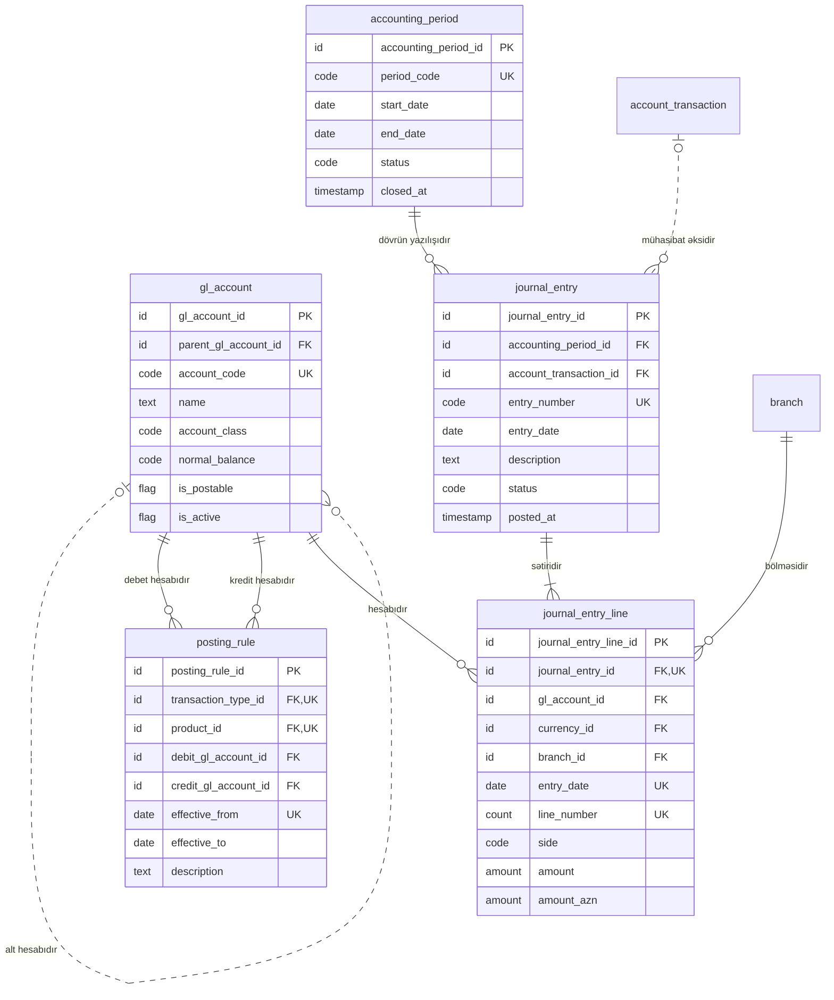

<!-- Bu fayl avtomatik yaradılıb (uv run bankmodel generate). Əl ilə redaktə etməyin. -->

# Baş kitab (sadələşdirilmiş) (`ledger`) — məntiqi model

[← Məntiqi model](index.md) | [Konseptual model](../01_konseptual/08_ledger.md) · **Məntiqi model** · [Fiziki model](../03_fiziki/08_ledger.md)

Əməliyyatların mühasibat uçotunda əks olunması üçün sadələşdirilmiş baş kitab: baş kitab hesabları, mühasibat dövrləri, yazılış qaydaları və ikili yazılışlar (debet = kredit). AMB hesablar planının tam iyerarxiyası modelləşdirilmir; hesablar valideyn hesab vasitəsilə qruplaşdırılır.

## Diaqram

## Obyektlər

### 1. `gl_account` — Baş kitab hesabı

Balans və balansdankənar baş kitab hesabları; qrup hesabları və yazılış aparılan hesablar.

| # | Atribut | Məntiqi tip | Məcburi | Açar | Təsvir |
|---|---|---|---|---|---|
| 1 | `gl_account_id` | İdentifikator | Bəli | PK | Baş kitab hesabı — surrogat identifikator (UUIDv7). |
| 2 | `parent_gl_account_id` | İdentifikator | Xeyr | FK | Baş kitab hesabı istinadı (alt hesabıdır). |
| 3 | `account_code` | Kod | Bəli | AK1 | Hesabın kodu. |
| 4 | `name` | Mətn | Bəli |  | Hesabın adı. |
| 5 | `account_class` | Kod | Bəli |  | Hesab sinfi. Dəyərlər: `ASSET`, `LIABILITY`, `EQUITY`, `INCOME`, `EXPENSE`, `OFF_BALANCE` |
| 6 | `normal_balance` | Kod | Bəli |  | Normal qalıq tərəfi. Dəyərlər: `DEBIT`, `CREDIT` |
| 7 | `is_postable` | Bayraq (bəli/xeyr) | Bəli |  | Bu hesaba yazılış aparıla bilər (qrup hesabı deyil). Susmaya görə: `true` |
| 8 | `is_active` | Bayraq (bəli/xeyr) | Bəli |  | Hesab aktivdir. Susmaya görə: `true` |

**Əsas açar:** `gl_account_id`

**Alternativ açarlar:**

- AK1: `account_code`

**Əlaqələr:**

| FK atributu | İstinad obyekti | Kardinallıq | Əlaqə |
|---|---|---|---|
| `parent_gl_account_id` | `ledger.gl_account` (Baş kitab hesabı) | 0..1 : 0..N | alt hesabıdır |

### 2. `accounting_period` — Mühasibat dövrü

Aylıq mühasibat dövrləri və onların statusu (açıq, bağlanır, bağlı). Bağlı dövrə yazılış aparılmır.

| # | Atribut | Məntiqi tip | Məcburi | Açar | Təsvir |
|---|---|---|---|---|---|
| 1 | `accounting_period_id` | İdentifikator | Bəli | PK | Mühasibat dövrü — surrogat identifikator (UUIDv7). |
| 2 | `period_code` | Kod | Bəli | AK1 | Dövrün kodu (2026-10). |
| 3 | `start_date` | Tarix | Bəli |  | Dövrün başlanğıcı. |
| 4 | `end_date` | Tarix | Bəli |  | Dövrün sonu. |
| 5 | `status` | Kod | Bəli |  | Status. Dəyərlər: `OPEN`, `CLOSING`, `CLOSED` |
| 6 | `closed_at` | Tarix-vaxt | Xeyr |  | Bağlanma anı. |

**Əsas açar:** `accounting_period_id`

**Alternativ açarlar:**

- AK1: `period_code`

**Biznes qaydaları:**

- Dövrün sonu başlanğıcdan əvvəl ola bilməz.

### 3. `posting_rule` — Yazılış qaydası

Məhsul və əməliyyat növünə görə debet və kredit baş kitab hesablarının müəyyən edilməsi qaydası; məhsul göstərilməyibsə qayda bütün məhsullara aiddir.

| # | Atribut | Məntiqi tip | Məcburi | Açar | Təsvir |
|---|---|---|---|---|---|
| 1 | `posting_rule_id` | İdentifikator | Bəli | PK | Yazılış qaydası — surrogat identifikator (UUIDv7). |
| 2 | `transaction_type_id` | İdentifikator | Bəli | FK, AK1 | Əməliyyat növü istinadı (qaydasıdır). |
| 3 | `product_id` | İdentifikator | Xeyr | FK, AK1 | Məhsul istinadı (qaydasıdır). |
| 4 | `debit_gl_account_id` | İdentifikator | Bəli | FK | Baş kitab hesabı istinadı (debet hesabıdır). |
| 5 | `credit_gl_account_id` | İdentifikator | Bəli | FK | Baş kitab hesabı istinadı (kredit hesabıdır). |
| 6 | `effective_from` | Tarix | Bəli | AK1 | Qüvvəyə minmə tarixi. |
| 7 | `effective_to` | Tarix | Xeyr |  | Qüvvədən düşmə tarixi. |
| 8 | `description` | Mətn | Xeyr |  | Qaydanın izahı. |

**Əsas açar:** `posting_rule_id`

**Alternativ açarlar:**

- AK1: `transaction_type_id`, `product_id`, `effective_from` (boş dəyərlər də təkrarlana bilməz)

**Əlaqələr:**

| FK atributu | İstinad obyekti | Kardinallıq | Əlaqə |
|---|---|---|---|
| `transaction_type_id` | `ref.transaction_type` (Əməliyyat növü) | 1 : 0..N | qaydasıdır |
| `product_id` | `ref.product` (Məhsul) | 0..1 : 0..N | qaydasıdır |
| `debit_gl_account_id` | `ledger.gl_account` (Baş kitab hesabı) | 1 : 0..N | debet hesabıdır |
| `credit_gl_account_id` | `ledger.gl_account` (Baş kitab hesabı) | 1 : 0..N | kredit hesabıdır |

**Biznes qaydaları:**

- Debet və kredit hesabları fərqli olmalıdır.
- Bitmə tarixi başlanğıcdan əvvəl ola bilməz.

### 4. `journal_entry` — Mühasibat yazılışı

Mühasibat yazılışının başlığı: yazılış tarixi, dövr, mənbə hesab əməliyyatı, təsvir, status (qaralama/yazılıb/storno).

| # | Atribut | Məntiqi tip | Məcburi | Açar | Təsvir |
|---|---|---|---|---|---|
| 1 | `journal_entry_id` | İdentifikator | Bəli | PK | Mühasibat yazılışı — surrogat identifikator (UUIDv7). |
| 2 | `accounting_period_id` | İdentifikator | Bəli | FK | Mühasibat dövrü istinadı (dövrün yazılışıdır). |
| 3 | `account_transaction_id` | İdentifikator | Xeyr | FK | Hesab əməliyyatı istinadı (mühasibat əksidir). |
| 4 | `entry_number` | Kod | Bəli | AK1 | Yazılışın nömrəsi. |
| 5 | `entry_date` | Tarix | Bəli |  | Yazılış tarixi. |
| 6 | `description` | Mətn | Bəli |  | Təsvir. |
| 7 | `status` | Kod | Bəli |  | Status. Dəyərlər: `DRAFT`, `POSTED`, `REVERSED` |
| 8 | `posted_at` | Tarix-vaxt | Xeyr |  | Yazılış anı. |

**Əsas açar:** `journal_entry_id`

**Alternativ açarlar:**

- AK1: `entry_number`

**Əlaqələr:**

| FK atributu | İstinad obyekti | Kardinallıq | Əlaqə |
|---|---|---|---|
| `accounting_period_id` | `ledger.accounting_period` (Mühasibat dövrü) | 1 : 0..N | dövrün yazılışıdır |
| `account_transaction_id` | `account.account_transaction` (Hesab əməliyyatı) | 0..1 : 0..N | mühasibat əksidir |

**Biznes qaydaları:**

- Yazılmış yazılışın yazılış anı olmalıdır.

### 5. `journal_entry_line` — Yazılış sətri

Yazılışın debet və kredit sətirləri; hər yazılış üzrə AZN ekvivalentində debet və kredit cəmi bərabər olmalıdır (tətbiq səviyyəsində yazılış zamanı yoxlanılır). Yüksək həcmli cədvəldir, aylar üzrə bölmələnir.

| # | Atribut | Məntiqi tip | Məcburi | Açar | Təsvir |
|---|---|---|---|---|---|
| 1 | `journal_entry_line_id` | İdentifikator | Bəli | PK | Yazılış sətri — surrogat identifikator (UUIDv7). |
| 2 | `journal_entry_id` | İdentifikator | Bəli | FK, AK1 | Mühasibat yazılışı istinadı (sətiridir). |
| 3 | `gl_account_id` | İdentifikator | Bəli | FK | Baş kitab hesabı istinadı (hesabıdır). |
| 4 | `currency_id` | İdentifikator | Bəli | FK | Valyuta istinadı (valyutasıdır). |
| 5 | `branch_id` | İdentifikator | Bəli | FK | Filial istinadı (bölməsidir). |
| 6 | `entry_date` | Tarix | Bəli | AK1 | Yazılış tarixi (bölmə açarı). |
| 7 | `line_number` | Say | Bəli | AK1 | Sətrin sıra nömrəsi. |
| 8 | `side` | Kod | Bəli |  | Debet və ya kredit. Dəyərlər: `DEBIT`, `CREDIT` |
| 9 | `amount` | Məbləğ | Bəli |  | Sətrin valyutasında məbləğ. |
| 10 | `amount_azn` | Məbləğ | Bəli |  | AZN ekvivalenti (AMB rəsmi məzənnəsi ilə). |

**Əsas açar:** `journal_entry_line_id`

**Alternativ açarlar:**

- AK1: `journal_entry_id`, `line_number`, `entry_date`

**Əlaqələr:**

| FK atributu | İstinad obyekti | Kardinallıq | Əlaqə |
|---|---|---|---|
| `journal_entry_id` | `ledger.journal_entry` (Mühasibat yazılışı) | 1 : 1..N | sətiridir |
| `gl_account_id` | `ledger.gl_account` (Baş kitab hesabı) | 1 : 0..N | hesabıdır |
| `currency_id` | `ref.currency` (Valyuta) | 1 : 0..N | valyutasıdır |
| `branch_id` | `org.branch` (Filial) | 1 : 0..N | bölməsidir |

**Biznes qaydaları:**

- Məbləğlər müsbət olmalıdır.
