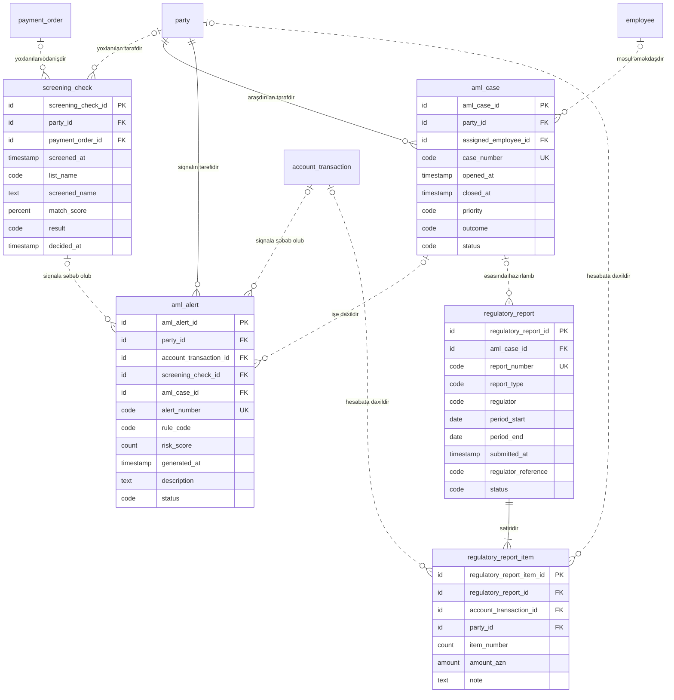

<!-- Bu fayl avtomatik yaradılıb (uv run bankmodel generate). Əl ilə redaktə etməyin. -->

# Uyğunluq və AML (sadələşdirilmiş) (`compliance`) — məntiqi model

[← Məntiqi model](index.md) | [Konseptual model](../01_konseptual/09_compliance.md) · **Məntiqi model** · [Fiziki model](../03_fiziki/09_compliance.md)

Cinayət yolu ilə əldə edilmiş gəlirlərin leqallaşdırılmasına qarşı mübarizə (AML): sanksiya və PEP yoxlamaları, şübhəli əməliyyat siqnalları, araşdırma işləri və Maliyyə Monitorinqi Xidmətinə (MMX) hesabatlar.

## Diaqram

## Obyektlər

### 1. `screening_check` — Sanksiya / PEP yoxlaması

Tərəfin və ya ödənişin sanksiya və PEP siyahıları üzrə yoxlanılması: siyahı, uyğunluq dərəcəsi, nəticə, qərar.

| # | Atribut | Məntiqi tip | Məcburi | Açar | Təsvir |
|---|---|---|---|---|---|
| 1 | `screening_check_id` | İdentifikator | Bəli | PK | Sanksiya / PEP yoxlaması — surrogat identifikator (UUIDv7). |
| 2 | `party_id` | İdentifikator | Xeyr | FK | Tərəf istinadı (yoxlanılan tərəfdir). |
| 3 | `payment_order_id` | İdentifikator | Xeyr | FK | Ödəniş tapşırığı istinadı (yoxlanılan ödənişdir). |
| 4 | `screened_at` | Tarix-vaxt | Bəli |  | Yoxlama anı. Susmaya görə: `now()` |
| 5 | `list_name` | Kod | Bəli |  | Siyahı. Dəyərlər: `UN`, `EU`, `OFAC`, `UK_HMT`, `LOCAL`, `PEP` |
| 6 | `screened_name` | Mətn | Bəli |  | Yoxlanılan ad. |
| 7 | `match_score` | Faiz payı | Xeyr |  | Uyğunluq dərəcəsi (%). |
| 8 | `result` | Kod | Bəli |  | Nəticə. Dəyərlər: `NO_MATCH`, `POTENTIAL_MATCH`, `TRUE_MATCH`, `FALSE_POSITIVE` |
| 9 | `decided_at` | Tarix-vaxt | Xeyr |  | Əməkdaşın qərar anı (potensial uyğunluqlar üçün). |

**Əsas açar:** `screening_check_id`

**Əlaqələr:**

| FK atributu | İstinad obyekti | Kardinallıq | Əlaqə |
|---|---|---|---|
| `party_id` | `party.party` (Tərəf) | 0..1 : 0..N | yoxlanılan tərəfdir |
| `payment_order_id` | `payment.payment_order` (Ödəniş tapşırığı) | 0..1 : 0..N | yoxlanılan ödənişdir |

**Biznes qaydaları:**

- Yoxlanılan tərəf və ya ödəniş göstərilməlidir.

### 2. `aml_case` — AML işi

Bir və ya bir neçə siqnalın araşdırıldığı iş: məsul əməkdaş, prioritet, nəticə, MMX-yə məlumat verilib-verilməməsi.

| # | Atribut | Məntiqi tip | Məcburi | Açar | Təsvir |
|---|---|---|---|---|---|
| 1 | `aml_case_id` | İdentifikator | Bəli | PK | AML işi — surrogat identifikator (UUIDv7). |
| 2 | `party_id` | İdentifikator | Bəli | FK | Tərəf istinadı (araşdırılan tərəfdir). |
| 3 | `assigned_employee_id` | İdentifikator | Xeyr | FK | Əməkdaş istinadı (məsul əməkdaşdır). |
| 4 | `case_number` | Kod | Bəli | AK1 | İşin nömrəsi. |
| 5 | `opened_at` | Tarix-vaxt | Bəli |  | Açılma anı. Susmaya görə: `now()` |
| 6 | `closed_at` | Tarix-vaxt | Xeyr |  | Bağlanma anı. |
| 7 | `priority` | Kod | Bəli |  | Prioritet. Dəyərlər: `LOW`, `MEDIUM`, `HIGH` |
| 8 | `outcome` | Kod | Xeyr |  | Nəticə. Dəyərlər: `NO_ACTION`, `REPORTED_TO_FMS`, `ACCOUNT_RESTRICTED`, `RELATIONSHIP_TERMINATED` |
| 9 | `status` | Kod | Bəli |  | Status. Dəyərlər: `OPEN`, `IN_PROGRESS`, `CLOSED` |

**Əsas açar:** `aml_case_id`

**Alternativ açarlar:**

- AK1: `case_number`

**Əlaqələr:**

| FK atributu | İstinad obyekti | Kardinallıq | Əlaqə |
|---|---|---|---|
| `party_id` | `party.party` (Tərəf) | 1 : 0..N | araşdırılan tərəfdir |
| `assigned_employee_id` | `org.employee` (Əməkdaş) | 0..1 : 0..N | məsul əməkdaşdır |

**Biznes qaydaları:**

- Bağlı işin bağlanma anı və nəticəsi olmalıdır.

### 3. `aml_alert` — AML siqnalı

Monitorinq qaydası və ya sanksiya yoxlaması ilə yaradılan şübhəli fəaliyyət siqnalı: qayda, risk balı, status.

| # | Atribut | Məntiqi tip | Məcburi | Açar | Təsvir |
|---|---|---|---|---|---|
| 1 | `aml_alert_id` | İdentifikator | Bəli | PK | AML siqnalı — surrogat identifikator (UUIDv7). |
| 2 | `party_id` | İdentifikator | Bəli | FK | Tərəf istinadı (siqnalın tərəfidir). |
| 3 | `account_transaction_id` | İdentifikator | Xeyr | FK | Hesab əməliyyatı istinadı (siqnala səbəb olub). |
| 4 | `screening_check_id` | İdentifikator | Xeyr | FK | Sanksiya / PEP yoxlaması istinadı (siqnala səbəb olub). |
| 5 | `aml_case_id` | İdentifikator | Xeyr | FK | AML işi istinadı (işə daxildir). |
| 6 | `alert_number` | Kod | Bəli | AK1 | Siqnalın nömrəsi. |
| 7 | `rule_code` | Kod | Bəli |  | Siqnalı yaradan monitorinq qaydasının kodu. |
| 8 | `risk_score` | Say | Bəli |  | Risk balı (0–100). |
| 9 | `generated_at` | Tarix-vaxt | Bəli |  | Yaranma anı. Susmaya görə: `now()` |
| 10 | `description` | Mətn | Xeyr |  | Təsvir. |
| 11 | `status` | Kod | Bəli |  | Status. Dəyərlər: `NEW`, `UNDER_REVIEW`, `ESCALATED`, `CLOSED_FALSE_POSITIVE`, `CLOSED_CONFIRMED` |

**Əsas açar:** `aml_alert_id`

**Alternativ açarlar:**

- AK1: `alert_number`

**Əlaqələr:**

| FK atributu | İstinad obyekti | Kardinallıq | Əlaqə |
|---|---|---|---|
| `party_id` | `party.party` (Tərəf) | 1 : 0..N | siqnalın tərəfidir |
| `account_transaction_id` | `account.account_transaction` (Hesab əməliyyatı) | 0..1 : 0..N | siqnala səbəb olub |
| `screening_check_id` | `compliance.screening_check` (Sanksiya / PEP yoxlaması) | 0..1 : 0..N | siqnala səbəb olub |
| `aml_case_id` | `compliance.aml_case` (AML işi) | 0..1 : 0..N | işə daxildir |

**Biznes qaydaları:**

- Risk balı 0–100 arasında olmalıdır.

### 4. `regulatory_report` — Tənzimləyici hesabat

MMX-yə (şübhəli əməliyyat, hədd məbləğini aşan əməliyyat) və AMB-yə göndərilən hesabat: növ, dövr, göndərilmə tarixi, status.

| # | Atribut | Məntiqi tip | Məcburi | Açar | Təsvir |
|---|---|---|---|---|---|
| 1 | `regulatory_report_id` | İdentifikator | Bəli | PK | Tənzimləyici hesabat — surrogat identifikator (UUIDv7). |
| 2 | `aml_case_id` | İdentifikator | Xeyr | FK | AML işi istinadı (əsasında hazırlanıb). |
| 3 | `report_number` | Kod | Bəli | AK1 | Hesabatın nömrəsi. |
| 4 | `report_type` | Kod | Bəli |  | Hesabatın növü: şübhəli əməliyyat, hədd məbləğini aşan əməliyyat, AMB-yə dövri hesabat. Dəyərlər: `SUSPICIOUS_TRANSACTION`, `THRESHOLD_TRANSACTION`, `CBAR_PERIODIC` |
| 5 | `regulator` | Kod | Bəli |  | Alan orqan. Dəyərlər: `FMS`, `CBAR` |
| 6 | `period_start` | Tarix | Xeyr |  | Hesabat dövrünün başlanğıcı. |
| 7 | `period_end` | Tarix | Xeyr |  | Hesabat dövrünün sonu. |
| 8 | `submitted_at` | Tarix-vaxt | Xeyr |  | Göndərilmə anı. |
| 9 | `regulator_reference` | Kod | Xeyr |  | Orqanın qəbul nömrəsi. |
| 10 | `status` | Kod | Bəli |  | Status. Dəyərlər: `DRAFT`, `SUBMITTED`, `ACCEPTED`, `REJECTED` |

**Əsas açar:** `regulatory_report_id`

**Alternativ açarlar:**

- AK1: `report_number`

**Əlaqələr:**

| FK atributu | İstinad obyekti | Kardinallıq | Əlaqə |
|---|---|---|---|
| `aml_case_id` | `compliance.aml_case` (AML işi) | 0..1 : 0..N | əsasında hazırlanıb |

**Biznes qaydaları:**

- Göndərilmiş hesabatın göndərilmə anı olmalıdır.

### 5. `regulatory_report_item` — Hesabat sətri

Hesabata daxil edilən əməliyyat və ya tərəf.

| # | Atribut | Məntiqi tip | Məcburi | Açar | Təsvir |
|---|---|---|---|---|---|
| 1 | `regulatory_report_item_id` | İdentifikator | Bəli | PK | Hesabat sətri — surrogat identifikator (UUIDv7). |
| 2 | `regulatory_report_id` | İdentifikator | Bəli | FK | Tənzimləyici hesabat istinadı (sətiridir). |
| 3 | `account_transaction_id` | İdentifikator | Xeyr | FK | Hesab əməliyyatı istinadı (hesabata daxildir). |
| 4 | `party_id` | İdentifikator | Xeyr | FK | Tərəf istinadı (hesabata daxildir). |
| 5 | `item_number` | Say | Bəli |  | Sətrin sıra nömrəsi. |
| 6 | `amount_azn` | Məbləğ | Xeyr |  | Əməliyyatın AZN ekvivalenti. |
| 7 | `note` | Mətn | Xeyr |  | Qeyd. |

**Əsas açar:** `regulatory_report_item_id`

**Əlaqələr:**

| FK atributu | İstinad obyekti | Kardinallıq | Əlaqə |
|---|---|---|---|
| `regulatory_report_id` | `compliance.regulatory_report` (Tənzimləyici hesabat) | 1 : 1..N | sətiridir |
| `account_transaction_id` | `account.account_transaction` (Hesab əməliyyatı) | 0..1 : 0..N | hesabata daxildir |
| `party_id` | `party.party` (Tərəf) | 0..1 : 0..N | hesabata daxildir |

**Biznes qaydaları:**

- Əməliyyat və ya tərəf göstərilməlidir.
