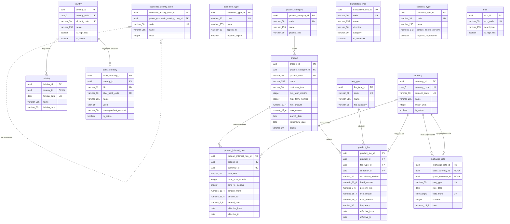

<!-- Bu fayl avtomatik yaradılıb (uv run bankmodel generate). Əl ilə redaktə etməyin. -->

# İstinad məlumatları (`ref`) — fiziki model

[← Fiziki model](index.md) | [Konseptual model](../01_konseptual/01_ref.md) · [Məntiqi model](../02_mentiqi/01_ref.md) · **Fiziki model**

Bütün domenlərin istifadə etdiyi kataloqlar və sorğu cədvəlləri: valyutalar, ölkələr, məzənnələr, bank kataloqu, məhsul kataloqu, əməliyyat, komissiya, sənəd və girov növləri. Biznes tərəfindən idarə olunan və vaxtaşırı dəyişən kod siyahıları burada saxlanılır.

## Diaqram

Audit sütunları diaqramda göstərilmir.

## Cədvəllər

### `ref.currency` — Valyuta

ISO 4217 valyuta kataloqu (AZN, USD, EUR və s.).

| # | Sütun | Tip | NULL | Default | Şərh |
|---|---|---|---|---|---|
| 1 | `currency_id` | `uuid` | NOT NULL | `uuidv7()` | Valyuta — surrogat identifikator (UUIDv7). |
| 2 | `currency_code` | `char(3)` | NOT NULL |  | ISO 4217 hərf kodu (AZN, USD, EUR). |
| 3 | `numeric_code` | `varchar(30)` | NOT NULL |  | ISO 4217 rəqəm kodu (944 — AZN). |
| 4 | `name` | `varchar(255)` | NOT NULL |  | Valyutanın adı. |
| 5 | `minor_units` | `integer` | NOT NULL | `2` | Kəsr hissəsinin rəqəm sayı (AZN üçün 2). |
| 6 | `is_active` | `boolean` | NOT NULL | `true` | Valyuta ilə əməliyyat aparılırmı. |
| 7 | `created_at` | `timestamptz` | NOT NULL | `now()` | Yazılışın yaradıldığı an. |
| 8 | `created_by` | `varchar(100)` | NOT NULL | `current_user` | Yazılışı yaradan istifadəçi. |
| 9 | `updated_at` | `timestamptz` | NULL |  | Son dəyişiklik anı. |
| 10 | `updated_by` | `varchar(100)` | NULL |  | Son dəyişikliyi edən istifadəçi. |

**Məhdudiyyətlər:**

| Ad | Növ | Tərif | Təsvir |
|---|---|---|---|
| `pk_currency` | PRIMARY KEY | `PRIMARY KEY (currency_id)` | Əsas açar |
| `uq_currency_currency_code` | UNIQUE | `UNIQUE (currency_code)` | Alternativ açar |
| `uq_currency_numeric_code` | UNIQUE | `UNIQUE (numeric_code)` | Alternativ açar |
| `ck_currency_minor_units_range` | CHECK | `CHECK (minor_units BETWEEN 0 AND 4)` | Kəsr rəqəmləri 0–4 arasında olmalıdır. |

### `ref.country` — Ölkə

ISO 3166 ölkə kataloqu; rezidentlik, vətəndaşlıq, ünvan və sanksiya riskinin müəyyən edilməsi üçün.

| # | Sütun | Tip | NULL | Default | Şərh |
|---|---|---|---|---|---|
| 1 | `country_id` | `uuid` | NOT NULL | `uuidv7()` | Ölkə — surrogat identifikator (UUIDv7). |
| 2 | `country_code` | `char(2)` | NOT NULL |  | ISO 3166-1 alpha-2 kodu (AZ). |
| 3 | `alpha3_code` | `varchar(30)` | NOT NULL |  | ISO 3166-1 alpha-3 kodu (AZE). |
| 4 | `name` | `varchar(255)` | NOT NULL |  | Ölkənin adı. |
| 5 | `is_high_risk` | `boolean` | NOT NULL | `false` | FATF və ya daxili siyasət üzrə yüksək riskli ölkə. |
| 6 | `is_active` | `boolean` | NOT NULL | `true` | Kataloqda aktivdir. |
| 7 | `created_at` | `timestamptz` | NOT NULL | `now()` | Yazılışın yaradıldığı an. |
| 8 | `created_by` | `varchar(100)` | NOT NULL | `current_user` | Yazılışı yaradan istifadəçi. |
| 9 | `updated_at` | `timestamptz` | NULL |  | Son dəyişiklik anı. |
| 10 | `updated_by` | `varchar(100)` | NULL |  | Son dəyişikliyi edən istifadəçi. |

**Məhdudiyyətlər:**

| Ad | Növ | Tərif | Təsvir |
|---|---|---|---|
| `pk_country` | PRIMARY KEY | `PRIMARY KEY (country_id)` | Əsas açar |
| `uq_country_country_code` | UNIQUE | `UNIQUE (country_code)` | Alternativ açar |
| `uq_country_alpha3_code` | UNIQUE | `UNIQUE (alpha3_code)` | Alternativ açar |

### `ref.exchange_rate` — Valyuta məzənnəsi

Valyuta cütü üzrə tarixə görə məzənnələr: AMB-nin rəsmi məzənnəsi və bankın nağd/nağdsız alış-satış məzənnələri.

| # | Sütun | Tip | NULL | Default | Şərh |
|---|---|---|---|---|---|
| 1 | `exchange_rate_id` | `uuid` | NOT NULL | `uuidv7()` | Valyuta məzənnəsi — surrogat identifikator (UUIDv7). |
| 2 | `base_currency_id` | `uuid` | NOT NULL |  | Valyuta istinadı (əsas valyutasıdır). |
| 3 | `quote_currency_id` | `uuid` | NOT NULL |  | Valyuta istinadı (qarşı valyutasıdır). |
| 4 | `rate_type` | `varchar(30)` | NOT NULL |  | Məzənnə növü: AMB rəsmi, nağd alış/satış, nağdsız alış/satış. Dəyərlər: `OFFICIAL_CBAR`, `CASH_BUY`, `CASH_SELL`, `NONCASH_BUY`, `NONCASH_SELL` |
| 5 | `rate_date` | `date` | NOT NULL |  | Məzənnənin aid olduğu tarix. |
| 6 | `valid_from` | `timestamptz` | NOT NULL |  | Məzənnənin qüvvəyə mindiyi an (gün ərzində bir neçə dəfə dəyişə bilər). |
| 7 | `nominal` | `integer` | NOT NULL | `1` | Neçə vahid əsas valyuta üçün (adətən 1). |
| 8 | `rate` | `numeric(18,8)` | NOT NULL |  | Nominal qədər əsas valyutanın qarşı valyutada dəyəri. |
| 9 | `created_at` | `timestamptz` | NOT NULL | `now()` | Yazılışın yaradıldığı an. |
| 10 | `created_by` | `varchar(100)` | NOT NULL | `current_user` | Yazılışı yaradan istifadəçi. |
| 11 | `updated_at` | `timestamptz` | NULL |  | Son dəyişiklik anı. |
| 12 | `updated_by` | `varchar(100)` | NULL |  | Son dəyişikliyi edən istifadəçi. |

**Məhdudiyyətlər:**

| Ad | Növ | Tərif | Təsvir |
|---|---|---|---|
| `pk_exchange_rate` | PRIMARY KEY | `PRIMARY KEY (exchange_rate_id)` | Əsas açar |
| `uq_exchange_rate_base_currency_id_quote_currency_id_ra_27883c42` | UNIQUE | `UNIQUE (base_currency_id, quote_currency_id, rate_type, valid_from)` | Alternativ açar |
| `ck_exchange_rate_rate_type` | CHECK | `CHECK (rate_type IN ('OFFICIAL_CBAR', 'CASH_BUY', 'CASH_SELL', 'NONCASH_BUY', 'NONCASH_SELL'))` | İcazəli dəyərlər |
| `ck_exchange_rate_rate_positive` | CHECK | `CHECK (rate > 0 AND nominal > 0)` | Məzənnə və nominal müsbət olmalıdır. |
| `ck_exchange_rate_distinct_currencies` | CHECK | `CHECK (base_currency_id <> quote_currency_id)` | Əsas və qarşı valyuta fərqli olmalıdır. |
| `fk_exchange_rate_base_currency_id` | FOREIGN KEY | `FOREIGN KEY (base_currency_id) REFERENCES ref.currency (currency_id)` | İstinad bütövlüyü |
| `fk_exchange_rate_quote_currency_id` | FOREIGN KEY | `FOREIGN KEY (quote_currency_id) REFERENCES ref.currency (currency_id)` | İstinad bütövlüyü |

**İndekslər:**

| Ad | Sütunlar | Şərt | Səbəb |
|---|---|---|---|
| `ix_exchange_rate_quote_currency_id` | `quote_currency_id` |  | FK |

### `ref.holiday` — Qeyri-iş günü

Bayram və qeyri-iş günləri təqvimi; dəyər tarixi, ödəniş qrafiki və faiz hesablanması üçün istifadə olunur.

| # | Sütun | Tip | NULL | Default | Şərh |
|---|---|---|---|---|---|
| 1 | `holiday_id` | `uuid` | NOT NULL | `uuidv7()` | Qeyri-iş günü — surrogat identifikator (UUIDv7). |
| 2 | `country_id` | `uuid` | NOT NULL |  | Ölkə istinadı (təqvimidir). |
| 3 | `holiday_date` | `date` | NOT NULL |  | Qeyri-iş günü. |
| 4 | `name` | `varchar(255)` | NOT NULL |  | Bayramın və ya günün adı. |
| 5 | `holiday_type` | `varchar(30)` | NOT NULL |  | Növ: dövlət bayramı, köçürülmüş istirahət günü, bankın qeyri-iş günü. Dəyərlər: `PUBLIC_HOLIDAY`, `TRANSFERRED_DAY_OFF`, `BANK_HOLIDAY` |
| 6 | `created_at` | `timestamptz` | NOT NULL | `now()` | Yazılışın yaradıldığı an. |
| 7 | `created_by` | `varchar(100)` | NOT NULL | `current_user` | Yazılışı yaradan istifadəçi. |
| 8 | `updated_at` | `timestamptz` | NULL |  | Son dəyişiklik anı. |
| 9 | `updated_by` | `varchar(100)` | NULL |  | Son dəyişikliyi edən istifadəçi. |

**Məhdudiyyətlər:**

| Ad | Növ | Tərif | Təsvir |
|---|---|---|---|
| `pk_holiday` | PRIMARY KEY | `PRIMARY KEY (holiday_id)` | Əsas açar |
| `uq_holiday_country_id_holiday_date` | UNIQUE | `UNIQUE (country_id, holiday_date)` | Alternativ açar |
| `ck_holiday_holiday_type` | CHECK | `CHECK (holiday_type IN ('PUBLIC_HOLIDAY', 'TRANSFERRED_DAY_OFF', 'BANK_HOLIDAY'))` | İcazəli dəyərlər |
| `fk_holiday_country_id` | FOREIGN KEY | `FOREIGN KEY (country_id) REFERENCES ref.country (country_id)` | İstinad bütövlüyü |

### `ref.bank_directory` — Bank kataloqu

Yerli və xarici banklar: BIC/SWIFT kodu, AMB bank kodu, müxbir hesab məlumatları.

| # | Sütun | Tip | NULL | Default | Şərh |
|---|---|---|---|---|---|
| 1 | `bank_directory_id` | `uuid` | NOT NULL | `uuidv7()` | Bank kataloqu — surrogat identifikator (UUIDv7). |
| 2 | `country_id` | `uuid` | NOT NULL |  | Ölkə istinadı (qeydiyyat ölkəsidir). |
| 3 | `bic` | `varchar(11)` | NULL |  | SWIFT BIC kodu. |
| 4 | `cbar_bank_code` | `varchar(30)` | NULL |  | AMB tərəfindən verilmiş 6 rəqəmli bank kodu (yerli banklar üçün). |
| 5 | `name` | `varchar(255)` | NOT NULL |  | Bankın adı. |
| 6 | `voen` | `char(10)` | NULL |  | Bankın VÖEN-i (yerli banklar üçün). |
| 7 | `correspondent_account` | `varchar(30)` | NULL |  | Bankın AMB-dəki müxbir hesabı. |
| 8 | `is_active` | `boolean` | NOT NULL | `true` | Bank fəaliyyətdədir. |
| 9 | `created_at` | `timestamptz` | NOT NULL | `now()` | Yazılışın yaradıldığı an. |
| 10 | `created_by` | `varchar(100)` | NOT NULL | `current_user` | Yazılışı yaradan istifadəçi. |
| 11 | `updated_at` | `timestamptz` | NULL |  | Son dəyişiklik anı. |
| 12 | `updated_by` | `varchar(100)` | NULL |  | Son dəyişikliyi edən istifadəçi. |

**Məhdudiyyətlər:**

| Ad | Növ | Tərif | Təsvir |
|---|---|---|---|
| `pk_bank_directory` | PRIMARY KEY | `PRIMARY KEY (bank_directory_id)` | Əsas açar |
| `uq_bank_directory_bic` | UNIQUE | `UNIQUE (bic)` | Alternativ açar |
| `uq_bank_directory_cbar_bank_code` | UNIQUE | `UNIQUE (cbar_bank_code)` | Alternativ açar |
| `ck_bank_directory_has_identifier` | CHECK | `CHECK (num_nonnulls(bic, cbar_bank_code) >= 1)` | BIC və ya AMB bank kodundan ən azı biri olmalıdır. |
| `fk_bank_directory_country_id` | FOREIGN KEY | `FOREIGN KEY (country_id) REFERENCES ref.country (country_id)` | İstinad bütövlüyü |

**İndekslər:**

| Ad | Sütunlar | Şərt | Səbəb |
|---|---|---|---|
| `ix_bank_directory_country_id` | `country_id` |  | FK |

### `ref.economic_activity_code` — İqtisadi fəaliyyət növü

İqtisadi fəaliyyət növlərinin iyerarxik təsnifatı (İFNT/NACE); hüquqi şəxslər və fərdi sahibkarlar üçün.

| # | Sütun | Tip | NULL | Default | Şərh |
|---|---|---|---|---|---|
| 1 | `economic_activity_code_id` | `uuid` | NOT NULL | `uuidv7()` | İqtisadi fəaliyyət növü — surrogat identifikator (UUIDv7). |
| 2 | `parent_economic_activity_code_id` | `uuid` | NULL |  | İqtisadi fəaliyyət növü istinadı (alt bölməsidir). |
| 3 | `code` | `varchar(30)` | NOT NULL |  | Təsnifat kodu. |
| 4 | `name` | `varchar(255)` | NOT NULL |  | Fəaliyyət növünün adı. |
| 5 | `level` | `integer` | NOT NULL |  | İyerarxiya səviyyəsi (1 — bölmə, sonrakılar — alt bölmələr). |
| 6 | `created_at` | `timestamptz` | NOT NULL | `now()` | Yazılışın yaradıldığı an. |
| 7 | `created_by` | `varchar(100)` | NOT NULL | `current_user` | Yazılışı yaradan istifadəçi. |
| 8 | `updated_at` | `timestamptz` | NULL |  | Son dəyişiklik anı. |
| 9 | `updated_by` | `varchar(100)` | NULL |  | Son dəyişikliyi edən istifadəçi. |

**Məhdudiyyətlər:**

| Ad | Növ | Tərif | Təsvir |
|---|---|---|---|
| `pk_economic_activity_code` | PRIMARY KEY | `PRIMARY KEY (economic_activity_code_id)` | Əsas açar |
| `uq_economic_activity_code_code` | UNIQUE | `UNIQUE (code)` | Alternativ açar |
| `fk_economic_activity_code_parent_economic_activity_code_id` | FOREIGN KEY | `FOREIGN KEY (parent_economic_activity_code_id) REFERENCES ref.economic_activity_code (economic_activity_code_id)` | İstinad bütövlüyü |

**İndekslər:**

| Ad | Sütunlar | Şərt | Səbəb |
|---|---|---|---|
| `ix_economic_activity_code_parent_economic_activity_code_id` | `parent_economic_activity_code_id` |  | FK |

### `ref.document_type` — Sənəd növü

Şəxsiyyət və qeydiyyat sənədlərinin növləri: şəxsiyyət vəsiqəsi, pasport, yaşayış icazəsi, dövlət qeydiyyatı şəhadətnaməsi və s.

| # | Sütun | Tip | NULL | Default | Şərh |
|---|---|---|---|---|---|
| 1 | `document_type_id` | `uuid` | NOT NULL | `uuidv7()` | Sənəd növü — surrogat identifikator (UUIDv7). |
| 2 | `code` | `varchar(30)` | NOT NULL |  | Sənəd növünün kodu. |
| 3 | `name` | `varchar(255)` | NOT NULL |  | Sənəd növünün adı. |
| 4 | `applies_to` | `varchar(30)` | NOT NULL |  | Hansı tərəf növü üçün. Dəyərlər: `INDIVIDUAL`, `ORGANIZATION`, `ANY` |
| 5 | `requires_expiry` | `boolean` | NOT NULL | `true` | Etibarlılıq müddəti məcburidir. |
| 6 | `created_at` | `timestamptz` | NOT NULL | `now()` | Yazılışın yaradıldığı an. |
| 7 | `created_by` | `varchar(100)` | NOT NULL | `current_user` | Yazılışı yaradan istifadəçi. |
| 8 | `updated_at` | `timestamptz` | NULL |  | Son dəyişiklik anı. |
| 9 | `updated_by` | `varchar(100)` | NULL |  | Son dəyişikliyi edən istifadəçi. |

**Məhdudiyyətlər:**

| Ad | Növ | Tərif | Təsvir |
|---|---|---|---|
| `pk_document_type` | PRIMARY KEY | `PRIMARY KEY (document_type_id)` | Əsas açar |
| `uq_document_type_code` | UNIQUE | `UNIQUE (code)` | Alternativ açar |
| `ck_document_type_applies_to` | CHECK | `CHECK (applies_to IN ('INDIVIDUAL', 'ORGANIZATION', 'ANY'))` | İcazəli dəyərlər |

### `ref.product_category` — Məhsul kateqoriyası

Bank məhsullarının qrupları: cari hesab, əmanət, müddətli depozit, debet kart, kredit kartı, istehlak krediti, ipoteka, biznes krediti, kredit xətti.

| # | Sütun | Tip | NULL | Default | Şərh |
|---|---|---|---|---|---|
| 1 | `product_category_id` | `uuid` | NOT NULL | `uuidv7()` | Məhsul kateqoriyası — surrogat identifikator (UUIDv7). |
| 2 | `code` | `varchar(30)` | NOT NULL |  | Kateqoriya kodu. |
| 3 | `name` | `varchar(255)` | NOT NULL |  | Kateqoriyanın adı. |
| 4 | `product_line` | `varchar(30)` | NOT NULL |  | Məhsul xətti; hansı domenin obyektləri ilə işlədiyini müəyyən edir. Dəyərlər: `CURRENT_ACCOUNT`, `SAVINGS`, `TERM_DEPOSIT`, `DEBIT_CARD`, `CREDIT_CARD`, `CONSUMER_LOAN`, `MORTGAGE`, `BUSINESS_LOAN`, `CREDIT_LINE`, `OVERDRAFT` |
| 5 | `created_at` | `timestamptz` | NOT NULL | `now()` | Yazılışın yaradıldığı an. |
| 6 | `created_by` | `varchar(100)` | NOT NULL | `current_user` | Yazılışı yaradan istifadəçi. |
| 7 | `updated_at` | `timestamptz` | NULL |  | Son dəyişiklik anı. |
| 8 | `updated_by` | `varchar(100)` | NULL |  | Son dəyişikliyi edən istifadəçi. |

**Məhdudiyyətlər:**

| Ad | Növ | Tərif | Təsvir |
|---|---|---|---|
| `pk_product_category` | PRIMARY KEY | `PRIMARY KEY (product_category_id)` | Əsas açar |
| `uq_product_category_code` | UNIQUE | `UNIQUE (code)` | Alternativ açar |
| `ck_product_category_product_line` | CHECK | `CHECK (product_line IN ('CURRENT_ACCOUNT', 'SAVINGS', 'TERM_DEPOSIT', 'DEBIT_CARD', 'CREDIT_CARD', 'CONSUMER_LOAN', 'MORTGAGE', 'BUSINESS_LOAN', 'CREDIT_LINE', 'OVERDRAFT'))` | İcazəli dəyərlər |

### `ref.product` — Məhsul

Bankın təklif etdiyi konkret məhsul və onun ümumi parametrləri (müştəri tipi, minimal/maksimal müddət və məbləğ).

| # | Sütun | Tip | NULL | Default | Şərh |
|---|---|---|---|---|---|
| 1 | `product_id` | `uuid` | NOT NULL | `uuidv7()` | Məhsul — surrogat identifikator (UUIDv7). |
| 2 | `product_category_id` | `uuid` | NOT NULL |  | Məhsul kateqoriyası istinadı (aiddir). |
| 3 | `product_code` | `varchar(30)` | NOT NULL |  | Məhsul kodu. |
| 4 | `name` | `varchar(255)` | NOT NULL |  | Məhsulun adı. |
| 5 | `customer_type` | `varchar(30)` | NOT NULL |  | Məhsulun hədəf müştəri növü. Dəyərlər: `INDIVIDUAL`, `LEGAL_ENTITY`, `INDIVIDUAL_ENTREPRENEUR`, `ANY` |
| 6 | `min_term_months` | `integer` | NULL |  | Minimal müddət (ay). |
| 7 | `max_term_months` | `integer` | NULL |  | Maksimal müddət (ay). |
| 8 | `min_amount` | `numeric(19,4)` | NULL |  | Minimal məbləğ. |
| 9 | `max_amount` | `numeric(19,4)` | NULL |  | Maksimal məbləğ. |
| 10 | `launch_date` | `date` | NOT NULL |  | Satışa çıxarılma tarixi. |
| 11 | `withdrawal_date` | `date` | NULL |  | Satışdan çıxarılma tarixi. |
| 12 | `status` | `varchar(30)` | NOT NULL |  | Məhsulun statusu. Dəyərlər: `ACTIVE`, `SUSPENDED`, `WITHDRAWN` |
| 13 | `created_at` | `timestamptz` | NOT NULL | `now()` | Yazılışın yaradıldığı an. |
| 14 | `created_by` | `varchar(100)` | NOT NULL | `current_user` | Yazılışı yaradan istifadəçi. |
| 15 | `updated_at` | `timestamptz` | NULL |  | Son dəyişiklik anı. |
| 16 | `updated_by` | `varchar(100)` | NULL |  | Son dəyişikliyi edən istifadəçi. |

**Məhdudiyyətlər:**

| Ad | Növ | Tərif | Təsvir |
|---|---|---|---|
| `pk_product` | PRIMARY KEY | `PRIMARY KEY (product_id)` | Əsas açar |
| `uq_product_product_code` | UNIQUE | `UNIQUE (product_code)` | Alternativ açar |
| `ck_product_customer_type` | CHECK | `CHECK (customer_type IN ('INDIVIDUAL', 'LEGAL_ENTITY', 'INDIVIDUAL_ENTREPRENEUR', 'ANY'))` | İcazəli dəyərlər |
| `ck_product_status` | CHECK | `CHECK (status IN ('ACTIVE', 'SUSPENDED', 'WITHDRAWN'))` | İcazəli dəyərlər |
| `ck_product_term_range` | CHECK | `CHECK (min_term_months IS NULL OR max_term_months IS NULL OR min_term_months <= max_term_months)` | Minimal müddət maksimaldan böyük ola bilməz. |
| `ck_product_amount_range` | CHECK | `CHECK (min_amount IS NULL OR max_amount IS NULL OR min_amount <= max_amount)` | Minimal məbləğ maksimaldan böyük ola bilməz. |
| `fk_product_product_category_id` | FOREIGN KEY | `FOREIGN KEY (product_category_id) REFERENCES ref.product_category (product_category_id)` | İstinad bütövlüyü |

**İndekslər:**

| Ad | Sütunlar | Şərt | Səbəb |
|---|---|---|---|
| `ix_product_product_category_id` | `product_category_id` |  | FK |

### `ref.product_interest_rate` — Məhsul faiz dərəcəsi

Məhsul üzrə standart illik faiz dərəcələri: valyuta, müddət və məbləğ diapazonuna görə, qüvvədə olma tarixləri ilə. Faiz faktiki/365 (actual/365) bazası ilə hesablanır.

| # | Sütun | Tip | NULL | Default | Şərh |
|---|---|---|---|---|---|
| 1 | `product_interest_rate_id` | `uuid` | NOT NULL | `uuidv7()` | Məhsul faiz dərəcəsi — surrogat identifikator (UUIDv7). |
| 2 | `product_id` | `uuid` | NOT NULL |  | Məhsul istinadı (faiz dərəcəsidir). |
| 3 | `currency_id` | `uuid` | NOT NULL |  | Valyuta istinadı (valyutasıdır). |
| 4 | `rate_kind` | `varchar(30)` | NOT NULL |  | Dərəcənin növü. Dəyərlər: `DEPOSIT`, `LENDING`, `OVERDRAFT`, `PENALTY`, `CREDIT_CARD` |
| 5 | `term_from_months` | `integer` | NULL |  | Müddət diapazonunun başlanğıcı (ay). |
| 6 | `term_to_months` | `integer` | NULL |  | Müddət diapazonunun sonu (ay). |
| 7 | `amount_from` | `numeric(19,4)` | NULL |  | Məbləğ diapazonunun başlanğıcı. |
| 8 | `amount_to` | `numeric(19,4)` | NULL |  | Məbləğ diapazonunun sonu. |
| 9 | `annual_rate` | `numeric(9,6)` | NOT NULL |  | İllik faiz dərəcəsi (0.125000 = 12.5%); dəbbə üçün gündəlik dərəcə. |
| 10 | `effective_from` | `date` | NOT NULL |  | Qüvvəyə minmə tarixi. |
| 11 | `effective_to` | `date` | NULL |  | Qüvvədən düşmə tarixi. |
| 12 | `created_at` | `timestamptz` | NOT NULL | `now()` | Yazılışın yaradıldığı an. |
| 13 | `created_by` | `varchar(100)` | NOT NULL | `current_user` | Yazılışı yaradan istifadəçi. |
| 14 | `updated_at` | `timestamptz` | NULL |  | Son dəyişiklik anı. |
| 15 | `updated_by` | `varchar(100)` | NULL |  | Son dəyişikliyi edən istifadəçi. |

**Məhdudiyyətlər:**

| Ad | Növ | Tərif | Təsvir |
|---|---|---|---|
| `pk_product_interest_rate` | PRIMARY KEY | `PRIMARY KEY (product_interest_rate_id)` | Əsas açar |
| `ck_product_interest_rate_rate_kind` | CHECK | `CHECK (rate_kind IN ('DEPOSIT', 'LENDING', 'OVERDRAFT', 'PENALTY', 'CREDIT_CARD'))` | İcazəli dəyərlər |
| `ck_product_interest_rate_rate_non_negative` | CHECK | `CHECK (annual_rate >= 0)` | Faiz dərəcəsi mənfi ola bilməz. |
| `ck_product_interest_rate_valid_period` | CHECK | `CHECK (effective_to IS NULL OR effective_to >= effective_from)` | Bitmə tarixi başlanğıcdan əvvəl ola bilməz. |
| `fk_product_interest_rate_product_id` | FOREIGN KEY | `FOREIGN KEY (product_id) REFERENCES ref.product (product_id)` | İstinad bütövlüyü |
| `fk_product_interest_rate_currency_id` | FOREIGN KEY | `FOREIGN KEY (currency_id) REFERENCES ref.currency (currency_id)` | İstinad bütövlüyü |

**İndekslər:**

| Ad | Sütunlar | Şərt | Səbəb |
|---|---|---|---|
| `ix_product_interest_rate_product_id` | `product_id` |  | FK |
| `ix_product_interest_rate_currency_id` | `currency_id` |  | FK |

### `ref.fee_type` — Komissiya növü

Komissiya və haqların kataloqu: hesab xidməti, köçürmə, nağdlaşdırma, kartın illik haqqı və s.

| # | Sütun | Tip | NULL | Default | Şərh |
|---|---|---|---|---|---|
| 1 | `fee_type_id` | `uuid` | NOT NULL | `uuidv7()` | Komissiya növü — surrogat identifikator (UUIDv7). |
| 2 | `code` | `varchar(30)` | NOT NULL |  | Komissiya kodu. |
| 3 | `name` | `varchar(255)` | NOT NULL |  | Komissiyanın adı. |
| 4 | `fee_category` | `varchar(30)` | NOT NULL |  | Komissiya qrupu. Dəyərlər: `ACCOUNT_SERVICE`, `TRANSFER`, `CASH`, `CARD`, `LOAN`, `OTHER` |
| 5 | `created_at` | `timestamptz` | NOT NULL | `now()` | Yazılışın yaradıldığı an. |
| 6 | `created_by` | `varchar(100)` | NOT NULL | `current_user` | Yazılışı yaradan istifadəçi. |
| 7 | `updated_at` | `timestamptz` | NULL |  | Son dəyişiklik anı. |
| 8 | `updated_by` | `varchar(100)` | NULL |  | Son dəyişikliyi edən istifadəçi. |

**Məhdudiyyətlər:**

| Ad | Növ | Tərif | Təsvir |
|---|---|---|---|
| `pk_fee_type` | PRIMARY KEY | `PRIMARY KEY (fee_type_id)` | Əsas açar |
| `uq_fee_type_code` | UNIQUE | `UNIQUE (code)` | Alternativ açar |
| `ck_fee_type_fee_category` | CHECK | `CHECK (fee_category IN ('ACCOUNT_SERVICE', 'TRANSFER', 'CASH', 'CARD', 'LOAN', 'OTHER'))` | İcazəli dəyərlər |

### `ref.product_fee` — Məhsul komissiyası

Məhsula tətbiq olunan komissiya tarifləri: sabit məbləğ və/və ya faiz, minimum/maksimum, qüvvədə olma tarixləri.

| # | Sütun | Tip | NULL | Default | Şərh |
|---|---|---|---|---|---|
| 1 | `product_fee_id` | `uuid` | NOT NULL | `uuidv7()` | Məhsul komissiyası — surrogat identifikator (UUIDv7). |
| 2 | `product_id` | `uuid` | NOT NULL |  | Məhsul istinadı (tarifidir). |
| 3 | `fee_type_id` | `uuid` | NOT NULL |  | Komissiya növü istinadı (növüdür). |
| 4 | `currency_id` | `uuid` | NOT NULL |  | Valyuta istinadı (valyutasıdır). |
| 5 | `calculation_method` | `varchar(30)` | NOT NULL |  | Hesablama üsulu. Dəyərlər: `FIXED`, `PERCENT`, `FIXED_PLUS_PERCENT` |
| 6 | `fixed_amount` | `numeric(19,4)` | NULL |  | Sabit məbləğ. |
| 7 | `percent_rate` | `numeric(9,6)` | NULL |  | Əməliyyat məbləğindən faiz (0.005000 = 0.5%). |
| 8 | `min_amount` | `numeric(19,4)` | NULL |  | Minimal komissiya. |
| 9 | `max_amount` | `numeric(19,4)` | NULL |  | Maksimal komissiya. |
| 10 | `frequency` | `varchar(30)` | NOT NULL |  | Tutulma tezliyi. Dəyərlər: `ONE_TIME`, `PER_TRANSACTION`, `MONTHLY`, `ANNUAL` |
| 11 | `effective_from` | `date` | NOT NULL |  | Qüvvəyə minmə tarixi. |
| 12 | `effective_to` | `date` | NULL |  | Qüvvədən düşmə tarixi. |
| 13 | `created_at` | `timestamptz` | NOT NULL | `now()` | Yazılışın yaradıldığı an. |
| 14 | `created_by` | `varchar(100)` | NOT NULL | `current_user` | Yazılışı yaradan istifadəçi. |
| 15 | `updated_at` | `timestamptz` | NULL |  | Son dəyişiklik anı. |
| 16 | `updated_by` | `varchar(100)` | NULL |  | Son dəyişikliyi edən istifadəçi. |

**Məhdudiyyətlər:**

| Ad | Növ | Tərif | Təsvir |
|---|---|---|---|
| `pk_product_fee` | PRIMARY KEY | `PRIMARY KEY (product_fee_id)` | Əsas açar |
| `ck_product_fee_calculation_method` | CHECK | `CHECK (calculation_method IN ('FIXED', 'PERCENT', 'FIXED_PLUS_PERCENT'))` | İcazəli dəyərlər |
| `ck_product_fee_frequency` | CHECK | `CHECK (frequency IN ('ONE_TIME', 'PER_TRANSACTION', 'MONTHLY', 'ANNUAL'))` | İcazəli dəyərlər |
| `ck_product_fee_method_fields` | CHECK | `CHECK ((calculation_method = 'FIXED' AND fixed_amount IS NOT NULL) OR (calculation_method = 'PERCENT' AND percent_rate IS NOT NULL) OR (calculation_method = 'FIXED_PLUS_PERCENT' AND fixed_amount IS NOT NULL AND percent_rate IS NOT NULL))` | Hesablama üsuluna uyğun sabit məbləğ və/və ya faiz göstərilməlidir. |
| `ck_product_fee_valid_period` | CHECK | `CHECK (effective_to IS NULL OR effective_to >= effective_from)` | Bitmə tarixi başlanğıcdan əvvəl ola bilməz. |
| `fk_product_fee_product_id` | FOREIGN KEY | `FOREIGN KEY (product_id) REFERENCES ref.product (product_id)` | İstinad bütövlüyü |
| `fk_product_fee_fee_type_id` | FOREIGN KEY | `FOREIGN KEY (fee_type_id) REFERENCES ref.fee_type (fee_type_id)` | İstinad bütövlüyü |
| `fk_product_fee_currency_id` | FOREIGN KEY | `FOREIGN KEY (currency_id) REFERENCES ref.currency (currency_id)` | İstinad bütövlüyü |

**İndekslər:**

| Ad | Sütunlar | Şərt | Səbəb |
|---|---|---|---|
| `ix_product_fee_product_id` | `product_id` |  | FK |
| `ix_product_fee_fee_type_id` | `fee_type_id` |  | FK |
| `ix_product_fee_currency_id` | `currency_id` |  | FK |

### `ref.transaction_type` — Əməliyyat növü

Hesab əməliyyatlarının kodları və istiqaməti (mədaxil/məxaric): köçürmə, nağd mədaxil, kart əməliyyatı, faiz, komissiya, kredit ödənişi və s.

| # | Sütun | Tip | NULL | Default | Şərh |
|---|---|---|---|---|---|
| 1 | `transaction_type_id` | `uuid` | NOT NULL | `uuidv7()` | Əməliyyat növü — surrogat identifikator (UUIDv7). |
| 2 | `code` | `varchar(30)` | NOT NULL |  | Əməliyyat növünün kodu. |
| 3 | `name` | `varchar(255)` | NOT NULL |  | Əməliyyat növünün adı. |
| 4 | `direction` | `varchar(30)` | NOT NULL |  | İcazə verilən istiqamət. Dəyərlər: `DEBIT`, `CREDIT`, `BOTH` |
| 5 | `category` | `varchar(30)` | NOT NULL |  | Əməliyyat qrupu. Dəyərlər: `TRANSFER`, `CASH`, `CARD`, `INTEREST`, `FEE`, `LOAN`, `FX`, `ADJUSTMENT` |
| 6 | `is_reversible` | `boolean` | NOT NULL | `true` | Storno edilə bilər. |
| 7 | `created_at` | `timestamptz` | NOT NULL | `now()` | Yazılışın yaradıldığı an. |
| 8 | `created_by` | `varchar(100)` | NOT NULL | `current_user` | Yazılışı yaradan istifadəçi. |
| 9 | `updated_at` | `timestamptz` | NULL |  | Son dəyişiklik anı. |
| 10 | `updated_by` | `varchar(100)` | NULL |  | Son dəyişikliyi edən istifadəçi. |

**Məhdudiyyətlər:**

| Ad | Növ | Tərif | Təsvir |
|---|---|---|---|
| `pk_transaction_type` | PRIMARY KEY | `PRIMARY KEY (transaction_type_id)` | Əsas açar |
| `uq_transaction_type_code` | UNIQUE | `UNIQUE (code)` | Alternativ açar |
| `ck_transaction_type_direction` | CHECK | `CHECK (direction IN ('DEBIT', 'CREDIT', 'BOTH'))` | İcazəli dəyərlər |
| `ck_transaction_type_category` | CHECK | `CHECK (category IN ('TRANSFER', 'CASH', 'CARD', 'INTEREST', 'FEE', 'LOAN', 'FX', 'ADJUSTMENT'))` | İcazəli dəyərlər |

### `ref.collateral_type` — Girov növü

Girov predmetlərinin növləri: daşınmaz əmlak, nəqliyyat vasitəsi, depozit, qiymətli metal, avadanlıq, mal-material.

| # | Sütun | Tip | NULL | Default | Şərh |
|---|---|---|---|---|---|
| 1 | `collateral_type_id` | `uuid` | NOT NULL | `uuidv7()` | Girov növü — surrogat identifikator (UUIDv7). |
| 2 | `code` | `varchar(30)` | NOT NULL |  | Girov növünün kodu. |
| 3 | `name` | `varchar(255)` | NOT NULL |  | Girov növünün adı. |
| 4 | `default_haircut_percent` | `numeric(5,2)` | NULL |  | Standart diskont (dəyərdən çıxılan faiz). |
| 5 | `requires_registration` | `boolean` | NOT NULL | `false` | Dövlət reyestrində qeydiyyat tələb olunur. |
| 6 | `created_at` | `timestamptz` | NOT NULL | `now()` | Yazılışın yaradıldığı an. |
| 7 | `created_by` | `varchar(100)` | NOT NULL | `current_user` | Yazılışı yaradan istifadəçi. |
| 8 | `updated_at` | `timestamptz` | NULL |  | Son dəyişiklik anı. |
| 9 | `updated_by` | `varchar(100)` | NULL |  | Son dəyişikliyi edən istifadəçi. |

**Məhdudiyyətlər:**

| Ad | Növ | Tərif | Təsvir |
|---|---|---|---|
| `pk_collateral_type` | PRIMARY KEY | `PRIMARY KEY (collateral_type_id)` | Əsas açar |
| `uq_collateral_type_code` | UNIQUE | `UNIQUE (code)` | Alternativ açar |
| `ck_collateral_type_haircut_range` | CHECK | `CHECK (default_haircut_percent IS NULL OR default_haircut_percent BETWEEN 0 AND 100)` | Diskont 0–100% arasında olmalıdır. |

### `ref.mcc` — Satıcı kateqoriya kodu (MCC)

ISO 18245 satıcı kateqoriya kodları; kart əməliyyatlarının təsnifatı, limitlər və riskin idarə edilməsi üçün.

| # | Sütun | Tip | NULL | Default | Şərh |
|---|---|---|---|---|---|
| 1 | `mcc_id` | `uuid` | NOT NULL | `uuidv7()` | Satıcı kateqoriya kodu (MCC) — surrogat identifikator (UUIDv7). |
| 2 | `mcc_code` | `varchar(30)` | NOT NULL |  | 4 rəqəmli MCC kodu. |
| 3 | `description` | `varchar(255)` | NOT NULL |  | Kateqoriyanın təsviri. |
| 4 | `is_high_risk` | `boolean` | NOT NULL | `false` | Yüksək riskli kateqoriya (qumar, kriptovalyuta və s.). |
| 5 | `created_at` | `timestamptz` | NOT NULL | `now()` | Yazılışın yaradıldığı an. |
| 6 | `created_by` | `varchar(100)` | NOT NULL | `current_user` | Yazılışı yaradan istifadəçi. |
| 7 | `updated_at` | `timestamptz` | NULL |  | Son dəyişiklik anı. |
| 8 | `updated_by` | `varchar(100)` | NULL |  | Son dəyişikliyi edən istifadəçi. |

**Məhdudiyyətlər:**

| Ad | Növ | Tərif | Təsvir |
|---|---|---|---|
| `pk_mcc` | PRIMARY KEY | `PRIMARY KEY (mcc_id)` | Əsas açar |
| `uq_mcc_mcc_code` | UNIQUE | `UNIQUE (mcc_code)` | Alternativ açar |
| `ck_mcc_mcc_format` | CHECK | `CHECK (mcc_code ~ '^[0-9]{4}$')` | MCC 4 rəqəmdən ibarət olmalıdır. |
