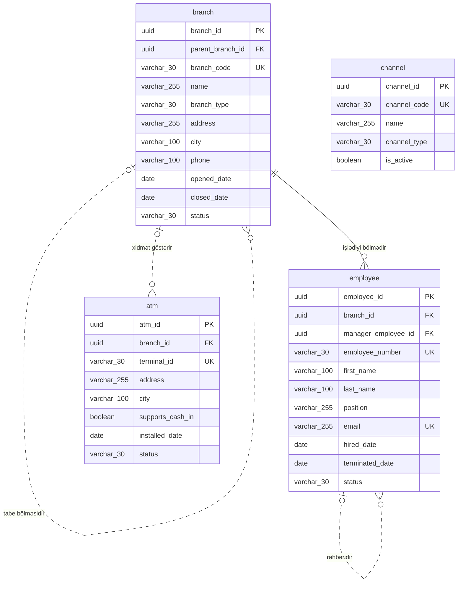

<!-- Bu fayl avtomatik yaradılıb (uv run bankmodel generate). Əl ilə redaktə etməyin. -->

# Təşkilat və kanallar (`org`) — fiziki model

[← Fiziki model](index.md) | [Konseptual model](../01_konseptual/02_org.md) · [Məntiqi model](../02_mentiqi/02_org.md) · **Fiziki model**

Bankın daxili strukturu və xidmət kanalları: filial və şöbələr, əməkdaşlar, müştərilərin banka müraciət etdiyi kanallar və bankomatlar.

## Diaqram

Audit sütunları diaqramda göstərilmir.

## Cədvəllər

### `org.branch` — Filial

Bankın baş ofisi, filialları və şöbələri; şöbə filiala tabe ola bilər.

| # | Sütun | Tip | NULL | Default | Şərh |
|---|---|---|---|---|---|
| 1 | `branch_id` | `uuid` | NOT NULL | `uuidv7()` | Filial — surrogat identifikator (UUIDv7). |
| 2 | `parent_branch_id` | `uuid` | NULL |  | Filial istinadı (tabe bölməsidir). |
| 3 | `branch_code` | `varchar(30)` | NOT NULL |  | Bölmənin daxili kodu. |
| 4 | `name` | `varchar(255)` | NOT NULL |  | Bölmənin adı. |
| 5 | `branch_type` | `varchar(30)` | NOT NULL |  | Bölmənin növü. Dəyərlər: `HEAD_OFFICE`, `BRANCH`, `DIVISION` |
| 6 | `address` | `varchar(255)` | NOT NULL |  | Ünvan. |
| 7 | `city` | `varchar(100)` | NOT NULL |  | Şəhər / rayon. |
| 8 | `phone` | `varchar(100)` | NULL |  | Əlaqə telefonu. |
| 9 | `opened_date` | `date` | NOT NULL |  | Açılış tarixi. |
| 10 | `closed_date` | `date` | NULL |  | Bağlanma tarixi. |
| 11 | `status` | `varchar(30)` | NOT NULL |  | Status. Dəyərlər: `ACTIVE`, `CLOSED` |
| 12 | `created_at` | `timestamptz` | NOT NULL | `now()` | Yazılışın yaradıldığı an. |
| 13 | `created_by` | `varchar(100)` | NOT NULL | `current_user` | Yazılışı yaradan istifadəçi. |
| 14 | `updated_at` | `timestamptz` | NULL |  | Son dəyişiklik anı. |
| 15 | `updated_by` | `varchar(100)` | NULL |  | Son dəyişikliyi edən istifadəçi. |

**Məhdudiyyətlər:**

| Ad | Növ | Tərif | Təsvir |
|---|---|---|---|
| `pk_branch` | PRIMARY KEY | `PRIMARY KEY (branch_id)` | Əsas açar |
| `uq_branch_branch_code` | UNIQUE | `UNIQUE (branch_code)` | Alternativ açar |
| `ck_branch_branch_type` | CHECK | `CHECK (branch_type IN ('HEAD_OFFICE', 'BRANCH', 'DIVISION'))` | İcazəli dəyərlər |
| `ck_branch_status` | CHECK | `CHECK (status IN ('ACTIVE', 'CLOSED'))` | İcazəli dəyərlər |
| `fk_branch_parent_branch_id` | FOREIGN KEY | `FOREIGN KEY (parent_branch_id) REFERENCES org.branch (branch_id)` | İstinad bütövlüyü |

**İndekslər:**

| Ad | Sütunlar | Şərt | Səbəb |
|---|---|---|---|
| `ix_branch_parent_branch_id` | `parent_branch_id` |  | FK |

### `org.employee` — Əməkdaş

Bank əməkdaşları: müştəri meneceri, kredit mütəxəssisi, operator, uyğunluq (compliance) əməkdaşı və s.

| # | Sütun | Tip | NULL | Default | Şərh |
|---|---|---|---|---|---|
| 1 | `employee_id` | `uuid` | NOT NULL | `uuidv7()` | Əməkdaş — surrogat identifikator (UUIDv7). |
| 2 | `branch_id` | `uuid` | NOT NULL |  | Filial istinadı (işlədiyi bölmədir). |
| 3 | `manager_employee_id` | `uuid` | NULL |  | Əməkdaş istinadı (rəhbəridir). |
| 4 | `employee_number` | `varchar(30)` | NOT NULL |  | Tabel nömrəsi. |
| 5 | `first_name` | `varchar(100)` | NOT NULL |  | Ad. |
| 6 | `last_name` | `varchar(100)` | NOT NULL |  | Soyad. |
| 7 | `position` | `varchar(255)` | NOT NULL |  | Vəzifə. |
| 8 | `email` | `varchar(255)` | NULL |  | Korporativ e-poçt. |
| 9 | `hired_date` | `date` | NOT NULL |  | İşə qəbul tarixi. |
| 10 | `terminated_date` | `date` | NULL |  | İşdən çıxma tarixi. |
| 11 | `status` | `varchar(30)` | NOT NULL |  | Status. Dəyərlər: `ACTIVE`, `ON_LEAVE`, `TERMINATED` |
| 12 | `created_at` | `timestamptz` | NOT NULL | `now()` | Yazılışın yaradıldığı an. |
| 13 | `created_by` | `varchar(100)` | NOT NULL | `current_user` | Yazılışı yaradan istifadəçi. |
| 14 | `updated_at` | `timestamptz` | NULL |  | Son dəyişiklik anı. |
| 15 | `updated_by` | `varchar(100)` | NULL |  | Son dəyişikliyi edən istifadəçi. |

**Məhdudiyyətlər:**

| Ad | Növ | Tərif | Təsvir |
|---|---|---|---|
| `pk_employee` | PRIMARY KEY | `PRIMARY KEY (employee_id)` | Əsas açar |
| `uq_employee_employee_number` | UNIQUE | `UNIQUE (employee_number)` | Alternativ açar |
| `uq_employee_email` | UNIQUE | `UNIQUE (email)` | Alternativ açar |
| `ck_employee_status` | CHECK | `CHECK (status IN ('ACTIVE', 'ON_LEAVE', 'TERMINATED'))` | İcazəli dəyərlər |
| `fk_employee_branch_id` | FOREIGN KEY | `FOREIGN KEY (branch_id) REFERENCES org.branch (branch_id)` | İstinad bütövlüyü |
| `fk_employee_manager_employee_id` | FOREIGN KEY | `FOREIGN KEY (manager_employee_id) REFERENCES org.employee (employee_id)` | İstinad bütövlüyü |

**İndekslər:**

| Ad | Sütunlar | Şərt | Səbəb |
|---|---|---|---|
| `ix_employee_branch_id` | `branch_id` |  | FK |
| `ix_employee_manager_employee_id` | `manager_employee_id` |  | FK |

### `org.channel` — Xidmət kanalı

Müştəriyə xidmət kanalları: filial, bankomat, internet bankçılıq, mobil bankçılıq, POS, çağrı mərkəzi, API.

| # | Sütun | Tip | NULL | Default | Şərh |
|---|---|---|---|---|---|
| 1 | `channel_id` | `uuid` | NOT NULL | `uuidv7()` | Xidmət kanalı — surrogat identifikator (UUIDv7). |
| 2 | `channel_code` | `varchar(30)` | NOT NULL |  | Kanalın kodu. |
| 3 | `name` | `varchar(255)` | NOT NULL |  | Kanalın adı. |
| 4 | `channel_type` | `varchar(30)` | NOT NULL |  | Kanalın növü. Dəyərlər: `BRANCH`, `ATM`, `INTERNET_BANKING`, `MOBILE_BANKING`, `POS`, `CALL_CENTER`, `API` |
| 5 | `is_active` | `boolean` | NOT NULL | `true` | Kanal aktivdir. |
| 6 | `created_at` | `timestamptz` | NOT NULL | `now()` | Yazılışın yaradıldığı an. |
| 7 | `created_by` | `varchar(100)` | NOT NULL | `current_user` | Yazılışı yaradan istifadəçi. |
| 8 | `updated_at` | `timestamptz` | NULL |  | Son dəyişiklik anı. |
| 9 | `updated_by` | `varchar(100)` | NULL |  | Son dəyişikliyi edən istifadəçi. |

**Məhdudiyyətlər:**

| Ad | Növ | Tərif | Təsvir |
|---|---|---|---|
| `pk_channel` | PRIMARY KEY | `PRIMARY KEY (channel_id)` | Əsas açar |
| `uq_channel_channel_code` | UNIQUE | `UNIQUE (channel_code)` | Alternativ açar |
| `ck_channel_channel_type` | CHECK | `CHECK (channel_type IN ('BRANCH', 'ATM', 'INTERNET_BANKING', 'MOBILE_BANKING', 'POS', 'CALL_CENTER', 'API'))` | İcazəli dəyərlər |

### `org.atm` — Bankomat

Bankın bankomatları və özünəxidmət terminalları: yerləşmə ünvanı, imkanlar, status.

| # | Sütun | Tip | NULL | Default | Şərh |
|---|---|---|---|---|---|
| 1 | `atm_id` | `uuid` | NOT NULL | `uuidv7()` | Bankomat — surrogat identifikator (UUIDv7). |
| 2 | `branch_id` | `uuid` | NULL |  | Filial istinadı (xidmət göstərir). |
| 3 | `terminal_id` | `varchar(30)` | NOT NULL |  | Terminal identifikatoru (prosessinqdə istifadə olunan). |
| 4 | `address` | `varchar(255)` | NOT NULL |  | Yerləşmə ünvanı. |
| 5 | `city` | `varchar(100)` | NOT NULL |  | Şəhər / rayon. |
| 6 | `supports_cash_in` | `boolean` | NOT NULL | `false` | Nağd mədaxil qəbul edir. |
| 7 | `installed_date` | `date` | NOT NULL |  | Quraşdırılma tarixi. |
| 8 | `status` | `varchar(30)` | NOT NULL |  | Status. Dəyərlər: `ACTIVE`, `OUT_OF_SERVICE`, `DECOMMISSIONED` |
| 9 | `created_at` | `timestamptz` | NOT NULL | `now()` | Yazılışın yaradıldığı an. |
| 10 | `created_by` | `varchar(100)` | NOT NULL | `current_user` | Yazılışı yaradan istifadəçi. |
| 11 | `updated_at` | `timestamptz` | NULL |  | Son dəyişiklik anı. |
| 12 | `updated_by` | `varchar(100)` | NULL |  | Son dəyişikliyi edən istifadəçi. |

**Məhdudiyyətlər:**

| Ad | Növ | Tərif | Təsvir |
|---|---|---|---|
| `pk_atm` | PRIMARY KEY | `PRIMARY KEY (atm_id)` | Əsas açar |
| `uq_atm_terminal_id` | UNIQUE | `UNIQUE (terminal_id)` | Alternativ açar |
| `ck_atm_status` | CHECK | `CHECK (status IN ('ACTIVE', 'OUT_OF_SERVICE', 'DECOMMISSIONED'))` | İcazəli dəyərlər |
| `fk_atm_branch_id` | FOREIGN KEY | `FOREIGN KEY (branch_id) REFERENCES org.branch (branch_id)` | İstinad bütövlüyü |

**İndekslər:**

| Ad | Sütunlar | Şərt | Səbəb |
|---|---|---|---|
| `ix_atm_branch_id` | `branch_id` |  | FK |
