<!-- Bu fayl avtomatik yaradılıb (uv run bankmodel generate). Əl ilə redaktə etməyin. -->

# Tərəf və müştəri (KYC) (`party`) — fiziki model

[← Fiziki model](index.md) | [Konseptual model](../01_konseptual/03_party.md) · [Məntiqi model](../02_mentiqi/03_party.md) · **Fiziki model**

Bankla münasibətdə olan bütün fiziki və hüquqi şəxslər (tərəflər), onların sənədləri, ünvanları, əlaqə vasitələri, bir-biri ilə əlaqələri, müştəri rolu və KYC yoxlamaları. Tərəf supertipdir: fiziki şəxs, hüquqi şəxs və ya fərdi sahibkar ola bilər.

## Diaqram

Audit sütunları diaqramda göstərilmir.

```mermaid
erDiagram
    party {
        uuid party_id PK
        uuid residence_country_id FK
        varchar_30 party_type
        varchar_255 display_name
        boolean is_resident
        varchar_30 status
    }
    individual_profile {
        uuid individual_profile_id PK
        uuid party_id FK, UK
        uuid citizenship_country_id FK
        varchar_100 last_name
        varchar_100 first_name
        varchar_100 patronymic
        date birth_date
        varchar_255 birth_place
        varchar_30 gender
        char_7 fin UK
        boolean is_pep
        varchar_30 marital_status
        varchar_30 employment_status
        numeric_19_4 monthly_income_azn
    }
    organization_profile {
        uuid organization_profile_id PK
        uuid party_id FK, UK
        uuid economic_activity_code_id FK
        uuid registration_country_id FK
        varchar_255 legal_name
        varchar_255 short_name
        char_10 voen UK
        varchar_30 legal_form
        varchar_100 registration_number
        date registration_date
        varchar_255 registration_authority
        numeric_19_4 authorized_capital
        integer employee_count
        numeric_19_4 annual_turnover_azn
        varchar_255 website
    }
    party_identifier {
        uuid party_identifier_id PK
        uuid party_id FK
        uuid document_type_id FK, UK
        uuid issuing_country_id FK, UK
        varchar_30 document_series UK
        varchar_100 document_number UK
        date issue_date
        date expiry_date
        varchar_255 issuing_authority
        boolean is_primary
        boolean is_verified
    }
    party_address {
        uuid party_address_id PK
        uuid party_id FK
        uuid country_id FK
        varchar_30 address_type
        varchar_255 address_line
        varchar_100 city
        varchar_100 district
        varchar_30 postal_code
        date effective_from
        date effective_to
        boolean is_primary
    }
    party_contact {
        uuid party_contact_id PK
        uuid party_id FK
        varchar_30 contact_type
        varchar_255 contact_value
        boolean is_primary
        boolean is_verified
        timestamptz verified_at
    }
    party_relationship {
        uuid party_relationship_id PK
        uuid from_party_id FK
        uuid to_party_id FK
        varchar_30 relationship_type
        numeric_5_2 ownership_percent
        date effective_from
        date effective_to
    }
    segment {
        uuid segment_id PK
        varchar_30 segment_code UK
        varchar_255 name
        varchar_30 customer_group
    }
    customer {
        uuid customer_id PK
        uuid party_id FK, UK
        uuid segment_id FK
        uuid home_branch_id FK
        uuid relationship_manager_id FK
        varchar_30 cif_number UK
        date customer_since
        date closed_date
        varchar_30 preferred_language
        varchar_30 status
    }
    kyc_review {
        uuid kyc_review_id PK
        uuid customer_id FK
        uuid reviewed_by_employee_id FK
        varchar_30 review_type
        varchar_30 due_diligence_level
        varchar_30 risk_level
        varchar_30 outcome
        date review_date
        date next_review_date
        varchar_255 source_of_funds
        text comment
    }
    consent {
        uuid consent_id PK
        uuid party_id FK
        varchar_30 consent_type
        timestamptz granted_at
        timestamptz revoked_at
        varchar_255 document_reference
    }
    party_status_history {
        uuid party_status_history_id PK
        uuid party_id FK
        varchar_30 from_status
        varchar_30 to_status
        timestamptz changed_at
        varchar_30 reason_code
        text comment
    }
    branch
    employee
    party ||--o| individual_profile : "fiziki şəxs məlumatlarıdır"
    party ||--o| organization_profile : "qeydiyyat məlumatlarıdır"
    party ||--o{ party_identifier : "sənədidir"
    party ||--o{ party_address : "ünvanıdır"
    party ||--o{ party_contact : "əlaqə vasitəsidir"
    party ||--o{ party_relationship : "əlaqənin subyektidir"
    party ||--o{ party_relationship : "əlaqənin obyektidir"
    party ||--o| customer : "müştəri roludur"
    segment ||--o{ customer : "aid olduğu seqmentdir"
    branch ||--o{ customer : "xidmət filialıdır"
    employee |o..o{ customer : "müştəri meneceridir"
    customer ||--o{ kyc_review : "yoxlamasıdır"
    employee |o..o{ kyc_review : "yoxlamanı aparıb"
    party ||--o{ consent : "razılığıdır"
    party ||--o{ party_status_history : "status tarixçəsidir"
```

## Cədvəllər

### `party.party` — Tərəf

Bankla münasibətdə olan istənilən şəxs (supertip). Növü: fiziki şəxs, hüquqi şəxs, fərdi sahibkar. Eyni tərəf müştəri, zamin, girov mülkiyyətçisi, benefisiar mülkiyyətçi və ya səlahiyyətli şəxs ola bilər.

| # | Sütun | Tip | NULL | Default | Şərh |
|---|---|---|---|---|---|
| 1 | `party_id` | `uuid` | NOT NULL | `uuidv7()` | Tərəf — surrogat identifikator (UUIDv7). |
| 2 | `residence_country_id` | `uuid` | NOT NULL |  | Ölkə istinadı (rezidentlik ölkəsidir). |
| 3 | `party_type` | `varchar(30)` | NOT NULL |  | Tərəfin növü (subtip diskriminatoru): fiziki şəxs, hüquqi şəxs, fərdi sahibkar. Dəyərlər: `INDIVIDUAL`, `LEGAL_ENTITY`, `INDIVIDUAL_ENTREPRENEUR` |
| 4 | `display_name` | `varchar(255)` | NOT NULL |  | Göstərilən ad (fiziki şəxs üçün tam ad, təşkilat üçün qısa ad). |
| 5 | `is_resident` | `boolean` | NOT NULL |  | Azərbaycan Respublikasının rezidentidir. |
| 6 | `status` | `varchar(30)` | NOT NULL |  | Tərəfin həyat dövrü statusu. Dəyərlər: `PROSPECT`, `ACTIVE`, `INACTIVE`, `BLOCKED`, `DECEASED`, `LIQUIDATED` |
| 7 | `created_at` | `timestamptz` | NOT NULL | `now()` | Yazılışın yaradıldığı an. |
| 8 | `created_by` | `varchar(100)` | NOT NULL | `current_user` | Yazılışı yaradan istifadəçi. |
| 9 | `updated_at` | `timestamptz` | NULL |  | Son dəyişiklik anı. |
| 10 | `updated_by` | `varchar(100)` | NULL |  | Son dəyişikliyi edən istifadəçi. |

**Məhdudiyyətlər:**

| Ad | Növ | Tərif | Təsvir |
|---|---|---|---|
| `pk_party` | PRIMARY KEY | `PRIMARY KEY (party_id)` | Əsas açar |
| `ck_party_party_type` | CHECK | `CHECK (party_type IN ('INDIVIDUAL', 'LEGAL_ENTITY', 'INDIVIDUAL_ENTREPRENEUR'))` | İcazəli dəyərlər |
| `ck_party_status` | CHECK | `CHECK (status IN ('PROSPECT', 'ACTIVE', 'INACTIVE', 'BLOCKED', 'DECEASED', 'LIQUIDATED'))` | İcazəli dəyərlər |
| `fk_party_residence_country_id` | FOREIGN KEY | `FOREIGN KEY (residence_country_id) REFERENCES ref.country (country_id)` | İstinad bütövlüyü |

**İndekslər:**

| Ad | Sütunlar | Şərt | Səbəb |
|---|---|---|---|
| `ix_party_residence_country_id` | `residence_country_id` |  | FK |

### `party.individual_profile` — Fiziki şəxs profili

Fiziki şəxsə və fərdi sahibkara aid şəxsi məlumatlar: soyad, ad, ata adı, doğum tarixi, FİN, vətəndaşlıq, PEP statusu.

| # | Sütun | Tip | NULL | Default | Şərh |
|---|---|---|---|---|---|
| 1 | `individual_profile_id` | `uuid` | NOT NULL | `uuidv7()` | Fiziki şəxs profili — surrogat identifikator (UUIDv7). |
| 2 | `party_id` | `uuid` | NOT NULL |  | Tərəf istinadı (fiziki şəxs məlumatlarıdır). |
| 3 | `citizenship_country_id` | `uuid` | NOT NULL |  | Ölkə istinadı (vətəndaşlığıdır). |
| 4 | `last_name` | `varchar(100)` | NOT NULL |  | Soyad. |
| 5 | `first_name` | `varchar(100)` | NOT NULL |  | Ad. |
| 6 | `patronymic` | `varchar(100)` | NULL |  | Ata adı. |
| 7 | `birth_date` | `date` | NOT NULL |  | Doğum tarixi. |
| 8 | `birth_place` | `varchar(255)` | NULL |  | Doğum yeri. |
| 9 | `gender` | `varchar(30)` | NOT NULL |  | Cins. Dəyərlər: `MALE`, `FEMALE` |
| 10 | `fin` | `char(7)` | NULL |  | FİN — şəxsiyyət vəsiqəsindəki 7 simvollu kod (Azərbaycan vətəndaşları və yaşayış icazəsi olanlar üçün). |
| 11 | `is_pep` | `boolean` | NOT NULL | `false` | Siyasi xadimdir (PEP). |
| 12 | `marital_status` | `varchar(30)` | NULL |  | Ailə vəziyyəti. Dəyərlər: `SINGLE`, `MARRIED`, `DIVORCED`, `WIDOWED` |
| 13 | `employment_status` | `varchar(30)` | NULL |  | Məşğulluq vəziyyəti. Dəyərlər: `EMPLOYED`, `SELF_EMPLOYED`, `UNEMPLOYED`, `RETIRED`, `STUDENT` |
| 14 | `monthly_income_azn` | `numeric(19,4)` | NULL |  | Bəyan edilmiş aylıq gəlir (AZN). |
| 15 | `created_at` | `timestamptz` | NOT NULL | `now()` | Yazılışın yaradıldığı an. |
| 16 | `created_by` | `varchar(100)` | NOT NULL | `current_user` | Yazılışı yaradan istifadəçi. |
| 17 | `updated_at` | `timestamptz` | NULL |  | Son dəyişiklik anı. |
| 18 | `updated_by` | `varchar(100)` | NULL |  | Son dəyişikliyi edən istifadəçi. |

**Məhdudiyyətlər:**

| Ad | Növ | Tərif | Təsvir |
|---|---|---|---|
| `pk_individual_profile` | PRIMARY KEY | `PRIMARY KEY (individual_profile_id)` | Əsas açar |
| `uq_individual_profile_party_id` | UNIQUE | `UNIQUE (party_id)` | Alternativ açar |
| `uq_individual_profile_fin` | UNIQUE | `UNIQUE (fin)` | Alternativ açar |
| `ck_individual_profile_gender` | CHECK | `CHECK (gender IN ('MALE', 'FEMALE'))` | İcazəli dəyərlər |
| `ck_individual_profile_marital_status` | CHECK | `CHECK (marital_status IN ('SINGLE', 'MARRIED', 'DIVORCED', 'WIDOWED'))` | İcazəli dəyərlər |
| `ck_individual_profile_employment_status` | CHECK | `CHECK (employment_status IN ('EMPLOYED', 'SELF_EMPLOYED', 'UNEMPLOYED', 'RETIRED', 'STUDENT'))` | İcazəli dəyərlər |
| `ck_individual_profile_fin_format` | CHECK | `CHECK (fin IS NULL OR fin ~ '^[0-9A-Z]{7}$')` | FİN 7 simvoldan (rəqəm və böyük latın hərfləri) ibarət olmalıdır. |
| `fk_individual_profile_party_id` | FOREIGN KEY | `FOREIGN KEY (party_id) REFERENCES party.party (party_id)` | İstinad bütövlüyü |
| `fk_individual_profile_citizenship_country_id` | FOREIGN KEY | `FOREIGN KEY (citizenship_country_id) REFERENCES ref.country (country_id)` | İstinad bütövlüyü |

**İndekslər:**

| Ad | Sütunlar | Şərt | Səbəb |
|---|---|---|---|
| `ix_individual_profile_citizenship_country_id` | `citizenship_country_id` |  | FK |
| `ix_individual_profile_last_name_first_name_birth_date` | `last_name`, `first_name`, `birth_date` |  | Sorğu |

### `party.organization_profile` — Təşkilat profili

Hüquqi şəxsə və fərdi sahibkara aid qeydiyyat məlumatları: VÖEN, dövlət qeydiyyatı, təşkilati-hüquqi forma, fəaliyyət növü. Fərdi sahibkarın həm fiziki şəxs, həm də təşkilat profili olur.

| # | Sütun | Tip | NULL | Default | Şərh |
|---|---|---|---|---|---|
| 1 | `organization_profile_id` | `uuid` | NOT NULL | `uuidv7()` | Təşkilat profili — surrogat identifikator (UUIDv7). |
| 2 | `party_id` | `uuid` | NOT NULL |  | Tərəf istinadı (qeydiyyat məlumatlarıdır). |
| 3 | `economic_activity_code_id` | `uuid` | NOT NULL |  | İqtisadi fəaliyyət növü istinadı (əsas fəaliyyət növüdür). |
| 4 | `registration_country_id` | `uuid` | NOT NULL |  | Ölkə istinadı (qeydiyyat ölkəsidir). |
| 5 | `legal_name` | `varchar(255)` | NOT NULL |  | Tam rəsmi adı. |
| 6 | `short_name` | `varchar(255)` | NULL |  | Qısa adı. |
| 7 | `voen` | `char(10)` | NULL |  | VÖEN — 10 rəqəmli vergi ödəyicisi kodu (qeyri-rezident təşkilatlarda olmaya bilər). |
| 8 | `legal_form` | `varchar(30)` | NOT NULL |  | Təşkilati-hüquqi forma: MMC, ASC, QSC, tam/kommandit ortaqlıq, kooperativ, publik hüquqi şəxs, qeyri-kommersiya təşkilatı, xarici şirkətin filialı, fərdi sahibkar. Dəyərlər: `LLC`, `OJSC`, `CJSC`, `GENERAL_PARTNERSHIP`, `LIMITED_PARTNERSHIP`, `COOPERATIVE`, `PUBLIC_LEGAL_ENTITY`, `NON_PROFIT`, `FOREIGN_BRANCH`, `INDIVIDUAL_ENTREPRENEUR` |
| 9 | `registration_number` | `varchar(100)` | NULL |  | Dövlət qeydiyyat nömrəsi. |
| 10 | `registration_date` | `date` | NOT NULL |  | Dövlət qeydiyyatı tarixi. |
| 11 | `registration_authority` | `varchar(255)` | NULL |  | Qeydiyyatı aparan orqan. |
| 12 | `authorized_capital` | `numeric(19,4)` | NULL |  | Nizamnamə kapitalı (AZN). |
| 13 | `employee_count` | `integer` | NULL |  | İşçi sayı. |
| 14 | `annual_turnover_azn` | `numeric(19,4)` | NULL |  | İllik dövriyyə (AZN). |
| 15 | `website` | `varchar(255)` | NULL |  | Veb sayt. |
| 16 | `created_at` | `timestamptz` | NOT NULL | `now()` | Yazılışın yaradıldığı an. |
| 17 | `created_by` | `varchar(100)` | NOT NULL | `current_user` | Yazılışı yaradan istifadəçi. |
| 18 | `updated_at` | `timestamptz` | NULL |  | Son dəyişiklik anı. |
| 19 | `updated_by` | `varchar(100)` | NULL |  | Son dəyişikliyi edən istifadəçi. |

**Məhdudiyyətlər:**

| Ad | Növ | Tərif | Təsvir |
|---|---|---|---|
| `pk_organization_profile` | PRIMARY KEY | `PRIMARY KEY (organization_profile_id)` | Əsas açar |
| `uq_organization_profile_party_id` | UNIQUE | `UNIQUE (party_id)` | Alternativ açar |
| `uq_organization_profile_voen` | UNIQUE | `UNIQUE (voen)` | Alternativ açar |
| `ck_organization_profile_legal_form` | CHECK | `CHECK (legal_form IN ('LLC', 'OJSC', 'CJSC', 'GENERAL_PARTNERSHIP', 'LIMITED_PARTNERSHIP', 'COOPERATIVE', 'PUBLIC_LEGAL_ENTITY', 'NON_PROFIT', 'FOREIGN_BRANCH', 'INDIVIDUAL_ENTREPRENEUR'))` | İcazəli dəyərlər |
| `ck_organization_profile_voen_format` | CHECK | `CHECK (voen IS NULL OR voen ~ '^[0-9]{10}$')` | VÖEN 10 rəqəmdən ibarət olmalıdır. |
| `fk_organization_profile_party_id` | FOREIGN KEY | `FOREIGN KEY (party_id) REFERENCES party.party (party_id)` | İstinad bütövlüyü |
| `fk_organization_profile_economic_activity_code_id` | FOREIGN KEY | `FOREIGN KEY (economic_activity_code_id) REFERENCES ref.economic_activity_code (economic_activity_code_id)` | İstinad bütövlüyü |
| `fk_organization_profile_registration_country_id` | FOREIGN KEY | `FOREIGN KEY (registration_country_id) REFERENCES ref.country (country_id)` | İstinad bütövlüyü |

**İndekslər:**

| Ad | Sütunlar | Şərt | Səbəb |
|---|---|---|---|
| `ix_organization_profile_economic_activity_code_id` | `economic_activity_code_id` |  | FK |
| `ix_organization_profile_registration_country_id` | `registration_country_id` |  | FK |

### `party.party_identifier` — Tərəfin sənədi / identifikatoru

Tərəfin şəxsiyyət və qeydiyyat sənədləri: şəxsiyyət vəsiqəsi, pasport, yaşayış icazəsi, şəhadətnamə; verilmə və etibarlılıq tarixləri ilə.

| # | Sütun | Tip | NULL | Default | Şərh |
|---|---|---|---|---|---|
| 1 | `party_identifier_id` | `uuid` | NOT NULL | `uuidv7()` | Tərəfin sənədi / identifikatoru — surrogat identifikator (UUIDv7). |
| 2 | `party_id` | `uuid` | NOT NULL |  | Tərəf istinadı (sənədidir). |
| 3 | `document_type_id` | `uuid` | NOT NULL |  | Sənəd növü istinadı (növüdür). |
| 4 | `issuing_country_id` | `uuid` | NOT NULL |  | Ölkə istinadı (verən ölkədir). |
| 5 | `document_series` | `varchar(30)` | NULL |  | Sənədin seriyası (AA, AZE və s.). |
| 6 | `document_number` | `varchar(100)` | NOT NULL |  | Sənədin nömrəsi. |
| 7 | `issue_date` | `date` | NULL |  | Verilmə tarixi. |
| 8 | `expiry_date` | `date` | NULL |  | Etibarlılıq müddətinin sonu. |
| 9 | `issuing_authority` | `varchar(255)` | NULL |  | Sənədi verən orqan. |
| 10 | `is_primary` | `boolean` | NOT NULL | `false` | Əsas şəxsiyyət sənədidir. |
| 11 | `is_verified` | `boolean` | NOT NULL | `false` | Sənəd yoxlanılıb (orijinal / dövlət reyestri). |
| 12 | `created_at` | `timestamptz` | NOT NULL | `now()` | Yazılışın yaradıldığı an. |
| 13 | `created_by` | `varchar(100)` | NOT NULL | `current_user` | Yazılışı yaradan istifadəçi. |
| 14 | `updated_at` | `timestamptz` | NULL |  | Son dəyişiklik anı. |
| 15 | `updated_by` | `varchar(100)` | NULL |  | Son dəyişikliyi edən istifadəçi. |

**Məhdudiyyətlər:**

| Ad | Növ | Tərif | Təsvir |
|---|---|---|---|
| `pk_party_identifier` | PRIMARY KEY | `PRIMARY KEY (party_identifier_id)` | Əsas açar |
| `uq_party_identifier_document_type_id_issuing_country_i_68a43b09` | UNIQUE | `UNIQUE NULLS NOT DISTINCT (document_type_id, issuing_country_id, document_series, document_number)` | Alternativ açar |
| `ck_party_identifier_valid_dates` | CHECK | `CHECK (expiry_date IS NULL OR issue_date IS NULL OR expiry_date > issue_date)` | Etibarlılıq tarixi verilmə tarixindən sonra olmalıdır. |
| `fk_party_identifier_party_id` | FOREIGN KEY | `FOREIGN KEY (party_id) REFERENCES party.party (party_id)` | İstinad bütövlüyü |
| `fk_party_identifier_document_type_id` | FOREIGN KEY | `FOREIGN KEY (document_type_id) REFERENCES ref.document_type (document_type_id)` | İstinad bütövlüyü |
| `fk_party_identifier_issuing_country_id` | FOREIGN KEY | `FOREIGN KEY (issuing_country_id) REFERENCES ref.country (country_id)` | İstinad bütövlüyü |

**İndekslər:**

| Ad | Sütunlar | Şərt | Səbəb |
|---|---|---|---|
| `ix_party_identifier_party_id` | `party_id` |  | FK |
| `ix_party_identifier_issuing_country_id` | `issuing_country_id` |  | FK |

### `party.party_address` — Tərəfin ünvanı

Qeydiyyat, faktiki və hüquqi ünvanlar; qüvvədə olma tarixləri ilə.

| # | Sütun | Tip | NULL | Default | Şərh |
|---|---|---|---|---|---|
| 1 | `party_address_id` | `uuid` | NOT NULL | `uuidv7()` | Tərəfin ünvanı — surrogat identifikator (UUIDv7). |
| 2 | `party_id` | `uuid` | NOT NULL |  | Tərəf istinadı (ünvanıdır). |
| 3 | `country_id` | `uuid` | NOT NULL |  | Ölkə istinadı (ölkəsidir). |
| 4 | `address_type` | `varchar(30)` | NOT NULL |  | Ünvanın növü. Dəyərlər: `REGISTRATION`, `ACTUAL`, `LEGAL`, `POSTAL` |
| 5 | `address_line` | `varchar(255)` | NOT NULL |  | Küçə, ev, mənzil. |
| 6 | `city` | `varchar(100)` | NOT NULL |  | Şəhər / rayon. |
| 7 | `district` | `varchar(100)` | NULL |  | Rayon / qəsəbə. |
| 8 | `postal_code` | `varchar(30)` | NULL |  | Poçt indeksi (AZ1000). |
| 9 | `effective_from` | `date` | NOT NULL |  | Ünvanın qüvvədə olma başlanğıcı. |
| 10 | `effective_to` | `date` | NULL |  | Ünvanın qüvvədə olma sonu. |
| 11 | `is_primary` | `boolean` | NOT NULL | `false` | Əsas əlaqə ünvanıdır. |
| 12 | `created_at` | `timestamptz` | NOT NULL | `now()` | Yazılışın yaradıldığı an. |
| 13 | `created_by` | `varchar(100)` | NOT NULL | `current_user` | Yazılışı yaradan istifadəçi. |
| 14 | `updated_at` | `timestamptz` | NULL |  | Son dəyişiklik anı. |
| 15 | `updated_by` | `varchar(100)` | NULL |  | Son dəyişikliyi edən istifadəçi. |

**Məhdudiyyətlər:**

| Ad | Növ | Tərif | Təsvir |
|---|---|---|---|
| `pk_party_address` | PRIMARY KEY | `PRIMARY KEY (party_address_id)` | Əsas açar |
| `ck_party_address_address_type` | CHECK | `CHECK (address_type IN ('REGISTRATION', 'ACTUAL', 'LEGAL', 'POSTAL'))` | İcazəli dəyərlər |
| `ck_party_address_valid_period` | CHECK | `CHECK (effective_to IS NULL OR effective_to >= effective_from)` | Bitmə tarixi başlanğıcdan əvvəl ola bilməz. |
| `fk_party_address_party_id` | FOREIGN KEY | `FOREIGN KEY (party_id) REFERENCES party.party (party_id)` | İstinad bütövlüyü |
| `fk_party_address_country_id` | FOREIGN KEY | `FOREIGN KEY (country_id) REFERENCES ref.country (country_id)` | İstinad bütövlüyü |

**İndekslər:**

| Ad | Sütunlar | Şərt | Səbəb |
|---|---|---|---|
| `ix_party_address_party_id` | `party_id` |  | FK |
| `ix_party_address_country_id` | `country_id` |  | FK |

### `party.party_contact` — Əlaqə vasitəsi

Telefon, e-poçt və digər əlaqə vasitələri; təsdiqlənmə statusu və üstünlük verilən vasitə əlaməti ilə.

| # | Sütun | Tip | NULL | Default | Şərh |
|---|---|---|---|---|---|
| 1 | `party_contact_id` | `uuid` | NOT NULL | `uuidv7()` | Əlaqə vasitəsi — surrogat identifikator (UUIDv7). |
| 2 | `party_id` | `uuid` | NOT NULL |  | Tərəf istinadı (əlaqə vasitəsidir). |
| 3 | `contact_type` | `varchar(30)` | NOT NULL |  | Əlaqə vasitəsinin növü. Dəyərlər: `MOBILE_PHONE`, `HOME_PHONE`, `WORK_PHONE`, `EMAIL`, `FAX` |
| 4 | `contact_value` | `varchar(255)` | NOT NULL |  | Telefon nömrəsi (E.164, +994...) və ya e-poçt ünvanı. |
| 5 | `is_primary` | `boolean` | NOT NULL | `false` | Üstünlük verilən vasitədir. |
| 6 | `is_verified` | `boolean` | NOT NULL | `false` | OTP və ya digər üsulla təsdiqlənib. |
| 7 | `verified_at` | `timestamptz` | NULL |  | Təsdiqlənmə anı. |
| 8 | `created_at` | `timestamptz` | NOT NULL | `now()` | Yazılışın yaradıldığı an. |
| 9 | `created_by` | `varchar(100)` | NOT NULL | `current_user` | Yazılışı yaradan istifadəçi. |
| 10 | `updated_at` | `timestamptz` | NULL |  | Son dəyişiklik anı. |
| 11 | `updated_by` | `varchar(100)` | NULL |  | Son dəyişikliyi edən istifadəçi. |

**Məhdudiyyətlər:**

| Ad | Növ | Tərif | Təsvir |
|---|---|---|---|
| `pk_party_contact` | PRIMARY KEY | `PRIMARY KEY (party_contact_id)` | Əsas açar |
| `ck_party_contact_contact_type` | CHECK | `CHECK (contact_type IN ('MOBILE_PHONE', 'HOME_PHONE', 'WORK_PHONE', 'EMAIL', 'FAX'))` | İcazəli dəyərlər |
| `fk_party_contact_party_id` | FOREIGN KEY | `FOREIGN KEY (party_id) REFERENCES party.party (party_id)` | İstinad bütövlüyü |

**İndekslər:**

| Ad | Sütunlar | Şərt | Səbəb |
|---|---|---|---|
| `ix_party_contact_party_id` | `party_id` |  | FK |
| `ix_party_contact_contact_value` | `contact_value` |  | Sorğu |

### `party.party_relationship` — Tərəflər arası əlaqə

İki tərəf arasında əlaqə: benefisiar mülkiyyətçi (UBO), direktor, təsisçi, səlahiyyətli imza sahibi, ailə üzvü; pay faizi və qüvvədə olma tarixləri ilə.

| # | Sütun | Tip | NULL | Default | Şərh |
|---|---|---|---|---|---|
| 1 | `party_relationship_id` | `uuid` | NOT NULL | `uuidv7()` | Tərəflər arası əlaqə — surrogat identifikator (UUIDv7). |
| 2 | `from_party_id` | `uuid` | NOT NULL |  | Tərəf istinadı (əlaqənin subyektidir). |
| 3 | `to_party_id` | `uuid` | NOT NULL |  | Tərəf istinadı (əlaqənin obyektidir). |
| 4 | `relationship_type` | `varchar(30)` | NOT NULL |  | Əlaqənin növü (from_party → to_party: məs. fiziki şəxs təşkilatın UBO-sudur). Dəyərlər: `UBO`, `DIRECTOR`, `FOUNDER`, `AUTHORIZED_SIGNATORY`, `CHIEF_ACCOUNTANT`, `LEGAL_REPRESENTATIVE`, `SPOUSE`, `PARENT`, `CHILD` |
| 5 | `ownership_percent` | `numeric(5,2)` | NULL |  | Mülkiyyət payı (UBO və təsisçi üçün). |
| 6 | `effective_from` | `date` | NOT NULL |  | Əlaqənin başlanğıcı. |
| 7 | `effective_to` | `date` | NULL |  | Əlaqənin sonu. |
| 8 | `created_at` | `timestamptz` | NOT NULL | `now()` | Yazılışın yaradıldığı an. |
| 9 | `created_by` | `varchar(100)` | NOT NULL | `current_user` | Yazılışı yaradan istifadəçi. |
| 10 | `updated_at` | `timestamptz` | NULL |  | Son dəyişiklik anı. |
| 11 | `updated_by` | `varchar(100)` | NULL |  | Son dəyişikliyi edən istifadəçi. |

**Məhdudiyyətlər:**

| Ad | Növ | Tərif | Təsvir |
|---|---|---|---|
| `pk_party_relationship` | PRIMARY KEY | `PRIMARY KEY (party_relationship_id)` | Əsas açar |
| `ck_party_relationship_relationship_type` | CHECK | `CHECK (relationship_type IN ('UBO', 'DIRECTOR', 'FOUNDER', 'AUTHORIZED_SIGNATORY', 'CHIEF_ACCOUNTANT', 'LEGAL_REPRESENTATIVE', 'SPOUSE', 'PARENT', 'CHILD'))` | İcazəli dəyərlər |
| `ck_party_relationship_distinct_parties` | CHECK | `CHECK (from_party_id <> to_party_id)` | Tərəf özü ilə əlaqədə ola bilməz. |
| `ck_party_relationship_ownership_range` | CHECK | `CHECK (ownership_percent IS NULL OR ownership_percent BETWEEN 0 AND 100)` | Pay 0–100% arasında olmalıdır. |
| `ck_party_relationship_valid_period` | CHECK | `CHECK (effective_to IS NULL OR effective_to >= effective_from)` | Bitmə tarixi başlanğıcdan əvvəl ola bilməz. |
| `fk_party_relationship_from_party_id` | FOREIGN KEY | `FOREIGN KEY (from_party_id) REFERENCES party.party (party_id)` | İstinad bütövlüyü |
| `fk_party_relationship_to_party_id` | FOREIGN KEY | `FOREIGN KEY (to_party_id) REFERENCES party.party (party_id)` | İstinad bütövlüyü |

**İndekslər:**

| Ad | Sütunlar | Şərt | Səbəb |
|---|---|---|---|
| `ix_party_relationship_from_party_id` | `from_party_id` |  | FK |
| `ix_party_relationship_to_party_id` | `to_party_id` |  | FK |

### `party.segment` — Müştəri seqmenti

Müştəri seqmentləri: kütləvi pərakəndə, premium, mikro və kiçik biznes, orta biznes, korporativ.

| # | Sütun | Tip | NULL | Default | Şərh |
|---|---|---|---|---|---|
| 1 | `segment_id` | `uuid` | NOT NULL | `uuidv7()` | Müştəri seqmenti — surrogat identifikator (UUIDv7). |
| 2 | `segment_code` | `varchar(30)` | NOT NULL |  | Seqment kodu. |
| 3 | `name` | `varchar(255)` | NOT NULL |  | Seqmentin adı. |
| 4 | `customer_group` | `varchar(30)` | NOT NULL |  | Müştəri qrupu. Dəyərlər: `RETAIL`, `BUSINESS` |
| 5 | `created_at` | `timestamptz` | NOT NULL | `now()` | Yazılışın yaradıldığı an. |
| 6 | `created_by` | `varchar(100)` | NOT NULL | `current_user` | Yazılışı yaradan istifadəçi. |
| 7 | `updated_at` | `timestamptz` | NULL |  | Son dəyişiklik anı. |
| 8 | `updated_by` | `varchar(100)` | NULL |  | Son dəyişikliyi edən istifadəçi. |

**Məhdudiyyətlər:**

| Ad | Növ | Tərif | Təsvir |
|---|---|---|---|
| `pk_segment` | PRIMARY KEY | `PRIMARY KEY (segment_id)` | Əsas açar |
| `uq_segment_segment_code` | UNIQUE | `UNIQUE (segment_code)` | Alternativ açar |
| `ck_segment_customer_group` | CHECK | `CHECK (customer_group IN ('RETAIL', 'BUSINESS'))` | İcazəli dəyərlər |

### `party.customer` — Müştəri

Tərəfin bankın müştərisi rolu: CIF nömrəsi, seqment, xidmət filialı, müştəri meneceri, münasibətin başlama və bitmə tarixi.

| # | Sütun | Tip | NULL | Default | Şərh |
|---|---|---|---|---|---|
| 1 | `customer_id` | `uuid` | NOT NULL | `uuidv7()` | Müştəri — surrogat identifikator (UUIDv7). |
| 2 | `party_id` | `uuid` | NOT NULL |  | Tərəf istinadı (müştəri roludur). |
| 3 | `segment_id` | `uuid` | NOT NULL |  | Müştəri seqmenti istinadı (aid olduğu seqmentdir). |
| 4 | `home_branch_id` | `uuid` | NOT NULL |  | Filial istinadı (xidmət filialıdır). |
| 5 | `relationship_manager_id` | `uuid` | NULL |  | Əməkdaş istinadı (müştəri meneceridir). |
| 6 | `cif_number` | `varchar(30)` | NOT NULL |  | CIF — bankın müştəriyə verdiyi unikal nömrə. |
| 7 | `customer_since` | `date` | NOT NULL |  | Müştəri münasibətinin başlama tarixi. |
| 8 | `closed_date` | `date` | NULL |  | Münasibətin bitmə tarixi. |
| 9 | `preferred_language` | `varchar(30)` | NOT NULL | `'AZ'` | Ünsiyyət dili. Dəyərlər: `AZ`, `EN`, `RU` |
| 10 | `status` | `varchar(30)` | NOT NULL |  | Müştəri statusu. Dəyərlər: `ACTIVE`, `DORMANT`, `BLOCKED`, `CLOSED` |
| 11 | `created_at` | `timestamptz` | NOT NULL | `now()` | Yazılışın yaradıldığı an. |
| 12 | `created_by` | `varchar(100)` | NOT NULL | `current_user` | Yazılışı yaradan istifadəçi. |
| 13 | `updated_at` | `timestamptz` | NULL |  | Son dəyişiklik anı. |
| 14 | `updated_by` | `varchar(100)` | NULL |  | Son dəyişikliyi edən istifadəçi. |

**Məhdudiyyətlər:**

| Ad | Növ | Tərif | Təsvir |
|---|---|---|---|
| `pk_customer` | PRIMARY KEY | `PRIMARY KEY (customer_id)` | Əsas açar |
| `uq_customer_party_id` | UNIQUE | `UNIQUE (party_id)` | Alternativ açar |
| `uq_customer_cif_number` | UNIQUE | `UNIQUE (cif_number)` | Alternativ açar |
| `ck_customer_preferred_language` | CHECK | `CHECK (preferred_language IN ('AZ', 'EN', 'RU'))` | İcazəli dəyərlər |
| `ck_customer_status` | CHECK | `CHECK (status IN ('ACTIVE', 'DORMANT', 'BLOCKED', 'CLOSED'))` | İcazəli dəyərlər |
| `fk_customer_party_id` | FOREIGN KEY | `FOREIGN KEY (party_id) REFERENCES party.party (party_id)` | İstinad bütövlüyü |
| `fk_customer_segment_id` | FOREIGN KEY | `FOREIGN KEY (segment_id) REFERENCES party.segment (segment_id)` | İstinad bütövlüyü |
| `fk_customer_home_branch_id` | FOREIGN KEY | `FOREIGN KEY (home_branch_id) REFERENCES org.branch (branch_id)` | İstinad bütövlüyü |
| `fk_customer_relationship_manager_id` | FOREIGN KEY | `FOREIGN KEY (relationship_manager_id) REFERENCES org.employee (employee_id)` | İstinad bütövlüyü |

**İndekslər:**

| Ad | Sütunlar | Şərt | Səbəb |
|---|---|---|---|
| `ix_customer_segment_id` | `segment_id` |  | FK |
| `ix_customer_home_branch_id` | `home_branch_id` |  | FK |
| `ix_customer_relationship_manager_id` | `relationship_manager_id` |  | FK |

### `party.kyc_review` — KYC yoxlaması

Müştərinin eyniləşdirilməsi və risk qiymətləndirilməsi (KYC/CDD/EDD): risk səviyyəsi, nəticə, növbəti yoxlama tarixi. Müştərinin cari risk səviyyəsi son təsdiqlənmiş yoxlamadır.

| # | Sütun | Tip | NULL | Default | Şərh |
|---|---|---|---|---|---|
| 1 | `kyc_review_id` | `uuid` | NOT NULL | `uuidv7()` | KYC yoxlaması — surrogat identifikator (UUIDv7). |
| 2 | `customer_id` | `uuid` | NOT NULL |  | Müştəri istinadı (yoxlamasıdır). |
| 3 | `reviewed_by_employee_id` | `uuid` | NULL |  | Əməkdaş istinadı (yoxlamanı aparıb). |
| 4 | `review_type` | `varchar(30)` | NOT NULL |  | Yoxlamanın səbəbi. Dəyərlər: `ONBOARDING`, `PERIODIC`, `EVENT_DRIVEN` |
| 5 | `due_diligence_level` | `varchar(30)` | NOT NULL |  | Yoxlama səviyyəsi: sadələşdirilmiş, standart, gücləndirilmiş. Dəyərlər: `SIMPLIFIED`, `STANDARD`, `ENHANCED` |
| 6 | `risk_level` | `varchar(30)` | NOT NULL |  | Müəyyən edilmiş AML risk səviyyəsi. Dəyərlər: `LOW`, `MEDIUM`, `HIGH`, `UNACCEPTABLE` |
| 7 | `outcome` | `varchar(30)` | NOT NULL |  | Nəticə. Dəyərlər: `APPROVED`, `REJECTED`, `PENDING_INFO` |
| 8 | `review_date` | `date` | NOT NULL |  | Yoxlama tarixi. |
| 9 | `next_review_date` | `date` | NULL |  | Növbəti yoxlama tarixi. |
| 10 | `source_of_funds` | `varchar(255)` | NULL |  | Vəsaitlərin mənbəyi. |
| 11 | `comment` | `text` | NULL |  | Qeydlər. |
| 12 | `created_at` | `timestamptz` | NOT NULL | `now()` | Yazılışın yaradıldığı an. |
| 13 | `created_by` | `varchar(100)` | NOT NULL | `current_user` | Yazılışı yaradan istifadəçi. |
| 14 | `updated_at` | `timestamptz` | NULL |  | Son dəyişiklik anı. |
| 15 | `updated_by` | `varchar(100)` | NULL |  | Son dəyişikliyi edən istifadəçi. |

**Məhdudiyyətlər:**

| Ad | Növ | Tərif | Təsvir |
|---|---|---|---|
| `pk_kyc_review` | PRIMARY KEY | `PRIMARY KEY (kyc_review_id)` | Əsas açar |
| `ck_kyc_review_review_type` | CHECK | `CHECK (review_type IN ('ONBOARDING', 'PERIODIC', 'EVENT_DRIVEN'))` | İcazəli dəyərlər |
| `ck_kyc_review_due_diligence_level` | CHECK | `CHECK (due_diligence_level IN ('SIMPLIFIED', 'STANDARD', 'ENHANCED'))` | İcazəli dəyərlər |
| `ck_kyc_review_risk_level` | CHECK | `CHECK (risk_level IN ('LOW', 'MEDIUM', 'HIGH', 'UNACCEPTABLE'))` | İcazəli dəyərlər |
| `ck_kyc_review_outcome` | CHECK | `CHECK (outcome IN ('APPROVED', 'REJECTED', 'PENDING_INFO'))` | İcazəli dəyərlər |
| `fk_kyc_review_customer_id` | FOREIGN KEY | `FOREIGN KEY (customer_id) REFERENCES party.customer (customer_id)` | İstinad bütövlüyü |
| `fk_kyc_review_reviewed_by_employee_id` | FOREIGN KEY | `FOREIGN KEY (reviewed_by_employee_id) REFERENCES org.employee (employee_id)` | İstinad bütövlüyü |

**İndekslər:**

| Ad | Sütunlar | Şərt | Səbəb |
|---|---|---|---|
| `ix_kyc_review_customer_id` | `customer_id` |  | FK |
| `ix_kyc_review_reviewed_by_employee_id` | `reviewed_by_employee_id` |  | FK |
| `ix_kyc_review_next_review_date` | `next_review_date` |  | Sorğu |

### `party.consent` — Razılıq

Tərəfin razılıqları: fərdi məlumatların emalı, Kredit Bürosuna sorğu, marketinq bildirişləri; verilmə və geri götürülmə tarixləri ilə.

| # | Sütun | Tip | NULL | Default | Şərh |
|---|---|---|---|---|---|
| 1 | `consent_id` | `uuid` | NOT NULL | `uuidv7()` | Razılıq — surrogat identifikator (UUIDv7). |
| 2 | `party_id` | `uuid` | NOT NULL |  | Tərəf istinadı (razılığıdır). |
| 3 | `consent_type` | `varchar(30)` | NOT NULL |  | Razılığın növü. Dəyərlər: `PERSONAL_DATA_PROCESSING`, `CREDIT_BUREAU_INQUIRY`, `MARKETING`, `ELECTRONIC_COMMUNICATION` |
| 4 | `granted_at` | `timestamptz` | NOT NULL |  | Razılığın verildiyi an. |
| 5 | `revoked_at` | `timestamptz` | NULL |  | Razılığın geri götürüldüyü an. |
| 6 | `document_reference` | `varchar(255)` | NULL |  | Razılıq sənədinin / elektron imzanın istinadı. |
| 7 | `created_at` | `timestamptz` | NOT NULL | `now()` | Yazılışın yaradıldığı an. |
| 8 | `created_by` | `varchar(100)` | NOT NULL | `current_user` | Yazılışı yaradan istifadəçi. |
| 9 | `updated_at` | `timestamptz` | NULL |  | Son dəyişiklik anı. |
| 10 | `updated_by` | `varchar(100)` | NULL |  | Son dəyişikliyi edən istifadəçi. |

**Məhdudiyyətlər:**

| Ad | Növ | Tərif | Təsvir |
|---|---|---|---|
| `pk_consent` | PRIMARY KEY | `PRIMARY KEY (consent_id)` | Əsas açar |
| `ck_consent_consent_type` | CHECK | `CHECK (consent_type IN ('PERSONAL_DATA_PROCESSING', 'CREDIT_BUREAU_INQUIRY', 'MARKETING', 'ELECTRONIC_COMMUNICATION'))` | İcazəli dəyərlər |
| `ck_consent_valid_period` | CHECK | `CHECK (revoked_at IS NULL OR revoked_at >= granted_at)` | Geri götürülmə verilmədən əvvəl ola bilməz. |
| `fk_consent_party_id` | FOREIGN KEY | `FOREIGN KEY (party_id) REFERENCES party.party (party_id)` | İstinad bütövlüyü |

**İndekslər:**

| Ad | Sütunlar | Şərt | Səbəb |
|---|---|---|---|
| `ix_consent_party_id` | `party_id` |  | FK |

### `party.party_status_history` — Tərəf statusu tarixçəsi

Tərəfin həyat dövrü statusunun dəyişiklikləri (yalnız əlavə olunur, dəyişdirilmir).

| # | Sütun | Tip | NULL | Default | Şərh |
|---|---|---|---|---|---|
| 1 | `party_status_history_id` | `uuid` | NOT NULL | `uuidv7()` | Tərəf statusu tarixçəsi — surrogat identifikator (UUIDv7). |
| 2 | `party_id` | `uuid` | NOT NULL |  | Tərəf istinadı (status tarixçəsidir). |
| 3 | `from_status` | `varchar(30)` | NULL |  | Əvvəlki status (ilk yazılışda boş). Dəyərlər: `PROSPECT`, `ACTIVE`, `INACTIVE`, `BLOCKED`, `DECEASED`, `LIQUIDATED` |
| 4 | `to_status` | `varchar(30)` | NOT NULL |  | Yeni status. Dəyərlər: `PROSPECT`, `ACTIVE`, `INACTIVE`, `BLOCKED`, `DECEASED`, `LIQUIDATED` |
| 5 | `changed_at` | `timestamptz` | NOT NULL | `now()` | Statusun dəyişdiyi an. |
| 6 | `reason_code` | `varchar(30)` | NULL |  | Dəyişikliyin səbəb kodu. |
| 7 | `comment` | `text` | NULL |  | Əlavə izah. |
| 8 | `created_at` | `timestamptz` | NOT NULL | `now()` | Yazılışın yaradıldığı an. |
| 9 | `created_by` | `varchar(100)` | NOT NULL | `current_user` | Yazılışı yaradan istifadəçi. |
| 10 | `updated_at` | `timestamptz` | NULL |  | Son dəyişiklik anı. |
| 11 | `updated_by` | `varchar(100)` | NULL |  | Son dəyişikliyi edən istifadəçi. |

**Məhdudiyyətlər:**

| Ad | Növ | Tərif | Təsvir |
|---|---|---|---|
| `pk_party_status_history` | PRIMARY KEY | `PRIMARY KEY (party_status_history_id)` | Əsas açar |
| `ck_party_status_history_from_status` | CHECK | `CHECK (from_status IN ('PROSPECT', 'ACTIVE', 'INACTIVE', 'BLOCKED', 'DECEASED', 'LIQUIDATED'))` | İcazəli dəyərlər |
| `ck_party_status_history_to_status` | CHECK | `CHECK (to_status IN ('PROSPECT', 'ACTIVE', 'INACTIVE', 'BLOCKED', 'DECEASED', 'LIQUIDATED'))` | İcazəli dəyərlər |
| `ck_party_status_history_status_changed` | CHECK | `CHECK (from_status IS DISTINCT FROM to_status)` | Yeni status əvvəlkindən fərqli olmalıdır. |
| `fk_party_status_history_party_id` | FOREIGN KEY | `FOREIGN KEY (party_id) REFERENCES party.party (party_id)` | İstinad bütövlüyü |

**İndekslər:**

| Ad | Sütunlar | Şərt | Səbəb |
|---|---|---|---|
| `ix_party_status_history_party_id` | `party_id` |  | FK |
