<!-- Bu fayl avtomatik yaradılıb (uv run bankmodel generate). Əl ilə redaktə etməyin. -->

# Hesablar və əməliyyatlar (`account`) — fiziki model

[← Fiziki model](index.md) | [Konseptual model](../01_konseptual/04_account.md) · [Məntiqi model](../02_mentiqi/04_account.md) · **Fiziki model**

Müştəri hesabları (cari, əmanət, müddətli depozit, kart hesabı), hesab sahibləri, qalıqlar, hesab əməliyyatları, bloklamalar, komissiyalar, faiz hesablanması, limitlər, daimi tapşırıqlar və çıxarışlar. Hesablar çoxvalyutalıdır: hər hesab bir valyutada açılır, müştərinin müxtəlif valyutalarda hesabları ola bilər.

## Diaqram

Audit sütunları diaqramda göstərilmir.

```mermaid
erDiagram
    account {
        uuid account_id PK
        uuid customer_id FK
        uuid product_id FK
        uuid currency_id FK
        uuid branch_id FK
        varchar_30 account_number UK
        varchar_34 iban UK
        varchar_30 account_type
        varchar_255 account_name
        date opened_date
        date closed_date
        boolean is_joint
        varchar_30 status
    }
    account_holder {
        uuid account_holder_id PK
        uuid account_id FK, UK
        uuid party_id FK, UK
        varchar_30 holder_role UK
        varchar_30 signing_rule
        varchar_100 power_of_attorney_number
        date effective_from UK
        date effective_to
    }
    account_balance {
        uuid account_balance_id PK
        uuid account_id FK, UK
        numeric_19_4 ledger_balance
        numeric_19_4 blocked_amount
        numeric_19_4 available_balance
        timestamptz last_transaction_at
    }
    account_balance_daily {
        uuid account_balance_daily_id PK
        uuid account_id FK, UK
        date balance_date UK
        numeric_19_4 ledger_balance
        numeric_19_4 available_balance
        numeric_19_4 debit_turnover
        numeric_19_4 credit_turnover
    }
    account_transaction {
        uuid account_transaction_id PK
        uuid account_id FK
        uuid transaction_type_id FK
        uuid channel_id FK
        uuid original_currency_id FK
        uuid payment_order_id FK
        uuid card_transaction_id FK
        date card_transaction_date FK
        uuid loan_disbursement_id FK
        uuid loan_repayment_id FK
        uuid reversed_account_transaction_id FK, UK
        date reversed_account_transaction_date FK, UK
        date transaction_date PK, UK
        date value_date
        timestamptz posted_at
        varchar_30 direction
        numeric_19_4 amount
        numeric_19_4 original_amount
        numeric_19_4 balance_after
        varchar_30 reference_number
        varchar_255 narrative
        varchar_30 status
    }
    hold {
        uuid hold_id PK
        uuid account_id FK
        uuid card_authorization_id FK, UK
        date card_authorization_date FK, UK
        varchar_30 hold_type
        numeric_19_4 amount
        timestamptz placed_at
        timestamptz expires_at
        timestamptz released_at
        varchar_255 legal_document_reference
        varchar_255 reason
        varchar_30 status
    }
    account_fee_charge {
        uuid account_fee_charge_id PK
        uuid account_id FK
        uuid fee_type_id FK
        uuid account_transaction_id FK, UK
        date account_transaction_date FK, UK
        date charge_date
        numeric_19_4 amount
        varchar_255 waiver_reason
        varchar_30 status
    }
    interest_accrual {
        uuid interest_accrual_id PK
        uuid account_id FK, UK
        date accrual_date UK
        numeric_19_4 balance_base
        numeric_9_6 annual_rate
        numeric_19_4 accrued_amount
        numeric_19_4 withholding_tax_amount
        boolean is_capitalized
    }
    account_interest_rate {
        uuid account_interest_rate_id PK
        uuid account_id FK, UK
        uuid product_interest_rate_id FK
        numeric_9_6 annual_rate
        date effective_from UK
        date effective_to
    }
    term_deposit_term {
        uuid term_deposit_term_id PK
        uuid account_id FK, UK
        uuid payout_account_id FK
        integer term_months
        date start_date
        date maturity_date
        varchar_30 interest_payment_frequency
        boolean auto_rollover
        boolean allows_top_up
        boolean allows_partial_withdrawal
        numeric_9_6 early_withdrawal_rate
    }
    overdraft_facility {
        uuid overdraft_facility_id PK
        uuid account_id FK
        numeric_19_4 limit_amount
        numeric_9_6 annual_rate
        date effective_from
        date effective_to
        varchar_30 status
    }
    standing_order {
        uuid standing_order_id PK
        uuid debit_account_id FK
        uuid beneficiary_id FK
        numeric_19_4 amount
        varchar_30 frequency
        integer execution_day
        date start_date
        date end_date
        date next_execution_date
        varchar_255 purpose
        varchar_30 status
    }
    account_limit {
        uuid account_limit_id PK
        uuid account_id FK, UK
        uuid channel_id FK, UK
        varchar_30 limit_type UK
        numeric_19_4 limit_amount
        date effective_from UK
        date effective_to
    }
    statement {
        uuid statement_id PK
        uuid account_id FK, UK
        date period_start UK
        date period_end UK
        numeric_19_4 opening_balance
        numeric_19_4 closing_balance
        numeric_19_4 total_debit
        numeric_19_4 total_credit
        timestamptz generated_at
        varchar_30 delivery_channel
    }
    account_status_history {
        uuid account_status_history_id PK
        uuid account_id FK
        varchar_30 from_status
        varchar_30 to_status
        timestamptz changed_at
        varchar_30 reason_code
        text comment
    }
    beneficiary
    branch
    card_authorization
    card_transaction
    channel
    customer
    loan_disbursement
    loan_repayment
    party
    payment_order
    customer ||--o{ account : "hesabıdır"
    branch ||--o{ account : "hesabın filialıdır"
    account ||--|{ account_holder : "sahibləridir"
    party ||--o{ account_holder : "hesab üzrə roludur"
    account ||--|| account_balance : "cari qalığıdır"
    account ||--o{ account_balance_daily : "gün sonu qalığıdır"
    account ||--o{ account_transaction : "əməliyyatıdır"
    channel |o..o{ account_transaction : "kanalıdır"
    payment_order |o..o{ account_transaction : "nəticəsidir"
    card_transaction |o..o{ account_transaction : "nəticəsidir"
    loan_disbursement |o..o{ account_transaction : "nəticəsidir"
    loan_repayment |o..o{ account_transaction : "nəticəsidir"
    account_transaction |o..o| account_transaction : "stornosudur"
    account ||--o{ hold : "bloklamasıdır"
    card_authorization |o..o| hold : "bloklamaya səbəb olub"
    account ||--o{ account_fee_charge : "komissiyasıdır"
    account_transaction |o..o| account_fee_charge : "tutulma yazılışıdır"
    account ||--o{ interest_accrual : "hesablanmış faizidir"
    account ||--o{ account_interest_rate : "faiz dərəcəsidir"
    account ||--o| term_deposit_term : "depozit şərtləridir"
    account |o..o{ term_deposit_term : "faiz ödəniş hesabıdır"
    account ||--o{ overdraft_facility : "overdraftıdır"
    account ||--o{ standing_order : "debet hesabıdır"
    beneficiary ||--o{ standing_order : "alanıdır"
    account ||--o{ account_limit : "limitidir"
    channel |o..o{ account_limit : "limitin kanalıdır"
    account ||--o{ statement : "çıxarışıdır"
    account ||--o{ account_status_history : "status tarixçəsidir"
```

## Cədvəllər

### `account.account` — Hesab

Müştəri hesabı: cari, əmanət, müddətli depozit və ya kart hesabı. AZ IBAN, valyuta, məhsul, xidmət filialı, status.

| # | Sütun | Tip | NULL | Default | Şərh |
|---|---|---|---|---|---|
| 1 | `account_id` | `uuid` | NOT NULL | `uuidv7()` | Hesab — surrogat identifikator (UUIDv7). |
| 2 | `customer_id` | `uuid` | NOT NULL |  | Müştəri istinadı (hesabıdır). |
| 3 | `product_id` | `uuid` | NOT NULL |  | Məhsul istinadı (məhsuludur). |
| 4 | `currency_id` | `uuid` | NOT NULL |  | Valyuta istinadı (valyutasıdır). |
| 5 | `branch_id` | `uuid` | NOT NULL |  | Filial istinadı (hesabın filialıdır). |
| 6 | `account_number` | `varchar(30)` | NOT NULL |  | Bankdaxili hesab nömrəsi (IBAN-ın 20 simvollu hissəsi). |
| 7 | `iban` | `varchar(34)` | NOT NULL |  | AZ IBAN — 28 simvol: AZ + 2 yoxlama rəqəmi + 4 simvollu bank kodu + 20 simvollu hesab nömrəsi. |
| 8 | `account_type` | `varchar(30)` | NOT NULL |  | Hesabın növü. Dəyərlər: `CURRENT`, `SAVINGS`, `TERM_DEPOSIT`, `CARD` |
| 9 | `account_name` | `varchar(255)` | NULL |  | Müştərinin hesaba verdiyi ad. |
| 10 | `opened_date` | `date` | NOT NULL |  | Açılış tarixi. |
| 11 | `closed_date` | `date` | NULL |  | Bağlanma tarixi. |
| 12 | `is_joint` | `boolean` | NOT NULL | `false` | Birgə hesabdır (bir neçə sahib). |
| 13 | `status` | `varchar(30)` | NOT NULL |  | Hesabın statusu. Dəyərlər: `PENDING`, `ACTIVE`, `DORMANT`, `FROZEN`, `CLOSED` |
| 14 | `created_at` | `timestamptz` | NOT NULL | `now()` | Yazılışın yaradıldığı an. |
| 15 | `created_by` | `varchar(100)` | NOT NULL | `current_user` | Yazılışı yaradan istifadəçi. |
| 16 | `updated_at` | `timestamptz` | NULL |  | Son dəyişiklik anı. |
| 17 | `updated_by` | `varchar(100)` | NULL |  | Son dəyişikliyi edən istifadəçi. |

**Məhdudiyyətlər:**

| Ad | Növ | Tərif | Təsvir |
|---|---|---|---|
| `pk_account` | PRIMARY KEY | `PRIMARY KEY (account_id)` | Əsas açar |
| `uq_account_account_number` | UNIQUE | `UNIQUE (account_number)` | Alternativ açar |
| `uq_account_iban` | UNIQUE | `UNIQUE (iban)` | Alternativ açar |
| `ck_account_account_type` | CHECK | `CHECK (account_type IN ('CURRENT', 'SAVINGS', 'TERM_DEPOSIT', 'CARD'))` | İcazəli dəyərlər |
| `ck_account_status` | CHECK | `CHECK (status IN ('PENDING', 'ACTIVE', 'DORMANT', 'FROZEN', 'CLOSED'))` | İcazəli dəyərlər |
| `ck_account_iban_format` | CHECK | `CHECK (iban ~ '^AZ[0-9]{2}[A-Z]{4}[A-Z0-9]{20}$')` | IBAN Azərbaycan formatına (28 simvol) uyğun olmalıdır. |
| `ck_account_closed_consistency` | CHECK | `CHECK ((status = 'CLOSED') = (closed_date IS NOT NULL))` | Bağlanma tarixi yalnız bağlı hesabda və mütləq olmalıdır. |
| `fk_account_customer_id` | FOREIGN KEY | `FOREIGN KEY (customer_id) REFERENCES party.customer (customer_id)` | İstinad bütövlüyü |
| `fk_account_product_id` | FOREIGN KEY | `FOREIGN KEY (product_id) REFERENCES ref.product (product_id)` | İstinad bütövlüyü |
| `fk_account_currency_id` | FOREIGN KEY | `FOREIGN KEY (currency_id) REFERENCES ref.currency (currency_id)` | İstinad bütövlüyü |
| `fk_account_branch_id` | FOREIGN KEY | `FOREIGN KEY (branch_id) REFERENCES org.branch (branch_id)` | İstinad bütövlüyü |

**İndekslər:**

| Ad | Sütunlar | Şərt | Səbəb |
|---|---|---|---|
| `ix_account_customer_id` | `customer_id` |  | FK |
| `ix_account_product_id` | `product_id` |  | FK |
| `ix_account_currency_id` | `currency_id` |  | FK |
| `ix_account_branch_id` | `branch_id` |  | FK |

### `account.account_holder` — Hesab sahibi / səlahiyyətli şəxs

Hesab ilə tərəf arasında rol: əsas sahib, birgə sahib, səlahiyyətli imza sahibi, etibarnamə üzrə nümayəndə; qüvvədə olma tarixləri ilə.

| # | Sütun | Tip | NULL | Default | Şərh |
|---|---|---|---|---|---|
| 1 | `account_holder_id` | `uuid` | NOT NULL | `uuidv7()` | Hesab sahibi / səlahiyyətli şəxs — surrogat identifikator (UUIDv7). |
| 2 | `account_id` | `uuid` | NOT NULL |  | Hesab istinadı (sahibləridir). |
| 3 | `party_id` | `uuid` | NOT NULL |  | Tərəf istinadı (hesab üzrə roludur). |
| 4 | `holder_role` | `varchar(30)` | NOT NULL |  | Tərəfin hesab üzrə rolu. Dəyərlər: `PRIMARY_OWNER`, `JOINT_OWNER`, `AUTHORIZED_SIGNATORY`, `POWER_OF_ATTORNEY`, `TRUSTEE` |
| 5 | `signing_rule` | `varchar(30)` | NULL |  | İmza qaydası: tək, istənilən iki, hamısı birlikdə. Dəyərlər: `SOLE`, `ANY_TWO`, `ALL` |
| 6 | `power_of_attorney_number` | `varchar(100)` | NULL |  | Etibarnamənin nömrəsi. |
| 7 | `effective_from` | `date` | NOT NULL |  | Rolun başlanğıcı. |
| 8 | `effective_to` | `date` | NULL |  | Rolun sonu. |
| 9 | `created_at` | `timestamptz` | NOT NULL | `now()` | Yazılışın yaradıldığı an. |
| 10 | `created_by` | `varchar(100)` | NOT NULL | `current_user` | Yazılışı yaradan istifadəçi. |
| 11 | `updated_at` | `timestamptz` | NULL |  | Son dəyişiklik anı. |
| 12 | `updated_by` | `varchar(100)` | NULL |  | Son dəyişikliyi edən istifadəçi. |

**Məhdudiyyətlər:**

| Ad | Növ | Tərif | Təsvir |
|---|---|---|---|
| `pk_account_holder` | PRIMARY KEY | `PRIMARY KEY (account_holder_id)` | Əsas açar |
| `uq_account_holder_account_id_party_id_holder_role_effe_ab07aa10` | UNIQUE | `UNIQUE (account_id, party_id, holder_role, effective_from)` | Alternativ açar |
| `ck_account_holder_holder_role` | CHECK | `CHECK (holder_role IN ('PRIMARY_OWNER', 'JOINT_OWNER', 'AUTHORIZED_SIGNATORY', 'POWER_OF_ATTORNEY', 'TRUSTEE'))` | İcazəli dəyərlər |
| `ck_account_holder_signing_rule` | CHECK | `CHECK (signing_rule IN ('SOLE', 'ANY_TWO', 'ALL'))` | İcazəli dəyərlər |
| `ck_account_holder_valid_period` | CHECK | `CHECK (effective_to IS NULL OR effective_to >= effective_from)` | Bitmə tarixi başlanğıcdan əvvəl ola bilməz. |
| `fk_account_holder_account_id` | FOREIGN KEY | `FOREIGN KEY (account_id) REFERENCES account.account (account_id)` | İstinad bütövlüyü |
| `fk_account_holder_party_id` | FOREIGN KEY | `FOREIGN KEY (party_id) REFERENCES party.party (party_id)` | İstinad bütövlüyü |

**İndekslər:**

| Ad | Sütunlar | Şərt | Səbəb |
|---|---|---|---|
| `ix_account_holder_party_id` | `party_id` |  | FK |

### `account.account_balance` — Hesab qalığı (cari)

Hesabın cari qalıqları: mühasibat qalığı, istifadəyə yararlı qalıq, bloklanmış məbləğ. Hər əməliyyatla eyni tranzaksiyada yenilənir (performans üçün idarə olunan denormallaşdırma; mənbə — hesab əməliyyatları və bloklamalar).

| # | Sütun | Tip | NULL | Default | Şərh |
|---|---|---|---|---|---|
| 1 | `account_balance_id` | `uuid` | NOT NULL | `uuidv7()` | Hesab qalığı (cari) — surrogat identifikator (UUIDv7). |
| 2 | `account_id` | `uuid` | NOT NULL |  | Hesab istinadı (cari qalığıdır). |
| 3 | `ledger_balance` | `numeric(19,4)` | NOT NULL | `0` | Mühasibat qalığı. |
| 4 | `blocked_amount` | `numeric(19,4)` | NOT NULL | `0` | Aktiv bloklamaların cəmi. |
| 5 | `available_balance` | `numeric(19,4)` | NOT NULL | `0` | İstifadəyə yararlı qalıq (qalıq − bloklama + overdraft limiti). |
| 6 | `last_transaction_at` | `timestamptz` | NULL |  | Son əməliyyatın anı. |
| 7 | `created_at` | `timestamptz` | NOT NULL | `now()` | Yazılışın yaradıldığı an. |
| 8 | `created_by` | `varchar(100)` | NOT NULL | `current_user` | Yazılışı yaradan istifadəçi. |
| 9 | `updated_at` | `timestamptz` | NULL |  | Son dəyişiklik anı. |
| 10 | `updated_by` | `varchar(100)` | NULL |  | Son dəyişikliyi edən istifadəçi. |

**Məhdudiyyətlər:**

| Ad | Növ | Tərif | Təsvir |
|---|---|---|---|
| `pk_account_balance` | PRIMARY KEY | `PRIMARY KEY (account_balance_id)` | Əsas açar |
| `uq_account_balance_account_id` | UNIQUE | `UNIQUE (account_id)` | Alternativ açar |
| `ck_account_balance_blocked_non_negative` | CHECK | `CHECK (blocked_amount >= 0)` | Bloklanmış məbləğ mənfi ola bilməz. |
| `fk_account_balance_account_id` | FOREIGN KEY | `FOREIGN KEY (account_id) REFERENCES account.account (account_id)` | İstinad bütövlüyü |

### `account.account_balance_daily` — Gün sonu qalığı

Hər iş günü sonunda hesab qalığının snapşotu; faiz hesablanması, çıxarış və hesabatlar üçün.

| # | Sütun | Tip | NULL | Default | Şərh |
|---|---|---|---|---|---|
| 1 | `account_balance_daily_id` | `uuid` | NOT NULL | `uuidv7()` | Gün sonu qalığı — surrogat identifikator (UUIDv7). |
| 2 | `account_id` | `uuid` | NOT NULL |  | Hesab istinadı (gün sonu qalığıdır). |
| 3 | `balance_date` | `date` | NOT NULL |  | Bank günü. |
| 4 | `ledger_balance` | `numeric(19,4)` | NOT NULL |  | Gün sonu mühasibat qalığı. |
| 5 | `available_balance` | `numeric(19,4)` | NOT NULL |  | Gün sonu istifadəyə yararlı qalıq. |
| 6 | `debit_turnover` | `numeric(19,4)` | NOT NULL | `0` | Gün ərzində debet dövriyyəsi. |
| 7 | `credit_turnover` | `numeric(19,4)` | NOT NULL | `0` | Gün ərzində kredit dövriyyəsi. |
| 8 | `created_at` | `timestamptz` | NOT NULL | `now()` | Yazılışın yaradıldığı an. |
| 9 | `created_by` | `varchar(100)` | NOT NULL | `current_user` | Yazılışı yaradan istifadəçi. |
| 10 | `updated_at` | `timestamptz` | NULL |  | Son dəyişiklik anı. |
| 11 | `updated_by` | `varchar(100)` | NULL |  | Son dəyişikliyi edən istifadəçi. |

**Məhdudiyyətlər:**

| Ad | Növ | Tərif | Təsvir |
|---|---|---|---|
| `pk_account_balance_daily` | PRIMARY KEY | `PRIMARY KEY (account_balance_daily_id)` | Əsas açar |
| `uq_account_balance_daily_account_id_balance_date` | UNIQUE | `UNIQUE (account_id, balance_date)` | Alternativ açar |
| `fk_account_balance_daily_account_id` | FOREIGN KEY | `FOREIGN KEY (account_id) REFERENCES account.account (account_id)` | İstinad bütövlüyü |

### `account.account_transaction` — Hesab əməliyyatı

Hesab üzrə mədaxil/məxaric yazılışı: məbləğ, əməliyyat və dəyər tarixi, mənbə (ödəniş, kart, kredit), storno əlaqəsi. Yüksək həcmli cədvəldir, aylar üzrə bölmələnir. Yazılış dəyişdirilmir — düzəliş storno ilə edilir.

**Bölmələmə:** `PARTITION BY RANGE (transaction_date)`, aylıq bölmələr + `account_transaction_default`.

| # | Sütun | Tip | NULL | Default | Şərh |
|---|---|---|---|---|---|
| 1 | `account_transaction_id` | `uuid` | NOT NULL | `uuidv7()` | Hesab əməliyyatı — surrogat identifikator (UUIDv7). |
| 2 | `account_id` | `uuid` | NOT NULL |  | Hesab istinadı (əməliyyatıdır). |
| 3 | `transaction_type_id` | `uuid` | NOT NULL |  | Əməliyyat növü istinadı (növüdür). |
| 4 | `channel_id` | `uuid` | NULL |  | Xidmət kanalı istinadı (kanalıdır). |
| 5 | `original_currency_id` | `uuid` | NULL |  | Valyuta istinadı (orijinal valyutadır). |
| 6 | `payment_order_id` | `uuid` | NULL |  | Ödəniş tapşırığı istinadı (nəticəsidir). |
| 7 | `card_transaction_id` | `uuid` | NULL |  | Kart əməliyyatı (klirinq) istinadı (nəticəsidir). |
| 8 | `card_transaction_date` | `date` | NULL |  | İstinad edilən `card_transaction` yazılışının bölmə tarixi (kompozit FK hissəsi). |
| 9 | `loan_disbursement_id` | `uuid` | NULL |  | Kreditin verilməsi istinadı (nəticəsidir). |
| 10 | `loan_repayment_id` | `uuid` | NULL |  | Kredit ödənişi istinadı (nəticəsidir). |
| 11 | `reversed_account_transaction_id` | `uuid` | NULL |  | Hesab əməliyyatı istinadı (stornosudur). |
| 12 | `reversed_account_transaction_date` | `date` | NULL |  | İstinad edilən `account_transaction` yazılışının bölmə tarixi (kompozit FK hissəsi). |
| 13 | `transaction_date` | `date` | NOT NULL |  | Əməliyyatın bank günü (bölmə açarı). |
| 14 | `value_date` | `date` | NOT NULL |  | Dəyər tarixi. |
| 15 | `posted_at` | `timestamptz` | NOT NULL | `now()` | Hesabda əks olunduğu an. |
| 16 | `direction` | `varchar(30)` | NOT NULL |  | İstiqamət: məxaric (debet) və ya mədaxil (kredit). Dəyərlər: `DEBIT`, `CREDIT` |
| 17 | `amount` | `numeric(19,4)` | NOT NULL |  | Hesab valyutasında məbləğ (həmişə müsbət; işarə istiqamətlə verilir). |
| 18 | `original_amount` | `numeric(19,4)` | NULL |  | Orijinal valyutada məbləğ (konversiya olduqda). |
| 19 | `balance_after` | `numeric(19,4)` | NOT NULL |  | Əməliyyatdan sonrakı mühasibat qalığı. |
| 20 | `reference_number` | `varchar(30)` | NOT NULL |  | Əməliyyatın istinad nömrəsi. |
| 21 | `narrative` | `varchar(255)` | NULL |  | Təyinat / təsvir. |
| 22 | `status` | `varchar(30)` | NOT NULL | `'POSTED'` | Status. Dəyərlər: `POSTED`, `REVERSED` |
| 23 | `created_at` | `timestamptz` | NOT NULL | `now()` | Yazılışın yaradıldığı an. |
| 24 | `created_by` | `varchar(100)` | NOT NULL | `current_user` | Yazılışı yaradan istifadəçi. |
| 25 | `updated_at` | `timestamptz` | NULL |  | Son dəyişiklik anı. |
| 26 | `updated_by` | `varchar(100)` | NULL |  | Son dəyişikliyi edən istifadəçi. |

**Məhdudiyyətlər:**

| Ad | Növ | Tərif | Təsvir |
|---|---|---|---|
| `pk_account_transaction` | PRIMARY KEY | `PRIMARY KEY (account_transaction_id, transaction_date)` | Əsas açar |
| `uq_account_transaction_reversed_account_transaction_id_7d624dfe` | UNIQUE | `UNIQUE (reversed_account_transaction_id, reversed_account_transaction_date, transaction_date)` | Alternativ açar |
| `ck_account_transaction_direction` | CHECK | `CHECK (direction IN ('DEBIT', 'CREDIT'))` | İcazəli dəyərlər |
| `ck_account_transaction_status` | CHECK | `CHECK (status IN ('POSTED', 'REVERSED'))` | İcazəli dəyərlər |
| `ck_account_transaction_amount_positive` | CHECK | `CHECK (amount > 0)` | Məbləğ müsbət olmalıdır. |
| `ck_account_transaction_single_source` | CHECK | `CHECK (num_nonnulls(payment_order_id, card_transaction_id, loan_disbursement_id, loan_repayment_id) <= 1)` | Əməliyyatın ən çoxu bir mənbəyi ola bilər (ödəniş, kart əməliyyatı, kreditin verilməsi və ya ödənişi). |
| `ck_account_transaction_original_pair` | CHECK | `CHECK ((original_currency_id IS NULL) = (original_amount IS NULL))` | Orijinal valyuta və orijinal məbləğ birlikdə göstərilməlidir. |
| `fk_account_transaction_account_id` | FOREIGN KEY | `FOREIGN KEY (account_id) REFERENCES account.account (account_id)` | İstinad bütövlüyü |
| `fk_account_transaction_transaction_type_id` | FOREIGN KEY | `FOREIGN KEY (transaction_type_id) REFERENCES ref.transaction_type (transaction_type_id)` | İstinad bütövlüyü |
| `fk_account_transaction_channel_id` | FOREIGN KEY | `FOREIGN KEY (channel_id) REFERENCES org.channel (channel_id)` | İstinad bütövlüyü |
| `fk_account_transaction_original_currency_id` | FOREIGN KEY | `FOREIGN KEY (original_currency_id) REFERENCES ref.currency (currency_id)` | İstinad bütövlüyü |
| `fk_account_transaction_payment_order_id` | FOREIGN KEY | `FOREIGN KEY (payment_order_id) REFERENCES payment.payment_order (payment_order_id)` | İstinad bütövlüyü |
| `fk_account_transaction_card_transaction_id` | FOREIGN KEY | `FOREIGN KEY (card_transaction_id, card_transaction_date) REFERENCES card.card_transaction (card_transaction_id, transaction_date)` | İstinad bütövlüyü |
| `fk_account_transaction_loan_disbursement_id` | FOREIGN KEY | `FOREIGN KEY (loan_disbursement_id) REFERENCES loan.loan_disbursement (loan_disbursement_id)` | İstinad bütövlüyü |
| `fk_account_transaction_loan_repayment_id` | FOREIGN KEY | `FOREIGN KEY (loan_repayment_id) REFERENCES loan.loan_repayment (loan_repayment_id)` | İstinad bütövlüyü |
| `fk_account_transaction_reversed_account_transaction_id` | FOREIGN KEY | `FOREIGN KEY (reversed_account_transaction_id, reversed_account_transaction_date) REFERENCES account.account_transaction (account_transaction_id, transaction_date)` | İstinad bütövlüyü |

**İndekslər:**

| Ad | Sütunlar | Şərt | Səbəb |
|---|---|---|---|
| `ix_account_transaction_transaction_type_id` | `transaction_type_id` |  | FK |
| `ix_account_transaction_channel_id` | `channel_id` |  | FK |
| `ix_account_transaction_original_currency_id` | `original_currency_id` |  | FK |
| `ix_account_transaction_payment_order_id` | `payment_order_id` |  | FK |
| `ix_account_transaction_card_transaction_id_card_transa_39416005` | `card_transaction_id`, `card_transaction_date` |  | FK |
| `ix_account_transaction_loan_disbursement_id` | `loan_disbursement_id` |  | FK |
| `ix_account_transaction_loan_repayment_id` | `loan_repayment_id` |  | FK |
| `ix_account_transaction_account_id_transaction_date` | `account_id`, `transaction_date` |  | Sorğu |
| `ix_account_transaction_reference_number` | `reference_number` |  | Sorğu |

### `account.hold` — Bloklama

Hesab vəsaitlərinin bloklanması: kart avtorizasiyası, məhkəmə qərarı, vergi orqanının sərəncamı, girov; bloklama və azad edilmə tarixləri ilə.

| # | Sütun | Tip | NULL | Default | Şərh |
|---|---|---|---|---|---|
| 1 | `hold_id` | `uuid` | NOT NULL | `uuidv7()` | Bloklama — surrogat identifikator (UUIDv7). |
| 2 | `account_id` | `uuid` | NOT NULL |  | Hesab istinadı (bloklamasıdır). |
| 3 | `card_authorization_id` | `uuid` | NULL |  | Kart avtorizasiyası istinadı (bloklamaya səbəb olub). |
| 4 | `card_authorization_date` | `date` | NULL |  | İstinad edilən `card_authorization` yazılışının bölmə tarixi (kompozit FK hissəsi). |
| 5 | `hold_type` | `varchar(30)` | NOT NULL |  | Bloklamanın növü. Dəyərlər: `CARD_AUTHORIZATION`, `COURT_ORDER`, `TAX_AUTHORITY`, `COLLATERAL`, `BANK_INTERNAL` |
| 6 | `amount` | `numeric(19,4)` | NOT NULL |  | Bloklanmış məbləğ (hesab valyutasında). |
| 7 | `placed_at` | `timestamptz` | NOT NULL | `now()` | Bloklama anı. |
| 8 | `expires_at` | `timestamptz` | NULL |  | Avtomatik azad olunma anı. |
| 9 | `released_at` | `timestamptz` | NULL |  | Faktiki azad olunma anı. |
| 10 | `legal_document_reference` | `varchar(255)` | NULL |  | Qərarın / sərəncamın nömrəsi və tarixi. |
| 11 | `reason` | `varchar(255)` | NULL |  | Səbəb. |
| 12 | `status` | `varchar(30)` | NOT NULL |  | Status. Dəyərlər: `ACTIVE`, `RELEASED`, `EXPIRED`, `CAPTURED` |
| 13 | `created_at` | `timestamptz` | NOT NULL | `now()` | Yazılışın yaradıldığı an. |
| 14 | `created_by` | `varchar(100)` | NOT NULL | `current_user` | Yazılışı yaradan istifadəçi. |
| 15 | `updated_at` | `timestamptz` | NULL |  | Son dəyişiklik anı. |
| 16 | `updated_by` | `varchar(100)` | NULL |  | Son dəyişikliyi edən istifadəçi. |

**Məhdudiyyətlər:**

| Ad | Növ | Tərif | Təsvir |
|---|---|---|---|
| `pk_hold` | PRIMARY KEY | `PRIMARY KEY (hold_id)` | Əsas açar |
| `uq_hold_card_authorization_id_card_authorization_date` | UNIQUE | `UNIQUE (card_authorization_id, card_authorization_date)` | Alternativ açar |
| `ck_hold_hold_type` | CHECK | `CHECK (hold_type IN ('CARD_AUTHORIZATION', 'COURT_ORDER', 'TAX_AUTHORITY', 'COLLATERAL', 'BANK_INTERNAL'))` | İcazəli dəyərlər |
| `ck_hold_status` | CHECK | `CHECK (status IN ('ACTIVE', 'RELEASED', 'EXPIRED', 'CAPTURED'))` | İcazəli dəyərlər |
| `ck_hold_amount_positive` | CHECK | `CHECK (amount > 0)` | Məbləğ müsbət olmalıdır. |
| `ck_hold_card_hold_source` | CHECK | `CHECK ((hold_type = 'CARD_AUTHORIZATION') = (card_authorization_id IS NOT NULL))` | Kart bloklaması avtorizasiyaya, digər bloklamalar isə avtorizasiyasız olmalıdır. |
| `fk_hold_account_id` | FOREIGN KEY | `FOREIGN KEY (account_id) REFERENCES account.account (account_id)` | İstinad bütövlüyü |
| `fk_hold_card_authorization_id` | FOREIGN KEY | `FOREIGN KEY (card_authorization_id, card_authorization_date) REFERENCES card.card_authorization (card_authorization_id, authorization_date)` | İstinad bütövlüyü |

**İndekslər:**

| Ad | Sütunlar | Şərt | Səbəb |
|---|---|---|---|
| `ix_hold_account_id` | `account_id` |  | FK |
| `ix_hold_account_id_partial` | `account_id` | `status = 'ACTIVE'` | Sorğu |

### `account.account_fee_charge` — Tutulmuş komissiya

Hesabdan tutulan, güzəşt edilən və ya geri qaytarılan komissiyalar.

| # | Sütun | Tip | NULL | Default | Şərh |
|---|---|---|---|---|---|
| 1 | `account_fee_charge_id` | `uuid` | NOT NULL | `uuidv7()` | Tutulmuş komissiya — surrogat identifikator (UUIDv7). |
| 2 | `account_id` | `uuid` | NOT NULL |  | Hesab istinadı (komissiyasıdır). |
| 3 | `fee_type_id` | `uuid` | NOT NULL |  | Komissiya növü istinadı (növüdür). |
| 4 | `account_transaction_id` | `uuid` | NULL |  | Hesab əməliyyatı istinadı (tutulma yazılışıdır). |
| 5 | `account_transaction_date` | `date` | NULL |  | İstinad edilən `account_transaction` yazılışının bölmə tarixi (kompozit FK hissəsi). |
| 6 | `charge_date` | `date` | NOT NULL |  | Hesablanma tarixi. |
| 7 | `amount` | `numeric(19,4)` | NOT NULL |  | Komissiya məbləği. |
| 8 | `waiver_reason` | `varchar(255)` | NULL |  | Güzəştin səbəbi. |
| 9 | `status` | `varchar(30)` | NOT NULL |  | Status. Dəyərlər: `PENDING`, `CHARGED`, `WAIVED`, `REFUNDED` |
| 10 | `created_at` | `timestamptz` | NOT NULL | `now()` | Yazılışın yaradıldığı an. |
| 11 | `created_by` | `varchar(100)` | NOT NULL | `current_user` | Yazılışı yaradan istifadəçi. |
| 12 | `updated_at` | `timestamptz` | NULL |  | Son dəyişiklik anı. |
| 13 | `updated_by` | `varchar(100)` | NULL |  | Son dəyişikliyi edən istifadəçi. |

**Məhdudiyyətlər:**

| Ad | Növ | Tərif | Təsvir |
|---|---|---|---|
| `pk_account_fee_charge` | PRIMARY KEY | `PRIMARY KEY (account_fee_charge_id)` | Əsas açar |
| `uq_account_fee_charge_account_transaction_id_account_t_8e5020b1` | UNIQUE | `UNIQUE (account_transaction_id, account_transaction_date)` | Alternativ açar |
| `ck_account_fee_charge_status` | CHECK | `CHECK (status IN ('PENDING', 'CHARGED', 'WAIVED', 'REFUNDED'))` | İcazəli dəyərlər |
| `ck_account_fee_charge_amount_non_negative` | CHECK | `CHECK (amount >= 0)` | Məbləğ mənfi ola bilməz. |
| `fk_account_fee_charge_account_id` | FOREIGN KEY | `FOREIGN KEY (account_id) REFERENCES account.account (account_id)` | İstinad bütövlüyü |
| `fk_account_fee_charge_fee_type_id` | FOREIGN KEY | `FOREIGN KEY (fee_type_id) REFERENCES ref.fee_type (fee_type_id)` | İstinad bütövlüyü |
| `fk_account_fee_charge_account_transaction_id` | FOREIGN KEY | `FOREIGN KEY (account_transaction_id, account_transaction_date) REFERENCES account.account_transaction (account_transaction_id, transaction_date)` | İstinad bütövlüyü |

**İndekslər:**

| Ad | Sütunlar | Şərt | Səbəb |
|---|---|---|---|
| `ix_account_fee_charge_account_id` | `account_id` |  | FK |
| `ix_account_fee_charge_fee_type_id` | `fee_type_id` |  | FK |

### `account.interest_accrual` — Faiz hesablanması

Hesab üzrə gündəlik faiz hesablanması, kapitallaşma və ödənilmə; ödəmə mənbəyində tutulan vergi ilə. Gündəlik faiz = qalıq × illik dərəcə / 365 (actual/365).

| # | Sütun | Tip | NULL | Default | Şərh |
|---|---|---|---|---|---|
| 1 | `interest_accrual_id` | `uuid` | NOT NULL | `uuidv7()` | Faiz hesablanması — surrogat identifikator (UUIDv7). |
| 2 | `account_id` | `uuid` | NOT NULL |  | Hesab istinadı (hesablanmış faizidir). |
| 3 | `accrual_date` | `date` | NOT NULL |  | Hesablama günü. |
| 4 | `balance_base` | `numeric(19,4)` | NOT NULL |  | Faizin hesablandığı qalıq. |
| 5 | `annual_rate` | `numeric(9,6)` | NOT NULL |  | Tətbiq olunan illik dərəcə. |
| 6 | `accrued_amount` | `numeric(19,4)` | NOT NULL |  | Hesablanmış faiz. |
| 7 | `withholding_tax_amount` | `numeric(19,4)` | NOT NULL | `0` | Ödəmə mənbəyində tutulan vergi. |
| 8 | `is_capitalized` | `boolean` | NOT NULL | `false` | Faiz hesaba əlavə edilib (kapitallaşıb). |
| 9 | `created_at` | `timestamptz` | NOT NULL | `now()` | Yazılışın yaradıldığı an. |
| 10 | `created_by` | `varchar(100)` | NOT NULL | `current_user` | Yazılışı yaradan istifadəçi. |
| 11 | `updated_at` | `timestamptz` | NULL |  | Son dəyişiklik anı. |
| 12 | `updated_by` | `varchar(100)` | NULL |  | Son dəyişikliyi edən istifadəçi. |

**Məhdudiyyətlər:**

| Ad | Növ | Tərif | Təsvir |
|---|---|---|---|
| `pk_interest_accrual` | PRIMARY KEY | `PRIMARY KEY (interest_accrual_id)` | Əsas açar |
| `uq_interest_accrual_account_id_accrual_date` | UNIQUE | `UNIQUE (account_id, accrual_date)` | Alternativ açar |
| `fk_interest_accrual_account_id` | FOREIGN KEY | `FOREIGN KEY (account_id) REFERENCES account.account (account_id)` | İstinad bütövlüyü |

### `account.account_interest_rate` — Hesab faiz dərəcəsi

Hesaba tətbiq olunan faiz dərəcəsi, qüvvədə olma tarixləri ilə; məhsulun standart dərəcəsi və ya fərdi dərəcə.

| # | Sütun | Tip | NULL | Default | Şərh |
|---|---|---|---|---|---|
| 1 | `account_interest_rate_id` | `uuid` | NOT NULL | `uuidv7()` | Hesab faiz dərəcəsi — surrogat identifikator (UUIDv7). |
| 2 | `account_id` | `uuid` | NOT NULL |  | Hesab istinadı (faiz dərəcəsidir). |
| 3 | `product_interest_rate_id` | `uuid` | NULL |  | Məhsul faiz dərəcəsi istinadı (əsas götürülüb). |
| 4 | `annual_rate` | `numeric(9,6)` | NOT NULL |  | İllik faiz dərəcəsi. |
| 5 | `effective_from` | `date` | NOT NULL |  | Qüvvəyə minmə tarixi. |
| 6 | `effective_to` | `date` | NULL |  | Qüvvədən düşmə tarixi. |
| 7 | `created_at` | `timestamptz` | NOT NULL | `now()` | Yazılışın yaradıldığı an. |
| 8 | `created_by` | `varchar(100)` | NOT NULL | `current_user` | Yazılışı yaradan istifadəçi. |
| 9 | `updated_at` | `timestamptz` | NULL |  | Son dəyişiklik anı. |
| 10 | `updated_by` | `varchar(100)` | NULL |  | Son dəyişikliyi edən istifadəçi. |

**Məhdudiyyətlər:**

| Ad | Növ | Tərif | Təsvir |
|---|---|---|---|
| `pk_account_interest_rate` | PRIMARY KEY | `PRIMARY KEY (account_interest_rate_id)` | Əsas açar |
| `uq_account_interest_rate_account_id_effective_from` | UNIQUE | `UNIQUE (account_id, effective_from)` | Alternativ açar |
| `ck_account_interest_rate_valid_period` | CHECK | `CHECK (effective_to IS NULL OR effective_to >= effective_from)` | Bitmə tarixi başlanğıcdan əvvəl ola bilməz. |
| `ck_account_interest_rate_rate_non_negative` | CHECK | `CHECK (annual_rate >= 0)` | Faiz dərəcəsi mənfi ola bilməz. |
| `fk_account_interest_rate_account_id` | FOREIGN KEY | `FOREIGN KEY (account_id) REFERENCES account.account (account_id)` | İstinad bütövlüyü |
| `fk_account_interest_rate_product_interest_rate_id` | FOREIGN KEY | `FOREIGN KEY (product_interest_rate_id) REFERENCES ref.product_interest_rate (product_interest_rate_id)` | İstinad bütövlüyü |

**İndekslər:**

| Ad | Sütunlar | Şərt | Səbəb |
|---|---|---|---|
| `ix_account_interest_rate_product_interest_rate_id` | `product_interest_rate_id` |  | FK |

### `account.term_deposit_term` — Müddətli depozit şərtləri

Müddətli depozitin şərtləri: müddət, bitmə tarixi, avtomatik uzadılma, faizin ödənilmə qaydası, vaxtından əvvəl çıxarma şərtləri.

| # | Sütun | Tip | NULL | Default | Şərh |
|---|---|---|---|---|---|
| 1 | `term_deposit_term_id` | `uuid` | NOT NULL | `uuidv7()` | Müddətli depozit şərtləri — surrogat identifikator (UUIDv7). |
| 2 | `account_id` | `uuid` | NOT NULL |  | Hesab istinadı (depozit şərtləridir). |
| 3 | `payout_account_id` | `uuid` | NULL |  | Hesab istinadı (faiz ödəniş hesabıdır). |
| 4 | `term_months` | `integer` | NOT NULL |  | Müddət (ay). |
| 5 | `start_date` | `date` | NOT NULL |  | Başlama tarixi. |
| 6 | `maturity_date` | `date` | NOT NULL |  | Bitmə tarixi. |
| 7 | `interest_payment_frequency` | `varchar(30)` | NOT NULL |  | Faizin ödənilmə tezliyi. Dəyərlər: `MONTHLY`, `QUARTERLY`, `AT_MATURITY` |
| 8 | `auto_rollover` | `boolean` | NOT NULL | `false` | Müddət bitdikdə avtomatik uzadılır. |
| 9 | `allows_top_up` | `boolean` | NOT NULL | `false` | Əlavə vəsait qəbul edilir. |
| 10 | `allows_partial_withdrawal` | `boolean` | NOT NULL | `false` | Qismən çıxarışa icazə verilir. |
| 11 | `early_withdrawal_rate` | `numeric(9,6)` | NULL |  | Vaxtından əvvəl çıxarışda tətbiq olunan dərəcə. |
| 12 | `created_at` | `timestamptz` | NOT NULL | `now()` | Yazılışın yaradıldığı an. |
| 13 | `created_by` | `varchar(100)` | NOT NULL | `current_user` | Yazılışı yaradan istifadəçi. |
| 14 | `updated_at` | `timestamptz` | NULL |  | Son dəyişiklik anı. |
| 15 | `updated_by` | `varchar(100)` | NULL |  | Son dəyişikliyi edən istifadəçi. |

**Məhdudiyyətlər:**

| Ad | Növ | Tərif | Təsvir |
|---|---|---|---|
| `pk_term_deposit_term` | PRIMARY KEY | `PRIMARY KEY (term_deposit_term_id)` | Əsas açar |
| `uq_term_deposit_term_account_id` | UNIQUE | `UNIQUE (account_id)` | Alternativ açar |
| `ck_term_deposit_term_interest_payment_frequency` | CHECK | `CHECK (interest_payment_frequency IN ('MONTHLY', 'QUARTERLY', 'AT_MATURITY'))` | İcazəli dəyərlər |
| `ck_term_deposit_term_maturity_after_start` | CHECK | `CHECK (maturity_date > start_date)` | Bitmə tarixi başlama tarixindən sonra olmalıdır. |
| `ck_term_deposit_term_term_positive` | CHECK | `CHECK (term_months > 0)` | Müddət müsbət olmalıdır. |
| `fk_term_deposit_term_account_id` | FOREIGN KEY | `FOREIGN KEY (account_id) REFERENCES account.account (account_id)` | İstinad bütövlüyü |
| `fk_term_deposit_term_payout_account_id` | FOREIGN KEY | `FOREIGN KEY (payout_account_id) REFERENCES account.account (account_id)` | İstinad bütövlüyü |

**İndekslər:**

| Ad | Sütunlar | Şərt | Səbəb |
|---|---|---|---|
| `ix_term_deposit_term_payout_account_id` | `payout_account_id` |  | FK |

### `account.overdraft_facility` — Overdraft

Cari hesab üzrə overdraft limiti və şərtləri: limit, faiz dərəcəsi, qüvvədə olma tarixləri.

| # | Sütun | Tip | NULL | Default | Şərh |
|---|---|---|---|---|---|
| 1 | `overdraft_facility_id` | `uuid` | NOT NULL | `uuidv7()` | Overdraft — surrogat identifikator (UUIDv7). |
| 2 | `account_id` | `uuid` | NOT NULL |  | Hesab istinadı (overdraftıdır). |
| 3 | `limit_amount` | `numeric(19,4)` | NOT NULL |  | Overdraft limiti. |
| 4 | `annual_rate` | `numeric(9,6)` | NOT NULL |  | İstifadə olunan məbləğə illik faiz dərəcəsi. |
| 5 | `effective_from` | `date` | NOT NULL |  | Qüvvəyə minmə tarixi. |
| 6 | `effective_to` | `date` | NULL |  | Qüvvədən düşmə tarixi. |
| 7 | `status` | `varchar(30)` | NOT NULL |  | Status. Dəyərlər: `ACTIVE`, `SUSPENDED`, `CLOSED` |
| 8 | `created_at` | `timestamptz` | NOT NULL | `now()` | Yazılışın yaradıldığı an. |
| 9 | `created_by` | `varchar(100)` | NOT NULL | `current_user` | Yazılışı yaradan istifadəçi. |
| 10 | `updated_at` | `timestamptz` | NULL |  | Son dəyişiklik anı. |
| 11 | `updated_by` | `varchar(100)` | NULL |  | Son dəyişikliyi edən istifadəçi. |

**Məhdudiyyətlər:**

| Ad | Növ | Tərif | Təsvir |
|---|---|---|---|
| `pk_overdraft_facility` | PRIMARY KEY | `PRIMARY KEY (overdraft_facility_id)` | Əsas açar |
| `ck_overdraft_facility_status` | CHECK | `CHECK (status IN ('ACTIVE', 'SUSPENDED', 'CLOSED'))` | İcazəli dəyərlər |
| `ck_overdraft_facility_valid_period` | CHECK | `CHECK (effective_to IS NULL OR effective_to >= effective_from)` | Bitmə tarixi başlanğıcdan əvvəl ola bilməz. |
| `ck_overdraft_facility_limit_positive` | CHECK | `CHECK (limit_amount > 0)` | Limit müsbət olmalıdır. |
| `fk_overdraft_facility_account_id` | FOREIGN KEY | `FOREIGN KEY (account_id) REFERENCES account.account (account_id)` | İstinad bütövlüyü |

**İndekslər:**

| Ad | Sütunlar | Şərt | Səbəb |
|---|---|---|---|
| `ix_overdraft_facility_account_id` | `account_id` |  | FK |

### `account.standing_order` — Daimi tapşırıq

Müştərinin müntəzəm köçürmə tapşırığı: məbləğ, tezlik, növbəti icra tarixi, başlama və bitmə tarixləri.

| # | Sütun | Tip | NULL | Default | Şərh |
|---|---|---|---|---|---|
| 1 | `standing_order_id` | `uuid` | NOT NULL | `uuidv7()` | Daimi tapşırıq — surrogat identifikator (UUIDv7). |
| 2 | `debit_account_id` | `uuid` | NOT NULL |  | Hesab istinadı (debet hesabıdır). |
| 3 | `beneficiary_id` | `uuid` | NOT NULL |  | Benefisiar (alan) istinadı (alanıdır). |
| 4 | `amount` | `numeric(19,4)` | NOT NULL |  | Köçürmə məbləği (debet hesabının valyutasında). |
| 5 | `frequency` | `varchar(30)` | NOT NULL |  | Tezlik. Dəyərlər: `WEEKLY`, `MONTHLY`, `QUARTERLY` |
| 6 | `execution_day` | `integer` | NULL |  | İcra günü (ayın günü və ya həftənin günü). |
| 7 | `start_date` | `date` | NOT NULL |  | Başlama tarixi. |
| 8 | `end_date` | `date` | NULL |  | Bitmə tarixi. |
| 9 | `next_execution_date` | `date` | NULL |  | Növbəti icra tarixi. |
| 10 | `purpose` | `varchar(255)` | NOT NULL |  | Ödənişin təyinatı. |
| 11 | `status` | `varchar(30)` | NOT NULL |  | Status. Dəyərlər: `ACTIVE`, `PAUSED`, `CANCELLED`, `COMPLETED` |
| 12 | `created_at` | `timestamptz` | NOT NULL | `now()` | Yazılışın yaradıldığı an. |
| 13 | `created_by` | `varchar(100)` | NOT NULL | `current_user` | Yazılışı yaradan istifadəçi. |
| 14 | `updated_at` | `timestamptz` | NULL |  | Son dəyişiklik anı. |
| 15 | `updated_by` | `varchar(100)` | NULL |  | Son dəyişikliyi edən istifadəçi. |

**Məhdudiyyətlər:**

| Ad | Növ | Tərif | Təsvir |
|---|---|---|---|
| `pk_standing_order` | PRIMARY KEY | `PRIMARY KEY (standing_order_id)` | Əsas açar |
| `ck_standing_order_frequency` | CHECK | `CHECK (frequency IN ('WEEKLY', 'MONTHLY', 'QUARTERLY'))` | İcazəli dəyərlər |
| `ck_standing_order_status` | CHECK | `CHECK (status IN ('ACTIVE', 'PAUSED', 'CANCELLED', 'COMPLETED'))` | İcazəli dəyərlər |
| `ck_standing_order_amount_positive` | CHECK | `CHECK (amount > 0)` | Məbləğ müsbət olmalıdır. |
| `ck_standing_order_valid_period` | CHECK | `CHECK (end_date IS NULL OR end_date >= start_date)` | Bitmə tarixi başlanğıcdan əvvəl ola bilməz. |
| `fk_standing_order_debit_account_id` | FOREIGN KEY | `FOREIGN KEY (debit_account_id) REFERENCES account.account (account_id)` | İstinad bütövlüyü |
| `fk_standing_order_beneficiary_id` | FOREIGN KEY | `FOREIGN KEY (beneficiary_id) REFERENCES payment.beneficiary (beneficiary_id)` | İstinad bütövlüyü |

**İndekslər:**

| Ad | Sütunlar | Şərt | Səbəb |
|---|---|---|---|
| `ix_standing_order_debit_account_id` | `debit_account_id` |  | FK |
| `ix_standing_order_beneficiary_id` | `beneficiary_id` |  | FK |
| `ix_standing_order_next_execution_date_partial` | `next_execution_date` | `status = 'ACTIVE'` | Sorğu |

### `account.account_limit` — Hesab limiti

Hesab üzrə əməliyyat limitləri: gündəlik və aylıq məxaric, tək əməliyyat, kanal üzrə məhdudiyyətlər.

| # | Sütun | Tip | NULL | Default | Şərh |
|---|---|---|---|---|---|
| 1 | `account_limit_id` | `uuid` | NOT NULL | `uuidv7()` | Hesab limiti — surrogat identifikator (UUIDv7). |
| 2 | `account_id` | `uuid` | NOT NULL |  | Hesab istinadı (limitidir). |
| 3 | `channel_id` | `uuid` | NULL |  | Xidmət kanalı istinadı (limitin kanalıdır). |
| 4 | `limit_type` | `varchar(30)` | NOT NULL |  | Limitin növü. Dəyərlər: `DAILY_DEBIT`, `MONTHLY_DEBIT`, `SINGLE_TRANSACTION` |
| 5 | `limit_amount` | `numeric(19,4)` | NOT NULL |  | Limit məbləği. |
| 6 | `effective_from` | `date` | NOT NULL |  | Qüvvəyə minmə tarixi. |
| 7 | `effective_to` | `date` | NULL |  | Qüvvədən düşmə tarixi. |
| 8 | `created_at` | `timestamptz` | NOT NULL | `now()` | Yazılışın yaradıldığı an. |
| 9 | `created_by` | `varchar(100)` | NOT NULL | `current_user` | Yazılışı yaradan istifadəçi. |
| 10 | `updated_at` | `timestamptz` | NULL |  | Son dəyişiklik anı. |
| 11 | `updated_by` | `varchar(100)` | NULL |  | Son dəyişikliyi edən istifadəçi. |

**Məhdudiyyətlər:**

| Ad | Növ | Tərif | Təsvir |
|---|---|---|---|
| `pk_account_limit` | PRIMARY KEY | `PRIMARY KEY (account_limit_id)` | Əsas açar |
| `uq_account_limit_account_id_channel_id_limit_type_effe_5a8e9787` | UNIQUE | `UNIQUE NULLS NOT DISTINCT (account_id, channel_id, limit_type, effective_from)` | Alternativ açar |
| `ck_account_limit_limit_type` | CHECK | `CHECK (limit_type IN ('DAILY_DEBIT', 'MONTHLY_DEBIT', 'SINGLE_TRANSACTION'))` | İcazəli dəyərlər |
| `ck_account_limit_valid_period` | CHECK | `CHECK (effective_to IS NULL OR effective_to >= effective_from)` | Bitmə tarixi başlanğıcdan əvvəl ola bilməz. |
| `ck_account_limit_limit_non_negative` | CHECK | `CHECK (limit_amount >= 0)` | Limit mənfi ola bilməz. |
| `fk_account_limit_account_id` | FOREIGN KEY | `FOREIGN KEY (account_id) REFERENCES account.account (account_id)` | İstinad bütövlüyü |
| `fk_account_limit_channel_id` | FOREIGN KEY | `FOREIGN KEY (channel_id) REFERENCES org.channel (channel_id)` | İstinad bütövlüyü |

**İndekslər:**

| Ad | Sütunlar | Şərt | Səbəb |
|---|---|---|---|
| `ix_account_limit_channel_id` | `channel_id` |  | FK |

### `account.statement` — Hesabdan çıxarış

Dövr üzrə hesab çıxarışı: açılış və bağlanış qalığı, debet və kredit dövriyyələri, çatdırılma kanalı.

| # | Sütun | Tip | NULL | Default | Şərh |
|---|---|---|---|---|---|
| 1 | `statement_id` | `uuid` | NOT NULL | `uuidv7()` | Hesabdan çıxarış — surrogat identifikator (UUIDv7). |
| 2 | `account_id` | `uuid` | NOT NULL |  | Hesab istinadı (çıxarışıdır). |
| 3 | `period_start` | `date` | NOT NULL |  | Dövrün başlanğıcı. |
| 4 | `period_end` | `date` | NOT NULL |  | Dövrün sonu. |
| 5 | `opening_balance` | `numeric(19,4)` | NOT NULL |  | Açılış qalığı. |
| 6 | `closing_balance` | `numeric(19,4)` | NOT NULL |  | Bağlanış qalığı. |
| 7 | `total_debit` | `numeric(19,4)` | NOT NULL |  | Debet dövriyyəsi. |
| 8 | `total_credit` | `numeric(19,4)` | NOT NULL |  | Kredit dövriyyəsi. |
| 9 | `generated_at` | `timestamptz` | NOT NULL | `now()` | Hazırlanma anı. |
| 10 | `delivery_channel` | `varchar(30)` | NOT NULL |  | Çatdırılma kanalı. Dəyərlər: `EMAIL`, `INTERNET_BANKING`, `BRANCH`, `POST` |
| 11 | `created_at` | `timestamptz` | NOT NULL | `now()` | Yazılışın yaradıldığı an. |
| 12 | `created_by` | `varchar(100)` | NOT NULL | `current_user` | Yazılışı yaradan istifadəçi. |
| 13 | `updated_at` | `timestamptz` | NULL |  | Son dəyişiklik anı. |
| 14 | `updated_by` | `varchar(100)` | NULL |  | Son dəyişikliyi edən istifadəçi. |

**Məhdudiyyətlər:**

| Ad | Növ | Tərif | Təsvir |
|---|---|---|---|
| `pk_statement` | PRIMARY KEY | `PRIMARY KEY (statement_id)` | Əsas açar |
| `uq_statement_account_id_period_start_period_end` | UNIQUE | `UNIQUE (account_id, period_start, period_end)` | Alternativ açar |
| `ck_statement_delivery_channel` | CHECK | `CHECK (delivery_channel IN ('EMAIL', 'INTERNET_BANKING', 'BRANCH', 'POST'))` | İcazəli dəyərlər |
| `ck_statement_valid_period` | CHECK | `CHECK (period_end >= period_start)` | Dövrün sonu başlanğıcdan əvvəl ola bilməz. |
| `fk_statement_account_id` | FOREIGN KEY | `FOREIGN KEY (account_id) REFERENCES account.account (account_id)` | İstinad bütövlüyü |

### `account.account_status_history` — Hesab statusu tarixçəsi

Hesab statusunun dəyişiklikləri: açılış, dondurma, passiv (dormant), bağlanma; səbəb və icraçı ilə (yalnız əlavə olunur).

| # | Sütun | Tip | NULL | Default | Şərh |
|---|---|---|---|---|---|
| 1 | `account_status_history_id` | `uuid` | NOT NULL | `uuidv7()` | Hesab statusu tarixçəsi — surrogat identifikator (UUIDv7). |
| 2 | `account_id` | `uuid` | NOT NULL |  | Hesab istinadı (status tarixçəsidir). |
| 3 | `from_status` | `varchar(30)` | NULL |  | Əvvəlki status (ilk yazılışda boş). Dəyərlər: `PENDING`, `ACTIVE`, `DORMANT`, `FROZEN`, `CLOSED` |
| 4 | `to_status` | `varchar(30)` | NOT NULL |  | Yeni status. Dəyərlər: `PENDING`, `ACTIVE`, `DORMANT`, `FROZEN`, `CLOSED` |
| 5 | `changed_at` | `timestamptz` | NOT NULL | `now()` | Statusun dəyişdiyi an. |
| 6 | `reason_code` | `varchar(30)` | NULL |  | Dəyişikliyin səbəb kodu. |
| 7 | `comment` | `text` | NULL |  | Əlavə izah. |
| 8 | `created_at` | `timestamptz` | NOT NULL | `now()` | Yazılışın yaradıldığı an. |
| 9 | `created_by` | `varchar(100)` | NOT NULL | `current_user` | Yazılışı yaradan istifadəçi. |
| 10 | `updated_at` | `timestamptz` | NULL |  | Son dəyişiklik anı. |
| 11 | `updated_by` | `varchar(100)` | NULL |  | Son dəyişikliyi edən istifadəçi. |

**Məhdudiyyətlər:**

| Ad | Növ | Tərif | Təsvir |
|---|---|---|---|
| `pk_account_status_history` | PRIMARY KEY | `PRIMARY KEY (account_status_history_id)` | Əsas açar |
| `ck_account_status_history_from_status` | CHECK | `CHECK (from_status IN ('PENDING', 'ACTIVE', 'DORMANT', 'FROZEN', 'CLOSED'))` | İcazəli dəyərlər |
| `ck_account_status_history_to_status` | CHECK | `CHECK (to_status IN ('PENDING', 'ACTIVE', 'DORMANT', 'FROZEN', 'CLOSED'))` | İcazəli dəyərlər |
| `ck_account_status_history_status_changed` | CHECK | `CHECK (from_status IS DISTINCT FROM to_status)` | Yeni status əvvəlkindən fərqli olmalıdır. |
| `fk_account_status_history_account_id` | FOREIGN KEY | `FOREIGN KEY (account_id) REFERENCES account.account (account_id)` | İstinad bütövlüyü |

**İndekslər:**

| Ad | Sütunlar | Şərt | Səbəb |
|---|---|---|---|
| `ix_account_status_history_account_id` | `account_id` |  | FK |
