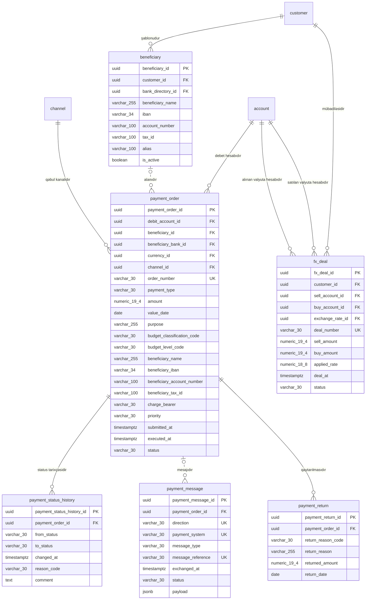

<!-- Bu fayl avtomatik yaradılıb (uv run bankmodel generate). Əl ilə redaktə etməyin. -->

# Ödənişlər (`payment`) — fiziki model

[← Fiziki model](index.md) | [Konseptual model](../01_konseptual/05_payment.md) · [Məntiqi model](../02_mentiqi/05_payment.md) · **Fiziki model**

Müştərilərin köçürmə tapşırıqları və onların icrası: daxili köçürmələr, yerli ödəniş sistemləri (AZIPS — iri məbləğli real vaxt, XÖHKS — kütləvi ödənişlər), beynəlxalq SWIFT köçürmələri, büdcə ödənişləri, qaytarılmalar və valyuta mübadiləsi.

## Diaqram

Audit sütunları diaqramda göstərilmir.

## Cədvəllər

### `payment.beneficiary` — Benefisiar (alan)

Müştərinin yadda saxladığı köçürmə alanı: ad, IBAN/hesab nömrəsi, VÖEN/FİN, alan bank.

| # | Sütun | Tip | NULL | Default | Şərh |
|---|---|---|---|---|---|
| 1 | `beneficiary_id` | `uuid` | NOT NULL | `uuidv7()` | Benefisiar (alan) — surrogat identifikator (UUIDv7). |
| 2 | `customer_id` | `uuid` | NOT NULL |  | Müştəri istinadı (şablonudur). |
| 3 | `bank_directory_id` | `uuid` | NULL |  | Bank kataloqu istinadı (alan bankdır). |
| 4 | `beneficiary_name` | `varchar(255)` | NOT NULL |  | Alanın adı. |
| 5 | `iban` | `varchar(34)` | NULL |  | Alanın IBAN-ı. |
| 6 | `account_number` | `varchar(100)` | NULL |  | Alanın hesab nömrəsi (IBAN olmayan ölkələr üçün). |
| 7 | `tax_id` | `varchar(100)` | NULL |  | Alanın VÖEN-i və ya FİN-i. |
| 8 | `alias` | `varchar(100)` | NULL |  | Müştərinin verdiyi qısa ad. |
| 9 | `is_active` | `boolean` | NOT NULL | `true` | Şablon aktivdir. |
| 10 | `created_at` | `timestamptz` | NOT NULL | `now()` | Yazılışın yaradıldığı an. |
| 11 | `created_by` | `varchar(100)` | NOT NULL | `current_user` | Yazılışı yaradan istifadəçi. |
| 12 | `updated_at` | `timestamptz` | NULL |  | Son dəyişiklik anı. |
| 13 | `updated_by` | `varchar(100)` | NULL |  | Son dəyişikliyi edən istifadəçi. |

**Məhdudiyyətlər:**

| Ad | Növ | Tərif | Təsvir |
|---|---|---|---|
| `pk_beneficiary` | PRIMARY KEY | `PRIMARY KEY (beneficiary_id)` | Əsas açar |
| `ck_beneficiary_has_account` | CHECK | `CHECK (num_nonnulls(iban, account_number) >= 1)` | IBAN və ya hesab nömrəsi göstərilməlidir. |
| `fk_beneficiary_customer_id` | FOREIGN KEY | `FOREIGN KEY (customer_id) REFERENCES party.customer (customer_id)` | İstinad bütövlüyü |
| `fk_beneficiary_bank_directory_id` | FOREIGN KEY | `FOREIGN KEY (bank_directory_id) REFERENCES ref.bank_directory (bank_directory_id)` | İstinad bütövlüyü |

**İndekslər:**

| Ad | Sütunlar | Şərt | Səbəb |
|---|---|---|---|
| `ix_beneficiary_customer_id` | `customer_id` |  | FK |
| `ix_beneficiary_bank_directory_id` | `bank_directory_id` |  | FK |

### `payment.payment_order` — Ödəniş tapşırığı

Müştərinin köçürmə tapşırığı: növü (daxili, AZIPS, XÖHKS, SWIFT, büdcə), məbləğ, valyuta, təyinat, büdcə təsnifat kodu, dəyər tarixi, status. Alanın rekvizitləri tapşırıq anındakı vəziyyətlə saxlanılır (şablon sonradan dəyişsə də tapşırıq dəyişməz).

| # | Sütun | Tip | NULL | Default | Şərh |
|---|---|---|---|---|---|
| 1 | `payment_order_id` | `uuid` | NOT NULL | `uuidv7()` | Ödəniş tapşırığı — surrogat identifikator (UUIDv7). |
| 2 | `debit_account_id` | `uuid` | NOT NULL |  | Hesab istinadı (debet hesabıdır). |
| 3 | `beneficiary_id` | `uuid` | NULL |  | Benefisiar (alan) istinadı (alanıdır). |
| 4 | `beneficiary_bank_id` | `uuid` | NULL |  | Bank kataloqu istinadı (alan bankdır). |
| 5 | `currency_id` | `uuid` | NOT NULL |  | Valyuta istinadı (valyutasıdır). |
| 6 | `channel_id` | `uuid` | NOT NULL |  | Xidmət kanalı istinadı (qəbul kanalıdır). |
| 7 | `order_number` | `varchar(30)` | NOT NULL |  | Tapşırığın unikal nömrəsi. |
| 8 | `payment_type` | `varchar(30)` | NOT NULL |  | Ödənişin növü. Dəyərlər: `INTERNAL`, `AZIPS`, `XOHKS`, `SWIFT`, `BUDGET` |
| 9 | `amount` | `numeric(19,4)` | NOT NULL |  | Köçürmə məbləği (tapşırığın valyutasında). |
| 10 | `value_date` | `date` | NOT NULL |  | İstənilən dəyər tarixi. |
| 11 | `purpose` | `varchar(255)` | NOT NULL |  | Ödənişin təyinatı. |
| 12 | `budget_classification_code` | `varchar(30)` | NULL |  | Büdcə təsnifatı kodu (büdcə ödənişləri üçün). |
| 13 | `budget_level_code` | `varchar(30)` | NULL |  | Büdcə səviyyəsinin kodu (büdcə ödənişləri üçün). |
| 14 | `beneficiary_name` | `varchar(255)` | NOT NULL |  | Alanın adı (tapşırıq anında). |
| 15 | `beneficiary_iban` | `varchar(34)` | NULL |  | Alanın IBAN-ı (tapşırıq anında). |
| 16 | `beneficiary_account_number` | `varchar(100)` | NULL |  | Alanın hesab nömrəsi (IBAN olmadıqda). |
| 17 | `beneficiary_tax_id` | `varchar(100)` | NULL |  | Alanın VÖEN-i / FİN-i. |
| 18 | `charge_bearer` | `varchar(30)` | NULL |  | SWIFT komissiyasını kim ödəyir. Dəyərlər: `OUR`, `SHA`, `BEN` |
| 19 | `priority` | `varchar(30)` | NOT NULL | `'NORMAL'` | Prioritet. Dəyərlər: `NORMAL`, `URGENT` |
| 20 | `submitted_at` | `timestamptz` | NOT NULL | `now()` | Tapşırığın qəbul edildiyi an. |
| 21 | `executed_at` | `timestamptz` | NULL |  | İcra anı. |
| 22 | `status` | `varchar(30)` | NOT NULL |  | Tapşırığın statusu. Dəyərlər: `CREATED`, `PENDING_APPROVAL`, `SCREENING`, `SENT`, `EXECUTED`, `REJECTED`, `CANCELLED`, `RETURNED` |
| 23 | `created_at` | `timestamptz` | NOT NULL | `now()` | Yazılışın yaradıldığı an. |
| 24 | `created_by` | `varchar(100)` | NOT NULL | `current_user` | Yazılışı yaradan istifadəçi. |
| 25 | `updated_at` | `timestamptz` | NULL |  | Son dəyişiklik anı. |
| 26 | `updated_by` | `varchar(100)` | NULL |  | Son dəyişikliyi edən istifadəçi. |

**Məhdudiyyətlər:**

| Ad | Növ | Tərif | Təsvir |
|---|---|---|---|
| `pk_payment_order` | PRIMARY KEY | `PRIMARY KEY (payment_order_id)` | Əsas açar |
| `uq_payment_order_order_number` | UNIQUE | `UNIQUE (order_number)` | Alternativ açar |
| `ck_payment_order_payment_type` | CHECK | `CHECK (payment_type IN ('INTERNAL', 'AZIPS', 'XOHKS', 'SWIFT', 'BUDGET'))` | İcazəli dəyərlər |
| `ck_payment_order_charge_bearer` | CHECK | `CHECK (charge_bearer IN ('OUR', 'SHA', 'BEN'))` | İcazəli dəyərlər |
| `ck_payment_order_priority` | CHECK | `CHECK (priority IN ('NORMAL', 'URGENT'))` | İcazəli dəyərlər |
| `ck_payment_order_status` | CHECK | `CHECK (status IN ('CREATED', 'PENDING_APPROVAL', 'SCREENING', 'SENT', 'EXECUTED', 'REJECTED', 'CANCELLED', 'RETURNED'))` | İcazəli dəyərlər |
| `ck_payment_order_amount_positive` | CHECK | `CHECK (amount > 0)` | Məbləğ müsbət olmalıdır. |
| `ck_payment_order_has_beneficiary_account` | CHECK | `CHECK (num_nonnulls(beneficiary_iban, beneficiary_account_number) >= 1)` | Alanın IBAN-ı və ya hesab nömrəsi olmalıdır. |
| `ck_payment_order_budget_fields` | CHECK | `CHECK (payment_type <> 'BUDGET' OR (budget_classification_code IS NOT NULL AND budget_level_code IS NOT NULL))` | Büdcə ödənişində büdcə təsnifatı və səviyyə kodları məcburidir. |
| `ck_payment_order_swift_charges` | CHECK | `CHECK (payment_type <> 'SWIFT' OR charge_bearer IS NOT NULL)` | SWIFT köçürməsində komissiya ödəyicisi göstərilməlidir. |
| `fk_payment_order_debit_account_id` | FOREIGN KEY | `FOREIGN KEY (debit_account_id) REFERENCES account.account (account_id)` | İstinad bütövlüyü |
| `fk_payment_order_beneficiary_id` | FOREIGN KEY | `FOREIGN KEY (beneficiary_id) REFERENCES payment.beneficiary (beneficiary_id)` | İstinad bütövlüyü |
| `fk_payment_order_beneficiary_bank_id` | FOREIGN KEY | `FOREIGN KEY (beneficiary_bank_id) REFERENCES ref.bank_directory (bank_directory_id)` | İstinad bütövlüyü |
| `fk_payment_order_currency_id` | FOREIGN KEY | `FOREIGN KEY (currency_id) REFERENCES ref.currency (currency_id)` | İstinad bütövlüyü |
| `fk_payment_order_channel_id` | FOREIGN KEY | `FOREIGN KEY (channel_id) REFERENCES org.channel (channel_id)` | İstinad bütövlüyü |

**İndekslər:**

| Ad | Sütunlar | Şərt | Səbəb |
|---|---|---|---|
| `ix_payment_order_debit_account_id` | `debit_account_id` |  | FK |
| `ix_payment_order_beneficiary_id` | `beneficiary_id` |  | FK |
| `ix_payment_order_beneficiary_bank_id` | `beneficiary_bank_id` |  | FK |
| `ix_payment_order_currency_id` | `currency_id` |  | FK |
| `ix_payment_order_channel_id` | `channel_id` |  | FK |
| `ix_payment_order_status_value_date_partial` | `status`, `value_date` | `status NOT IN ('EXECUTED', 'REJECTED', 'CANCELLED', 'RETURNED')` | Sorğu |

### `payment.payment_status_history` — Ödəniş statusu tarixçəsi

Ödəniş tapşırığının statuslarının dəyişikliyi: qəbul, yoxlama, göndərilmə, icra, rədd (yalnız əlavə olunur).

| # | Sütun | Tip | NULL | Default | Şərh |
|---|---|---|---|---|---|
| 1 | `payment_status_history_id` | `uuid` | NOT NULL | `uuidv7()` | Ödəniş statusu tarixçəsi — surrogat identifikator (UUIDv7). |
| 2 | `payment_order_id` | `uuid` | NOT NULL |  | Ödəniş tapşırığı istinadı (status tarixçəsidir). |
| 3 | `from_status` | `varchar(30)` | NULL |  | Əvvəlki status (ilk yazılışda boş). Dəyərlər: `CREATED`, `PENDING_APPROVAL`, `SCREENING`, `SENT`, `EXECUTED`, `REJECTED`, `CANCELLED`, `RETURNED` |
| 4 | `to_status` | `varchar(30)` | NOT NULL |  | Yeni status. Dəyərlər: `CREATED`, `PENDING_APPROVAL`, `SCREENING`, `SENT`, `EXECUTED`, `REJECTED`, `CANCELLED`, `RETURNED` |
| 5 | `changed_at` | `timestamptz` | NOT NULL | `now()` | Statusun dəyişdiyi an. |
| 6 | `reason_code` | `varchar(30)` | NULL |  | Dəyişikliyin səbəb kodu. |
| 7 | `comment` | `text` | NULL |  | Əlavə izah. |
| 8 | `created_at` | `timestamptz` | NOT NULL | `now()` | Yazılışın yaradıldığı an. |
| 9 | `created_by` | `varchar(100)` | NOT NULL | `current_user` | Yazılışı yaradan istifadəçi. |
| 10 | `updated_at` | `timestamptz` | NULL |  | Son dəyişiklik anı. |
| 11 | `updated_by` | `varchar(100)` | NULL |  | Son dəyişikliyi edən istifadəçi. |

**Məhdudiyyətlər:**

| Ad | Növ | Tərif | Təsvir |
|---|---|---|---|
| `pk_payment_status_history` | PRIMARY KEY | `PRIMARY KEY (payment_status_history_id)` | Əsas açar |
| `ck_payment_status_history_from_status` | CHECK | `CHECK (from_status IN ('CREATED', 'PENDING_APPROVAL', 'SCREENING', 'SENT', 'EXECUTED', 'REJECTED', 'CANCELLED', 'RETURNED'))` | İcazəli dəyərlər |
| `ck_payment_status_history_to_status` | CHECK | `CHECK (to_status IN ('CREATED', 'PENDING_APPROVAL', 'SCREENING', 'SENT', 'EXECUTED', 'REJECTED', 'CANCELLED', 'RETURNED'))` | İcazəli dəyərlər |
| `ck_payment_status_history_status_changed` | CHECK | `CHECK (from_status IS DISTINCT FROM to_status)` | Yeni status əvvəlkindən fərqli olmalıdır. |
| `fk_payment_status_history_payment_order_id` | FOREIGN KEY | `FOREIGN KEY (payment_order_id) REFERENCES payment.payment_order (payment_order_id)` | İstinad bütövlüyü |

**İndekslər:**

| Ad | Sütunlar | Şərt | Səbəb |
|---|---|---|---|
| `ix_payment_status_history_payment_order_id` | `payment_order_id` |  | FK |

### `payment.payment_message` — Ödəniş mesajı

Ödəniş sistemlərinə göndərilən və onlardan alınan mesajlar (AZIPS, XÖHKS, SWIFT MT / ISO 20022): istiqamət, mesaj tipi, istinad, status.

| # | Sütun | Tip | NULL | Default | Şərh |
|---|---|---|---|---|---|
| 1 | `payment_message_id` | `uuid` | NOT NULL | `uuidv7()` | Ödəniş mesajı — surrogat identifikator (UUIDv7). |
| 2 | `payment_order_id` | `uuid` | NULL |  | Ödəniş tapşırığı istinadı (mesajıdır). |
| 3 | `direction` | `varchar(30)` | NOT NULL |  | İstiqamət. Dəyərlər: `OUTBOUND`, `INBOUND` |
| 4 | `payment_system` | `varchar(30)` | NOT NULL |  | Ödəniş sistemi. Dəyərlər: `AZIPS`, `XOHKS`, `SWIFT` |
| 5 | `message_type` | `varchar(30)` | NOT NULL |  | Mesaj tipi (MT103, pacs.008 və s.). |
| 6 | `message_reference` | `varchar(30)` | NOT NULL |  | Mesajın sistemdəki istinadı. |
| 7 | `exchanged_at` | `timestamptz` | NOT NULL |  | Göndərilmə / qəbul anı. |
| 8 | `status` | `varchar(30)` | NOT NULL |  | Mesajın statusu. Dəyərlər: `QUEUED`, `SENT`, `ACKNOWLEDGED`, `REJECTED`, `RECEIVED`, `PROCESSED` |
| 9 | `payload` | `jsonb` | NULL |  | Mesajın strukturlaşdırılmış məzmunu. |
| 10 | `created_at` | `timestamptz` | NOT NULL | `now()` | Yazılışın yaradıldığı an. |
| 11 | `created_by` | `varchar(100)` | NOT NULL | `current_user` | Yazılışı yaradan istifadəçi. |
| 12 | `updated_at` | `timestamptz` | NULL |  | Son dəyişiklik anı. |
| 13 | `updated_by` | `varchar(100)` | NULL |  | Son dəyişikliyi edən istifadəçi. |

**Məhdudiyyətlər:**

| Ad | Növ | Tərif | Təsvir |
|---|---|---|---|
| `pk_payment_message` | PRIMARY KEY | `PRIMARY KEY (payment_message_id)` | Əsas açar |
| `uq_payment_message_payment_system_direction_message_reference` | UNIQUE | `UNIQUE (payment_system, direction, message_reference)` | Alternativ açar |
| `ck_payment_message_direction` | CHECK | `CHECK (direction IN ('OUTBOUND', 'INBOUND'))` | İcazəli dəyərlər |
| `ck_payment_message_payment_system` | CHECK | `CHECK (payment_system IN ('AZIPS', 'XOHKS', 'SWIFT'))` | İcazəli dəyərlər |
| `ck_payment_message_status` | CHECK | `CHECK (status IN ('QUEUED', 'SENT', 'ACKNOWLEDGED', 'REJECTED', 'RECEIVED', 'PROCESSED'))` | İcazəli dəyərlər |
| `fk_payment_message_payment_order_id` | FOREIGN KEY | `FOREIGN KEY (payment_order_id) REFERENCES payment.payment_order (payment_order_id)` | İstinad bütövlüyü |

**İndekslər:**

| Ad | Sütunlar | Şərt | Səbəb |
|---|---|---|---|
| `ix_payment_message_payment_order_id` | `payment_order_id` |  | FK |

### `payment.payment_return` — Ödəniş qaytarılması

Qaytarılmış və ya rədd edilmiş ödənişlər: səbəb kodu, qaytarılan məbləğ, tarix.

| # | Sütun | Tip | NULL | Default | Şərh |
|---|---|---|---|---|---|
| 1 | `payment_return_id` | `uuid` | NOT NULL | `uuidv7()` | Ödəniş qaytarılması — surrogat identifikator (UUIDv7). |
| 2 | `payment_order_id` | `uuid` | NOT NULL |  | Ödəniş tapşırığı istinadı (qaytarılmasıdır). |
| 3 | `return_reason_code` | `varchar(30)` | NOT NULL |  | Qaytarılma səbəbinin kodu. |
| 4 | `return_reason` | `varchar(255)` | NULL |  | Səbəbin izahı. |
| 5 | `returned_amount` | `numeric(19,4)` | NOT NULL |  | Qaytarılan məbləğ. |
| 6 | `return_date` | `date` | NOT NULL |  | Qaytarılma tarixi. |
| 7 | `created_at` | `timestamptz` | NOT NULL | `now()` | Yazılışın yaradıldığı an. |
| 8 | `created_by` | `varchar(100)` | NOT NULL | `current_user` | Yazılışı yaradan istifadəçi. |
| 9 | `updated_at` | `timestamptz` | NULL |  | Son dəyişiklik anı. |
| 10 | `updated_by` | `varchar(100)` | NULL |  | Son dəyişikliyi edən istifadəçi. |

**Məhdudiyyətlər:**

| Ad | Növ | Tərif | Təsvir |
|---|---|---|---|
| `pk_payment_return` | PRIMARY KEY | `PRIMARY KEY (payment_return_id)` | Əsas açar |
| `ck_payment_return_amount_positive` | CHECK | `CHECK (returned_amount > 0)` | Məbləğ müsbət olmalıdır. |
| `fk_payment_return_payment_order_id` | FOREIGN KEY | `FOREIGN KEY (payment_order_id) REFERENCES payment.payment_order (payment_order_id)` | İstinad bütövlüyü |

**İndekslər:**

| Ad | Sütunlar | Şərt | Səbəb |
|---|---|---|---|
| `ix_payment_return_payment_order_id` | `payment_order_id` |  | FK |

### `payment.fx_deal` — Valyuta mübadiləsi

Müştərinin hesabları arasında valyuta alqı-satqısı (konversiya): satılan və alınan məbləğ, tətbiq olunan məzənnə. Valyutalar hesablardan müəyyən olunur.

| # | Sütun | Tip | NULL | Default | Şərh |
|---|---|---|---|---|---|
| 1 | `fx_deal_id` | `uuid` | NOT NULL | `uuidv7()` | Valyuta mübadiləsi — surrogat identifikator (UUIDv7). |
| 2 | `customer_id` | `uuid` | NOT NULL |  | Müştəri istinadı (mübadiləsidir). |
| 3 | `sell_account_id` | `uuid` | NOT NULL |  | Hesab istinadı (satılan valyuta hesabıdır). |
| 4 | `buy_account_id` | `uuid` | NOT NULL |  | Hesab istinadı (alınan valyuta hesabıdır). |
| 5 | `exchange_rate_id` | `uuid` | NULL |  | Valyuta məzənnəsi istinadı (tətbiq olunan məzənnədir). |
| 6 | `deal_number` | `varchar(30)` | NOT NULL |  | Əqdin nömrəsi. |
| 7 | `sell_amount` | `numeric(19,4)` | NOT NULL |  | Satılan məbləğ. |
| 8 | `buy_amount` | `numeric(19,4)` | NOT NULL |  | Alınan məbləğ. |
| 9 | `applied_rate` | `numeric(18,8)` | NOT NULL |  | Faktiki tətbiq olunan məzənnə (fərdi məzənnə ola bilər). |
| 10 | `deal_at` | `timestamptz` | NOT NULL | `now()` | Əqdin anı. |
| 11 | `status` | `varchar(30)` | NOT NULL |  | Status. Dəyərlər: `EXECUTED`, `CANCELLED` |
| 12 | `created_at` | `timestamptz` | NOT NULL | `now()` | Yazılışın yaradıldığı an. |
| 13 | `created_by` | `varchar(100)` | NOT NULL | `current_user` | Yazılışı yaradan istifadəçi. |
| 14 | `updated_at` | `timestamptz` | NULL |  | Son dəyişiklik anı. |
| 15 | `updated_by` | `varchar(100)` | NULL |  | Son dəyişikliyi edən istifadəçi. |

**Məhdudiyyətlər:**

| Ad | Növ | Tərif | Təsvir |
|---|---|---|---|
| `pk_fx_deal` | PRIMARY KEY | `PRIMARY KEY (fx_deal_id)` | Əsas açar |
| `uq_fx_deal_deal_number` | UNIQUE | `UNIQUE (deal_number)` | Alternativ açar |
| `ck_fx_deal_status` | CHECK | `CHECK (status IN ('EXECUTED', 'CANCELLED'))` | İcazəli dəyərlər |
| `ck_fx_deal_distinct_accounts` | CHECK | `CHECK (sell_account_id <> buy_account_id)` | Satış və alış hesabları fərqli olmalıdır. |
| `ck_fx_deal_amounts_positive` | CHECK | `CHECK (sell_amount > 0 AND buy_amount > 0 AND applied_rate > 0)` | Məbləğlər və məzənnə müsbət olmalıdır. |
| `fk_fx_deal_customer_id` | FOREIGN KEY | `FOREIGN KEY (customer_id) REFERENCES party.customer (customer_id)` | İstinad bütövlüyü |
| `fk_fx_deal_sell_account_id` | FOREIGN KEY | `FOREIGN KEY (sell_account_id) REFERENCES account.account (account_id)` | İstinad bütövlüyü |
| `fk_fx_deal_buy_account_id` | FOREIGN KEY | `FOREIGN KEY (buy_account_id) REFERENCES account.account (account_id)` | İstinad bütövlüyü |
| `fk_fx_deal_exchange_rate_id` | FOREIGN KEY | `FOREIGN KEY (exchange_rate_id) REFERENCES ref.exchange_rate (exchange_rate_id)` | İstinad bütövlüyü |

**İndekslər:**

| Ad | Sütunlar | Şərt | Səbəb |
|---|---|---|---|
| `ix_fx_deal_customer_id` | `customer_id` |  | FK |
| `ix_fx_deal_sell_account_id` | `sell_account_id` |  | FK |
| `ix_fx_deal_buy_account_id` | `buy_account_id` |  | FK |
| `ix_fx_deal_exchange_rate_id` | `exchange_rate_id` |  | FK |
