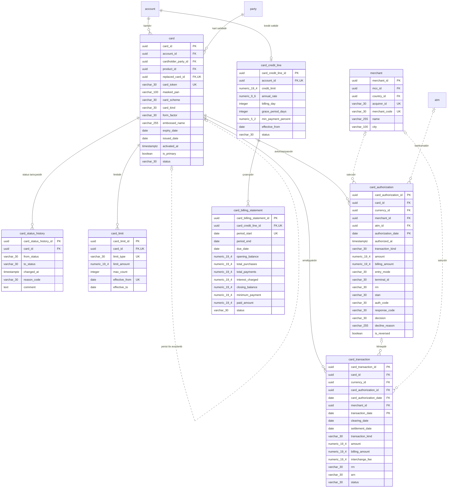

<!-- Bu fayl avtomatik yaradılıb (uv run bankmodel generate). Əl ilə redaktə etməyin. -->

# Kartlar (`card`) — fiziki model

[← Fiziki model](index.md) | [Konseptual model](../01_konseptual/06_card.md) · [Məntiqi model](../02_mentiqi/06_card.md) · **Fiziki model**

Debet və kredit kartları, onların limitləri, kredit kartı xətti və hesablaşma çıxarışları, real vaxt avtorizasiyaları və ödəniş sistemindən gələn klirinq əməliyyatları. Avtorizasiya bankın öz prosessinq sistemi tərəfindən aparılır. Kart həmişə hesaba bağlıdır: debet kart cari/kart hesabına, kredit kartı kredit xətti olan kart hesabına. Tam PAN, CVV və PIN bu bazada saxlanılmır (PCI DSS) — yalnız token və maskalanmış nömrə.

## Diaqram

Audit sütunları diaqramda göstərilmir.

## Cədvəllər

### `card.merchant` — Satıcı (ticarət obyekti)

Kartla ödəniş qəbul edən ticarət obyekti: ad, MCC, ölkə, şəhər; avtorizasiya məlumatından yaradılır.

| # | Sütun | Tip | NULL | Default | Şərh |
|---|---|---|---|---|---|
| 1 | `merchant_id` | `uuid` | NOT NULL | `uuidv7()` | Satıcı (ticarət obyekti) — surrogat identifikator (UUIDv7). |
| 2 | `mcc_id` | `uuid` | NOT NULL |  | Satıcı kateqoriya kodu (MCC) istinadı (kateqoriyasıdır). |
| 3 | `country_id` | `uuid` | NOT NULL |  | Ölkə istinadı (ölkəsidir). |
| 4 | `acquirer_id` | `varchar(30)` | NOT NULL |  | Ekvayer bankın identifikatoru. |
| 5 | `merchant_code` | `varchar(30)` | NOT NULL |  | Ekvayerin verdiyi satıcı identifikatoru (MID). |
| 6 | `name` | `varchar(255)` | NOT NULL |  | Satıcının adı (çeklərdə göstərilən). |
| 7 | `city` | `varchar(100)` | NULL |  | Şəhər. |
| 8 | `created_at` | `timestamptz` | NOT NULL | `now()` | Yazılışın yaradıldığı an. |
| 9 | `created_by` | `varchar(100)` | NOT NULL | `current_user` | Yazılışı yaradan istifadəçi. |
| 10 | `updated_at` | `timestamptz` | NULL |  | Son dəyişiklik anı. |
| 11 | `updated_by` | `varchar(100)` | NULL |  | Son dəyişikliyi edən istifadəçi. |

**Məhdudiyyətlər:**

| Ad | Növ | Tərif | Təsvir |
|---|---|---|---|
| `pk_merchant` | PRIMARY KEY | `PRIMARY KEY (merchant_id)` | Əsas açar |
| `uq_merchant_acquirer_id_merchant_code` | UNIQUE | `UNIQUE (acquirer_id, merchant_code)` | Alternativ açar |
| `fk_merchant_mcc_id` | FOREIGN KEY | `FOREIGN KEY (mcc_id) REFERENCES ref.mcc (mcc_id)` | İstinad bütövlüyü |
| `fk_merchant_country_id` | FOREIGN KEY | `FOREIGN KEY (country_id) REFERENCES ref.country (country_id)` | İstinad bütövlüyü |

**İndekslər:**

| Ad | Sütunlar | Şərt | Səbəb |
|---|---|---|---|
| `ix_merchant_mcc_id` | `mcc_id` |  | FK |
| `ix_merchant_country_id` | `country_id` |  | FK |

### `card.card` — Kart

Debet və ya kredit kartı: token, maskalanmış PAN, ödəniş sistemi (Visa/Mastercard), növ (fiziki/virtual), etibarlılıq müddəti, kart sahibi, bağlı hesab, status.

| # | Sütun | Tip | NULL | Default | Şərh |
|---|---|---|---|---|---|
| 1 | `card_id` | `uuid` | NOT NULL | `uuidv7()` | Kart — surrogat identifikator (UUIDv7). |
| 2 | `account_id` | `uuid` | NOT NULL |  | Hesab istinadı (kartıdır). |
| 3 | `cardholder_party_id` | `uuid` | NOT NULL |  | Tərəf istinadı (kart sahibidir). |
| 4 | `product_id` | `uuid` | NOT NULL |  | Məhsul istinadı (məhsuludur). |
| 5 | `replaced_card_id` | `uuid` | NULL |  | Kart istinadı (yenisi ilə əvəzlənib). |
| 6 | `card_token` | `varchar(30)` | NOT NULL |  | Kart tokeni (tam PAN təhlükəsiz kart anbarında saxlanılır). |
| 7 | `masked_pan` | `varchar(100)` | NOT NULL |  | Maskalanmış kart nömrəsi (416973******1234). |
| 8 | `card_scheme` | `varchar(30)` | NOT NULL |  | Ödəniş sistemi. Dəyərlər: `VISA`, `MASTERCARD` |
| 9 | `card_kind` | `varchar(30)` | NOT NULL |  | Kartın növü. Dəyərlər: `DEBIT`, `CREDIT` |
| 10 | `form_factor` | `varchar(30)` | NOT NULL |  | Fiziki və ya virtual kart. Dəyərlər: `PHYSICAL`, `VIRTUAL` |
| 11 | `embossed_name` | `varchar(255)` | NULL |  | Kartın üzərindəki ad. |
| 12 | `expiry_date` | `date` | NOT NULL |  | Etibarlılıq müddətinin sonu (ayın son günü). |
| 13 | `issued_date` | `date` | NOT NULL |  | Buraxılış tarixi. |
| 14 | `activated_at` | `timestamptz` | NULL |  | Aktivləşmə anı. |
| 15 | `is_primary` | `boolean` | NOT NULL | `true` | Əsas kartdır (əlavə kart deyil). |
| 16 | `status` | `varchar(30)` | NOT NULL |  | Kartın statusu. Dəyərlər: `ISSUED`, `ACTIVE`, `BLOCKED`, `LOST`, `STOLEN`, `EXPIRED`, `CLOSED` |
| 17 | `created_at` | `timestamptz` | NOT NULL | `now()` | Yazılışın yaradıldığı an. |
| 18 | `created_by` | `varchar(100)` | NOT NULL | `current_user` | Yazılışı yaradan istifadəçi. |
| 19 | `updated_at` | `timestamptz` | NULL |  | Son dəyişiklik anı. |
| 20 | `updated_by` | `varchar(100)` | NULL |  | Son dəyişikliyi edən istifadəçi. |

**Məhdudiyyətlər:**

| Ad | Növ | Tərif | Təsvir |
|---|---|---|---|
| `pk_card` | PRIMARY KEY | `PRIMARY KEY (card_id)` | Əsas açar |
| `uq_card_replaced_card_id` | UNIQUE | `UNIQUE (replaced_card_id)` | Alternativ açar |
| `uq_card_card_token` | UNIQUE | `UNIQUE (card_token)` | Alternativ açar |
| `ck_card_card_scheme` | CHECK | `CHECK (card_scheme IN ('VISA', 'MASTERCARD'))` | İcazəli dəyərlər |
| `ck_card_card_kind` | CHECK | `CHECK (card_kind IN ('DEBIT', 'CREDIT'))` | İcazəli dəyərlər |
| `ck_card_form_factor` | CHECK | `CHECK (form_factor IN ('PHYSICAL', 'VIRTUAL'))` | İcazəli dəyərlər |
| `ck_card_status` | CHECK | `CHECK (status IN ('ISSUED', 'ACTIVE', 'BLOCKED', 'LOST', 'STOLEN', 'EXPIRED', 'CLOSED'))` | İcazəli dəyərlər |
| `ck_card_expiry_after_issue` | CHECK | `CHECK (expiry_date > issued_date)` | Etibarlılıq tarixi buraxılış tarixindən sonra olmalıdır. |
| `fk_card_account_id` | FOREIGN KEY | `FOREIGN KEY (account_id) REFERENCES account.account (account_id)` | İstinad bütövlüyü |
| `fk_card_cardholder_party_id` | FOREIGN KEY | `FOREIGN KEY (cardholder_party_id) REFERENCES party.party (party_id)` | İstinad bütövlüyü |
| `fk_card_product_id` | FOREIGN KEY | `FOREIGN KEY (product_id) REFERENCES ref.product (product_id)` | İstinad bütövlüyü |
| `fk_card_replaced_card_id` | FOREIGN KEY | `FOREIGN KEY (replaced_card_id) REFERENCES card.card (card_id)` | İstinad bütövlüyü |

**İndekslər:**

| Ad | Sütunlar | Şərt | Səbəb |
|---|---|---|---|
| `ix_card_account_id` | `account_id` |  | FK |
| `ix_card_cardholder_party_id` | `cardholder_party_id` |  | FK |
| `ix_card_product_id` | `product_id` |  | FK |

### `card.card_status_history` — Kart statusu tarixçəsi

Kart statusunun dəyişiklikləri: buraxılış, aktivləşmə, bloklama, itki/oğurluq, bağlanma (yalnız əlavə olunur).

| # | Sütun | Tip | NULL | Default | Şərh |
|---|---|---|---|---|---|
| 1 | `card_status_history_id` | `uuid` | NOT NULL | `uuidv7()` | Kart statusu tarixçəsi — surrogat identifikator (UUIDv7). |
| 2 | `card_id` | `uuid` | NOT NULL |  | Kart istinadı (status tarixçəsidir). |
| 3 | `from_status` | `varchar(30)` | NULL |  | Əvvəlki status (ilk yazılışda boş). Dəyərlər: `ISSUED`, `ACTIVE`, `BLOCKED`, `LOST`, `STOLEN`, `EXPIRED`, `CLOSED` |
| 4 | `to_status` | `varchar(30)` | NOT NULL |  | Yeni status. Dəyərlər: `ISSUED`, `ACTIVE`, `BLOCKED`, `LOST`, `STOLEN`, `EXPIRED`, `CLOSED` |
| 5 | `changed_at` | `timestamptz` | NOT NULL | `now()` | Statusun dəyişdiyi an. |
| 6 | `reason_code` | `varchar(30)` | NULL |  | Dəyişikliyin səbəb kodu. |
| 7 | `comment` | `text` | NULL |  | Əlavə izah. |
| 8 | `created_at` | `timestamptz` | NOT NULL | `now()` | Yazılışın yaradıldığı an. |
| 9 | `created_by` | `varchar(100)` | NOT NULL | `current_user` | Yazılışı yaradan istifadəçi. |
| 10 | `updated_at` | `timestamptz` | NULL |  | Son dəyişiklik anı. |
| 11 | `updated_by` | `varchar(100)` | NULL |  | Son dəyişikliyi edən istifadəçi. |

**Məhdudiyyətlər:**

| Ad | Növ | Tərif | Təsvir |
|---|---|---|---|
| `pk_card_status_history` | PRIMARY KEY | `PRIMARY KEY (card_status_history_id)` | Əsas açar |
| `ck_card_status_history_from_status` | CHECK | `CHECK (from_status IN ('ISSUED', 'ACTIVE', 'BLOCKED', 'LOST', 'STOLEN', 'EXPIRED', 'CLOSED'))` | İcazəli dəyərlər |
| `ck_card_status_history_to_status` | CHECK | `CHECK (to_status IN ('ISSUED', 'ACTIVE', 'BLOCKED', 'LOST', 'STOLEN', 'EXPIRED', 'CLOSED'))` | İcazəli dəyərlər |
| `ck_card_status_history_status_changed` | CHECK | `CHECK (from_status IS DISTINCT FROM to_status)` | Yeni status əvvəlkindən fərqli olmalıdır. |
| `fk_card_status_history_card_id` | FOREIGN KEY | `FOREIGN KEY (card_id) REFERENCES card.card (card_id)` | İstinad bütövlüyü |

**İndekslər:**

| Ad | Sütunlar | Şərt | Səbəb |
|---|---|---|---|
| `ix_card_status_history_card_id` | `card_id` |  | FK |

### `card.card_limit` — Kart limiti

Kart üzrə limitlər: gündəlik nağdlaşdırma, POS, internet əməliyyatları, aylıq ümumi, tək əməliyyat.

| # | Sütun | Tip | NULL | Default | Şərh |
|---|---|---|---|---|---|
| 1 | `card_limit_id` | `uuid` | NOT NULL | `uuidv7()` | Kart limiti — surrogat identifikator (UUIDv7). |
| 2 | `card_id` | `uuid` | NOT NULL |  | Kart istinadı (limitidir). |
| 3 | `limit_type` | `varchar(30)` | NOT NULL |  | Limitin növü. Dəyərlər: `DAILY_CASH`, `DAILY_PURCHASE`, `DAILY_ECOMMERCE`, `MONTHLY_TOTAL`, `SINGLE_TRANSACTION` |
| 4 | `limit_amount` | `numeric(19,4)` | NOT NULL |  | Limit məbləği (hesab valyutasında). |
| 5 | `max_count` | `integer` | NULL |  | Əməliyyat sayı limiti. |
| 6 | `effective_from` | `date` | NOT NULL |  | Qüvvəyə minmə tarixi. |
| 7 | `effective_to` | `date` | NULL |  | Qüvvədən düşmə tarixi. |
| 8 | `created_at` | `timestamptz` | NOT NULL | `now()` | Yazılışın yaradıldığı an. |
| 9 | `created_by` | `varchar(100)` | NOT NULL | `current_user` | Yazılışı yaradan istifadəçi. |
| 10 | `updated_at` | `timestamptz` | NULL |  | Son dəyişiklik anı. |
| 11 | `updated_by` | `varchar(100)` | NULL |  | Son dəyişikliyi edən istifadəçi. |

**Məhdudiyyətlər:**

| Ad | Növ | Tərif | Təsvir |
|---|---|---|---|
| `pk_card_limit` | PRIMARY KEY | `PRIMARY KEY (card_limit_id)` | Əsas açar |
| `uq_card_limit_card_id_limit_type_effective_from` | UNIQUE | `UNIQUE (card_id, limit_type, effective_from)` | Alternativ açar |
| `ck_card_limit_limit_type` | CHECK | `CHECK (limit_type IN ('DAILY_CASH', 'DAILY_PURCHASE', 'DAILY_ECOMMERCE', 'MONTHLY_TOTAL', 'SINGLE_TRANSACTION'))` | İcazəli dəyərlər |
| `ck_card_limit_limit_non_negative` | CHECK | `CHECK (limit_amount >= 0)` | Limit mənfi ola bilməz. |
| `ck_card_limit_valid_period` | CHECK | `CHECK (effective_to IS NULL OR effective_to >= effective_from)` | Bitmə tarixi başlanğıcdan əvvəl ola bilməz. |
| `fk_card_limit_card_id` | FOREIGN KEY | `FOREIGN KEY (card_id) REFERENCES card.card (card_id)` | İstinad bütövlüyü |

### `card.card_credit_line` — Kredit kartı xətti

Kart hesabının kredit limiti və şərtləri: hesablaşma dövrü günü, güzəşt müddəti, minimal ödəniş faizi, illik faiz dərəcəsi (actual/365).

| # | Sütun | Tip | NULL | Default | Şərh |
|---|---|---|---|---|---|
| 1 | `card_credit_line_id` | `uuid` | NOT NULL | `uuidv7()` | Kredit kartı xətti — surrogat identifikator (UUIDv7). |
| 2 | `account_id` | `uuid` | NOT NULL |  | Hesab istinadı (kredit xəttidir). |
| 3 | `credit_limit` | `numeric(19,4)` | NOT NULL |  | Kredit limiti. |
| 4 | `annual_rate` | `numeric(9,6)` | NOT NULL |  | İllik faiz dərəcəsi. |
| 5 | `billing_day` | `integer` | NOT NULL |  | Hesablaşma dövrünün bağlandığı gün (1–28). |
| 6 | `grace_period_days` | `integer` | NOT NULL |  | Güzəşt müddəti (gün). |
| 7 | `min_payment_percent` | `numeric(5,2)` | NOT NULL |  | Minimal ödəniş — borcun faizi. |
| 8 | `effective_from` | `date` | NOT NULL |  | Qüvvəyə minmə tarixi. |
| 9 | `status` | `varchar(30)` | NOT NULL |  | Status. Dəyərlər: `ACTIVE`, `SUSPENDED`, `CLOSED` |
| 10 | `created_at` | `timestamptz` | NOT NULL | `now()` | Yazılışın yaradıldığı an. |
| 11 | `created_by` | `varchar(100)` | NOT NULL | `current_user` | Yazılışı yaradan istifadəçi. |
| 12 | `updated_at` | `timestamptz` | NULL |  | Son dəyişiklik anı. |
| 13 | `updated_by` | `varchar(100)` | NULL |  | Son dəyişikliyi edən istifadəçi. |

**Məhdudiyyətlər:**

| Ad | Növ | Tərif | Təsvir |
|---|---|---|---|
| `pk_card_credit_line` | PRIMARY KEY | `PRIMARY KEY (card_credit_line_id)` | Əsas açar |
| `uq_card_credit_line_account_id` | UNIQUE | `UNIQUE (account_id)` | Alternativ açar |
| `ck_card_credit_line_status` | CHECK | `CHECK (status IN ('ACTIVE', 'SUSPENDED', 'CLOSED'))` | İcazəli dəyərlər |
| `ck_card_credit_line_billing_day_range` | CHECK | `CHECK (billing_day BETWEEN 1 AND 28)` | Hesablaşma günü 1–28 arasında olmalıdır. |
| `ck_card_credit_line_limit_positive` | CHECK | `CHECK (credit_limit > 0)` | Kredit limiti müsbət olmalıdır. |
| `ck_card_credit_line_min_payment_range` | CHECK | `CHECK (min_payment_percent > 0 AND min_payment_percent <= 100)` | Minimal ödəniş faizi 0–100% arasında olmalıdır. |
| `fk_card_credit_line_account_id` | FOREIGN KEY | `FOREIGN KEY (account_id) REFERENCES account.account (account_id)` | İstinad bütövlüyü |

### `card.card_authorization` — Kart avtorizasiyası

Bankın prosessinq sistemində kart əməliyyatı üçün real vaxt avtorizasiya sorğusu və cavabı (təsdiq/imtina): məbləğ, valyuta, satıcı/bankomat, cavab kodu, RRN, STAN. Yüksək həcmli cədvəldir, aylar üzrə bölmələnir.

**Bölmələmə:** `PARTITION BY RANGE (authorization_date)`, aylıq bölmələr + `card_authorization_default`.

| # | Sütun | Tip | NULL | Default | Şərh |
|---|---|---|---|---|---|
| 1 | `card_authorization_id` | `uuid` | NOT NULL | `uuidv7()` | Kart avtorizasiyası — surrogat identifikator (UUIDv7). |
| 2 | `card_id` | `uuid` | NOT NULL |  | Kart istinadı (avtorizasiyasıdır). |
| 3 | `currency_id` | `uuid` | NOT NULL |  | Valyuta istinadı (əməliyyat valyutasıdır). |
| 4 | `merchant_id` | `uuid` | NULL |  | Satıcı (ticarət obyekti) istinadı (satıcıdır). |
| 5 | `atm_id` | `uuid` | NULL |  | Bankomat istinadı (bankomatdır). |
| 6 | `authorization_date` | `date` | NOT NULL |  | Avtorizasiyanın bank günü (bölmə açarı). |
| 7 | `authorized_at` | `timestamptz` | NOT NULL |  | Sorğunun anı. |
| 8 | `transaction_kind` | `varchar(30)` | NOT NULL |  | Əməliyyatın növü. Dəyərlər: `PURCHASE`, `CASH_WITHDRAWAL`, `ECOMMERCE`, `REFUND`, `BALANCE_INQUIRY`, `P2P` |
| 9 | `amount` | `numeric(19,4)` | NOT NULL |  | Əməliyyat valyutasında məbləğ. |
| 10 | `billing_amount` | `numeric(19,4)` | NOT NULL |  | Hesab valyutasında məbləğ (bloklanan). |
| 11 | `entry_mode` | `varchar(30)` | NOT NULL |  | Kart məlumatının daxil edilmə üsulu. Dəyərlər: `CHIP`, `CONTACTLESS`, `MAGSTRIPE`, `ECOMMERCE`, `MANUAL` |
| 12 | `terminal_id` | `varchar(30)` | NULL |  | Terminalın identifikatoru. |
| 13 | `rrn` | `varchar(30)` | NOT NULL |  | Retrieval Reference Number — əməliyyatın istinad nömrəsi. |
| 14 | `stan` | `varchar(30)` | NOT NULL |  | System Trace Audit Number. |
| 15 | `auth_code` | `varchar(30)` | NULL |  | Təsdiq kodu (təsdiq edilmiş əməliyyatlar üçün). |
| 16 | `response_code` | `varchar(30)` | NOT NULL |  | Cavab kodu (ISO 8583, 00 — təsdiq). |
| 17 | `decision` | `varchar(30)` | NOT NULL |  | Qərar. Dəyərlər: `APPROVED`, `DECLINED` |
| 18 | `decline_reason` | `varchar(255)` | NULL |  | İmtinanın səbəbi. |
| 19 | `is_reversed` | `boolean` | NOT NULL | `false` | Avtorizasiya ləğv edilib (reversal). |
| 20 | `created_at` | `timestamptz` | NOT NULL | `now()` | Yazılışın yaradıldığı an. |
| 21 | `created_by` | `varchar(100)` | NOT NULL | `current_user` | Yazılışı yaradan istifadəçi. |
| 22 | `updated_at` | `timestamptz` | NULL |  | Son dəyişiklik anı. |
| 23 | `updated_by` | `varchar(100)` | NULL |  | Son dəyişikliyi edən istifadəçi. |

**Məhdudiyyətlər:**

| Ad | Növ | Tərif | Təsvir |
|---|---|---|---|
| `pk_card_authorization` | PRIMARY KEY | `PRIMARY KEY (card_authorization_id, authorization_date)` | Əsas açar |
| `ck_card_authorization_transaction_kind` | CHECK | `CHECK (transaction_kind IN ('PURCHASE', 'CASH_WITHDRAWAL', 'ECOMMERCE', 'REFUND', 'BALANCE_INQUIRY', 'P2P'))` | İcazəli dəyərlər |
| `ck_card_authorization_entry_mode` | CHECK | `CHECK (entry_mode IN ('CHIP', 'CONTACTLESS', 'MAGSTRIPE', 'ECOMMERCE', 'MANUAL'))` | İcazəli dəyərlər |
| `ck_card_authorization_decision` | CHECK | `CHECK (decision IN ('APPROVED', 'DECLINED'))` | İcazəli dəyərlər |
| `ck_card_authorization_approved_has_code` | CHECK | `CHECK (decision <> 'APPROVED' OR auth_code IS NOT NULL)` | Təsdiq edilmiş avtorizasiyanın təsdiq kodu olmalıdır. |
| `ck_card_authorization_amount_non_negative` | CHECK | `CHECK (amount >= 0 AND billing_amount >= 0)` | Məbləğ mənfi ola bilməz. |
| `fk_card_authorization_card_id` | FOREIGN KEY | `FOREIGN KEY (card_id) REFERENCES card.card (card_id)` | İstinad bütövlüyü |
| `fk_card_authorization_currency_id` | FOREIGN KEY | `FOREIGN KEY (currency_id) REFERENCES ref.currency (currency_id)` | İstinad bütövlüyü |
| `fk_card_authorization_merchant_id` | FOREIGN KEY | `FOREIGN KEY (merchant_id) REFERENCES card.merchant (merchant_id)` | İstinad bütövlüyü |
| `fk_card_authorization_atm_id` | FOREIGN KEY | `FOREIGN KEY (atm_id) REFERENCES org.atm (atm_id)` | İstinad bütövlüyü |

**İndekslər:**

| Ad | Sütunlar | Şərt | Səbəb |
|---|---|---|---|
| `ix_card_authorization_currency_id` | `currency_id` |  | FK |
| `ix_card_authorization_merchant_id` | `merchant_id` |  | FK |
| `ix_card_authorization_atm_id` | `atm_id` |  | FK |
| `ix_card_authorization_rrn` | `rrn` |  | Sorğu |
| `ix_card_authorization_card_id_authorization_date` | `card_id`, `authorization_date` |  | Sorğu |

### `card.card_transaction` — Kart əməliyyatı (klirinq)

Ödəniş sisteminin klirinq/hesablaşma faylı ilə təsdiqlənmiş kart əməliyyatı: əməliyyat və hesablaşma məbləği, valyutası, komissiya. Yüksək həcmli cədvəldir, aylar üzrə bölmələnir.

**Bölmələmə:** `PARTITION BY RANGE (transaction_date)`, aylıq bölmələr + `card_transaction_default`.

| # | Sütun | Tip | NULL | Default | Şərh |
|---|---|---|---|---|---|
| 1 | `card_transaction_id` | `uuid` | NOT NULL | `uuidv7()` | Kart əməliyyatı (klirinq) — surrogat identifikator (UUIDv7). |
| 2 | `card_id` | `uuid` | NOT NULL |  | Kart istinadı (əməliyyatıdır). |
| 3 | `currency_id` | `uuid` | NOT NULL |  | Valyuta istinadı (əməliyyat valyutasıdır). |
| 4 | `card_authorization_id` | `uuid` | NULL |  | Kart avtorizasiyası istinadı (klirinqidir). |
| 5 | `card_authorization_date` | `date` | NULL |  | İstinad edilən `card_authorization` yazılışının bölmə tarixi (kompozit FK hissəsi). |
| 6 | `merchant_id` | `uuid` | NULL |  | Satıcı (ticarət obyekti) istinadı (satıcıdır). |
| 7 | `transaction_date` | `date` | NOT NULL |  | Əməliyyatın tarixi (bölmə açarı). |
| 8 | `clearing_date` | `date` | NOT NULL |  | Klirinq faylının tarixi. |
| 9 | `settlement_date` | `date` | NULL |  | Hesablaşma tarixi. |
| 10 | `transaction_kind` | `varchar(30)` | NOT NULL |  | Əməliyyatın növü. Dəyərlər: `PURCHASE`, `CASH_WITHDRAWAL`, `ECOMMERCE`, `REFUND`, `BALANCE_INQUIRY`, `P2P` |
| 11 | `amount` | `numeric(19,4)` | NOT NULL |  | Əməliyyat valyutasında məbləğ. |
| 12 | `billing_amount` | `numeric(19,4)` | NOT NULL |  | Hesab valyutasında məbləğ. |
| 13 | `interchange_fee` | `numeric(19,4)` | NULL |  | İnterçeync komissiyası. |
| 14 | `rrn` | `varchar(30)` | NOT NULL |  | Retrieval Reference Number. |
| 15 | `arn` | `varchar(30)` | NULL |  | Acquirer Reference Number. |
| 16 | `status` | `varchar(30)` | NOT NULL |  | Status. Dəyərlər: `CLEARED`, `POSTED`, `DISPUTED`, `REVERSED` |
| 17 | `created_at` | `timestamptz` | NOT NULL | `now()` | Yazılışın yaradıldığı an. |
| 18 | `created_by` | `varchar(100)` | NOT NULL | `current_user` | Yazılışı yaradan istifadəçi. |
| 19 | `updated_at` | `timestamptz` | NULL |  | Son dəyişiklik anı. |
| 20 | `updated_by` | `varchar(100)` | NULL |  | Son dəyişikliyi edən istifadəçi. |

**Məhdudiyyətlər:**

| Ad | Növ | Tərif | Təsvir |
|---|---|---|---|
| `pk_card_transaction` | PRIMARY KEY | `PRIMARY KEY (card_transaction_id, transaction_date)` | Əsas açar |
| `ck_card_transaction_transaction_kind` | CHECK | `CHECK (transaction_kind IN ('PURCHASE', 'CASH_WITHDRAWAL', 'ECOMMERCE', 'REFUND', 'BALANCE_INQUIRY', 'P2P'))` | İcazəli dəyərlər |
| `ck_card_transaction_status` | CHECK | `CHECK (status IN ('CLEARED', 'POSTED', 'DISPUTED', 'REVERSED'))` | İcazəli dəyərlər |
| `ck_card_transaction_amount_non_negative` | CHECK | `CHECK (amount >= 0 AND billing_amount >= 0)` | Məbləğ mənfi ola bilməz. |
| `fk_card_transaction_card_id` | FOREIGN KEY | `FOREIGN KEY (card_id) REFERENCES card.card (card_id)` | İstinad bütövlüyü |
| `fk_card_transaction_currency_id` | FOREIGN KEY | `FOREIGN KEY (currency_id) REFERENCES ref.currency (currency_id)` | İstinad bütövlüyü |
| `fk_card_transaction_card_authorization_id` | FOREIGN KEY | `FOREIGN KEY (card_authorization_id, card_authorization_date) REFERENCES card.card_authorization (card_authorization_id, authorization_date)` | İstinad bütövlüyü |
| `fk_card_transaction_merchant_id` | FOREIGN KEY | `FOREIGN KEY (merchant_id) REFERENCES card.merchant (merchant_id)` | İstinad bütövlüyü |

**İndekslər:**

| Ad | Sütunlar | Şərt | Səbəb |
|---|---|---|---|
| `ix_card_transaction_currency_id` | `currency_id` |  | FK |
| `ix_card_transaction_card_authorization_id_card_authori_599dc545` | `card_authorization_id`, `card_authorization_date` |  | FK |
| `ix_card_transaction_merchant_id` | `merchant_id` |  | FK |
| `ix_card_transaction_rrn` | `rrn` |  | Sorğu |
| `ix_card_transaction_card_id_transaction_date` | `card_id`, `transaction_date` |  | Sorğu |

### `card.card_billing_statement` — Kredit kartı çıxarışı

Kredit kartı üzrə hesablaşma dövrü çıxarışı: ümumi borc, minimal ödəniş, son ödəniş tarixi, ödənilmə vəziyyəti.

| # | Sütun | Tip | NULL | Default | Şərh |
|---|---|---|---|---|---|
| 1 | `card_billing_statement_id` | `uuid` | NOT NULL | `uuidv7()` | Kredit kartı çıxarışı — surrogat identifikator (UUIDv7). |
| 2 | `card_credit_line_id` | `uuid` | NOT NULL |  | Kredit kartı xətti istinadı (çıxarışıdır). |
| 3 | `period_start` | `date` | NOT NULL |  | Dövrün başlanğıcı. |
| 4 | `period_end` | `date` | NOT NULL |  | Dövrün sonu. |
| 5 | `due_date` | `date` | NOT NULL |  | Minimal ödənişin son tarixi. |
| 6 | `opening_balance` | `numeric(19,4)` | NOT NULL |  | Dövrün əvvəlinə borc. |
| 7 | `total_purchases` | `numeric(19,4)` | NOT NULL |  | Dövr ərzində xərclər. |
| 8 | `total_payments` | `numeric(19,4)` | NOT NULL |  | Dövr ərzində ödənişlər. |
| 9 | `interest_charged` | `numeric(19,4)` | NOT NULL | `0` | Hesablanmış faiz. |
| 10 | `closing_balance` | `numeric(19,4)` | NOT NULL |  | Dövrün sonuna ümumi borc. |
| 11 | `minimum_payment` | `numeric(19,4)` | NOT NULL |  | Minimal ödəniş məbləği. |
| 12 | `paid_amount` | `numeric(19,4)` | NOT NULL | `0` | Son tarixədək ödənilmiş məbləğ. |
| 13 | `status` | `varchar(30)` | NOT NULL |  | Status. Dəyərlər: `OPEN`, `PAID`, `PARTIALLY_PAID`, `OVERDUE` |
| 14 | `created_at` | `timestamptz` | NOT NULL | `now()` | Yazılışın yaradıldığı an. |
| 15 | `created_by` | `varchar(100)` | NOT NULL | `current_user` | Yazılışı yaradan istifadəçi. |
| 16 | `updated_at` | `timestamptz` | NULL |  | Son dəyişiklik anı. |
| 17 | `updated_by` | `varchar(100)` | NULL |  | Son dəyişikliyi edən istifadəçi. |

**Məhdudiyyətlər:**

| Ad | Növ | Tərif | Təsvir |
|---|---|---|---|
| `pk_card_billing_statement` | PRIMARY KEY | `PRIMARY KEY (card_billing_statement_id)` | Əsas açar |
| `uq_card_billing_statement_card_credit_line_id_period_start` | UNIQUE | `UNIQUE (card_credit_line_id, period_start)` | Alternativ açar |
| `ck_card_billing_statement_status` | CHECK | `CHECK (status IN ('OPEN', 'PAID', 'PARTIALLY_PAID', 'OVERDUE'))` | İcazəli dəyərlər |
| `ck_card_billing_statement_valid_period` | CHECK | `CHECK (period_end >= period_start AND due_date >= period_end)` | Dövr tarixləri ardıcıl olmalıdır. |
| `ck_card_billing_statement_minimum_le_balance` | CHECK | `CHECK (minimum_payment <= GREATEST(closing_balance, 0))` | Minimal ödəniş ümumi borcdan çox ola bilməz. |
| `fk_card_billing_statement_card_credit_line_id` | FOREIGN KEY | `FOREIGN KEY (card_credit_line_id) REFERENCES card.card_credit_line (card_credit_line_id)` | İstinad bütövlüyü |
