<!-- Bu fayl avtomatik yaradılıb (uv run bankmodel generate). Əl ilə redaktə etməyin. -->

# Kreditlər (`loan`) — fiziki model

[← Fiziki model](index.md) | [Konseptual model](../01_konseptual/07_loan.md) · [Məntiqi model](../02_mentiqi/07_loan.md) · **Fiziki model**

Kredit həyat dövrü: müraciət, Kredit Bürosu yoxlaması, kredit xətti (biznes), kredit müqaviləsi (istehlak, ipoteka, biznes krediti), kreditin verilməsi, ödəniş qrafiki, ödənişlər və onların bölüşdürülməsi, dəbbə (gündəlik dərəcə ilə cərimə), girov və zaminlik, kovenantlar, restrukturizasiya. Faizlər faktiki/365 (actual/365) bazası ilə hesablanır.

## Diaqram

Audit sütunları diaqramda göstərilmir.

```mermaid
erDiagram
    credit_application {
        uuid credit_application_id PK
        uuid customer_id FK
        uuid product_id FK
        uuid currency_id FK
        uuid branch_id FK
        uuid loan_officer_id FK
        varchar_30 application_number UK
        numeric_19_4 requested_amount
        integer requested_term_months
        varchar_255 purpose
        timestamptz submitted_at
        timestamptz decision_at
        numeric_19_4 approved_amount
        integer approved_term_months
        numeric_9_6 approved_rate
        varchar_255 rejection_reason
        varchar_30 status
    }
    credit_bureau_check {
        uuid credit_bureau_check_id PK
        uuid party_id FK
        uuid credit_application_id FK
        timestamptz requested_at
        varchar_30 bureau_reference
        integer credit_score
        numeric_19_4 total_outstanding_debt
        integer active_loan_count
        integer max_days_past_due
        varchar_30 result
        jsonb report
    }
    credit_facility {
        uuid credit_facility_id PK
        uuid customer_id FK
        uuid credit_application_id FK, UK
        uuid currency_id FK
        varchar_30 facility_number UK
        varchar_30 facility_type
        numeric_19_4 limit_amount
        date available_from
        date available_until
        date maturity_date
        numeric_9_6 commitment_fee_rate
        varchar_30 status
    }
    loan {
        uuid loan_id PK
        uuid customer_id FK
        uuid product_id FK
        uuid currency_id FK
        uuid credit_application_id FK, UK
        uuid credit_facility_id FK
        uuid settlement_account_id FK
        uuid branch_id FK
        varchar_30 loan_number UK
        varchar_30 loan_type
        numeric_19_4 principal_amount
        numeric_9_6 annual_rate
        varchar_30 rate_type
        integer term_months
        date contract_date
        date start_date
        date maturity_date
        varchar_30 repayment_method
        integer payment_day
        numeric_9_6 penalty_daily_rate
        varchar_30 penalty_base
        numeric_19_4 outstanding_principal
        integer days_past_due
        varchar_30 status
    }
    loan_disbursement {
        uuid loan_disbursement_id PK
        uuid loan_id FK
        uuid target_account_id FK
        date disbursement_date
        numeric_19_4 amount
        varchar_30 status
    }
    repayment_schedule {
        uuid repayment_schedule_id PK
        uuid loan_id FK, UK
        integer schedule_version UK
        integer installment_number UK
        date due_date
        numeric_19_4 principal_due
        numeric_19_4 interest_due
        numeric_19_4 fee_due
        numeric_19_4 principal_paid
        numeric_19_4 interest_paid
        numeric_19_4 fee_paid
        varchar_30 status
    }
    loan_repayment {
        uuid loan_repayment_id PK
        uuid loan_id FK
        uuid source_account_id FK
        date payment_date
        date value_date
        numeric_19_4 amount
        boolean is_early_repayment
        varchar_30 status
    }
    repayment_allocation {
        uuid repayment_allocation_id PK
        uuid loan_repayment_id FK
        uuid repayment_schedule_id FK
        varchar_30 component
        numeric_19_4 amount
    }
    loan_penalty_charge {
        uuid loan_penalty_charge_id PK
        uuid repayment_schedule_id FK, UK
        date penalty_date UK
        numeric_19_4 overdue_amount
        numeric_9_6 daily_rate
        numeric_19_4 penalty_amount
        numeric_19_4 paid_amount
        varchar_30 status
    }
    collateral {
        uuid collateral_id PK
        uuid collateral_type_id FK
        uuid owner_party_id FK
        uuid currency_id FK
        uuid pledged_account_id FK
        text description
        varchar_100 registry_number
        varchar_255 registry_authority
        varchar_255 location_address
        numeric_19_4 initial_value
        varchar_30 status
    }
    collateral_valuation {
        uuid collateral_valuation_id PK
        uuid collateral_id FK, UK
        date valuation_date UK
        numeric_19_4 market_value
        numeric_19_4 liquidation_value
        varchar_30 valuation_method
        varchar_255 valuer_name
        date next_valuation_date
    }
    loan_collateral {
        uuid loan_collateral_id PK
        uuid collateral_id FK
        uuid loan_id FK
        uuid credit_facility_id FK
        varchar_30 pledge_agreement_number
        numeric_19_4 secured_amount
        integer priority_rank
        date effective_from
        date effective_to
    }
    loan_guarantee {
        uuid loan_guarantee_id PK
        uuid guarantor_party_id FK
        uuid loan_id FK
        uuid credit_facility_id FK
        varchar_30 guarantee_agreement_number
        numeric_19_4 guaranteed_amount
        date effective_from
        date effective_to
        varchar_30 status
    }
    covenant {
        uuid covenant_id PK
        uuid loan_id FK
        uuid credit_facility_id FK
        varchar_30 covenant_type
        text description
        varchar_100 metric
        varchar_30 threshold_operator
        numeric_18_8 threshold_value
        varchar_30 test_frequency
        date last_tested_date
        varchar_30 last_test_result
        varchar_30 status
    }
    loan_restructuring {
        uuid loan_restructuring_id PK
        uuid loan_id FK
        uuid approved_by_employee_id FK
        date effective_date
        varchar_255 reason
        numeric_9_6 old_annual_rate
        numeric_9_6 new_annual_rate
        date old_maturity_date
        date new_maturity_date
        integer new_schedule_version
        varchar_30 status
    }
    loan_status_history {
        uuid loan_status_history_id PK
        uuid loan_id FK
        varchar_30 from_status
        varchar_30 to_status
        timestamptz changed_at
        varchar_30 reason_code
        text comment
    }
    account
    branch
    customer
    employee
    party
    customer ||--o{ credit_application : "müraciətidir"
    branch ||--o{ credit_application : "qəbul edən filialdır"
    employee |o..o{ credit_application : "kredit mütəxəssisidir"
    party ||--o{ credit_bureau_check : "yoxlanılan tərəfdir"
    credit_application |o..o{ credit_bureau_check : "sorğusudur"
    customer ||--o{ credit_facility : "kredit xəttidir"
    credit_application |o..o| credit_facility : "əsasında açılıb"
    customer ||--o{ loan : "kreditidir"
    credit_application |o..o| loan : "əsasında verilib"
    credit_facility |o..o{ loan : "tranşıdır"
    account ||--o{ loan : "hesablaşma hesabıdır"
    branch ||--o{ loan : "kreditin filialıdır"
    loan ||--|{ loan_disbursement : "verilməsidir"
    account ||--o{ loan_disbursement : "köçürüldüyü hesabdır"
    loan ||--|{ repayment_schedule : "ödəniş qrafikidir"
    loan ||--o{ loan_repayment : "ödənişidir"
    account |o..o{ loan_repayment : "mənbə hesabdır"
    loan_repayment ||--|{ repayment_allocation : "bölüşdürülməsidir"
    repayment_schedule |o..o{ repayment_allocation : "örtülən ödənişdir"
    repayment_schedule ||--o{ loan_penalty_charge : "gecikmiş ödənişdir"
    party ||--o{ collateral : "mülkiyyətçisidir"
    account |o..o{ collateral : "girov qoyulmuş depozitdir"
    collateral ||--o{ collateral_valuation : "qiymətləndirilməsidir"
    collateral ||--o{ loan_collateral : "təminatdır"
    loan |o..o{ loan_collateral : "təmin edilən kreditdir"
    credit_facility |o..o{ loan_collateral : "təmin edilən xətdir"
    party ||--o{ loan_guarantee : "zamindir"
    loan |o..o{ loan_guarantee : "zəmanət verilən kreditdir"
    credit_facility |o..o{ loan_guarantee : "zəmanət verilən xətdir"
    loan |o..o{ covenant : "şərtidir"
    credit_facility |o..o{ covenant : "şərtidir"
    loan ||--o{ loan_restructuring : "restrukturizasiyasıdır"
    employee |o..o{ loan_restructuring : "təsdiq edib"
    loan ||--o{ loan_status_history : "status tarixçəsidir"
```

## Cədvəllər

### `loan.credit_application` — Kredit müraciəti

Kredit müraciəti: məhsul, istənilən məbləğ, valyuta və müddət, məqsəd, qərar, təsdiq edilmiş şərtlər.

| # | Sütun | Tip | NULL | Default | Şərh |
|---|---|---|---|---|---|
| 1 | `credit_application_id` | `uuid` | NOT NULL | `uuidv7()` | Kredit müraciəti — surrogat identifikator (UUIDv7). |
| 2 | `customer_id` | `uuid` | NOT NULL |  | Müştəri istinadı (müraciətidir). |
| 3 | `product_id` | `uuid` | NOT NULL |  | Məhsul istinadı (istənilən məhsuldur). |
| 4 | `currency_id` | `uuid` | NOT NULL |  | Valyuta istinadı (istənilən valyutadır). |
| 5 | `branch_id` | `uuid` | NOT NULL |  | Filial istinadı (qəbul edən filialdır). |
| 6 | `loan_officer_id` | `uuid` | NULL |  | Əməkdaş istinadı (kredit mütəxəssisidir). |
| 7 | `application_number` | `varchar(30)` | NOT NULL |  | Müraciətin nömrəsi. |
| 8 | `requested_amount` | `numeric(19,4)` | NOT NULL |  | İstənilən məbləğ. |
| 9 | `requested_term_months` | `integer` | NOT NULL |  | İstənilən müddət (ay). |
| 10 | `purpose` | `varchar(255)` | NOT NULL |  | Kreditin məqsədi. |
| 11 | `submitted_at` | `timestamptz` | NOT NULL | `now()` | Müraciət anı. |
| 12 | `decision_at` | `timestamptz` | NULL |  | Qərar anı. |
| 13 | `approved_amount` | `numeric(19,4)` | NULL |  | Təsdiq edilmiş məbləğ. |
| 14 | `approved_term_months` | `integer` | NULL |  | Təsdiq edilmiş müddət (ay). |
| 15 | `approved_rate` | `numeric(9,6)` | NULL |  | Təsdiq edilmiş illik faiz dərəcəsi. |
| 16 | `rejection_reason` | `varchar(255)` | NULL |  | İmtinanın səbəbi. |
| 17 | `status` | `varchar(30)` | NOT NULL |  | Müraciətin statusu. Dəyərlər: `DRAFT`, `SUBMITTED`, `UNDER_REVIEW`, `APPROVED`, `REJECTED`, `CANCELLED`, `CONTRACTED` |
| 18 | `created_at` | `timestamptz` | NOT NULL | `now()` | Yazılışın yaradıldığı an. |
| 19 | `created_by` | `varchar(100)` | NOT NULL | `current_user` | Yazılışı yaradan istifadəçi. |
| 20 | `updated_at` | `timestamptz` | NULL |  | Son dəyişiklik anı. |
| 21 | `updated_by` | `varchar(100)` | NULL |  | Son dəyişikliyi edən istifadəçi. |

**Məhdudiyyətlər:**

| Ad | Növ | Tərif | Təsvir |
|---|---|---|---|
| `pk_credit_application` | PRIMARY KEY | `PRIMARY KEY (credit_application_id)` | Əsas açar |
| `uq_credit_application_application_number` | UNIQUE | `UNIQUE (application_number)` | Alternativ açar |
| `ck_credit_application_status` | CHECK | `CHECK (status IN ('DRAFT', 'SUBMITTED', 'UNDER_REVIEW', 'APPROVED', 'REJECTED', 'CANCELLED', 'CONTRACTED'))` | İcazəli dəyərlər |
| `ck_credit_application_amount_positive` | CHECK | `CHECK (requested_amount > 0 AND requested_term_months > 0)` | Məbləğ və müddət müsbət olmalıdır. |
| `ck_credit_application_approved_terms` | CHECK | `CHECK (status NOT IN ('APPROVED', 'CONTRACTED') OR (approved_amount IS NOT NULL AND approved_term_months IS NOT NULL AND approved_rate IS NOT NULL))` | Təsdiq edilmiş müraciətdə təsdiq olunan şərtlər göstərilməlidir. |
| `fk_credit_application_customer_id` | FOREIGN KEY | `FOREIGN KEY (customer_id) REFERENCES party.customer (customer_id)` | İstinad bütövlüyü |
| `fk_credit_application_product_id` | FOREIGN KEY | `FOREIGN KEY (product_id) REFERENCES ref.product (product_id)` | İstinad bütövlüyü |
| `fk_credit_application_currency_id` | FOREIGN KEY | `FOREIGN KEY (currency_id) REFERENCES ref.currency (currency_id)` | İstinad bütövlüyü |
| `fk_credit_application_branch_id` | FOREIGN KEY | `FOREIGN KEY (branch_id) REFERENCES org.branch (branch_id)` | İstinad bütövlüyü |
| `fk_credit_application_loan_officer_id` | FOREIGN KEY | `FOREIGN KEY (loan_officer_id) REFERENCES org.employee (employee_id)` | İstinad bütövlüyü |

**İndekslər:**

| Ad | Sütunlar | Şərt | Səbəb |
|---|---|---|---|
| `ix_credit_application_customer_id` | `customer_id` |  | FK |
| `ix_credit_application_product_id` | `product_id` |  | FK |
| `ix_credit_application_currency_id` | `currency_id` |  | FK |
| `ix_credit_application_branch_id` | `branch_id` |  | FK |
| `ix_credit_application_loan_officer_id` | `loan_officer_id` |  | FK |

### `loan.credit_bureau_check` — Kredit Bürosu sorğusu

Azərbaycan Kredit Bürosuna sorğu və nəticəsi: kredit skoru, mövcud öhdəliklər, gecikmələr; tərəfin razılığı əsasında.

| # | Sütun | Tip | NULL | Default | Şərh |
|---|---|---|---|---|---|
| 1 | `credit_bureau_check_id` | `uuid` | NOT NULL | `uuidv7()` | Kredit Bürosu sorğusu — surrogat identifikator (UUIDv7). |
| 2 | `party_id` | `uuid` | NOT NULL |  | Tərəf istinadı (yoxlanılan tərəfdir). |
| 3 | `credit_application_id` | `uuid` | NULL |  | Kredit müraciəti istinadı (sorğusudur). |
| 4 | `requested_at` | `timestamptz` | NOT NULL | `now()` | Sorğu anı. |
| 5 | `bureau_reference` | `varchar(30)` | NULL |  | Büronun hesabat istinadı. |
| 6 | `credit_score` | `integer` | NULL |  | Kredit skoru. |
| 7 | `total_outstanding_debt` | `numeric(19,4)` | NULL |  | Bütün banklar üzrə qalıq borc (AZN). |
| 8 | `active_loan_count` | `integer` | NULL |  | Aktiv kreditlərin sayı. |
| 9 | `max_days_past_due` | `integer` | NULL |  | Maksimal gecikmə günləri. |
| 10 | `result` | `varchar(30)` | NOT NULL |  | Sorğunun nəticəsi. Dəyərlər: `SUCCESS`, `NO_HIT`, `ERROR` |
| 11 | `report` | `jsonb` | NULL |  | Büronun hesabatı (strukturlaşdırılmış). |
| 12 | `created_at` | `timestamptz` | NOT NULL | `now()` | Yazılışın yaradıldığı an. |
| 13 | `created_by` | `varchar(100)` | NOT NULL | `current_user` | Yazılışı yaradan istifadəçi. |
| 14 | `updated_at` | `timestamptz` | NULL |  | Son dəyişiklik anı. |
| 15 | `updated_by` | `varchar(100)` | NULL |  | Son dəyişikliyi edən istifadəçi. |

**Məhdudiyyətlər:**

| Ad | Növ | Tərif | Təsvir |
|---|---|---|---|
| `pk_credit_bureau_check` | PRIMARY KEY | `PRIMARY KEY (credit_bureau_check_id)` | Əsas açar |
| `ck_credit_bureau_check_result` | CHECK | `CHECK (result IN ('SUCCESS', 'NO_HIT', 'ERROR'))` | İcazəli dəyərlər |
| `fk_credit_bureau_check_party_id` | FOREIGN KEY | `FOREIGN KEY (party_id) REFERENCES party.party (party_id)` | İstinad bütövlüyü |
| `fk_credit_bureau_check_credit_application_id` | FOREIGN KEY | `FOREIGN KEY (credit_application_id) REFERENCES loan.credit_application (credit_application_id)` | İstinad bütövlüyü |

**İndekslər:**

| Ad | Sütunlar | Şərt | Səbəb |
|---|---|---|---|
| `ix_credit_bureau_check_party_id` | `party_id` |  | FK |
| `ix_credit_bureau_check_credit_application_id` | `credit_application_id` |  | FK |

### `loan.credit_facility` — Kredit xətti

Biznes müştəriləri üçün kredit xətti (bərpa olunan və ya olunmayan): ümumi limit, valyuta, istifadə müddəti. Xətt üzrə bir neçə kredit (tranş) verilə bilər; istifadə olunmuş məbləğ tranşların qalıqlarının cəmidir.

| # | Sütun | Tip | NULL | Default | Şərh |
|---|---|---|---|---|---|
| 1 | `credit_facility_id` | `uuid` | NOT NULL | `uuidv7()` | Kredit xətti — surrogat identifikator (UUIDv7). |
| 2 | `customer_id` | `uuid` | NOT NULL |  | Müştəri istinadı (kredit xəttidir). |
| 3 | `credit_application_id` | `uuid` | NULL |  | Kredit müraciəti istinadı (əsasında açılıb). |
| 4 | `currency_id` | `uuid` | NOT NULL |  | Valyuta istinadı (valyutasıdır). |
| 5 | `facility_number` | `varchar(30)` | NOT NULL |  | Kredit xətti müqaviləsinin nömrəsi. |
| 6 | `facility_type` | `varchar(30)` | NOT NULL |  | Bərpa olunan və ya olunmayan. Dəyərlər: `REVOLVING`, `NON_REVOLVING` |
| 7 | `limit_amount` | `numeric(19,4)` | NOT NULL |  | Ümumi limit. |
| 8 | `available_from` | `date` | NOT NULL |  | İstifadənin başlanğıcı. |
| 9 | `available_until` | `date` | NOT NULL |  | Yeni tranş götürmək üçün son tarix. |
| 10 | `maturity_date` | `date` | NOT NULL |  | Xəttin son ödəniş tarixi. |
| 11 | `commitment_fee_rate` | `numeric(9,6)` | NULL |  | İstifadə olunmamış limitə illik komissiya dərəcəsi. |
| 12 | `status` | `varchar(30)` | NOT NULL |  | Status. Dəyərlər: `ACTIVE`, `SUSPENDED`, `EXPIRED`, `CLOSED` |
| 13 | `created_at` | `timestamptz` | NOT NULL | `now()` | Yazılışın yaradıldığı an. |
| 14 | `created_by` | `varchar(100)` | NOT NULL | `current_user` | Yazılışı yaradan istifadəçi. |
| 15 | `updated_at` | `timestamptz` | NULL |  | Son dəyişiklik anı. |
| 16 | `updated_by` | `varchar(100)` | NULL |  | Son dəyişikliyi edən istifadəçi. |

**Məhdudiyyətlər:**

| Ad | Növ | Tərif | Təsvir |
|---|---|---|---|
| `pk_credit_facility` | PRIMARY KEY | `PRIMARY KEY (credit_facility_id)` | Əsas açar |
| `uq_credit_facility_credit_application_id` | UNIQUE | `UNIQUE (credit_application_id)` | Alternativ açar |
| `uq_credit_facility_facility_number` | UNIQUE | `UNIQUE (facility_number)` | Alternativ açar |
| `ck_credit_facility_facility_type` | CHECK | `CHECK (facility_type IN ('REVOLVING', 'NON_REVOLVING'))` | İcazəli dəyərlər |
| `ck_credit_facility_status` | CHECK | `CHECK (status IN ('ACTIVE', 'SUSPENDED', 'EXPIRED', 'CLOSED'))` | İcazəli dəyərlər |
| `ck_credit_facility_limit_positive` | CHECK | `CHECK (limit_amount > 0)` | Limit müsbət olmalıdır. |
| `ck_credit_facility_date_order` | CHECK | `CHECK (available_from <= available_until AND available_until <= maturity_date)` | Tarixlər ardıcıl olmalıdır. |
| `fk_credit_facility_customer_id` | FOREIGN KEY | `FOREIGN KEY (customer_id) REFERENCES party.customer (customer_id)` | İstinad bütövlüyü |
| `fk_credit_facility_credit_application_id` | FOREIGN KEY | `FOREIGN KEY (credit_application_id) REFERENCES loan.credit_application (credit_application_id)` | İstinad bütövlüyü |
| `fk_credit_facility_currency_id` | FOREIGN KEY | `FOREIGN KEY (currency_id) REFERENCES ref.currency (currency_id)` | İstinad bütövlüyü |

**İndekslər:**

| Ad | Sütunlar | Şərt | Səbəb |
|---|---|---|---|
| `ix_credit_facility_customer_id` | `customer_id` |  | FK |
| `ix_credit_facility_currency_id` | `currency_id` |  | FK |

### `loan.loan` — Kredit

Kredit müqaviləsi və kredit hesabı: növ (istehlak, ipoteka, biznes, xətt üzrə tranş), məbləğ, valyuta, faiz dərəcəsi, müddət, ödəniş metodu (annuitet/diferensial), dəbbə şərtləri, qalıq borc, gecikmə günləri, status. Qalıq borc və gecikmə günləri əməliyyatlarla yenilənən idarə olunan denormallaşdırmadır.

| # | Sütun | Tip | NULL | Default | Şərh |
|---|---|---|---|---|---|
| 1 | `loan_id` | `uuid` | NOT NULL | `uuidv7()` | Kredit — surrogat identifikator (UUIDv7). |
| 2 | `customer_id` | `uuid` | NOT NULL |  | Müştəri istinadı (kreditidir). |
| 3 | `product_id` | `uuid` | NOT NULL |  | Məhsul istinadı (məhsuludur). |
| 4 | `currency_id` | `uuid` | NOT NULL |  | Valyuta istinadı (valyutasıdır). |
| 5 | `credit_application_id` | `uuid` | NULL |  | Kredit müraciəti istinadı (əsasında verilib). |
| 6 | `credit_facility_id` | `uuid` | NULL |  | Kredit xətti istinadı (tranşıdır). |
| 7 | `settlement_account_id` | `uuid` | NOT NULL |  | Hesab istinadı (hesablaşma hesabıdır). |
| 8 | `branch_id` | `uuid` | NOT NULL |  | Filial istinadı (kreditin filialıdır). |
| 9 | `loan_number` | `varchar(30)` | NOT NULL |  | Kredit müqaviləsinin nömrəsi. |
| 10 | `loan_type` | `varchar(30)` | NOT NULL |  | Kreditin növü. Dəyərlər: `CONSUMER`, `MORTGAGE`, `BUSINESS`, `FACILITY_TRANCHE` |
| 11 | `principal_amount` | `numeric(19,4)` | NOT NULL |  | Kreditin məbləği. |
| 12 | `annual_rate` | `numeric(9,6)` | NOT NULL |  | İllik faiz dərəcəsi (actual/365). |
| 13 | `rate_type` | `varchar(30)` | NOT NULL |  | Sabit və ya üzən dərəcə. Dəyərlər: `FIXED`, `FLOATING` |
| 14 | `term_months` | `integer` | NOT NULL |  | Müddət (ay). |
| 15 | `contract_date` | `date` | NOT NULL |  | Müqavilə tarixi. |
| 16 | `start_date` | `date` | NOT NULL |  | Faiz hesablanmasının başlanğıcı. |
| 17 | `maturity_date` | `date` | NOT NULL |  | Son ödəniş tarixi. |
| 18 | `repayment_method` | `varchar(30)` | NOT NULL |  | Ödəniş metodu. Dəyərlər: `ANNUITY`, `DIFFERENTIATED`, `BULLET` |
| 19 | `payment_day` | `integer` | NOT NULL |  | Aylıq ödəniş günü (1–28). |
| 20 | `penalty_daily_rate` | `numeric(9,6)` | NOT NULL |  | Dəbbənin gündəlik dərəcəsi (0.001000 = gündə 0.1%). |
| 21 | `penalty_base` | `varchar(30)` | NOT NULL |  | Dəbbənin hesablandığı baza (müqavilə ilə müəyyən olunur): gecikmiş əsas borc və ya gecikmiş əsas borc + faiz. Dəyərlər: `OVERDUE_PRINCIPAL`, `OVERDUE_PRINCIPAL_AND_INTEREST` |
| 22 | `outstanding_principal` | `numeric(19,4)` | NOT NULL |  | Qalıq əsas borc. |
| 23 | `days_past_due` | `integer` | NOT NULL | `0` | Cari gecikmə günləri. |
| 24 | `status` | `varchar(30)` | NOT NULL |  | Kreditin statusu. Dəyərlər: `APPROVED`, `ACTIVE`, `OVERDUE`, `RESTRUCTURED`, `WRITTEN_OFF`, `CLOSED` |
| 25 | `created_at` | `timestamptz` | NOT NULL | `now()` | Yazılışın yaradıldığı an. |
| 26 | `created_by` | `varchar(100)` | NOT NULL | `current_user` | Yazılışı yaradan istifadəçi. |
| 27 | `updated_at` | `timestamptz` | NULL |  | Son dəyişiklik anı. |
| 28 | `updated_by` | `varchar(100)` | NULL |  | Son dəyişikliyi edən istifadəçi. |

**Məhdudiyyətlər:**

| Ad | Növ | Tərif | Təsvir |
|---|---|---|---|
| `pk_loan` | PRIMARY KEY | `PRIMARY KEY (loan_id)` | Əsas açar |
| `uq_loan_credit_application_id` | UNIQUE | `UNIQUE (credit_application_id)` | Alternativ açar |
| `uq_loan_loan_number` | UNIQUE | `UNIQUE (loan_number)` | Alternativ açar |
| `ck_loan_loan_type` | CHECK | `CHECK (loan_type IN ('CONSUMER', 'MORTGAGE', 'BUSINESS', 'FACILITY_TRANCHE'))` | İcazəli dəyərlər |
| `ck_loan_rate_type` | CHECK | `CHECK (rate_type IN ('FIXED', 'FLOATING'))` | İcazəli dəyərlər |
| `ck_loan_repayment_method` | CHECK | `CHECK (repayment_method IN ('ANNUITY', 'DIFFERENTIATED', 'BULLET'))` | İcazəli dəyərlər |
| `ck_loan_penalty_base` | CHECK | `CHECK (penalty_base IN ('OVERDUE_PRINCIPAL', 'OVERDUE_PRINCIPAL_AND_INTEREST'))` | İcazəli dəyərlər |
| `ck_loan_status` | CHECK | `CHECK (status IN ('APPROVED', 'ACTIVE', 'OVERDUE', 'RESTRUCTURED', 'WRITTEN_OFF', 'CLOSED'))` | İcazəli dəyərlər |
| `ck_loan_amounts_valid` | CHECK | `CHECK (principal_amount > 0 AND outstanding_principal >= 0 AND outstanding_principal <= principal_amount)` | Məbləğ müsbət, qalıq borc isə 0 ilə kredit məbləği arasında olmalıdır. |
| `ck_loan_date_order` | CHECK | `CHECK (contract_date <= start_date AND start_date < maturity_date)` | Tarixlər ardıcıl olmalıdır. |
| `ck_loan_payment_day_range` | CHECK | `CHECK (payment_day BETWEEN 1 AND 28)` | Ödəniş günü 1–28 arasında olmalıdır. |
| `ck_loan_tranche_has_facility` | CHECK | `CHECK ((loan_type = 'FACILITY_TRANCHE') = (credit_facility_id IS NOT NULL))` | Tranş kredit xəttinə, digər kreditlər isə xəttsiz olmalıdır. |
| `ck_loan_rates_non_negative` | CHECK | `CHECK (annual_rate >= 0 AND penalty_daily_rate >= 0)` | Dərəcələr mənfi ola bilməz. |
| `fk_loan_customer_id` | FOREIGN KEY | `FOREIGN KEY (customer_id) REFERENCES party.customer (customer_id)` | İstinad bütövlüyü |
| `fk_loan_product_id` | FOREIGN KEY | `FOREIGN KEY (product_id) REFERENCES ref.product (product_id)` | İstinad bütövlüyü |
| `fk_loan_currency_id` | FOREIGN KEY | `FOREIGN KEY (currency_id) REFERENCES ref.currency (currency_id)` | İstinad bütövlüyü |
| `fk_loan_credit_application_id` | FOREIGN KEY | `FOREIGN KEY (credit_application_id) REFERENCES loan.credit_application (credit_application_id)` | İstinad bütövlüyü |
| `fk_loan_credit_facility_id` | FOREIGN KEY | `FOREIGN KEY (credit_facility_id) REFERENCES loan.credit_facility (credit_facility_id)` | İstinad bütövlüyü |
| `fk_loan_settlement_account_id` | FOREIGN KEY | `FOREIGN KEY (settlement_account_id) REFERENCES account.account (account_id)` | İstinad bütövlüyü |
| `fk_loan_branch_id` | FOREIGN KEY | `FOREIGN KEY (branch_id) REFERENCES org.branch (branch_id)` | İstinad bütövlüyü |

**İndekslər:**

| Ad | Sütunlar | Şərt | Səbəb |
|---|---|---|---|
| `ix_loan_customer_id` | `customer_id` |  | FK |
| `ix_loan_product_id` | `product_id` |  | FK |
| `ix_loan_currency_id` | `currency_id` |  | FK |
| `ix_loan_credit_facility_id` | `credit_facility_id` |  | FK |
| `ix_loan_settlement_account_id` | `settlement_account_id` |  | FK |
| `ix_loan_branch_id` | `branch_id` |  | FK |
| `ix_loan_status_days_past_due_partial` | `status`, `days_past_due` | `days_past_due > 0` | Sorğu |

### `loan.loan_disbursement` — Kreditin verilməsi

Kredit məbləğinin (və ya onun bir hissəsinin) müştəri hesabına köçürülməsi.

| # | Sütun | Tip | NULL | Default | Şərh |
|---|---|---|---|---|---|
| 1 | `loan_disbursement_id` | `uuid` | NOT NULL | `uuidv7()` | Kreditin verilməsi — surrogat identifikator (UUIDv7). |
| 2 | `loan_id` | `uuid` | NOT NULL |  | Kredit istinadı (verilməsidir). |
| 3 | `target_account_id` | `uuid` | NOT NULL |  | Hesab istinadı (köçürüldüyü hesabdır). |
| 4 | `disbursement_date` | `date` | NOT NULL |  | Verilmə tarixi. |
| 5 | `amount` | `numeric(19,4)` | NOT NULL |  | Verilən məbləğ. |
| 6 | `status` | `varchar(30)` | NOT NULL |  | Status. Dəyərlər: `PENDING`, `COMPLETED`, `CANCELLED` |
| 7 | `created_at` | `timestamptz` | NOT NULL | `now()` | Yazılışın yaradıldığı an. |
| 8 | `created_by` | `varchar(100)` | NOT NULL | `current_user` | Yazılışı yaradan istifadəçi. |
| 9 | `updated_at` | `timestamptz` | NULL |  | Son dəyişiklik anı. |
| 10 | `updated_by` | `varchar(100)` | NULL |  | Son dəyişikliyi edən istifadəçi. |

**Məhdudiyyətlər:**

| Ad | Növ | Tərif | Təsvir |
|---|---|---|---|
| `pk_loan_disbursement` | PRIMARY KEY | `PRIMARY KEY (loan_disbursement_id)` | Əsas açar |
| `ck_loan_disbursement_status` | CHECK | `CHECK (status IN ('PENDING', 'COMPLETED', 'CANCELLED'))` | İcazəli dəyərlər |
| `ck_loan_disbursement_amount_positive` | CHECK | `CHECK (amount > 0)` | Məbləğ müsbət olmalıdır. |
| `fk_loan_disbursement_loan_id` | FOREIGN KEY | `FOREIGN KEY (loan_id) REFERENCES loan.loan (loan_id)` | İstinad bütövlüyü |
| `fk_loan_disbursement_target_account_id` | FOREIGN KEY | `FOREIGN KEY (target_account_id) REFERENCES account.account (account_id)` | İstinad bütövlüyü |

**İndekslər:**

| Ad | Sütunlar | Şərt | Səbəb |
|---|---|---|---|
| `ix_loan_disbursement_loan_id` | `loan_id` |  | FK |
| `ix_loan_disbursement_target_account_id` | `target_account_id` |  | FK |

### `loan.repayment_schedule` — Ödəniş qrafiki

Kreditin ödəniş qrafiki: hər ödəniş tarixi üzrə əsas borc, faiz və komissiya məbləğləri, ödənilmiş hissələr. Restrukturizasiya zamanı yeni qrafik versiyası yaradılır, köhnə sətirlər SUPERSEDED olur.

| # | Sütun | Tip | NULL | Default | Şərh |
|---|---|---|---|---|---|
| 1 | `repayment_schedule_id` | `uuid` | NOT NULL | `uuidv7()` | Ödəniş qrafiki — surrogat identifikator (UUIDv7). |
| 2 | `loan_id` | `uuid` | NOT NULL |  | Kredit istinadı (ödəniş qrafikidir). |
| 3 | `schedule_version` | `integer` | NOT NULL | `1` | Qrafikin versiyası. |
| 4 | `installment_number` | `integer` | NOT NULL |  | Ödənişin sıra nömrəsi. |
| 5 | `due_date` | `date` | NOT NULL |  | Ödəniş tarixi. |
| 6 | `principal_due` | `numeric(19,4)` | NOT NULL |  | Ödənilməli əsas borc. |
| 7 | `interest_due` | `numeric(19,4)` | NOT NULL |  | Ödənilməli faiz. |
| 8 | `fee_due` | `numeric(19,4)` | NOT NULL | `0` | Ödənilməli komissiya. |
| 9 | `principal_paid` | `numeric(19,4)` | NOT NULL | `0` | Ödənilmiş əsas borc. |
| 10 | `interest_paid` | `numeric(19,4)` | NOT NULL | `0` | Ödənilmiş faiz. |
| 11 | `fee_paid` | `numeric(19,4)` | NOT NULL | `0` | Ödənilmiş komissiya. |
| 12 | `status` | `varchar(30)` | NOT NULL |  | Status. Dəyərlər: `PENDING`, `PARTIALLY_PAID`, `PAID`, `OVERDUE`, `SUPERSEDED` |
| 13 | `created_at` | `timestamptz` | NOT NULL | `now()` | Yazılışın yaradıldığı an. |
| 14 | `created_by` | `varchar(100)` | NOT NULL | `current_user` | Yazılışı yaradan istifadəçi. |
| 15 | `updated_at` | `timestamptz` | NULL |  | Son dəyişiklik anı. |
| 16 | `updated_by` | `varchar(100)` | NULL |  | Son dəyişikliyi edən istifadəçi. |

**Məhdudiyyətlər:**

| Ad | Növ | Tərif | Təsvir |
|---|---|---|---|
| `pk_repayment_schedule` | PRIMARY KEY | `PRIMARY KEY (repayment_schedule_id)` | Əsas açar |
| `uq_repayment_schedule_loan_id_schedule_version_install_fd0a8e19` | UNIQUE | `UNIQUE (loan_id, schedule_version, installment_number)` | Alternativ açar |
| `ck_repayment_schedule_status` | CHECK | `CHECK (status IN ('PENDING', 'PARTIALLY_PAID', 'PAID', 'OVERDUE', 'SUPERSEDED'))` | İcazəli dəyərlər |
| `ck_repayment_schedule_paid_le_due` | CHECK | `CHECK (principal_paid <= principal_due AND interest_paid <= interest_due AND fee_paid <= fee_due)` | Ödənilmiş məbləğ ödənilməli məbləğdən çox ola bilməz. |
| `ck_repayment_schedule_amounts_non_negative` | CHECK | `CHECK (principal_due >= 0 AND interest_due >= 0 AND fee_due >= 0)` | Məbləğlər mənfi ola bilməz. |
| `fk_repayment_schedule_loan_id` | FOREIGN KEY | `FOREIGN KEY (loan_id) REFERENCES loan.loan (loan_id)` | İstinad bütövlüyü |

**İndekslər:**

| Ad | Sütunlar | Şərt | Səbəb |
|---|---|---|---|
| `ix_repayment_schedule_due_date_partial` | `due_date` | `status IN ('PENDING', 'PARTIALLY_PAID', 'OVERDUE')` | Sorğu |

### `loan.loan_repayment` — Kredit ödənişi

Müştərinin kredit üzrə etdiyi ödəniş: məbləğ, tarix, mənbə hesab, vaxtından əvvəl ödəniş əlaməti.

| # | Sütun | Tip | NULL | Default | Şərh |
|---|---|---|---|---|---|
| 1 | `loan_repayment_id` | `uuid` | NOT NULL | `uuidv7()` | Kredit ödənişi — surrogat identifikator (UUIDv7). |
| 2 | `loan_id` | `uuid` | NOT NULL |  | Kredit istinadı (ödənişidir). |
| 3 | `source_account_id` | `uuid` | NULL |  | Hesab istinadı (mənbə hesabdır). |
| 4 | `payment_date` | `date` | NOT NULL |  | Ödəniş tarixi. |
| 5 | `value_date` | `date` | NOT NULL |  | Dəyər tarixi. |
| 6 | `amount` | `numeric(19,4)` | NOT NULL |  | Ödənilən məbləğ (kredit valyutasında). |
| 7 | `is_early_repayment` | `boolean` | NOT NULL | `false` | Vaxtından əvvəl ödənişdir. |
| 8 | `status` | `varchar(30)` | NOT NULL |  | Status. Dəyərlər: `POSTED`, `REVERSED` |
| 9 | `created_at` | `timestamptz` | NOT NULL | `now()` | Yazılışın yaradıldığı an. |
| 10 | `created_by` | `varchar(100)` | NOT NULL | `current_user` | Yazılışı yaradan istifadəçi. |
| 11 | `updated_at` | `timestamptz` | NULL |  | Son dəyişiklik anı. |
| 12 | `updated_by` | `varchar(100)` | NULL |  | Son dəyişikliyi edən istifadəçi. |

**Məhdudiyyətlər:**

| Ad | Növ | Tərif | Təsvir |
|---|---|---|---|
| `pk_loan_repayment` | PRIMARY KEY | `PRIMARY KEY (loan_repayment_id)` | Əsas açar |
| `ck_loan_repayment_status` | CHECK | `CHECK (status IN ('POSTED', 'REVERSED'))` | İcazəli dəyərlər |
| `ck_loan_repayment_amount_positive` | CHECK | `CHECK (amount > 0)` | Məbləğ müsbət olmalıdır. |
| `fk_loan_repayment_loan_id` | FOREIGN KEY | `FOREIGN KEY (loan_id) REFERENCES loan.loan (loan_id)` | İstinad bütövlüyü |
| `fk_loan_repayment_source_account_id` | FOREIGN KEY | `FOREIGN KEY (source_account_id) REFERENCES account.account (account_id)` | İstinad bütövlüyü |

**İndekslər:**

| Ad | Sütunlar | Şərt | Səbəb |
|---|---|---|---|
| `ix_loan_repayment_loan_id` | `loan_id` |  | FK |
| `ix_loan_repayment_source_account_id` | `source_account_id` |  | FK |

### `loan.repayment_allocation` — Ödənişin bölüşdürülməsi

Ödənişin qrafik üzrə ödənişlərə və komponentlərə bölüşdürülməsi. Növbəlilik: dəbbə → faiz → əsas borc → komissiya.

| # | Sütun | Tip | NULL | Default | Şərh |
|---|---|---|---|---|---|
| 1 | `repayment_allocation_id` | `uuid` | NOT NULL | `uuidv7()` | Ödənişin bölüşdürülməsi — surrogat identifikator (UUIDv7). |
| 2 | `loan_repayment_id` | `uuid` | NOT NULL |  | Kredit ödənişi istinadı (bölüşdürülməsidir). |
| 3 | `repayment_schedule_id` | `uuid` | NULL |  | Ödəniş qrafiki istinadı (örtülən ödənişdir). |
| 4 | `component` | `varchar(30)` | NOT NULL |  | Komponent. Dəyərlər: `PENALTY`, `INTEREST`, `PRINCIPAL`, `FEE` |
| 5 | `amount` | `numeric(19,4)` | NOT NULL |  | Bu komponentə yönəldilən məbləğ. |
| 6 | `created_at` | `timestamptz` | NOT NULL | `now()` | Yazılışın yaradıldığı an. |
| 7 | `created_by` | `varchar(100)` | NOT NULL | `current_user` | Yazılışı yaradan istifadəçi. |
| 8 | `updated_at` | `timestamptz` | NULL |  | Son dəyişiklik anı. |
| 9 | `updated_by` | `varchar(100)` | NULL |  | Son dəyişikliyi edən istifadəçi. |

**Məhdudiyyətlər:**

| Ad | Növ | Tərif | Təsvir |
|---|---|---|---|
| `pk_repayment_allocation` | PRIMARY KEY | `PRIMARY KEY (repayment_allocation_id)` | Əsas açar |
| `ck_repayment_allocation_component` | CHECK | `CHECK (component IN ('PENALTY', 'INTEREST', 'PRINCIPAL', 'FEE'))` | İcazəli dəyərlər |
| `ck_repayment_allocation_amount_positive` | CHECK | `CHECK (amount > 0)` | Məbləğ müsbət olmalıdır. |
| `fk_repayment_allocation_loan_repayment_id` | FOREIGN KEY | `FOREIGN KEY (loan_repayment_id) REFERENCES loan.loan_repayment (loan_repayment_id)` | İstinad bütövlüyü |
| `fk_repayment_allocation_repayment_schedule_id` | FOREIGN KEY | `FOREIGN KEY (repayment_schedule_id) REFERENCES loan.repayment_schedule (repayment_schedule_id)` | İstinad bütövlüyü |

**İndekslər:**

| Ad | Sütunlar | Şərt | Səbəb |
|---|---|---|---|
| `ix_repayment_allocation_loan_repayment_id` | `loan_repayment_id` |  | FK |
| `ix_repayment_allocation_repayment_schedule_id` | `repayment_schedule_id` |  | FK |

### `loan.loan_penalty_charge` — Dəbbə (cərimə)

Gecikmiş qrafik ödənişinə görə hər gün hesablanan dəbbə: gecikmiş məbləğ (kreditin dəbbə bazasına görə) × gündəlik dərəcə.

| # | Sütun | Tip | NULL | Default | Şərh |
|---|---|---|---|---|---|
| 1 | `loan_penalty_charge_id` | `uuid` | NOT NULL | `uuidv7()` | Dəbbə (cərimə) — surrogat identifikator (UUIDv7). |
| 2 | `repayment_schedule_id` | `uuid` | NOT NULL |  | Ödəniş qrafiki istinadı (gecikmiş ödənişdir). |
| 3 | `penalty_date` | `date` | NOT NULL |  | Hesablama günü. |
| 4 | `overdue_amount` | `numeric(19,4)` | NOT NULL |  | Həmin gün gecikmiş məbləğ (dəbbə bazası). |
| 5 | `daily_rate` | `numeric(9,6)` | NOT NULL |  | Tətbiq olunan gündəlik dərəcə. |
| 6 | `penalty_amount` | `numeric(19,4)` | NOT NULL |  | Hesablanmış dəbbə. |
| 7 | `paid_amount` | `numeric(19,4)` | NOT NULL | `0` | Ödənilmiş hissə. |
| 8 | `status` | `varchar(30)` | NOT NULL |  | Status. Dəyərlər: `ACCRUED`, `PAID`, `WAIVED` |
| 9 | `created_at` | `timestamptz` | NOT NULL | `now()` | Yazılışın yaradıldığı an. |
| 10 | `created_by` | `varchar(100)` | NOT NULL | `current_user` | Yazılışı yaradan istifadəçi. |
| 11 | `updated_at` | `timestamptz` | NULL |  | Son dəyişiklik anı. |
| 12 | `updated_by` | `varchar(100)` | NULL |  | Son dəyişikliyi edən istifadəçi. |

**Məhdudiyyətlər:**

| Ad | Növ | Tərif | Təsvir |
|---|---|---|---|
| `pk_loan_penalty_charge` | PRIMARY KEY | `PRIMARY KEY (loan_penalty_charge_id)` | Əsas açar |
| `uq_loan_penalty_charge_repayment_schedule_id_penalty_date` | UNIQUE | `UNIQUE (repayment_schedule_id, penalty_date)` | Alternativ açar |
| `ck_loan_penalty_charge_status` | CHECK | `CHECK (status IN ('ACCRUED', 'PAID', 'WAIVED'))` | İcazəli dəyərlər |
| `ck_loan_penalty_charge_amounts_valid` | CHECK | `CHECK (overdue_amount > 0 AND penalty_amount >= 0 AND paid_amount <= penalty_amount)` | Məbləğlər düzgün olmalıdır. |
| `fk_loan_penalty_charge_repayment_schedule_id` | FOREIGN KEY | `FOREIGN KEY (repayment_schedule_id) REFERENCES loan.repayment_schedule (repayment_schedule_id)` | İstinad bütövlüyü |

### `loan.collateral` — Girov

Girov predmeti: növ, təsvir, mülkiyyətçi, reyestr qeydiyyatı (daşınmaz əmlak çıxarışı, nəqliyyat vasitəsinin qeydiyyatı), girov qoyulmuş depozit hesabı.

| # | Sütun | Tip | NULL | Default | Şərh |
|---|---|---|---|---|---|
| 1 | `collateral_id` | `uuid` | NOT NULL | `uuidv7()` | Girov — surrogat identifikator (UUIDv7). |
| 2 | `collateral_type_id` | `uuid` | NOT NULL |  | Girov növü istinadı (növüdür). |
| 3 | `owner_party_id` | `uuid` | NOT NULL |  | Tərəf istinadı (mülkiyyətçisidir). |
| 4 | `currency_id` | `uuid` | NOT NULL |  | Valyuta istinadı (dəyərin valyutasıdır). |
| 5 | `pledged_account_id` | `uuid` | NULL |  | Hesab istinadı (girov qoyulmuş depozitdir). |
| 6 | `description` | `text` | NOT NULL |  | Girov predmetinin təsviri. |
| 7 | `registry_number` | `varchar(100)` | NULL |  | Dövlət reyestrində qeydiyyat nömrəsi. |
| 8 | `registry_authority` | `varchar(255)` | NULL |  | Reyestri aparan orqan. |
| 9 | `location_address` | `varchar(255)` | NULL |  | Yerləşmə ünvanı. |
| 10 | `initial_value` | `numeric(19,4)` | NOT NULL |  | İlkin razılaşdırılmış dəyər. |
| 11 | `status` | `varchar(30)` | NOT NULL |  | Status. Dəyərlər: `ACTIVE`, `RELEASED`, `FORECLOSED` |
| 12 | `created_at` | `timestamptz` | NOT NULL | `now()` | Yazılışın yaradıldığı an. |
| 13 | `created_by` | `varchar(100)` | NOT NULL | `current_user` | Yazılışı yaradan istifadəçi. |
| 14 | `updated_at` | `timestamptz` | NULL |  | Son dəyişiklik anı. |
| 15 | `updated_by` | `varchar(100)` | NULL |  | Son dəyişikliyi edən istifadəçi. |

**Məhdudiyyətlər:**

| Ad | Növ | Tərif | Təsvir |
|---|---|---|---|
| `pk_collateral` | PRIMARY KEY | `PRIMARY KEY (collateral_id)` | Əsas açar |
| `ck_collateral_status` | CHECK | `CHECK (status IN ('ACTIVE', 'RELEASED', 'FORECLOSED'))` | İcazəli dəyərlər |
| `ck_collateral_value_positive` | CHECK | `CHECK (initial_value > 0)` | Dəyər müsbət olmalıdır. |
| `fk_collateral_collateral_type_id` | FOREIGN KEY | `FOREIGN KEY (collateral_type_id) REFERENCES ref.collateral_type (collateral_type_id)` | İstinad bütövlüyü |
| `fk_collateral_owner_party_id` | FOREIGN KEY | `FOREIGN KEY (owner_party_id) REFERENCES party.party (party_id)` | İstinad bütövlüyü |
| `fk_collateral_currency_id` | FOREIGN KEY | `FOREIGN KEY (currency_id) REFERENCES ref.currency (currency_id)` | İstinad bütövlüyü |
| `fk_collateral_pledged_account_id` | FOREIGN KEY | `FOREIGN KEY (pledged_account_id) REFERENCES account.account (account_id)` | İstinad bütövlüyü |

**İndekslər:**

| Ad | Sütunlar | Şərt | Səbəb |
|---|---|---|---|
| `ix_collateral_collateral_type_id` | `collateral_type_id` |  | FK |
| `ix_collateral_owner_party_id` | `owner_party_id` |  | FK |
| `ix_collateral_currency_id` | `currency_id` |  | FK |
| `ix_collateral_pledged_account_id` | `pledged_account_id` |  | FK |

### `loan.collateral_valuation` — Girovun qiymətləndirilməsi

Girovun bazar və likvid dəyərinin qiymətləndirilməsi: tarix, qiymətləndirici, məbləğ (girovun valyutasında).

| # | Sütun | Tip | NULL | Default | Şərh |
|---|---|---|---|---|---|
| 1 | `collateral_valuation_id` | `uuid` | NOT NULL | `uuidv7()` | Girovun qiymətləndirilməsi — surrogat identifikator (UUIDv7). |
| 2 | `collateral_id` | `uuid` | NOT NULL |  | Girov istinadı (qiymətləndirilməsidir). |
| 3 | `valuation_date` | `date` | NOT NULL |  | Qiymətləndirmə tarixi. |
| 4 | `market_value` | `numeric(19,4)` | NOT NULL |  | Bazar dəyəri. |
| 5 | `liquidation_value` | `numeric(19,4)` | NOT NULL |  | Likvid (məcburi satış) dəyəri. |
| 6 | `valuation_method` | `varchar(30)` | NOT NULL |  | Qiymətləndirmə üsulu. Dəyərlər: `MARKET`, `INCOME`, `COST` |
| 7 | `valuer_name` | `varchar(255)` | NOT NULL |  | Qiymətləndirici (şirkət və ya şəxs). |
| 8 | `next_valuation_date` | `date` | NULL |  | Növbəti qiymətləndirmə tarixi. |
| 9 | `created_at` | `timestamptz` | NOT NULL | `now()` | Yazılışın yaradıldığı an. |
| 10 | `created_by` | `varchar(100)` | NOT NULL | `current_user` | Yazılışı yaradan istifadəçi. |
| 11 | `updated_at` | `timestamptz` | NULL |  | Son dəyişiklik anı. |
| 12 | `updated_by` | `varchar(100)` | NULL |  | Son dəyişikliyi edən istifadəçi. |

**Məhdudiyyətlər:**

| Ad | Növ | Tərif | Təsvir |
|---|---|---|---|
| `pk_collateral_valuation` | PRIMARY KEY | `PRIMARY KEY (collateral_valuation_id)` | Əsas açar |
| `uq_collateral_valuation_collateral_id_valuation_date` | UNIQUE | `UNIQUE (collateral_id, valuation_date)` | Alternativ açar |
| `ck_collateral_valuation_valuation_method` | CHECK | `CHECK (valuation_method IN ('MARKET', 'INCOME', 'COST'))` | İcazəli dəyərlər |
| `ck_collateral_valuation_values_valid` | CHECK | `CHECK (market_value > 0 AND liquidation_value > 0 AND liquidation_value <= market_value)` | Likvid dəyər müsbət olmalı və bazar dəyərini aşmamalıdır. |
| `fk_collateral_valuation_collateral_id` | FOREIGN KEY | `FOREIGN KEY (collateral_id) REFERENCES loan.collateral (collateral_id)` | İstinad bütövlüyü |

### `loan.loan_collateral` — Kreditin girovu

Kredit və ya kredit xətti ilə girov arasında əlaqə: təminat məbləği, girov müqaviləsi nömrəsi, prioritet, qüvvədə olma tarixləri.

| # | Sütun | Tip | NULL | Default | Şərh |
|---|---|---|---|---|---|
| 1 | `loan_collateral_id` | `uuid` | NOT NULL | `uuidv7()` | Kreditin girovu — surrogat identifikator (UUIDv7). |
| 2 | `collateral_id` | `uuid` | NOT NULL |  | Girov istinadı (təminatdır). |
| 3 | `loan_id` | `uuid` | NULL |  | Kredit istinadı (təmin edilən kreditdir). |
| 4 | `credit_facility_id` | `uuid` | NULL |  | Kredit xətti istinadı (təmin edilən xətdir). |
| 5 | `pledge_agreement_number` | `varchar(30)` | NOT NULL |  | Girov müqaviləsinin nömrəsi. |
| 6 | `secured_amount` | `numeric(19,4)` | NOT NULL |  | Bu girovla təmin edilən məbləğ. |
| 7 | `priority_rank` | `integer` | NOT NULL | `1` | Girovun növbəliliyi (1 — birinci növbəli). |
| 8 | `effective_from` | `date` | NOT NULL |  | Qüvvəyə minmə tarixi. |
| 9 | `effective_to` | `date` | NULL |  | Qüvvədən düşmə tarixi. |
| 10 | `created_at` | `timestamptz` | NOT NULL | `now()` | Yazılışın yaradıldığı an. |
| 11 | `created_by` | `varchar(100)` | NOT NULL | `current_user` | Yazılışı yaradan istifadəçi. |
| 12 | `updated_at` | `timestamptz` | NULL |  | Son dəyişiklik anı. |
| 13 | `updated_by` | `varchar(100)` | NULL |  | Son dəyişikliyi edən istifadəçi. |

**Məhdudiyyətlər:**

| Ad | Növ | Tərif | Təsvir |
|---|---|---|---|
| `pk_loan_collateral` | PRIMARY KEY | `PRIMARY KEY (loan_collateral_id)` | Əsas açar |
| `ck_loan_collateral_loan_or_facility` | CHECK | `CHECK (num_nonnulls(loan_id, credit_facility_id) = 1)` | Ya kreditə, ya da kredit xəttinə (yalnız birinə) aid olmalıdır. |
| `ck_loan_collateral_valid_period` | CHECK | `CHECK (effective_to IS NULL OR effective_to >= effective_from)` | Bitmə tarixi başlanğıcdan əvvəl ola bilməz. |
| `ck_loan_collateral_amount_positive` | CHECK | `CHECK (secured_amount > 0)` | Məbləğ müsbət olmalıdır. |
| `fk_loan_collateral_collateral_id` | FOREIGN KEY | `FOREIGN KEY (collateral_id) REFERENCES loan.collateral (collateral_id)` | İstinad bütövlüyü |
| `fk_loan_collateral_loan_id` | FOREIGN KEY | `FOREIGN KEY (loan_id) REFERENCES loan.loan (loan_id)` | İstinad bütövlüyü |
| `fk_loan_collateral_credit_facility_id` | FOREIGN KEY | `FOREIGN KEY (credit_facility_id) REFERENCES loan.credit_facility (credit_facility_id)` | İstinad bütövlüyü |

**İndekslər:**

| Ad | Sütunlar | Şərt | Səbəb |
|---|---|---|---|
| `ix_loan_collateral_collateral_id` | `collateral_id` |  | FK |
| `ix_loan_collateral_loan_id` | `loan_id` |  | FK |
| `ix_loan_collateral_credit_facility_id` | `credit_facility_id` |  | FK |

### `loan.loan_guarantee` — Zaminlik

Kredit və ya kredit xətti üzrə zamin (fiziki və ya hüquqi şəxs) və zaminlik müqaviləsi: zəmanət məbləği, qüvvədə olma tarixləri.

| # | Sütun | Tip | NULL | Default | Şərh |
|---|---|---|---|---|---|
| 1 | `loan_guarantee_id` | `uuid` | NOT NULL | `uuidv7()` | Zaminlik — surrogat identifikator (UUIDv7). |
| 2 | `guarantor_party_id` | `uuid` | NOT NULL |  | Tərəf istinadı (zamindir). |
| 3 | `loan_id` | `uuid` | NULL |  | Kredit istinadı (zəmanət verilən kreditdir). |
| 4 | `credit_facility_id` | `uuid` | NULL |  | Kredit xətti istinadı (zəmanət verilən xətdir). |
| 5 | `guarantee_agreement_number` | `varchar(30)` | NOT NULL |  | Zaminlik müqaviləsinin nömrəsi. |
| 6 | `guaranteed_amount` | `numeric(19,4)` | NOT NULL |  | Zəmanət məbləği. |
| 7 | `effective_from` | `date` | NOT NULL |  | Qüvvəyə minmə tarixi. |
| 8 | `effective_to` | `date` | NULL |  | Qüvvədən düşmə tarixi. |
| 9 | `status` | `varchar(30)` | NOT NULL |  | Status. Dəyərlər: `ACTIVE`, `RELEASED`, `CALLED` |
| 10 | `created_at` | `timestamptz` | NOT NULL | `now()` | Yazılışın yaradıldığı an. |
| 11 | `created_by` | `varchar(100)` | NOT NULL | `current_user` | Yazılışı yaradan istifadəçi. |
| 12 | `updated_at` | `timestamptz` | NULL |  | Son dəyişiklik anı. |
| 13 | `updated_by` | `varchar(100)` | NULL |  | Son dəyişikliyi edən istifadəçi. |

**Məhdudiyyətlər:**

| Ad | Növ | Tərif | Təsvir |
|---|---|---|---|
| `pk_loan_guarantee` | PRIMARY KEY | `PRIMARY KEY (loan_guarantee_id)` | Əsas açar |
| `ck_loan_guarantee_status` | CHECK | `CHECK (status IN ('ACTIVE', 'RELEASED', 'CALLED'))` | İcazəli dəyərlər |
| `ck_loan_guarantee_loan_or_facility` | CHECK | `CHECK (num_nonnulls(loan_id, credit_facility_id) = 1)` | Ya kreditə, ya da kredit xəttinə (yalnız birinə) aid olmalıdır. |
| `ck_loan_guarantee_valid_period` | CHECK | `CHECK (effective_to IS NULL OR effective_to >= effective_from)` | Bitmə tarixi başlanğıcdan əvvəl ola bilməz. |
| `ck_loan_guarantee_amount_positive` | CHECK | `CHECK (guaranteed_amount > 0)` | Məbləğ müsbət olmalıdır. |
| `fk_loan_guarantee_guarantor_party_id` | FOREIGN KEY | `FOREIGN KEY (guarantor_party_id) REFERENCES party.party (party_id)` | İstinad bütövlüyü |
| `fk_loan_guarantee_loan_id` | FOREIGN KEY | `FOREIGN KEY (loan_id) REFERENCES loan.loan (loan_id)` | İstinad bütövlüyü |
| `fk_loan_guarantee_credit_facility_id` | FOREIGN KEY | `FOREIGN KEY (credit_facility_id) REFERENCES loan.credit_facility (credit_facility_id)` | İstinad bütövlüyü |

**İndekslər:**

| Ad | Sütunlar | Şərt | Səbəb |
|---|---|---|---|
| `ix_loan_guarantee_guarantor_party_id` | `guarantor_party_id` |  | FK |
| `ix_loan_guarantee_loan_id` | `loan_id` |  | FK |
| `ix_loan_guarantee_credit_facility_id` | `credit_facility_id` |  | FK |

### `loan.covenant` — Kovenant

Biznes krediti üzrə maliyyə və qeyri-maliyyə şərtləri (məs. borc/EBITDA həddi) və onların yerinə yetirilməsinin yoxlanması.

| # | Sütun | Tip | NULL | Default | Şərh |
|---|---|---|---|---|---|
| 1 | `covenant_id` | `uuid` | NOT NULL | `uuidv7()` | Kovenant — surrogat identifikator (UUIDv7). |
| 2 | `loan_id` | `uuid` | NULL |  | Kredit istinadı (şərtidir). |
| 3 | `credit_facility_id` | `uuid` | NULL |  | Kredit xətti istinadı (şərtidir). |
| 4 | `covenant_type` | `varchar(30)` | NOT NULL |  | Növ. Dəyərlər: `FINANCIAL`, `NON_FINANCIAL` |
| 5 | `description` | `text` | NOT NULL |  | Şərtin mətni. |
| 6 | `metric` | `varchar(100)` | NULL |  | Ölçülən göstərici (maliyyə kovenantları üçün). |
| 7 | `threshold_operator` | `varchar(30)` | NULL |  | Müqayisə operatoru. Dəyərlər: `LT`, `LE`, `GT`, `GE`, `EQ` |
| 8 | `threshold_value` | `numeric(18,8)` | NULL |  | Hədd dəyəri. |
| 9 | `test_frequency` | `varchar(30)` | NOT NULL |  | Yoxlama tezliyi. Dəyərlər: `MONTHLY`, `QUARTERLY`, `ANNUAL` |
| 10 | `last_tested_date` | `date` | NULL |  | Son yoxlama tarixi. |
| 11 | `last_test_result` | `varchar(30)` | NULL |  | Son yoxlamanın nəticəsi. Dəyərlər: `MET`, `BREACHED`, `WAIVED` |
| 12 | `status` | `varchar(30)` | NOT NULL |  | Status. Dəyərlər: `ACTIVE`, `CLOSED` |
| 13 | `created_at` | `timestamptz` | NOT NULL | `now()` | Yazılışın yaradıldığı an. |
| 14 | `created_by` | `varchar(100)` | NOT NULL | `current_user` | Yazılışı yaradan istifadəçi. |
| 15 | `updated_at` | `timestamptz` | NULL |  | Son dəyişiklik anı. |
| 16 | `updated_by` | `varchar(100)` | NULL |  | Son dəyişikliyi edən istifadəçi. |

**Məhdudiyyətlər:**

| Ad | Növ | Tərif | Təsvir |
|---|---|---|---|
| `pk_covenant` | PRIMARY KEY | `PRIMARY KEY (covenant_id)` | Əsas açar |
| `ck_covenant_covenant_type` | CHECK | `CHECK (covenant_type IN ('FINANCIAL', 'NON_FINANCIAL'))` | İcazəli dəyərlər |
| `ck_covenant_threshold_operator` | CHECK | `CHECK (threshold_operator IN ('LT', 'LE', 'GT', 'GE', 'EQ'))` | İcazəli dəyərlər |
| `ck_covenant_test_frequency` | CHECK | `CHECK (test_frequency IN ('MONTHLY', 'QUARTERLY', 'ANNUAL'))` | İcazəli dəyərlər |
| `ck_covenant_last_test_result` | CHECK | `CHECK (last_test_result IN ('MET', 'BREACHED', 'WAIVED'))` | İcazəli dəyərlər |
| `ck_covenant_status` | CHECK | `CHECK (status IN ('ACTIVE', 'CLOSED'))` | İcazəli dəyərlər |
| `ck_covenant_loan_or_facility` | CHECK | `CHECK (num_nonnulls(loan_id, credit_facility_id) = 1)` | Ya kreditə, ya da kredit xəttinə (yalnız birinə) aid olmalıdır. |
| `ck_covenant_financial_threshold` | CHECK | `CHECK (covenant_type <> 'FINANCIAL' OR (metric IS NOT NULL AND threshold_operator IS NOT NULL AND threshold_value IS NOT NULL))` | Maliyyə kovenantında göstərici, operator və hədd məcburidir. |
| `fk_covenant_loan_id` | FOREIGN KEY | `FOREIGN KEY (loan_id) REFERENCES loan.loan (loan_id)` | İstinad bütövlüyü |
| `fk_covenant_credit_facility_id` | FOREIGN KEY | `FOREIGN KEY (credit_facility_id) REFERENCES loan.credit_facility (credit_facility_id)` | İstinad bütövlüyü |

**İndekslər:**

| Ad | Sütunlar | Şərt | Səbəb |
|---|---|---|---|
| `ix_covenant_loan_id` | `loan_id` |  | FK |
| `ix_covenant_credit_facility_id` | `credit_facility_id` |  | FK |

### `loan.loan_restructuring` — Restrukturizasiya

Kredit şərtlərinin dəyişdirilməsi: müddət, faiz, ödəniş qrafiki; səbəb, təsdiq edən və qüvvəyə minmə tarixi.

| # | Sütun | Tip | NULL | Default | Şərh |
|---|---|---|---|---|---|
| 1 | `loan_restructuring_id` | `uuid` | NOT NULL | `uuidv7()` | Restrukturizasiya — surrogat identifikator (UUIDv7). |
| 2 | `loan_id` | `uuid` | NOT NULL |  | Kredit istinadı (restrukturizasiyasıdır). |
| 3 | `approved_by_employee_id` | `uuid` | NULL |  | Əməkdaş istinadı (təsdiq edib). |
| 4 | `effective_date` | `date` | NOT NULL |  | Yeni şərtlərin qüvvəyə minmə tarixi. |
| 5 | `reason` | `varchar(255)` | NOT NULL |  | Səbəb. |
| 6 | `old_annual_rate` | `numeric(9,6)` | NOT NULL |  | Əvvəlki illik dərəcə. |
| 7 | `new_annual_rate` | `numeric(9,6)` | NOT NULL |  | Yeni illik dərəcə. |
| 8 | `old_maturity_date` | `date` | NOT NULL |  | Əvvəlki son ödəniş tarixi. |
| 9 | `new_maturity_date` | `date` | NOT NULL |  | Yeni son ödəniş tarixi. |
| 10 | `new_schedule_version` | `integer` | NOT NULL |  | Yaradılan yeni qrafik versiyası. |
| 11 | `status` | `varchar(30)` | NOT NULL |  | Status. Dəyərlər: `PROPOSED`, `APPROVED`, `APPLIED`, `REJECTED` |
| 12 | `created_at` | `timestamptz` | NOT NULL | `now()` | Yazılışın yaradıldığı an. |
| 13 | `created_by` | `varchar(100)` | NOT NULL | `current_user` | Yazılışı yaradan istifadəçi. |
| 14 | `updated_at` | `timestamptz` | NULL |  | Son dəyişiklik anı. |
| 15 | `updated_by` | `varchar(100)` | NULL |  | Son dəyişikliyi edən istifadəçi. |

**Məhdudiyyətlər:**

| Ad | Növ | Tərif | Təsvir |
|---|---|---|---|
| `pk_loan_restructuring` | PRIMARY KEY | `PRIMARY KEY (loan_restructuring_id)` | Əsas açar |
| `ck_loan_restructuring_status` | CHECK | `CHECK (status IN ('PROPOSED', 'APPROVED', 'APPLIED', 'REJECTED'))` | İcazəli dəyərlər |
| `fk_loan_restructuring_loan_id` | FOREIGN KEY | `FOREIGN KEY (loan_id) REFERENCES loan.loan (loan_id)` | İstinad bütövlüyü |
| `fk_loan_restructuring_approved_by_employee_id` | FOREIGN KEY | `FOREIGN KEY (approved_by_employee_id) REFERENCES org.employee (employee_id)` | İstinad bütövlüyü |

**İndekslər:**

| Ad | Sütunlar | Şərt | Səbəb |
|---|---|---|---|
| `ix_loan_restructuring_loan_id` | `loan_id` |  | FK |
| `ix_loan_restructuring_approved_by_employee_id` | `approved_by_employee_id` |  | FK |

### `loan.loan_status_history` — Kredit statusu tarixçəsi

Kredit statusunun dəyişiklikləri: aktiv, gecikmədə, restrukturizasiya, silinmiş, bağlanmış (yalnız əlavə olunur).

| # | Sütun | Tip | NULL | Default | Şərh |
|---|---|---|---|---|---|
| 1 | `loan_status_history_id` | `uuid` | NOT NULL | `uuidv7()` | Kredit statusu tarixçəsi — surrogat identifikator (UUIDv7). |
| 2 | `loan_id` | `uuid` | NOT NULL |  | Kredit istinadı (status tarixçəsidir). |
| 3 | `from_status` | `varchar(30)` | NULL |  | Əvvəlki status (ilk yazılışda boş). Dəyərlər: `APPROVED`, `ACTIVE`, `OVERDUE`, `RESTRUCTURED`, `WRITTEN_OFF`, `CLOSED` |
| 4 | `to_status` | `varchar(30)` | NOT NULL |  | Yeni status. Dəyərlər: `APPROVED`, `ACTIVE`, `OVERDUE`, `RESTRUCTURED`, `WRITTEN_OFF`, `CLOSED` |
| 5 | `changed_at` | `timestamptz` | NOT NULL | `now()` | Statusun dəyişdiyi an. |
| 6 | `reason_code` | `varchar(30)` | NULL |  | Dəyişikliyin səbəb kodu. |
| 7 | `comment` | `text` | NULL |  | Əlavə izah. |
| 8 | `created_at` | `timestamptz` | NOT NULL | `now()` | Yazılışın yaradıldığı an. |
| 9 | `created_by` | `varchar(100)` | NOT NULL | `current_user` | Yazılışı yaradan istifadəçi. |
| 10 | `updated_at` | `timestamptz` | NULL |  | Son dəyişiklik anı. |
| 11 | `updated_by` | `varchar(100)` | NULL |  | Son dəyişikliyi edən istifadəçi. |

**Məhdudiyyətlər:**

| Ad | Növ | Tərif | Təsvir |
|---|---|---|---|
| `pk_loan_status_history` | PRIMARY KEY | `PRIMARY KEY (loan_status_history_id)` | Əsas açar |
| `ck_loan_status_history_from_status` | CHECK | `CHECK (from_status IN ('APPROVED', 'ACTIVE', 'OVERDUE', 'RESTRUCTURED', 'WRITTEN_OFF', 'CLOSED'))` | İcazəli dəyərlər |
| `ck_loan_status_history_to_status` | CHECK | `CHECK (to_status IN ('APPROVED', 'ACTIVE', 'OVERDUE', 'RESTRUCTURED', 'WRITTEN_OFF', 'CLOSED'))` | İcazəli dəyərlər |
| `ck_loan_status_history_status_changed` | CHECK | `CHECK (from_status IS DISTINCT FROM to_status)` | Yeni status əvvəlkindən fərqli olmalıdır. |
| `fk_loan_status_history_loan_id` | FOREIGN KEY | `FOREIGN KEY (loan_id) REFERENCES loan.loan (loan_id)` | İstinad bütövlüyü |

**İndekslər:**

| Ad | Sütunlar | Şərt | Səbəb |
|---|---|---|---|
| `ix_loan_status_history_loan_id` | `loan_id` |  | FK |
