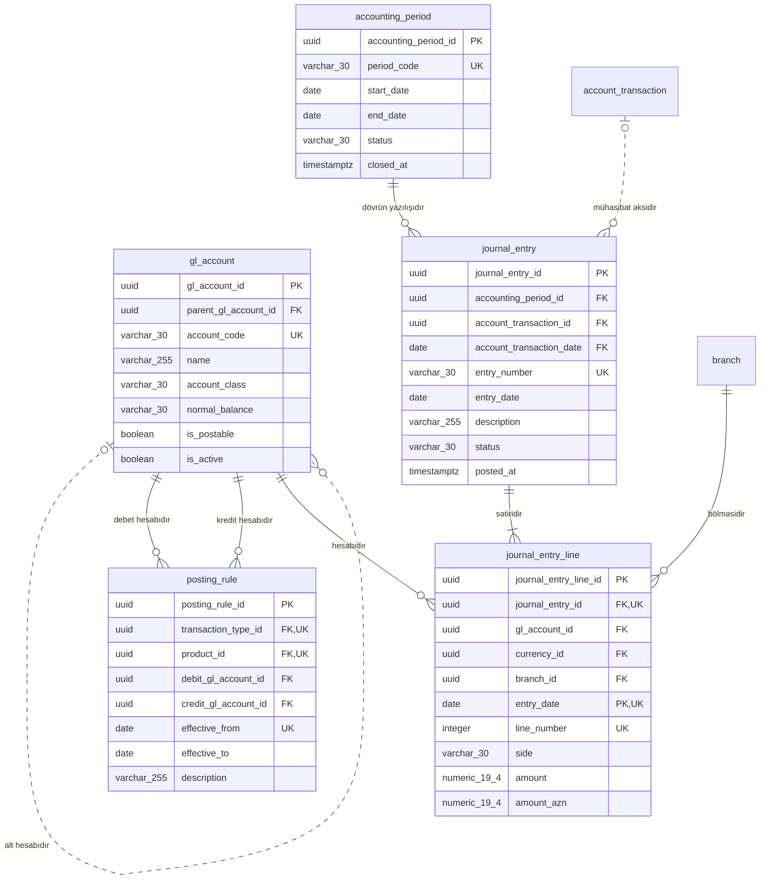

<!-- Bu fayl avtomatik yaradılıb (uv run bankmodel generate). Əl ilə redaktə etməyin. -->

# Baş kitab (sadələşdirilmiş) (`ledger`) — fiziki model

[← Fiziki model](index.md) | [Konseptual model](../01_konseptual/08_ledger.md) · [Məntiqi model](../02_mentiqi/08_ledger.md) · **Fiziki model**

Əməliyyatların mühasibat uçotunda əks olunması üçün sadələşdirilmiş baş kitab: baş kitab hesabları, mühasibat dövrləri, yazılış qaydaları və ikili yazılışlar (debet = kredit). AMB hesablar planının tam iyerarxiyası modelləşdirilmir; hesablar valideyn hesab vasitəsilə qruplaşdırılır.

## Diaqram

Audit sütunları diaqramda göstərilmir.

## Cədvəllər

### `ledger.gl_account` — Baş kitab hesabı

Balans və balansdankənar baş kitab hesabları; qrup hesabları və yazılış aparılan hesablar.

| # | Sütun | Tip | NULL | Default | Şərh |
|---|---|---|---|---|---|
| 1 | `gl_account_id` | `uuid` | NOT NULL | `uuidv7()` | Baş kitab hesabı — surrogat identifikator (UUIDv7). |
| 2 | `parent_gl_account_id` | `uuid` | NULL |  | Baş kitab hesabı istinadı (alt hesabıdır). |
| 3 | `account_code` | `varchar(30)` | NOT NULL |  | Hesabın kodu. |
| 4 | `name` | `varchar(255)` | NOT NULL |  | Hesabın adı. |
| 5 | `account_class` | `varchar(30)` | NOT NULL |  | Hesab sinfi. Dəyərlər: `ASSET`, `LIABILITY`, `EQUITY`, `INCOME`, `EXPENSE`, `OFF_BALANCE` |
| 6 | `normal_balance` | `varchar(30)` | NOT NULL |  | Normal qalıq tərəfi. Dəyərlər: `DEBIT`, `CREDIT` |
| 7 | `is_postable` | `boolean` | NOT NULL | `true` | Bu hesaba yazılış aparıla bilər (qrup hesabı deyil). |
| 8 | `is_active` | `boolean` | NOT NULL | `true` | Hesab aktivdir. |
| 9 | `created_at` | `timestamptz` | NOT NULL | `now()` | Yazılışın yaradıldığı an. |
| 10 | `created_by` | `varchar(100)` | NOT NULL | `current_user` | Yazılışı yaradan istifadəçi. |
| 11 | `updated_at` | `timestamptz` | NULL |  | Son dəyişiklik anı. |
| 12 | `updated_by` | `varchar(100)` | NULL |  | Son dəyişikliyi edən istifadəçi. |

**Məhdudiyyətlər:**

| Ad | Növ | Tərif | Təsvir |
|---|---|---|---|
| `pk_gl_account` | PRIMARY KEY | `PRIMARY KEY (gl_account_id)` | Əsas açar |
| `uq_gl_account_account_code` | UNIQUE | `UNIQUE (account_code)` | Alternativ açar |
| `ck_gl_account_account_class` | CHECK | `CHECK (account_class IN ('ASSET', 'LIABILITY', 'EQUITY', 'INCOME', 'EXPENSE', 'OFF_BALANCE'))` | İcazəli dəyərlər |
| `ck_gl_account_normal_balance` | CHECK | `CHECK (normal_balance IN ('DEBIT', 'CREDIT'))` | İcazəli dəyərlər |
| `fk_gl_account_parent_gl_account_id` | FOREIGN KEY | `FOREIGN KEY (parent_gl_account_id) REFERENCES ledger.gl_account (gl_account_id)` | İstinad bütövlüyü |

**İndekslər:**

| Ad | Sütunlar | Şərt | Səbəb |
|---|---|---|---|
| `ix_gl_account_parent_gl_account_id` | `parent_gl_account_id` |  | FK |

### `ledger.accounting_period` — Mühasibat dövrü

Aylıq mühasibat dövrləri və onların statusu (açıq, bağlanır, bağlı). Bağlı dövrə yazılış aparılmır.

| # | Sütun | Tip | NULL | Default | Şərh |
|---|---|---|---|---|---|
| 1 | `accounting_period_id` | `uuid` | NOT NULL | `uuidv7()` | Mühasibat dövrü — surrogat identifikator (UUIDv7). |
| 2 | `period_code` | `varchar(30)` | NOT NULL |  | Dövrün kodu (2026-10). |
| 3 | `start_date` | `date` | NOT NULL |  | Dövrün başlanğıcı. |
| 4 | `end_date` | `date` | NOT NULL |  | Dövrün sonu. |
| 5 | `status` | `varchar(30)` | NOT NULL |  | Status. Dəyərlər: `OPEN`, `CLOSING`, `CLOSED` |
| 6 | `closed_at` | `timestamptz` | NULL |  | Bağlanma anı. |
| 7 | `created_at` | `timestamptz` | NOT NULL | `now()` | Yazılışın yaradıldığı an. |
| 8 | `created_by` | `varchar(100)` | NOT NULL | `current_user` | Yazılışı yaradan istifadəçi. |
| 9 | `updated_at` | `timestamptz` | NULL |  | Son dəyişiklik anı. |
| 10 | `updated_by` | `varchar(100)` | NULL |  | Son dəyişikliyi edən istifadəçi. |

**Məhdudiyyətlər:**

| Ad | Növ | Tərif | Təsvir |
|---|---|---|---|
| `pk_accounting_period` | PRIMARY KEY | `PRIMARY KEY (accounting_period_id)` | Əsas açar |
| `uq_accounting_period_period_code` | UNIQUE | `UNIQUE (period_code)` | Alternativ açar |
| `ck_accounting_period_status` | CHECK | `CHECK (status IN ('OPEN', 'CLOSING', 'CLOSED'))` | İcazəli dəyərlər |
| `ck_accounting_period_valid_period` | CHECK | `CHECK (end_date >= start_date)` | Dövrün sonu başlanğıcdan əvvəl ola bilməz. |

### `ledger.posting_rule` — Yazılış qaydası

Məhsul və əməliyyat növünə görə debet və kredit baş kitab hesablarının müəyyən edilməsi qaydası; məhsul göstərilməyibsə qayda bütün məhsullara aiddir.

| # | Sütun | Tip | NULL | Default | Şərh |
|---|---|---|---|---|---|
| 1 | `posting_rule_id` | `uuid` | NOT NULL | `uuidv7()` | Yazılış qaydası — surrogat identifikator (UUIDv7). |
| 2 | `transaction_type_id` | `uuid` | NOT NULL |  | Əməliyyat növü istinadı (qaydasıdır). |
| 3 | `product_id` | `uuid` | NULL |  | Məhsul istinadı (qaydasıdır). |
| 4 | `debit_gl_account_id` | `uuid` | NOT NULL |  | Baş kitab hesabı istinadı (debet hesabıdır). |
| 5 | `credit_gl_account_id` | `uuid` | NOT NULL |  | Baş kitab hesabı istinadı (kredit hesabıdır). |
| 6 | `effective_from` | `date` | NOT NULL |  | Qüvvəyə minmə tarixi. |
| 7 | `effective_to` | `date` | NULL |  | Qüvvədən düşmə tarixi. |
| 8 | `description` | `varchar(255)` | NULL |  | Qaydanın izahı. |
| 9 | `created_at` | `timestamptz` | NOT NULL | `now()` | Yazılışın yaradıldığı an. |
| 10 | `created_by` | `varchar(100)` | NOT NULL | `current_user` | Yazılışı yaradan istifadəçi. |
| 11 | `updated_at` | `timestamptz` | NULL |  | Son dəyişiklik anı. |
| 12 | `updated_by` | `varchar(100)` | NULL |  | Son dəyişikliyi edən istifadəçi. |

**Məhdudiyyətlər:**

| Ad | Növ | Tərif | Təsvir |
|---|---|---|---|
| `pk_posting_rule` | PRIMARY KEY | `PRIMARY KEY (posting_rule_id)` | Əsas açar |
| `uq_posting_rule_transaction_type_id_product_id_effective_from` | UNIQUE | `UNIQUE NULLS NOT DISTINCT (transaction_type_id, product_id, effective_from)` | Alternativ açar |
| `ck_posting_rule_distinct_accounts` | CHECK | `CHECK (debit_gl_account_id <> credit_gl_account_id)` | Debet və kredit hesabları fərqli olmalıdır. |
| `ck_posting_rule_valid_period` | CHECK | `CHECK (effective_to IS NULL OR effective_to >= effective_from)` | Bitmə tarixi başlanğıcdan əvvəl ola bilməz. |
| `fk_posting_rule_transaction_type_id` | FOREIGN KEY | `FOREIGN KEY (transaction_type_id) REFERENCES ref.transaction_type (transaction_type_id)` | İstinad bütövlüyü |
| `fk_posting_rule_product_id` | FOREIGN KEY | `FOREIGN KEY (product_id) REFERENCES ref.product (product_id)` | İstinad bütövlüyü |
| `fk_posting_rule_debit_gl_account_id` | FOREIGN KEY | `FOREIGN KEY (debit_gl_account_id) REFERENCES ledger.gl_account (gl_account_id)` | İstinad bütövlüyü |
| `fk_posting_rule_credit_gl_account_id` | FOREIGN KEY | `FOREIGN KEY (credit_gl_account_id) REFERENCES ledger.gl_account (gl_account_id)` | İstinad bütövlüyü |

**İndekslər:**

| Ad | Sütunlar | Şərt | Səbəb |
|---|---|---|---|
| `ix_posting_rule_product_id` | `product_id` |  | FK |
| `ix_posting_rule_debit_gl_account_id` | `debit_gl_account_id` |  | FK |
| `ix_posting_rule_credit_gl_account_id` | `credit_gl_account_id` |  | FK |

### `ledger.journal_entry` — Mühasibat yazılışı

Mühasibat yazılışının başlığı: yazılış tarixi, dövr, mənbə hesab əməliyyatı, təsvir, status (qaralama/yazılıb/storno).

| # | Sütun | Tip | NULL | Default | Şərh |
|---|---|---|---|---|---|
| 1 | `journal_entry_id` | `uuid` | NOT NULL | `uuidv7()` | Mühasibat yazılışı — surrogat identifikator (UUIDv7). |
| 2 | `accounting_period_id` | `uuid` | NOT NULL |  | Mühasibat dövrü istinadı (dövrün yazılışıdır). |
| 3 | `account_transaction_id` | `uuid` | NULL |  | Hesab əməliyyatı istinadı (mühasibat əksidir). |
| 4 | `account_transaction_date` | `date` | NULL |  | İstinad edilən `account_transaction` yazılışının bölmə tarixi (kompozit FK hissəsi). |
| 5 | `entry_number` | `varchar(30)` | NOT NULL |  | Yazılışın nömrəsi. |
| 6 | `entry_date` | `date` | NOT NULL |  | Yazılış tarixi. |
| 7 | `description` | `varchar(255)` | NOT NULL |  | Təsvir. |
| 8 | `status` | `varchar(30)` | NOT NULL |  | Status. Dəyərlər: `DRAFT`, `POSTED`, `REVERSED` |
| 9 | `posted_at` | `timestamptz` | NULL |  | Yazılış anı. |
| 10 | `created_at` | `timestamptz` | NOT NULL | `now()` | Yazılışın yaradıldığı an. |
| 11 | `created_by` | `varchar(100)` | NOT NULL | `current_user` | Yazılışı yaradan istifadəçi. |
| 12 | `updated_at` | `timestamptz` | NULL |  | Son dəyişiklik anı. |
| 13 | `updated_by` | `varchar(100)` | NULL |  | Son dəyişikliyi edən istifadəçi. |

**Məhdudiyyətlər:**

| Ad | Növ | Tərif | Təsvir |
|---|---|---|---|
| `pk_journal_entry` | PRIMARY KEY | `PRIMARY KEY (journal_entry_id)` | Əsas açar |
| `uq_journal_entry_entry_number` | UNIQUE | `UNIQUE (entry_number)` | Alternativ açar |
| `ck_journal_entry_status` | CHECK | `CHECK (status IN ('DRAFT', 'POSTED', 'REVERSED'))` | İcazəli dəyərlər |
| `ck_journal_entry_posted_has_time` | CHECK | `CHECK (status = 'DRAFT' OR posted_at IS NOT NULL)` | Yazılmış yazılışın yazılış anı olmalıdır. |
| `fk_journal_entry_accounting_period_id` | FOREIGN KEY | `FOREIGN KEY (accounting_period_id) REFERENCES ledger.accounting_period (accounting_period_id)` | İstinad bütövlüyü |
| `fk_journal_entry_account_transaction_id` | FOREIGN KEY | `FOREIGN KEY (account_transaction_id, account_transaction_date) REFERENCES account.account_transaction (account_transaction_id, transaction_date)` | İstinad bütövlüyü |

**İndekslər:**

| Ad | Sütunlar | Şərt | Səbəb |
|---|---|---|---|
| `ix_journal_entry_accounting_period_id` | `accounting_period_id` |  | FK |
| `ix_journal_entry_account_transaction_id_account_transa_8f0da3f1` | `account_transaction_id`, `account_transaction_date` |  | FK |

### `ledger.journal_entry_line` — Yazılış sətri

Yazılışın debet və kredit sətirləri; hər yazılış üzrə AZN ekvivalentində debet və kredit cəmi bərabər olmalıdır (tətbiq səviyyəsində yazılış zamanı yoxlanılır). Yüksək həcmli cədvəldir, aylar üzrə bölmələnir.

**Bölmələmə:** `PARTITION BY RANGE (entry_date)`, aylıq bölmələr + `journal_entry_line_default`.

| # | Sütun | Tip | NULL | Default | Şərh |
|---|---|---|---|---|---|
| 1 | `journal_entry_line_id` | `uuid` | NOT NULL | `uuidv7()` | Yazılış sətri — surrogat identifikator (UUIDv7). |
| 2 | `journal_entry_id` | `uuid` | NOT NULL |  | Mühasibat yazılışı istinadı (sətiridir). |
| 3 | `gl_account_id` | `uuid` | NOT NULL |  | Baş kitab hesabı istinadı (hesabıdır). |
| 4 | `currency_id` | `uuid` | NOT NULL |  | Valyuta istinadı (valyutasıdır). |
| 5 | `branch_id` | `uuid` | NOT NULL |  | Filial istinadı (bölməsidir). |
| 6 | `entry_date` | `date` | NOT NULL |  | Yazılış tarixi (bölmə açarı). |
| 7 | `line_number` | `integer` | NOT NULL |  | Sətrin sıra nömrəsi. |
| 8 | `side` | `varchar(30)` | NOT NULL |  | Debet və ya kredit. Dəyərlər: `DEBIT`, `CREDIT` |
| 9 | `amount` | `numeric(19,4)` | NOT NULL |  | Sətrin valyutasında məbləğ. |
| 10 | `amount_azn` | `numeric(19,4)` | NOT NULL |  | AZN ekvivalenti (AMB rəsmi məzənnəsi ilə). |
| 11 | `created_at` | `timestamptz` | NOT NULL | `now()` | Yazılışın yaradıldığı an. |
| 12 | `created_by` | `varchar(100)` | NOT NULL | `current_user` | Yazılışı yaradan istifadəçi. |
| 13 | `updated_at` | `timestamptz` | NULL |  | Son dəyişiklik anı. |
| 14 | `updated_by` | `varchar(100)` | NULL |  | Son dəyişikliyi edən istifadəçi. |

**Məhdudiyyətlər:**

| Ad | Növ | Tərif | Təsvir |
|---|---|---|---|
| `pk_journal_entry_line` | PRIMARY KEY | `PRIMARY KEY (journal_entry_line_id, entry_date)` | Əsas açar |
| `uq_journal_entry_line_journal_entry_id_line_number_entry_date` | UNIQUE | `UNIQUE (journal_entry_id, line_number, entry_date)` | Alternativ açar |
| `ck_journal_entry_line_side` | CHECK | `CHECK (side IN ('DEBIT', 'CREDIT'))` | İcazəli dəyərlər |
| `ck_journal_entry_line_amounts_positive` | CHECK | `CHECK (amount > 0 AND amount_azn > 0)` | Məbləğlər müsbət olmalıdır. |
| `fk_journal_entry_line_journal_entry_id` | FOREIGN KEY | `FOREIGN KEY (journal_entry_id) REFERENCES ledger.journal_entry (journal_entry_id)` | İstinad bütövlüyü |
| `fk_journal_entry_line_gl_account_id` | FOREIGN KEY | `FOREIGN KEY (gl_account_id) REFERENCES ledger.gl_account (gl_account_id)` | İstinad bütövlüyü |
| `fk_journal_entry_line_currency_id` | FOREIGN KEY | `FOREIGN KEY (currency_id) REFERENCES ref.currency (currency_id)` | İstinad bütövlüyü |
| `fk_journal_entry_line_branch_id` | FOREIGN KEY | `FOREIGN KEY (branch_id) REFERENCES org.branch (branch_id)` | İstinad bütövlüyü |

**İndekslər:**

| Ad | Sütunlar | Şərt | Səbəb |
|---|---|---|---|
| `ix_journal_entry_line_gl_account_id` | `gl_account_id` |  | FK |
| `ix_journal_entry_line_currency_id` | `currency_id` |  | FK |
| `ix_journal_entry_line_branch_id` | `branch_id` |  | FK |
