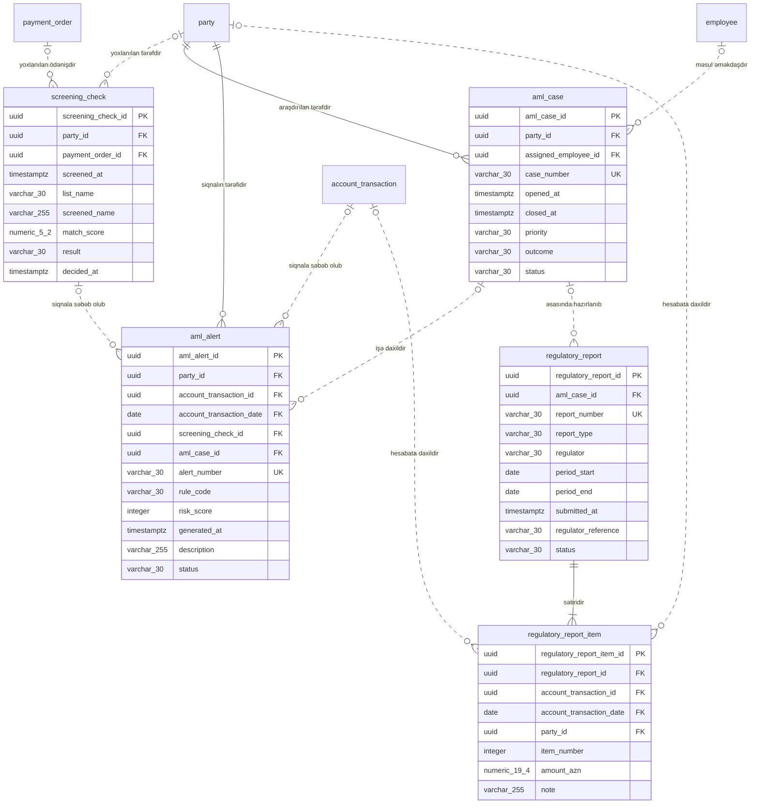

<!-- Bu fayl avtomatik yaradılıb (uv run bankmodel generate). Əl ilə redaktə etməyin. -->

# Uyğunluq və AML (sadələşdirilmiş) (`compliance`) — fiziki model

[← Fiziki model](index.md) | [Konseptual model](../01_konseptual/09_compliance.md) · [Məntiqi model](../02_mentiqi/09_compliance.md) · **Fiziki model**

Cinayət yolu ilə əldə edilmiş gəlirlərin leqallaşdırılmasına qarşı mübarizə (AML): sanksiya və PEP yoxlamaları, şübhəli əməliyyat siqnalları, araşdırma işləri və Maliyyə Monitorinqi Xidmətinə (MMX) hesabatlar.

## Diaqram

Audit sütunları diaqramda göstərilmir.

## Cədvəllər

### `compliance.screening_check` — Sanksiya / PEP yoxlaması

Tərəfin və ya ödənişin sanksiya və PEP siyahıları üzrə yoxlanılması: siyahı, uyğunluq dərəcəsi, nəticə, qərar.

| # | Sütun | Tip | NULL | Default | Şərh |
|---|---|---|---|---|---|
| 1 | `screening_check_id` | `uuid` | NOT NULL | `uuidv7()` | Sanksiya / PEP yoxlaması — surrogat identifikator (UUIDv7). |
| 2 | `party_id` | `uuid` | NULL |  | Tərəf istinadı (yoxlanılan tərəfdir). |
| 3 | `payment_order_id` | `uuid` | NULL |  | Ödəniş tapşırığı istinadı (yoxlanılan ödənişdir). |
| 4 | `screened_at` | `timestamptz` | NOT NULL | `now()` | Yoxlama anı. |
| 5 | `list_name` | `varchar(30)` | NOT NULL |  | Siyahı. Dəyərlər: `UN`, `EU`, `OFAC`, `UK_HMT`, `LOCAL`, `PEP` |
| 6 | `screened_name` | `varchar(255)` | NOT NULL |  | Yoxlanılan ad. |
| 7 | `match_score` | `numeric(5,2)` | NULL |  | Uyğunluq dərəcəsi (%). |
| 8 | `result` | `varchar(30)` | NOT NULL |  | Nəticə. Dəyərlər: `NO_MATCH`, `POTENTIAL_MATCH`, `TRUE_MATCH`, `FALSE_POSITIVE` |
| 9 | `decided_at` | `timestamptz` | NULL |  | Əməkdaşın qərar anı (potensial uyğunluqlar üçün). |
| 10 | `created_at` | `timestamptz` | NOT NULL | `now()` | Yazılışın yaradıldığı an. |
| 11 | `created_by` | `varchar(100)` | NOT NULL | `current_user` | Yazılışı yaradan istifadəçi. |
| 12 | `updated_at` | `timestamptz` | NULL |  | Son dəyişiklik anı. |
| 13 | `updated_by` | `varchar(100)` | NULL |  | Son dəyişikliyi edən istifadəçi. |

**Məhdudiyyətlər:**

| Ad | Növ | Tərif | Təsvir |
|---|---|---|---|
| `pk_screening_check` | PRIMARY KEY | `PRIMARY KEY (screening_check_id)` | Əsas açar |
| `ck_screening_check_list_name` | CHECK | `CHECK (list_name IN ('UN', 'EU', 'OFAC', 'UK_HMT', 'LOCAL', 'PEP'))` | İcazəli dəyərlər |
| `ck_screening_check_result` | CHECK | `CHECK (result IN ('NO_MATCH', 'POTENTIAL_MATCH', 'TRUE_MATCH', 'FALSE_POSITIVE'))` | İcazəli dəyərlər |
| `ck_screening_check_has_subject` | CHECK | `CHECK (num_nonnulls(party_id, payment_order_id) >= 1)` | Yoxlanılan tərəf və ya ödəniş göstərilməlidir. |
| `fk_screening_check_party_id` | FOREIGN KEY | `FOREIGN KEY (party_id) REFERENCES party.party (party_id)` | İstinad bütövlüyü |
| `fk_screening_check_payment_order_id` | FOREIGN KEY | `FOREIGN KEY (payment_order_id) REFERENCES payment.payment_order (payment_order_id)` | İstinad bütövlüyü |

**İndekslər:**

| Ad | Sütunlar | Şərt | Səbəb |
|---|---|---|---|
| `ix_screening_check_party_id` | `party_id` |  | FK |
| `ix_screening_check_payment_order_id` | `payment_order_id` |  | FK |

### `compliance.aml_case` — AML işi

Bir və ya bir neçə siqnalın araşdırıldığı iş: məsul əməkdaş, prioritet, nəticə, MMX-yə məlumat verilib-verilməməsi.

| # | Sütun | Tip | NULL | Default | Şərh |
|---|---|---|---|---|---|
| 1 | `aml_case_id` | `uuid` | NOT NULL | `uuidv7()` | AML işi — surrogat identifikator (UUIDv7). |
| 2 | `party_id` | `uuid` | NOT NULL |  | Tərəf istinadı (araşdırılan tərəfdir). |
| 3 | `assigned_employee_id` | `uuid` | NULL |  | Əməkdaş istinadı (məsul əməkdaşdır). |
| 4 | `case_number` | `varchar(30)` | NOT NULL |  | İşin nömrəsi. |
| 5 | `opened_at` | `timestamptz` | NOT NULL | `now()` | Açılma anı. |
| 6 | `closed_at` | `timestamptz` | NULL |  | Bağlanma anı. |
| 7 | `priority` | `varchar(30)` | NOT NULL |  | Prioritet. Dəyərlər: `LOW`, `MEDIUM`, `HIGH` |
| 8 | `outcome` | `varchar(30)` | NULL |  | Nəticə. Dəyərlər: `NO_ACTION`, `REPORTED_TO_FMS`, `ACCOUNT_RESTRICTED`, `RELATIONSHIP_TERMINATED` |
| 9 | `status` | `varchar(30)` | NOT NULL |  | Status. Dəyərlər: `OPEN`, `IN_PROGRESS`, `CLOSED` |
| 10 | `created_at` | `timestamptz` | NOT NULL | `now()` | Yazılışın yaradıldığı an. |
| 11 | `created_by` | `varchar(100)` | NOT NULL | `current_user` | Yazılışı yaradan istifadəçi. |
| 12 | `updated_at` | `timestamptz` | NULL |  | Son dəyişiklik anı. |
| 13 | `updated_by` | `varchar(100)` | NULL |  | Son dəyişikliyi edən istifadəçi. |

**Məhdudiyyətlər:**

| Ad | Növ | Tərif | Təsvir |
|---|---|---|---|
| `pk_aml_case` | PRIMARY KEY | `PRIMARY KEY (aml_case_id)` | Əsas açar |
| `uq_aml_case_case_number` | UNIQUE | `UNIQUE (case_number)` | Alternativ açar |
| `ck_aml_case_priority` | CHECK | `CHECK (priority IN ('LOW', 'MEDIUM', 'HIGH'))` | İcazəli dəyərlər |
| `ck_aml_case_outcome` | CHECK | `CHECK (outcome IN ('NO_ACTION', 'REPORTED_TO_FMS', 'ACCOUNT_RESTRICTED', 'RELATIONSHIP_TERMINATED'))` | İcazəli dəyərlər |
| `ck_aml_case_status` | CHECK | `CHECK (status IN ('OPEN', 'IN_PROGRESS', 'CLOSED'))` | İcazəli dəyərlər |
| `ck_aml_case_closed_consistency` | CHECK | `CHECK ((status = 'CLOSED') = (closed_at IS NOT NULL AND outcome IS NOT NULL))` | Bağlı işin bağlanma anı və nəticəsi olmalıdır. |
| `fk_aml_case_party_id` | FOREIGN KEY | `FOREIGN KEY (party_id) REFERENCES party.party (party_id)` | İstinad bütövlüyü |
| `fk_aml_case_assigned_employee_id` | FOREIGN KEY | `FOREIGN KEY (assigned_employee_id) REFERENCES org.employee (employee_id)` | İstinad bütövlüyü |

**İndekslər:**

| Ad | Sütunlar | Şərt | Səbəb |
|---|---|---|---|
| `ix_aml_case_party_id` | `party_id` |  | FK |
| `ix_aml_case_assigned_employee_id` | `assigned_employee_id` |  | FK |

### `compliance.aml_alert` — AML siqnalı

Monitorinq qaydası və ya sanksiya yoxlaması ilə yaradılan şübhəli fəaliyyət siqnalı: qayda, risk balı, status.

| # | Sütun | Tip | NULL | Default | Şərh |
|---|---|---|---|---|---|
| 1 | `aml_alert_id` | `uuid` | NOT NULL | `uuidv7()` | AML siqnalı — surrogat identifikator (UUIDv7). |
| 2 | `party_id` | `uuid` | NOT NULL |  | Tərəf istinadı (siqnalın tərəfidir). |
| 3 | `account_transaction_id` | `uuid` | NULL |  | Hesab əməliyyatı istinadı (siqnala səbəb olub). |
| 4 | `account_transaction_date` | `date` | NULL |  | İstinad edilən `account_transaction` yazılışının bölmə tarixi (kompozit FK hissəsi). |
| 5 | `screening_check_id` | `uuid` | NULL |  | Sanksiya / PEP yoxlaması istinadı (siqnala səbəb olub). |
| 6 | `aml_case_id` | `uuid` | NULL |  | AML işi istinadı (işə daxildir). |
| 7 | `alert_number` | `varchar(30)` | NOT NULL |  | Siqnalın nömrəsi. |
| 8 | `rule_code` | `varchar(30)` | NOT NULL |  | Siqnalı yaradan monitorinq qaydasının kodu. |
| 9 | `risk_score` | `integer` | NOT NULL |  | Risk balı (0–100). |
| 10 | `generated_at` | `timestamptz` | NOT NULL | `now()` | Yaranma anı. |
| 11 | `description` | `varchar(255)` | NULL |  | Təsvir. |
| 12 | `status` | `varchar(30)` | NOT NULL |  | Status. Dəyərlər: `NEW`, `UNDER_REVIEW`, `ESCALATED`, `CLOSED_FALSE_POSITIVE`, `CLOSED_CONFIRMED` |
| 13 | `created_at` | `timestamptz` | NOT NULL | `now()` | Yazılışın yaradıldığı an. |
| 14 | `created_by` | `varchar(100)` | NOT NULL | `current_user` | Yazılışı yaradan istifadəçi. |
| 15 | `updated_at` | `timestamptz` | NULL |  | Son dəyişiklik anı. |
| 16 | `updated_by` | `varchar(100)` | NULL |  | Son dəyişikliyi edən istifadəçi. |

**Məhdudiyyətlər:**

| Ad | Növ | Tərif | Təsvir |
|---|---|---|---|
| `pk_aml_alert` | PRIMARY KEY | `PRIMARY KEY (aml_alert_id)` | Əsas açar |
| `uq_aml_alert_alert_number` | UNIQUE | `UNIQUE (alert_number)` | Alternativ açar |
| `ck_aml_alert_status` | CHECK | `CHECK (status IN ('NEW', 'UNDER_REVIEW', 'ESCALATED', 'CLOSED_FALSE_POSITIVE', 'CLOSED_CONFIRMED'))` | İcazəli dəyərlər |
| `ck_aml_alert_score_range` | CHECK | `CHECK (risk_score BETWEEN 0 AND 100)` | Risk balı 0–100 arasında olmalıdır. |
| `fk_aml_alert_party_id` | FOREIGN KEY | `FOREIGN KEY (party_id) REFERENCES party.party (party_id)` | İstinad bütövlüyü |
| `fk_aml_alert_account_transaction_id` | FOREIGN KEY | `FOREIGN KEY (account_transaction_id, account_transaction_date) REFERENCES account.account_transaction (account_transaction_id, transaction_date)` | İstinad bütövlüyü |
| `fk_aml_alert_screening_check_id` | FOREIGN KEY | `FOREIGN KEY (screening_check_id) REFERENCES compliance.screening_check (screening_check_id)` | İstinad bütövlüyü |
| `fk_aml_alert_aml_case_id` | FOREIGN KEY | `FOREIGN KEY (aml_case_id) REFERENCES compliance.aml_case (aml_case_id)` | İstinad bütövlüyü |

**İndekslər:**

| Ad | Sütunlar | Şərt | Səbəb |
|---|---|---|---|
| `ix_aml_alert_party_id` | `party_id` |  | FK |
| `ix_aml_alert_account_transaction_id_account_transaction_date` | `account_transaction_id`, `account_transaction_date` |  | FK |
| `ix_aml_alert_screening_check_id` | `screening_check_id` |  | FK |
| `ix_aml_alert_aml_case_id` | `aml_case_id` |  | FK |

### `compliance.regulatory_report` — Tənzimləyici hesabat

MMX-yə (şübhəli əməliyyat, hədd məbləğini aşan əməliyyat) və AMB-yə göndərilən hesabat: növ, dövr, göndərilmə tarixi, status.

| # | Sütun | Tip | NULL | Default | Şərh |
|---|---|---|---|---|---|
| 1 | `regulatory_report_id` | `uuid` | NOT NULL | `uuidv7()` | Tənzimləyici hesabat — surrogat identifikator (UUIDv7). |
| 2 | `aml_case_id` | `uuid` | NULL |  | AML işi istinadı (əsasında hazırlanıb). |
| 3 | `report_number` | `varchar(30)` | NOT NULL |  | Hesabatın nömrəsi. |
| 4 | `report_type` | `varchar(30)` | NOT NULL |  | Hesabatın növü: şübhəli əməliyyat, hədd məbləğini aşan əməliyyat, AMB-yə dövri hesabat. Dəyərlər: `SUSPICIOUS_TRANSACTION`, `THRESHOLD_TRANSACTION`, `CBAR_PERIODIC` |
| 5 | `regulator` | `varchar(30)` | NOT NULL |  | Alan orqan. Dəyərlər: `FMS`, `CBAR` |
| 6 | `period_start` | `date` | NULL |  | Hesabat dövrünün başlanğıcı. |
| 7 | `period_end` | `date` | NULL |  | Hesabat dövrünün sonu. |
| 8 | `submitted_at` | `timestamptz` | NULL |  | Göndərilmə anı. |
| 9 | `regulator_reference` | `varchar(30)` | NULL |  | Orqanın qəbul nömrəsi. |
| 10 | `status` | `varchar(30)` | NOT NULL |  | Status. Dəyərlər: `DRAFT`, `SUBMITTED`, `ACCEPTED`, `REJECTED` |
| 11 | `created_at` | `timestamptz` | NOT NULL | `now()` | Yazılışın yaradıldığı an. |
| 12 | `created_by` | `varchar(100)` | NOT NULL | `current_user` | Yazılışı yaradan istifadəçi. |
| 13 | `updated_at` | `timestamptz` | NULL |  | Son dəyişiklik anı. |
| 14 | `updated_by` | `varchar(100)` | NULL |  | Son dəyişikliyi edən istifadəçi. |

**Məhdudiyyətlər:**

| Ad | Növ | Tərif | Təsvir |
|---|---|---|---|
| `pk_regulatory_report` | PRIMARY KEY | `PRIMARY KEY (regulatory_report_id)` | Əsas açar |
| `uq_regulatory_report_report_number` | UNIQUE | `UNIQUE (report_number)` | Alternativ açar |
| `ck_regulatory_report_report_type` | CHECK | `CHECK (report_type IN ('SUSPICIOUS_TRANSACTION', 'THRESHOLD_TRANSACTION', 'CBAR_PERIODIC'))` | İcazəli dəyərlər |
| `ck_regulatory_report_regulator` | CHECK | `CHECK (regulator IN ('FMS', 'CBAR'))` | İcazəli dəyərlər |
| `ck_regulatory_report_status` | CHECK | `CHECK (status IN ('DRAFT', 'SUBMITTED', 'ACCEPTED', 'REJECTED'))` | İcazəli dəyərlər |
| `ck_regulatory_report_submitted_has_time` | CHECK | `CHECK (status = 'DRAFT' OR submitted_at IS NOT NULL)` | Göndərilmiş hesabatın göndərilmə anı olmalıdır. |
| `fk_regulatory_report_aml_case_id` | FOREIGN KEY | `FOREIGN KEY (aml_case_id) REFERENCES compliance.aml_case (aml_case_id)` | İstinad bütövlüyü |

**İndekslər:**

| Ad | Sütunlar | Şərt | Səbəb |
|---|---|---|---|
| `ix_regulatory_report_aml_case_id` | `aml_case_id` |  | FK |

### `compliance.regulatory_report_item` — Hesabat sətri

Hesabata daxil edilən əməliyyat və ya tərəf.

| # | Sütun | Tip | NULL | Default | Şərh |
|---|---|---|---|---|---|
| 1 | `regulatory_report_item_id` | `uuid` | NOT NULL | `uuidv7()` | Hesabat sətri — surrogat identifikator (UUIDv7). |
| 2 | `regulatory_report_id` | `uuid` | NOT NULL |  | Tənzimləyici hesabat istinadı (sətiridir). |
| 3 | `account_transaction_id` | `uuid` | NULL |  | Hesab əməliyyatı istinadı (hesabata daxildir). |
| 4 | `account_transaction_date` | `date` | NULL |  | İstinad edilən `account_transaction` yazılışının bölmə tarixi (kompozit FK hissəsi). |
| 5 | `party_id` | `uuid` | NULL |  | Tərəf istinadı (hesabata daxildir). |
| 6 | `item_number` | `integer` | NOT NULL |  | Sətrin sıra nömrəsi. |
| 7 | `amount_azn` | `numeric(19,4)` | NULL |  | Əməliyyatın AZN ekvivalenti. |
| 8 | `note` | `varchar(255)` | NULL |  | Qeyd. |
| 9 | `created_at` | `timestamptz` | NOT NULL | `now()` | Yazılışın yaradıldığı an. |
| 10 | `created_by` | `varchar(100)` | NOT NULL | `current_user` | Yazılışı yaradan istifadəçi. |
| 11 | `updated_at` | `timestamptz` | NULL |  | Son dəyişiklik anı. |
| 12 | `updated_by` | `varchar(100)` | NULL |  | Son dəyişikliyi edən istifadəçi. |

**Məhdudiyyətlər:**

| Ad | Növ | Tərif | Təsvir |
|---|---|---|---|
| `pk_regulatory_report_item` | PRIMARY KEY | `PRIMARY KEY (regulatory_report_item_id)` | Əsas açar |
| `ck_regulatory_report_item_has_subject` | CHECK | `CHECK (num_nonnulls(account_transaction_id, party_id) >= 1)` | Əməliyyat və ya tərəf göstərilməlidir. |
| `fk_regulatory_report_item_regulatory_report_id` | FOREIGN KEY | `FOREIGN KEY (regulatory_report_id) REFERENCES compliance.regulatory_report (regulatory_report_id)` | İstinad bütövlüyü |
| `fk_regulatory_report_item_account_transaction_id` | FOREIGN KEY | `FOREIGN KEY (account_transaction_id, account_transaction_date) REFERENCES account.account_transaction (account_transaction_id, transaction_date)` | İstinad bütövlüyü |
| `fk_regulatory_report_item_party_id` | FOREIGN KEY | `FOREIGN KEY (party_id) REFERENCES party.party (party_id)` | İstinad bütövlüyü |

**İndekslər:**

| Ad | Sütunlar | Şərt | Səbəb |
|---|---|---|---|
| `ix_regulatory_report_item_regulatory_report_id` | `regulatory_report_id` |  | FK |
| `ix_regulatory_report_item_account_transaction_id_accou_c27dfe1b` | `account_transaction_id`, `account_transaction_date` |  | FK |
| `ix_regulatory_report_item_party_id` | `party_id` |  | FK |
